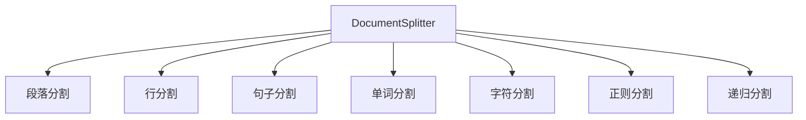

## 纲要

- **为什么分割**：大模型上下文窗口有限；不分段的整文档易超窗、易幻觉
- **DocumentSplitter 接口**：提供段落 / 行 / 句子 / 单词 / 字符分割，以及正则、递归分割
- **递归分割（默认）**：先按段落，超长则降级到行→句子→单词→字符，保证每段 ≤ 默认 300 token
- **重叠窗口（overlap）**：相邻片段重叠若干字符/token，保持语义连贯；文档本身已短时无需重叠
- **自定义分割器**：可按段落（maxChars=300,overlap=30）或正则（如按「一问一答」换行切分）实现

> 代码按课程口径重构示意（外部课件代码卷未挂载）。本卡覆盖 8-7/8-10，聚焦「怎么把文档切得既准又连贯」。

## 一、分割器类型



## 二、递归分割的降级链

递归分割默认上限 300 token，超长自动降级：

```
段落(≤300 token) → 行 → 句子 → 单词 → 字符(最小1)
```

每一级有「子分割器」：段落的子是行，行的子是句子，句子的子是单词，单词的子是字符。逐层递归直到满足上限。

## 三、重叠窗口

```java
// 按段落分割，每段最大 300 字符，重叠 30 字符保持连贯
DocumentSplitter splitter = DocumentSplitters.paragraph(300, 30);
```

`overlap` 让相邻片段共享上下文，模型理解更连贯；文档总长短于上限时不必重叠。

## 四、自定义分割器

```java
// 按正则：每「一问一答」换行切分（京东外卖知识库）
public class QASplitter implements DocumentSplitter {
    private final Pattern pattern = Pattern.compile("\\n");  // 按行分割
    public List<TextSegment> split(Document doc) {
        // 返回每行一个 TextSegment
    }
}
```

课程口径的京东知识库是「问题\n答案」规整结构，用换行正则切出 31 个片段。

## 五、FAQ

**Q1：为什么默认 300 token？**
平衡上下文窗口与召回粒度；可在 builder 里自定义。

**Q2：overlap 会不会导致重复？**
会引入少量重复文本，但换来连贯性；检索时按 score 去重即可。

**Q3：自定义分割器实现什么接口？**
实现 `DocumentSplitter` 的 `split(Document)` 返回 `List<TextSegment>`。

## 六、面试高频问答

**1. 递归分割为什么需要子分割器链？**
保证任意长度段落最终都能切到 ≤上限，且不破坏语义颗粒度。

**2. 重叠窗口的作用？**
相邻片段共享上下文，避免切断语义，提升检索命中质量。

**3. 如何为「问答对」知识库切分？**
实现自定义 `DocumentSplitter`，按换行/空行正则切出每对 QA。

## 七、ops 提示（分割红线）

> **递归是默认稳妥选**：不确定粒度时先上递归（≤300 token），再按语料调。
>
> **overlap 别太大**：30 字符/若干 token 足够；过大浪费 token 与存储。
>
> **知识库排版先行**：源数据排版规整（如 QA 换行），分割代码最简、效果最好。
