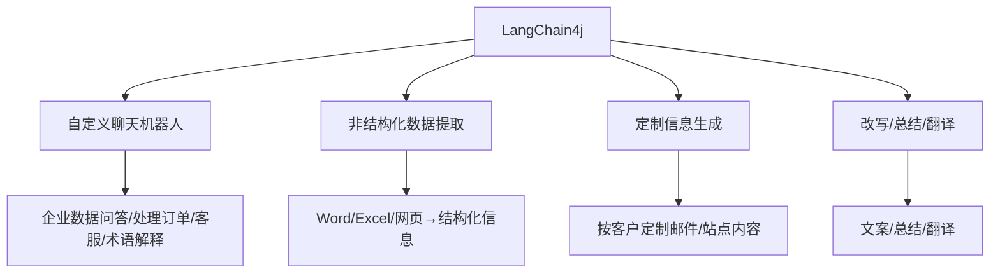

## 纲要

- **框架目标**：**简化大模型语言开发**；底层封装对接主流大模型，Java 程序员不关心底层细节，只写应用
- **历史与版本**：2022.11.30 ChatGPT(GPT3.5) 发布；Python 版 LangChain 2022.10 发布；**Java 版 LangChain4j 2023.11 的 0.1 → 2025.2 的 1.0-beta → 4 月 beta3**；社区活跃（迭代快、bug 及时修）
- **官网**：为 Java 程序员定制，涵盖 SpringBoot 集成、ChatMemory/Tools/RAG/向量库/图片模型等
- **三大主要功能**：① 与 LLM/向量库便捷交互（统一 API 访问商业+开源模型）② **专为 Java 而生**（For Java，借 SpringBoot 集成，大模型与 Java 双向调用）③ 智能代理/Tools/检索增强（RAG）等高级特性
- **四类应用场景**：① 自定义聊天机器人（访问企业数据/处理订单/客服/专业术语解释）② 处理大量非结构化数据（Word/Excel/网页提取结构化信息）③ 生成定制信息（如按客户量身定制邮件）④ 改写/总结/翻译文案

> 概念章，按课程口径重构；无代码，重在理解框架定位、版本节奏与典型用法。

## 一、LangChain4j 是什么

**一句话**：目标是**简化大模型语言的开发**——底层通过封装对接市面主流大模型语言，Java 程序员无需关心底层，只实现应用。

### 1.1 历史背景

- 2022.11.30：OpenAI 发布 ChatGPT（基于 GPT3.5 微调），全球轰动。
- 2022.10：Python 版 LangChain 已发布（降成本降难度提效率）。
- Python 版（对接 Python 应用）、JS 版（LangChain.js，前端/浏览器插件）。
- **Java 市场占用率高** → 需大模型集成能力 → **LangChain4j（Java 版）诞生**：全称 LangChain for Java，简写即 LangChain4j。

### 1.2 版本演进

| 时间 | 版本 |
|---|---|
| 2023.11 | 0.1（诞生） |
| 2025.2 | 1.0-beta（里程碑，公测） |
| 2025.4 | beta3 |
| 最新 | beta（每隔最多一两个月迭代，社区活跃） |

> 迭代快 → 可能修复 bug/更新特性；学习以官网当前版为准。

### 1.3 三大主要功能

1. **便捷交互**：统一 API 轻松访问商业/开源大模型 + 向量数据库；轻松创建聊天机器人/智能应用。
2. **Java 专属**：For Java，借 SpringBoot 集成；大模型与 Java 应用**双向集成**（Java 调大模型，大模型也能反过来调 Java 代码）。
3. **高级特性**：提供 Tools、ChatMemory 管理、结构化解析、智能代理（AiService）、RAG 等。

## 二、四类典型应用场景

1. **自定义聊天机器人**：访问企业数据、按角色运行、处理/更改/取消订单；教育助手、客服机器人、企业专业术语解释。
2. **非结构化数据处理**：从文件（Word/Excel/网页）提取结构化信息纳入大模型框架。
3. **定制信息生成**：为每客户量身定制邮件、为应用/网站生成定制内容。
4. **改写/总结/翻译**：文案润色、内容总结、多语言翻译。

> 官网整合了大量大模型框架（Google/OpenAI/智谱等）、图片处理模型、文档结构化工具有机统一。

## 三、FAQ

**Q1：LangChain4j 一句话定义？**
简化大模型语言开发的 Java 框架，封装底层对接主流模型，只写应用。

**Q2：和 Python/JS 版关系？**
同源；Java 版为 Java 生态定制，简写 LangChain4j。

**Q3：版本节奏？**
迭代快（数月一版），社区活跃，bug 及时修；以官网为准。

**Q4：双向集成什么意思？**
Java 调大模型，大模型也能反过来调 Java 代码。

**Q5：四类场景？**
聊天机器人、非结构化提取、定制生成、改写翻译。

**Q6：和 Spring AI 比谁活跃？**
LangChain4j 社区热度更高（GitHub 7.2k vs Spring AI 4.8k）。

## 四、面试高频问答

**1. LangChain4j 核心目标？**
为 Java 开发者简化大模型应用开发，封装各家模型接口，不关心底层。

**2. 它和 SpringBoot 关系？**
借 SpringBoot 集成，大模型与 Java 双向调用；后续 AiService 注解式开发。

**3. 为什么 Java 生态需要它？**
Java 占用率高，企业核心系统多用 Java，需把大模型集成进既有微服务。

**4. 主要高级特性？**
AiService、ChatMemory、Tools、RAG、结构化解析、智能代理。

**5. 典型落地场景？**
聊天机器人、非结构化数据提取、定制邮件/内容生成、改写翻译。

**6. 版本选型注意？**
迭代快、文档可能与版本有出入，学习盯官网当前版。

## 五、ops 提示（学习与选型）

> **版本跟踪**：LangChain4j beta 阶段迭代快，生产锁定版本，避免文档与 API 出入导致踩坑。
>
> **双向调用价值**：大模型反调 Java 代码让「业务系统 + AI」真正融合，是企业集成关键能力。
>
> **社区红利**：热度高于 Spring AI，疑难杂症社区响应快，选型时可加权。
>
> **JDK 基线**：运行需 JDK 17+；与 SpringBoot 集成时注意 starter 可能存在的版本 bug（新版本已修）。
