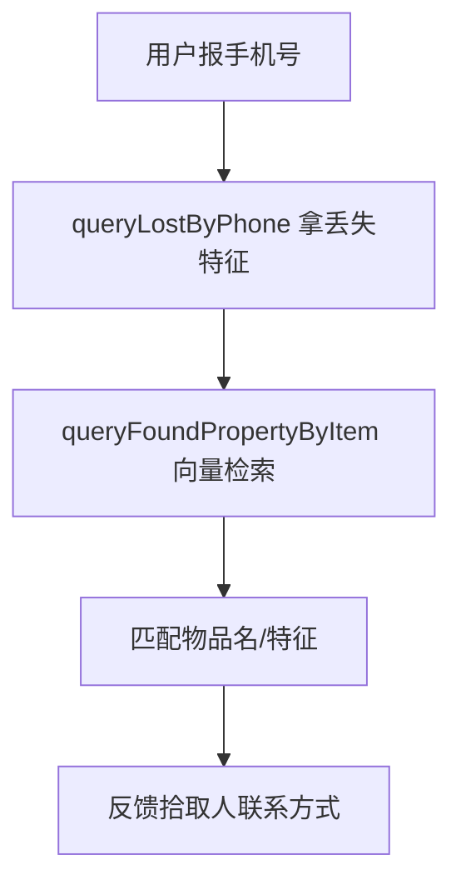

## 纲要

- **整合目标**：让失物查询具备 ChatMemory + Tools + 大模型上下文能力，而非仅向量库裸查
- **AiService 方法**：`queryLostProperty(@MemoryId sid,@UserMessage msg)` 返回 `Flux<String>`（流式）
- **两个关键 Tool**：① `queryFoundPropertyByItem(物品名+特征)`——向量库检索 foundregister；② `queryLostByPhone(手机号)`——查用户自己丢失的特征
- **提示词设计**：角色=专业失物管理人员；流程=询问姓名手机号 → 按手机号查 lostregister 拿丢失特征 → 向量检索 foundregister → 匹配物品名/特征 → 反馈拾取人信息；限制=基于系统真实信息、不调无关函数
- **编排**：意图=3 时路由到 queryLostProperty

> 代码按课程口径重构示意（外部课件代码卷未挂载）。本卡覆盖 9-4/9-5，是 V2 查询的「智能体」核心。

## 一、两个 Tool

```java
// Tool1: 按物品名+特征从向量库查捡到记录
@Tool("根据物品名称及特征查询捡到登记信息")
public List<String> queryFoundPropertyByItem(@P("物品名称及特征") String item) {
    Embedding q = embeddingModel.embed(item).content();
    SearchRequest req = SearchRequest.builder()
            .queryEmbedding(q).maxResults(1).minScore(0.8).build();
    return embeddingStore.search(req).matches().stream()
            .map(m -> m.embedded().text())
            .collect(toList());
}

// Tool2: 按手机号查用户自己丢失的特征
@Tool("根据手机号查询丢失登记信息")
public List<LostRegister> queryLostByPhone(@P("手机号") String phone) {
    return lostRegisterRepository.findLostByPhone(phone);
}
```

## 二、AiService 与提示词

```java
@SystemMessage(fromResource = "prompts/system-query-lost.txt")
public interface LostQueryAiService {
    Flux<String> queryLostProperty(@MemoryId String sid, @UserMessage String msg);
}
```

提示词 `system-query-lost.txt` 要点：

```
角色：专业失物管理人员，处理失物招领相关事务。
流程：
 1. 主动询问用户姓名和手机号（用户此前在 lostregister 登记过丢失）。
 2. 用户提供手机号 → 调用 queryLostByPhone 查其丢失特征。
 3. 拿到丢失特征 → 调用 queryFoundPropertyByItem 向量检索 foundregister。
 4. 匹配物品名/特征，最多返回 1 条；匹配上则准确告知拾取人信息。
 5. 未匹配 → 引导用户进入丢失登记流程。
限制：仅围绕失物招领交流；反馈必须基于系统真实记录；不得调用无关函数。
```

## 三、为什么需要两步 Tool

用户报「我丢的伞找到没」时，模型先靠手机号从 `lostregister` 拿「白色伞/两个破洞」特征，再拿特征去向量库匹配 `foundregister`，才能精准命中他人捡到的对应物品——**特征比对是关键**，避免拿错记录。



## 四、FAQ

**Q1：为什么不直接拿用户原话去向量库查？**
用户原话可能模糊（「我的伞」），用其登记过的精确特征比对更准。

**Q2：queryLostByPhone 在哪定义的？**
V1 已实现；V2 复用，需注入到查询 AiService。

**Q3：maxResults=1 够吗？**
课程场景取最相似 1 条；多候选可放大并让模型筛。

## 五、面试高频问答

**1. V2 查询为何要结合两个 Tool？**
先查用户自身丢失特征，再据特征向量检索他人捡到记录，两步保证匹配精度。

**2. 提示词为什么强调「基于系统真实信息」？**
防幻觉——反馈必须来自 foundregister 真实记录，不得编造拾取人。

**3. 流式返回 Flux 的作用？**
逐字输出体验好；业务层用 StringBuilder 收集后再处理。

## 六、ops 提示（整合红线）

> **Tool 必须加 @Tool 注解**：漏注大模型调不到；命名规范统一加 `Tool` 后缀便于维护。
>
> **minScore 两端一致**：建索引与查询都 0.8，否则召回标准漂移。
>
> **提示词锁范围**：明确「不调无关函数」「基于真实记录」，抑制幻觉与越权调用。

> **。
