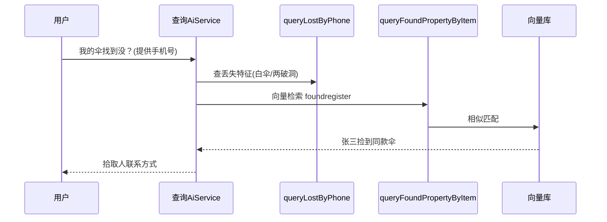

## 纲要

- **业务路由**：`chatStream` 意图=3 时调用 `queryLostProperty(userId,message)`
- **流式接收**：返回的 `Flux<String>` 用 `doOnNext` 追加到 `StringBuilder`，收集完整结果后返回/处理
- **测试要点**：命名规范（Tool 加后缀）、`@Tool` 注解别漏、把 `lostRegisterTool` 与 `queryFoundPropertyTool` 都注入 AiService
- **演示场景**：用户丢失「白色伞/两破洞」→ 提供手机号 → 向量库匹配到张三捡到的同款伞 → 返回拾取人联系方式
- **V2 收尾**：失物招领助手四大链路（丢失/捡到登记 + 各自修改 + 失物查询）全部闭环

> 代码按课程口径重构示意（外部课件代码卷未挂载）。本卡覆盖 9-6/9-7，是 V2 的收口。

## 一、业务层路由

```java
// chatStream 意图=3 分支
private Flux<String> queryLostProperty(String userId, String message) {
    StringBuilder sb = new StringBuilder();
    return lostQueryAiService.queryLostProperty(userId, message)
        .doOnNext(sb::append)                  // 流式逐块收集
        .doOnComplete(() -> log.info("RAG查询结果: {}", sb));
}
```

整体链路回顾：意图=3 → `queryLostProperty` → 提示词要求先要手机号 → 调 `queryLostByPhone` 拿丢失特征 → 调 `queryFoundPropertyByItem` 向量检索 → 大模型比对反馈。

## 二、测试踩坑

| 坑 | 修复 |
|---|---|
| Tool 命名不统一 | 统一加 `Tool` 后缀，与 V1 一致 |
| 漏 `@Tool` 注解 | 补注解，否则大模型调不到 |
| 未注入 `lostRegisterTool` | 查询 AiService 必须注入该 Tool（先查用户丢失特征）与 `queryFoundPropertyTool` |

## 三、演示验证



数据库侧：lostregister 有「白色伞/两破洞」，foundregister 恰有张三捡到的同款 → 向量匹配成功，返回张三联系方式。

## 四、V2 全链路闭环

| 功能 | 状态 |
|---|---|
| 丢失登记 / 修改 | V1 完成 |
| 捡到登记 / 修改 | V1 完成 |
| 失物查询（RAG） | **V2 完成** |

至此失物招领助手具备完整 AI 客服能力。

## 五、FAQ

**Q1：流式结果怎么二次处理？**
`doOnNext` 收集到 StringBuilder，complete 后再解析/落库/返回。

**Q2：为什么查询也要 ChatMemory？**
记录对话上下文（已问过手机号），避免重复询问，体验连贯。

**Q3：V2 和 V1 的代码关系？**
V2 复用 V1 的 lostRegisterTool / foundRegisterTool，新增查询 AiService 与 RAG 配置。

## 六、面试高频问答

**1. 意图=3 如何落地？**
chatStream 的 switch 路由到 queryLostProperty，内部用 RAG+双 Tool 完成检索反馈。

**2. 测试中容易漏什么？**
@Tool 注解、Tool 注入、命名规范——三者任一缺失大模型都调不到工具。

**3. V2 核心增量是什么？**
把前述 RAG 真正接进业务：foundregister 建索引 + 双 Tool 特征比对 + 提示词约束。

## 七、ops 提示（收尾红线）

> **注入清单核对**：查询 AiService 构造时确认 `lostRegisterTool` + `queryFoundPropertyTool` 都进去。
>
> **索引先于查询**：内存库每次重启先 `/index` 建索引，否则检索空。
>
> **命名一致性**：跨 V1/V2 的 Tool 命名统一，降低维护与调试成本。
