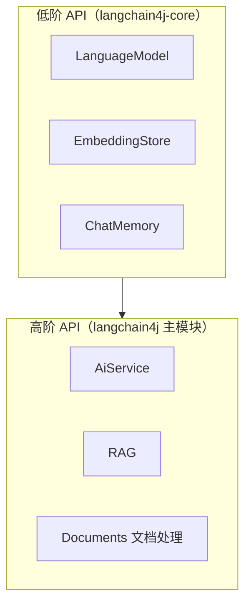

## 纲要

- **官网 get-started**：接入前先看官方文档；硬性要求 JDK 17
- **低阶 API vs 高阶 API**：低阶 = `ChatLanguageModel` / `UserMessage` / `AiMessage` / `EmbeddingStore` / `ChatMemory`；高阶 = `AiService` / RAG
- **模块化设计**：`langchain4j-core`（原子能力，低阶）与 `langchain4j`（文档处理 / 记忆 / 高阶）分层
- **依赖选择**：`langchain4j-openai`（仅低阶）vs `langchain4j`（全量高阶+低阶）
- **HelloWorld**：用 `OpenAIChatModel` + `baseUrl` + `chat()` 跑通首个对话

> 本章打通「Java 工程 → 大模型」第一步，按课程口径重构；代码为课程示意，去品牌与脱敏处理。

## 一、接入前必读：官网与硬性要求

任何模型接入，优先看 LangChain4j 官网 `get-started`。关键约束：

- **JDK 17+**：低于 17 直接无法编译。
- **模型对接靠「标准依赖」**：DeepSeek 基于 OpenAI 标准，引入 `langchain4j-openai` 即可，无需额外依赖。

## 二、低阶 API 与高阶 API

LangChain4j 把能力分成两层，这是理解整个框架的钥匙：

| 层级 | 代表 API | 说明 |
|---|---|---|
| 低阶 API | `ChatLanguageModel`、`UserMessage`、`AiMessage`、`EmbeddingStore`、`ChatMemory` | 原子能力，需自行编排 |
| 高阶 API | `AiService`、RAG 相关 | 开箱即用的高级抽象，自动编排低阶能力 |

## 三、模块化设计

框架采用模块化设计，避免一上来就引入全部依赖：

- **`langchain4j-core`**：定义核心原子能力模块，如 `LanguageModel`、`EmbeddingStore` —— 属于低阶 API。
- **主模块 `langchain4j`**：包含文档处理（`documents`）、`ChatMemory`、高阶功能 —— 属于低阶+高阶全集。



## 四、依赖选择

| 依赖 | 包含内容 | 适用场景 |
|---|---|---|
| `langchain4j-openai` | 仅 OpenAI 低阶能力 | 只想直接调 `OpenAIChatModel` |
| `langchain4j` | 低阶 + 高阶全量（含 AiService / RAG） | 需要 AiService、RAG 等高级功能 |

## 五、HelloWorld：OpenAIChatModel

用最朴素的低阶 API 跑通第一个对话。课程 demo 用测试地址与 `gpt-4o-mini` 模型。

```xml
<dependency>
    <groupId>dev.langchain4j</groupId>
    <artifactId>langchain4j-openai</artifactId>
</dependency>
```

```java
import dev.langchain4j.model.openai.OpenAIChatModel;

public class HelloWorld {
    public static void main(String[] args) {
        OpenAIChatModel model = OpenAIChatModel.builder()
                .baseUrl("https://api.openai.com/v1")   // 课程 demo 测试地址
                .apiKey("demo")                          // 测试 key，生产请换真实 key
                .modelName("gpt-4o-mini")
                .build();
        String answer = model.chat("你是谁？");
        System.out.println(answer);
    }
}
```

运行后控制台返回「我是一个人工智能助手」，说明 Java 工程已成功与大模型对话。

## 六、FAQ

**Q1：低阶和高阶 API 我用哪个？**
初期学原理用低阶（`ChatLanguageModel`）理解流程；做业务用高阶（`AiService`）提升效率。

**Q2：为什么 DeepSeek 不用单独依赖？**
DeepSeek 兼容 OpenAI 协议，引入 `langchain4j-openai` 后改 `baseUrl` / `apiKey` / `modelName` 即可。

**Q3：core 模块和主模块必须都引吗？**
不必；`langchain4j` 主模块已包含 core，但只想用低阶时可只引 `langchain4j-openai` 精简体积。

## 七、面试高频问答

1. **LangChain4j 的 API 分层？** 低阶（原子能力：模型/记忆/向量库）与高阶（AiService/RAG 抽象）。
2. **模块化设计的好处？** 按需引入，避免无关依赖膨胀，也利于理解框架边界。
3. **OpenAIChatModel 三要素？** `baseUrl`、`apiKey`、`modelName`，三者决定对话打到哪个模型。

## 八、ops 提示

> **先官网后编码**：接入任何模型前查 `get-started`，版本差异（如 beta 与正式版 API 出入）以官网为准。
>
> **demo 地址仅测试**：课程 `demo` key / 测试地址只能验证连通，生产必须替换为你自己的 API Key 与正式 `baseUrl`。
>
> **密钥脱敏**：`apiKey` 切勿硬编码进源码或提交仓库，走环境变量 / 配置中心。
