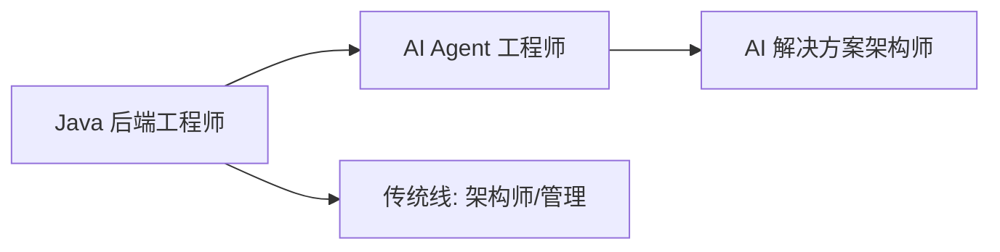
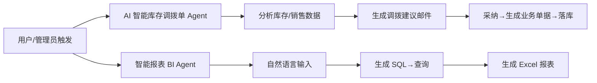
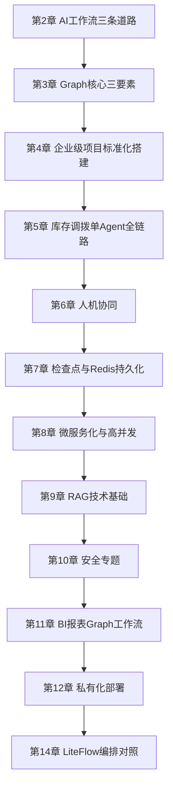

## 【学习目标】

学完本节，应当能够：

- 说清 AI Agent 为何成为 Java 工程师的新赛道，以及它带来的职业路径变化；
- 从招聘市场信号判断「Java + AI Agent」岗位的能力诉求与薪资区间；
- 区分本课程与同类课程在「生产级实战、双 Agent 项目、私有化部署、面试包装」上的差异；
- 概述课程要交付的两个可写进简历的 Agent 项目及其业务闭环，并说出各自对应的技术栈与配套工程模块。

## 【正文】

### 一、行业趋势：AI Agent 是 Java 工程师的延伸赛道

2025 年被业界普遍称为 AI Agent 的元年，Agent 在这一年迎来爆发式增长。多家机构预测 AI Agent 市场规模将达到 1200 亿美元级别，年增长率超过 150%。OpenAI、Google、Meta 等海外巨头，以及阿里巴巴、字节跳动等国内大厂，都在重注 Agent 研发。

对 Java 工程师而言，关键不是「转行去学 Python」，而是技术栈的自然延伸：Java 依旧是企业级开发的主流语言，而 Spring AI 这类框架让 Java 工程师能在熟悉的 Spring 生态里直接开发 AI Agent。课程配套的生产工程 `980-demo` 即基于 **Java 21 + Spring Boot 4.1.1 + Spring AI 2.0.1** 构建，这也是 2026 年企业新项目的默认选型线。

这套组合里每一层都有明确分工：

| 组件 | 版本 | 在课程中的职责 |
|---|---|---|
| Java | 21 LTS | 虚拟线程承载高并发 Agent 调用，Record 简化 DTO，是 Spring AI 2.0 的基线要求 |
| Spring Boot | 4.1.1 | 自动配置接入 ChatModel，Actuator + Micrometer 提供健康检查与指标端点 |
| Spring AI | 2.0.1 | 统一 `ChatClient` 抽象，Advisor 链承载横切关注点，`call().entity()` 落地结构化输出 |

职业层面有三个值得关注的信号：

1. **薪资红利**：传统 Java 后端岗位竞争加剧，而 AI Agent 开发岗位存在明显的薪资溢价。行业薪资报告显示，AI Agent 开发者平均薪资比传统 Java 开发者高出约 45%，高级 Agent 工程师年薪可达 80–120 万。掌握 Agent 开发，等于在未来 5–10 年建立一道「职业护城河」。
2. **岗位替代压力**：已有公司用 AI 替代部分前端岗位的重复劳动，让前端工程师借助 AI 做设计，把精力转向技术审查与方案指导。后端工程师若不想被替代，同样需要构建自己的 AI 护城河，把 AI 能力变成主动交付的业务价值，而非被动等待被工具取代。
3. **路径拓宽**：传统路线是「初级 → 中级 → 高级 → 架构/管理」；引入 AI 之后多出一条「Java 后端工程师 → AI Agent 工程师 → AI 解决方案架构师」的清晰路径。

### 二、从招聘市场看信号

从招聘平台选取四个有代表性的岗位，能直观看到市场对「Java + AI」的诉求：

| 岗位 | 薪资区间 | 关键诉求 | 对 Java 工程师的含义 |
|---|---|---|---|
| Java AI Agent 工程师 | 25–50K · 16 薪 | 负责 Agent 设计、熟悉 Agent 架构、了解上下文工程/RAG、常见深度学习算法、2 年以上 Java 经验 | 新增的高薪赛道，要求 Java 功底 + AI 工程能力 |
| 高级 Java 开发工程师 | 25–45K · 16 薪 | 传统 Java 岗，但写明「喜欢钻研并尝试最新技术（如 AI）」者优先 | 传统岗开始把 AI 当作加分项 |
| Java AI 方向 | 15–22K · 15 薪 | 聚焦 AI 方向，加分项是主流大模型开发平台经验 | 直接面向 AI 的中段岗位 |
| Java 后端开发 | 20–30K | 加分项明确写「参与过大模型 AI 相关平台研发（数据标注、模型评估、Agent 平台等）」 | 即使纯后端，AI 平台经验也能拉开差距 |

右侧两个传统 Java 岗位已把 AI 经验列为加分项；左侧两个则意味着 Java 开发者多了一条 AI 研发新赛道，且薪资更高。更现实的是：目前这些岗位对 AI 的要求并不算高，谁先系统学完 Agent 开发，简历在面试时就会格外有吸引力。

把四行诉求抽象一层，市场要的能力可以归为三块：**Java 工程基本功**（并发、数据库、框架原理，这是门槛）、**AI 工程能力**（提示词、RAG、工具调用、结构化输出，这是溢价来源）、**业务闭环意识**（把模型接进真实业务流程并兜底，这是面试区分度）。本课程的章节安排正是按这三层展开的。

### 三、这门课和同类课的差异

同类课程大多停留在「跑通一个 Demo」。本课程把重心放在「能上生产的实战项目」上，差异体现在六点：

1. **不是 Demo，是可上生产的实战项目**：按企业级标准设计，而非演示案例。
2. **双 Agent 项目**：通过两个 Agent 的开发，教会如何把传统公司项目与 AI 整合，适合 Java 后端向 Java AI 开发转型。
3. **完全按企业级要求设计**：覆盖高安全性、高并发、高可用等生产指标。
4. **大量项目优化设计**：逐章带着读者做优化，让项目有更高含金量，并讲清每个亮点为什么是亮点。
5. **手把手私有化部署**：覆盖多种企业级私有化大模型部署方案（很多课程刻意避开这一点）。
6. **全程跟随式教程**：不仅做开发，还包含简历指导与面试应对，把项目亮点整理成面试官可能问的问题，并教你把项目写进简历。

「Demo 级」与「生产级」的差距不是主观感受，而是可以逐项对照的：

| 维度 | 跑通 Demo | 本课程的生产级要求 | 对应章节 |
|---|---|---|---|
| 安全 | 模型输出直接执行 | Prompt 约束 + 执行侧只读 + 评估节点兜底 | 第 10–11 章 |
| 状态 | 流程状态放在内存 | Redis Stack 检查点持久化，可恢复 | 第 7 章 |
| 并发 | 单线程逐次调用 | Kafka 削峰 + 消费端幂等 + 虚拟线程 | 第 8 章 |
| 配置 | 密钥硬编码在代码里 | Nacos 配置中心 + 多环境隔离 | 第 8 章 |
| 部署 | 本地 IDE 跑通即可 | Ollama / vLLM / Qwen 私有化部署 | 第 12 章 |

### 四、两个可写进简历的 Agent 项目

课程交付两个完整闭环的 Agent，二者共同构成简历里的「双核」：

**第一个 Agent：AI 智能库存调拨单。** 触发后自动执行，执行完毕发送一封邮件，邮件内含 AI 分析商品库存、销售等数据后整合生成的库存调拨建议。管理员收到后可「采纳」或「拒绝」：拒绝则不采用 AI 建议；采纳后，系统把建议生成对应的业务单据并保存到数据库，进入后续流程。整个过程由 Agent 自动分析、自动执行，无需人工干预。

**第二个 Agent：智能报表 BI。** 用户在页面直接输入自然语言（例如「查一下某商品在某年的销售情况」），Agent 自动执行并生成一份 Excel 数据报表，报表内含门店、销售总金额、销售商品数量等字段。同样由 Agent 自主完成，无人工干预。

两个项目对应两套不同的技术重心，前者重「结构化与入库」，后者重「检索与安全」：

| 项目 | 核心链路 | 关键技术 | 配套工程 |
|---|---|---|---|
| 库存调拨单 Agent | 数据流 → Graph 状态机 → LLM 生成 → JSON 抽取 → MapStruct 转换 → 入库 → 邮件通知 | Graph 状态机、`ChatClient`、`call().entity()`、MapStruct | `980-demo`（第 5 章） |
| 智能报表 BI | 自然语言 → RAG 召回表结构 → 生成 SQL → 安全执行 → 生成 Excel | `RetrievalAugmentationAdvisor`、查询重写、`JdbcTemplate` 只读执行、评估节点、Graph 工作流 | 第 9–11 章 |

这两个项目分别对应课程第 5 章（调拨单，配套工程 `980-demo`）与第 10–11 章（BI 报表问答 + Graph 工作流），是后续所有章节要落地的实体。

### 五、课程章节地图

课程共 15 章，一条主线贯穿：先建立工作流与 Graph 的认知，再完成两个项目，最后补私有化部署与面试包装：

第 5–8 章是调拨单项目的纵深（状态机、人机协同、持久化、微服务化），第 9–11 章是 BI 项目的纵深（RAG、安全、Graph 工作流），第 12 章私有化部署与第 13 章面试包装负责把两个项目推向生产与求职。`980-demo` 工程按第 5 章能力抽取最小闭环，模块与博客篇章的对应关系写在 `980-demo/README.md` 顶部。

### 六、课程亮点

- **双核驱动，双倍价值**：不是 Demo，而是两个能直接写进简历的高含金量项目。
- **专为 Java 开发者赋能**：无需转学 Python，用最熟悉的 Java 技术栈撬动 AI 时代。
- **全链路闭环教学**：从数据到决策、从思路到落地，全程跟随式指导。
- **深入企业级集成**：聚焦高可控、深集成，打造真正能上生产环境的系统。

## 【易错点 / 面试题】

1. **面试官问：「你简历里写了 AI Agent 项目，它和生产环境的关系是什么？只是调了个 API 吗？」**
   答：项目按企业级标准设计，涵盖安全性（SQL 注入防护、Prompt 约束）、高并发、高可用；调拨单项目还配套可部署工程 `980-demo`，用 Spring AI 2.0.1 的 `ChatClient` + 结构化抽取 + MapStruct 转换 + 受控落库，不是「调个 API 出段文本」的玩具。

2. **面试官问：「Java 做 AI Agent 相比 Python 有什么优劣势？」**
   答：优势在生态成熟度与工程化能力（Spring 全家桶、事务、监控、容器化），劣势在 AI 原生库的数量；但 Spring AI 已补齐编排、RAG、工具调用等核心能力，且与既有 Java 系统无缝集成，是存量 Java 团队落地 AI 的最低风险路径。可以对照着说：

   | 维度 | Java + Spring AI | Python 生态 |
   |---|---|---|
   | 工程化 | 事务、连接池、监控、容器化开箱即用 | 偏脚本化，工程设施需自行拼装 |
   | AI 生态 | 原生库数量较少，但编排/RAG/工具调用已齐 | 数量占优，论文复现快 |
   | 系统集成 | 与存量 Java 业务系统同栈，零桥接 | 跨语言调用增加运维面 |

3. **常见误区：「AI Agent 就是让大模型自动干活。」**
   澄清：Agent 的可靠性来自「约束 + 编排 + 可观测」，而非模型自由发挥。本课程的两条主线，BI 报表的「Prompt 约束 + 执行侧锁死 SELECT」、调拨单的「结构化抽取 + 受控入库」，都是把模型的「不确定性」收敛到「可落地的确定性结果」。

4. **面试官问：「为什么用 Graph 状态机编排，而不是 if-else 或成熟规则引擎？」**
   答：Graph 状态机把节点做成一等公民，每个节点可以是 LLM 调用、工具执行或纯业务逻辑，边承载条件路由，状态由统一的状态对象承载，这与 LLM 驱动的流程天然匹配；第 14 章还会引入 LiteFlow 做传统规则编排的对照，理解两者差异才能正确选型。

## 【小结】

本节界定了课程的定位：面向已有 Java 后端基础的工程师，把「AI Agent」从概念变成两份能上生产、能写进简历的实战项目。两个项目的可运行实体分别是：第 5 章的 `980-demo`，其中 `agent/TransferAgent.java` 串联「自然语言 → 抽取 → 入库」的节点动作，`extract/TransferOrderExtractor.java` 用 `call().entity()` 完成结构化抽取，`convert/TransferOrderConvert.java` 以 MapStruct 做 POJO 转换，`repository/BbTransferOrderRepository.java` 受控落库，`config/OfflineChatModel.java` 提供离线 Mock，`mvn -q clean verify` 不联网即可验证主链路；以及第 10–11 章的 BI 报表问答系统。后续章节先建立工作流与 Graph 认知（第 2–4 章），再逐章落地两个项目，其中第 10 章安全专题会专门剖析 BI 系统里「大模型生成 SQL」这一被忽视却致命的隐患。

## 【配套工程落点】

`980-demo` 已随本课程入库：仓库内路径 `work/blog/courses/30.生产级AI Agent开发/980-demo`。JDK 21 + Maven 3.9+ 环境下 `mvn clean package -DskipTests` 构建，`java -jar target/transfer-demo-1.0.0.jar` 即可以 default 离线 profile 起服务（8080），`mvn -q clean verify` 不联网跑全部 42 例测试；切 prod 接真实模型见工程内 `DEPLOY.md`。
