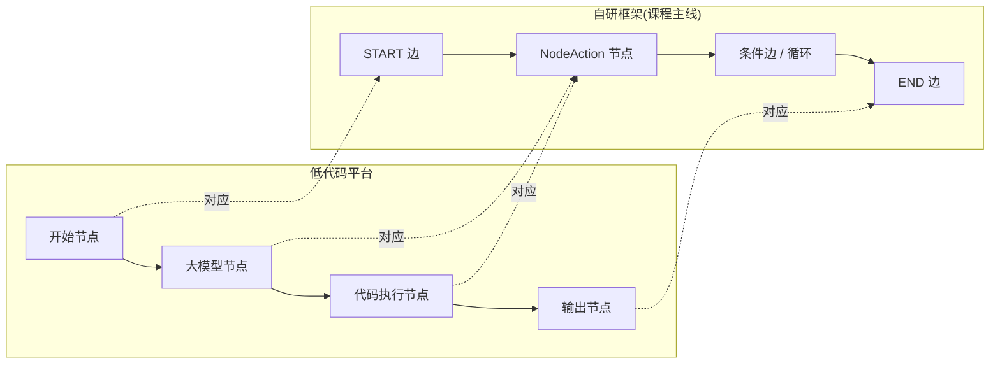

【学习目标】

- 走完 Dify 与 Coze 的注册、模型接入、插件安装、工作流创建全流程，建立对低代码平台的直观认知。
- 说清低代码平台「开始 → 节点编排 → 结束」的流程结构与各类节点（大模型 / 知识检索 / 工具 / 代码执行 / Agent）的职责。
- 建立低代码平台与自研框架之间的概念映射，为后续「为何从零造轮子」的讨论积累感性材料。

【正文】

本节课简单讲解 Dify 和 Coze，对它们建立基本认识即可。目标是「知道它们长什么样、能做什么」，而不是成为使用专家。

## 1. 认识 Dify

打开浏览器搜索 Dify，第一个结果就是它的官网 dify.ai。进入官网可以看到大量介绍，比如「打造生产级 Agent 工作流」，以及很多公司的使用案例，下面是它一些强大功能的简介，例如「无缝接入全球大模型」。

从这些信息可以看出，Dify 面向的主要是海外市场，页面右侧基本是英文，这一点也能体会到它的定位。

### 1.1 进入工作台

点击右侧的「立即开始」。这里需要注意，访问需要开启科学上网，否则打不开。开启之后就能直接进入 Dify 的工作室。

无论是创建工作流、创建 Agent 还是创建聊天助手，都要在工作室里进行。它还内置了知识库和一些工具，另外有「探索」板块，里面是别人已经写好的 Agent，初学者可以从「探索」里找现成案例反推别人的编排思路，是很好的学习材料。

### 1.2 接入大模型

使用之前一般需要在「设置」中选择模型供应商并添加对应的模型。如果使用第三方大模型，肯定需要 API Key，把对应的 API Key 填进去完成集成，才能调用该大模型。

这一步是所有 LLM 应用的通用前提：模型供应商负责「大脑」，平台负责「编排」，两者通过 API Key 建立信任。课程自研工程里对应的环节是 `ChatModel` 的装配，在 980-demo 中即 `980-demo/src/main/java/com/carl/ai/transfer/config/ChatModelConfig.java`，同样是通过端点、模型名、Key 三要素完成接入，只是一个在页面上填表，一个在配置文件里声明。

### 1.3 安装插件

集成好大模型之后就可以下载插件了。点击右上角的「插件」即可搜索，Dify 的插件数量非常多，国内外的都有：比如支付宝支付是国内的插件，此外还有谷歌、亚马逊、微软、K8S 等等，应有尽有。需要什么插件直接安装即可。

安装某些插件时还需要获取插件自己的 API Key，可以按照提示去对应官网注册登录账号，然后申请 API Key。

### 1.4 创建工作流

如何创建工作流呢？点击「工作流」，再点击「创建空白」，因为目标是通过编排工作流来创建 Agent。起个名字，比如「测试 222」，描述可写可不写，然后点创建。

创建之后可以看到各种流程编排能力。有一个「开始」节点，可以在里面添加下一个节点要做的事：下一个节点可以是大模型节点、知识检索节点、输出节点，也可以是一个 Agent，在一个流程编排里用多个 Agent 串联也是可以的。

「开始」节点在低代码平台里承担两个职责：定义流程入口，以及声明入口参数（相当于给整条链路约定一份入参结构）。这与课程自研框架里 StateGraph 的入口状态定义是同一回事，链路未动、状态先行。

下一个节点也可以是工具，工具就是各类插件，比如网页爬取等。按这样的方式编排：下面选择添加一个大模型节点，并指定使用哪个模型；再下一个节点可以是代码执行，让它执行指定的代码；执行完之后可以接一个输出节点，输出完就结束了，因为输出通常就是最后一个节点。

也可以不让它走输出，比如根据代码执行完成后的结果去循环多少次、迭代多少次，或者按条件分支往哪几个分支走，这些都支持。

这里直接让它结束即可。可以看到这就是一个低代码平台：直接在上面添加节点、拖拖拽拽完成编排，还支持每个节点的单独执行以及整个流程的执行，是一个典型的低代码平台。这就是 Dify。

「支持单个节点单独执行」值得多说一句：这是低代码平台调试体验的核心优势，节点级调试能大幅降低排查成本。自研框架里对应的能力是给每个节点写单元测试，980-demo 的 `src/test/java` 下即为抽取与转换两个核心模块配了离线单测（`TransferOrderExtractorTest`、`TransferOrderConvertTest`），思路相通，形态不同。且自研框架的单测可以脱离真实大模型离线运行：用固定返回值驱动节点逻辑，CI 里秒级跑完，不烧 token 也不怕接口抖动。

## 2. 认识 Coze

再搜索 Coze，找到 Coze 的官网 coze.com，访问同样需要科学上网，coze.com 是国外网站。国内也有一个 Coze，点击 Coze 官网入口可以看到 coze.cn，这是国内的官网，可以直接访问。

国内站需要先登录，登录之后点击「开发平台」，这里就是国内版本了：coze.com 是国外网站，coze.cn 是国内网站。

国内站里的插件也很多，同样可以安装，不过 Coze 的插件数量比 Dify 少很多，而且基本都是国内插件，并不是面向海外市场的。

它同样是一个低代码平台，使用方式一致：创建之后起个名字、确认，依然可以通过拖拖拽拽来进行编排。选择大模型、选择工作流，就可以创建工作流。使用上可能比 Dify 稍微复杂一点，但整体差别不大。

创建工作流同样是「开始」「结束」两端，中间可以添加：下一个节点是大模型，还是再嵌套一个工作流，还是执行代码，或者使用什么插件，都是同一套东西。

本质上，这类产品只要有一个先做出来，另一个无非是借鉴前者再做开放，形态上大同小异。

以上是 Dify 和 Coze 这两种低代码平台的使用方式。

## 3. 低代码平台的真实价值与边界

看完两个平台的使用，值得停下来做个阶段性判断，这也是下一节「为何从零造轮子」的铺垫。

低代码平台的真实价值集中在三类场景：**原型验证**，产品经理拿到需求，当天就能搭出可演示的流程；**快速演示**，向领导或客户汇报时，可视化链路比代码更有说服力；**轻量级应用**，个人接私活、内部小工具，不值得为它建一套工程。

边界同样清晰：预置节点圈定了能力上限。当业务需要一个平台没有的节点类型时（例如调用内部古老 ERP 的接口、对接公司自研的消息中间件），就只能等平台排期，或者用代码节点绕一大圈。调试体验好是事实，但「改节点要进平台、发布要走平台、版本管理靠平台」这套流程，与成熟研发团队的工程体系之间存在着天然的摩擦。

一句话：**低代码平台赢在起点，自研框架赢在终点**。中间在哪里切换，取决于项目要走多远。

## 3. 两个平台对照

| 维度 | Dify | Coze |
|---|---|---|
| 官网 | dify.ai（需科学上网） | coze.com（国外）/ coze.cn（国内直连） |
| 市场定位 | 海外市场 | 国内市场为主 |
| 插件生态 | 数量多，国内外都有 | 数量少于 Dify，以国内插件为主 |
| 商业化 | 插件安装为主，付费环节相对少 | 商业化倾向明显，付费环节较多 |
| 使用复杂度 | 相对简单 | 略复杂，整体差别不大 |
| 节点能力 | 大模型 / 知识检索 / 工具 / 代码执行 / Agent / 输出 / 条件分支 / 循环 | 同左，另支持嵌套工作流 |

## 4. 低代码概念与自研框架的映射

把平台里的概念翻译成课程自研框架的概念，两条道路就打通了：

对应关系：平台的「开始 / 输出节点」对应 Graph 的 START / END 边；「大模型 / 代码执行节点」对应各自实现的 `NodeAction`；「条件分支」「循环」对应 Graph 的条件边与循环编排；「嵌套工作流」对应子图。概念一一对应之后就能看出：平台把编排做成了可视化表单，框架把编排做成了代码，底层思想是同一套。

Dify 工作台内置的知识库，对应的是课程第 9 章的 RAG 体系：把文档灌入向量库，问答时先召回相关片段再交给大模型生成。课程用 Tika 做文档读取、自定义分割器提升召回准确度、Redis / Milvus 作向量库，走的是自研路线，每一步都可替换、可测试。平台路线则是把这整套封装成「上传文档即用」的知识库功能，省事，但召回质量出问题时排查空间有限。两条路线解决同一个问题，可控性与易用性各取一端。

【易错点 / 面试题】

1. **「Dify 和 Coze 有什么区别」**：至少答出三点，市场定位（海外 vs 国内）、插件生态（多且国际化 vs 少且国内化）、访问条件（都需科学上网，但 Coze 有国内站 coze.cn 可直连）。只答「都差不多」会显得没实际用过。
2. **「低代码平台的节点类型有哪些」**：大模型节点、知识检索节点、工具（插件）节点、代码执行节点、Agent 节点、输出节点，外加条件分支与循环控制。答完可以补一句与自研框架的映射，展示理解深度。
3. **「你用过这些平台吗？项目为什么没用」**：诚实回答「了解过、做过原型验证」，再用 2-3 的框架回答生产项目为何选自研：整合进既有业务系统笨重、定制化节点受制于人。没用过却假装精通，是面试大忌。

【小结】

本节走完了 Dify 与 Coze 的基本使用流程：注册进入工作台、接入大模型、安装插件、创建并运行工作流，并用对照表梳理了两个平台的差异。低代码平台的价值在于「快」，节点拖拽即可运行，单节点可调试；局限同样明显，预置节点圈定了能力边界，下一节就展开讨论：低代码平台遍地，为何还要从零造轮子。
