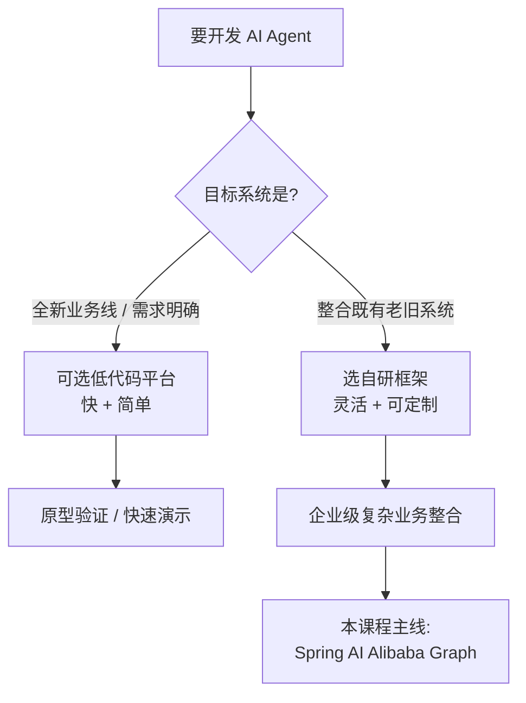

【学习目标】

- 说清低代码平台在企业落地中的四类局限：平台边界、集成壁垒、功能受制、灵活性缺失。
- 建立「场景决定选型」的判断框架：什么情况选自研，什么情况选低代码。
- 掌握「为什么不用 Dify / Coze」这一面试高频题的标准答题结构。

【正文】

本门课程的重点不在 Dify 和 Coze 这类低代码平台的使用，所以前面只做了简要介绍，先建立起基本概念。

回到这一小节，提出一个「灵魂拷问」：**低代码平台遍地，为何还要从零造轮子？** 不妨先自行思考一遍。

之所以强调先想，是因为课程中所有的提问，都有可能是面试官将来会问到你的。他很可能会这样追：现在有 Dify、有 Coze，你们公司为什么不用，而是用 Spring AI Alibaba Graph 来开发？这类「为何存在该需求」的追问非常常见。所以 PPT 上出现的每一个问题，都建议先自己想一遍，再看讲解。

## 一、平台局限性：样板间与定制豪宅

首先是低代码平台自身的局限性。Dify 和 Coze 很棒，这一点无可厚非，但它们更像是一个精美的**样板间**，而企业需要的是能够承载复杂业务的**定制豪宅**。

样板间的逻辑是把最常见的设计预制好，参观者觉得漂亮就能快速入住；定制豪宅的逻辑是每一寸空间都按业主的生活习惯展开。企业级业务的复杂度，历史数据、组织流程、权限体系、合规要求，恰恰是样板间覆盖不了的部分。平台预置的节点再丰富，也只能覆盖「常见的业务」，覆盖不了「你这家公司的业务」。

再往深看一层：平台为了易用性，会把能力封装成「填空式」的配置项，参数给什么就渲染什么；而企业需求常常是「一半标准化、一半特例化」，特例部分往往写不进平台的配置表单。样板间服务于「大多数人」，定制豪宅服务于「具体的一个人」，企业要的从来都是后者。

## 二、集成壁垒难以驾驭

这一点指向平台的现状：如何把平台上开发的 Agent 无缝集成到公司现有的 Spring Boot、用户认证、事务管理、日志监控体系当中？该集成过程往往非常笨重。换句话说，用低代码平台开发出来的工作流，想要整合进那些复杂、老旧的既有系统，会非常笨重，不够灵活。

展开说，这里的摩擦是结构性的：

| 集成点 | 自研框架（Spring 生态内） | 低代码平台 |
|---|---|---|
| 用户认证 | 直接复用项目的 Security 过滤器链 | 平台账号体系与公司 SSO 打通 |
| 事务管理 | `@Transactional` 原生生效 | 跨平台边界，事务难以传递 |
| 日志监控 | Micrometer + 既有日志规范 | 平台自有日志，需额外对接 |
| 服务治理 | Nacos / Sentinel 等现成设施 | 平台部署形态独立，治理另起一套 |

每一项单独看都能克服，加在一起就是一笔可观的集成成本。更麻烦的是这些摩擦不在「AI 能力」上，而在「企业基建」上，本该由框架顺带解决的事情，变成了需要专门攻克的工程课题。

课程第 8 章的改造过程就是该论断的实证：把单体项目改造为微服务、接入 Nacos 配置中心、引入 Kafka 做异步化，放在自研框架里，这些都是 Spring 生态的标准操作，改配置、加注解、引依赖即可完成；换成平台方案，AI 部分被隔离在平台内部，每一次基建升级都要面对「平台内怎么接」的新问题。框架路线把 AI 应用变成了普通 Spring 应用，基建红利一分不少；平台路线则让 AI 应用成为一个需要单独供养的系统。

## 三、功能边界，受制于人

平台的节点和能力都是预设好的。当你需要一个高度定制化的业务逻辑节点时，比如调用一个内部古老的 ERP 接口，平台可能根本提供不了，或者实现起来非常别扭。

ERP 接口只是举例，真实企业里这类需求层出不穷：祖传的 SOAP 服务、私有二进制协议、公司内部的审批中台、特定格式的报表引擎……平台没有义务为某一家公司的历史买单，等平台排期不现实，用通用 HTTP 节点硬绕又会让链路变得脆弱难维护。自研框架则没有这层天花板，节点就是普通 Java 类，能调 Spring 就能调的一切。

「实现起来非常别扭」通常有两种表现形式。一种是**能力缺失**：平台压根没提供这类节点，只能把逻辑塞进代码节点里，用字符串拼接参数、用正则解析响应，链路退化成「平台里裹着一层脚本」。另一种是**能力错位**：平台提供了看似通用的节点，但参数粒度对不上业务需要，比如要给一次模型调用同时挂上公司内部的审计埋点和多租户隔离，通用节点只暴露了「填个 Key」的入口，剩下的需求只能在节点外再包一层。两种形态都会让流程越来越难维护，而维护成本是会随项目生命周期持续累积的。自研框架下这些需求只是普通的横切关注点，用 Advisor 或拦截器统一处理即可。

## 四、说到底，核心问题就是「不灵活」

以上几点归根结底是同一个问题：不灵活。想把 AI 应用整合进现有系统，最大的难点在于，现在很多公司原有的业务系统都非常老旧、非常复杂，早期需求本身可能都不明确，也就是传说中的「屎山」。要在这种系统里整合 AI，直接上低代码平台会非常困难。

反过来，如果公司要开发的是一条全新业务线、一套新系统，需求比较明确，也能更好地与 AI 应用整合，完全可以尝试用这两个低代码平台来做 AI Agent 开发。但如果目标是与现有的老系统做整合和升级，这两个平台就显得笨重，便利性大打折扣。

用一张决策图收拢这一判断：

## 五、Dify 与 Coze 的定位

两者的定位是**原型验证、快速演示、轻量级应用**，在这类场景下是绝佳选择，适合产品经理、运营或者全栈开发者进行快速尝试。

它也同样适合个人开发者：作为个人开发者想接一些小项目、接一些私活，可以用这两个平台快速验证自己的方案能否实现。

同样也适合产品经理：拿到需求之后，可以先通过低代码平台快速做原型验证与演示；如果发现确实能满足需求，再把需求下发给开发部门做正式研发。运营场景同理。

所以对产品经理、运营或者个人全栈开发者来说，用这两个低代码平台非常方便，原因归根结底就一个字，**快**；再加两个字，就是**简单**。快和简单。

值得注意的是，「快」与「简单」在这里并非贬义，而是对特定阶段核心诉求的精准满足，需求验证阶段追求的就是用最小成本换最大信息量。

把「快」和「简单」翻译成工程语言：低代码平台把 80% 的常见需求做成了填空，省下的是从零搭骨架的时间。企业级项目真正的成本往往不在骨架，而在那 20% 的定制需求加上与存量系统的集成，这恰是平台帮不上忙的部分。

即便生产项目选自研，低代码平台在工程师的工具箱里仍有一席之地：验证一个新想法是否可行，先用平台半小时搭个原型，比先在自研框架里写三天更有决策效率；向非技术角色演示链路时，可视化流程的沟通成本也远低于代码评审。把它当作「想法验证器」和「沟通演示器」，而不是「生产运行时」，是对这两个平台最理性的定位。

## 总结：面试时该怎么回答

将来面对面试官的这类提问，可以这样回答：这两个低代码平台要整合进我们原有的业务系统，比较笨重，折腾起来也不方便，所以我们选择了更加灵活、定制化程度更高的 Spring AI Alibaba Graph 来做工作流开发，因为它最核心的优势就是能够进行定制化。

这套回答的背后有工程实证：课程配套的 980-demo 把「定制化」落到了具体处，`convert/TransferOrderConvert.java`（MapStruct 转换层）处理 POJO 之间的字段映射与 `LocalDate` 边界，`repository/BbTransferOrderRepository.java` 直接复用 Spring Data JPA 的仓储能力，`extract/TransferOrderExtractor.java` 上的 resilience4j 熔断注解与项目自身的监控体系无缝衔接。这些在自研框架里都是顺手可得的 Spring 生态能力，换到平台方案里则每一项都要重新论证可行性。定制化不是口号，是这些具体到类的选择。

【易错点 / 面试题】

1. **「为什么不用 Dify / Coze，而用 Spring AI Alibaba Graph？」**：标准答案三段式，先承认平台价值（快、适合原型验证），再讲企业整合痛点（老旧系统集成笨重、定制节点受制于人），最后落到自研优势（定制化程度高、Spring 生态原生融合）。切忌一上来就贬低平台，显得眼界狭窄。
2. **「低代码平台完全不能用吗？」**：能，场景要对。原型验证、快速演示、轻量级应用、个人接私活，都是绝佳场景。选型题永远答「分场景」，不答「一边倒」。
3. **「自研的工作流和平台比，开发效率不是低很多吗？」**：承认前期投入高，但把账算完整：平台省下的是搭骨架的时间，自研省下的是每一次定制需求时的排期等待和集成攻关；项目越复杂、生命周期越长，自研的复利越明显。另外「效率」要分阶段看，首版可能确实慢，但第二个、第三个需求接入时，框架的复用价值才会兑现。

【小结】

本节从平台局限性、集成壁垒、功能边界、灵活性四个角度回答了「为何从零造轮子」，并给出了「场景决定选型」的决策框架：低代码平台赢在原型验证与快速演示，自研框架赢在企业级整合与深度定制。需要再次强调的是，「从零造轮子」造的不是 HTTP 客户端、不是 JSON 解析器这些通用轮子，而是「贴合自家业务的编排框架」，通用能力交给 Spring AI Alibaba 与 Spring 生态，自研部分只聚焦业务编排本身，这才是「造轮子」的正确姿势。下一节从「工具使用者」转向「架构创造者」，正式开始搭建属于自己的工作流 Agent 框架。
