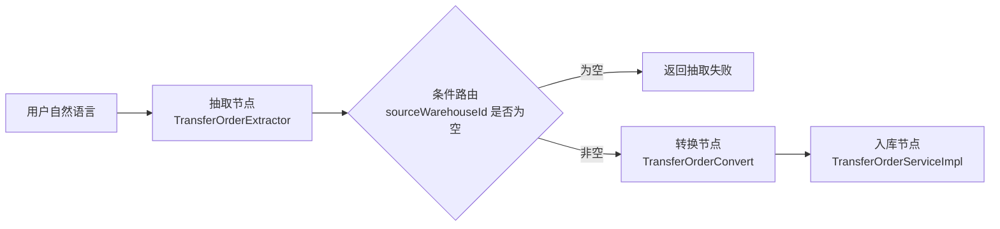

【学习目标】

- 说清「工具使用者」与「架构创造者」两种能力模型的分水岭，建立职业升维的判断标准。
- 理解状态管理、节点编排、条件路由是跨语言、跨平台的 Agent 通用内核，以及亲手实现它的长期价值。
- 把「缓解 35 岁危机」从口号落到可执行的能力建设路径上。

【正文】

上一节留下的问题是：低代码平台遍地，为何还要从零造轮子？那一节回答的是「平台有什么局限」，本节换个视角，回答「这件事对个人职业发展意味着什么」。结论先行：**停留在低代码平台的页面上，你是工具使用者；用代码把工作流实现出来，你才升维为架构创造者。**

## 一、核心竞争力：分水岭两侧是两种能力模型

只会使用平台，技能上限就被锁死在「熟悉某两个工具」上，可替代性极强。以 Dify 和 Coze 为例：能在页面上拖拽完成编排，简历上能写的只有「熟练使用 Dify / Coze」。麻烦在于这类技能的习得门槛太低，新员工花点时间熟悉页面怎么用，思路可能更灵活，拖出来的流程甚至比老手更规整。工具型技能的残酷之处在于：它不构成壁垒，只构成一段短暂的有效工龄。

换个方向看。掌握 Spring AI Alibaba Graph 这套代码化的开发方式，等价于拥有了设计 AI 系统架构的底层思维，而后者正是架构师的核心能力，护城河极深。对正在转型架构师的人，它补齐的是「AI 应用该怎么设计」这块关键拼图；对已经身在架构师岗位的人，它提供的是把 AI 能力纳入既有架构的落地抓手。两条路径通向同一个结果：从「会用工具的人」变成「能造工具的人」。

把两种能力模型摊开对照，差异是结构性的：

| 维度 | 工具使用者 | 架构创造者 |
|---|---|---|
| 技能载体 | 平台页面操作 | 代码与工程设计 |
| 能力上限 | 由平台预置节点决定 | 由自身对业务与架构的理解决定 |
| 可替代性 | 高（短期培训即可上岗） | 低（需要系统化工程积累） |
| 需求变更响应 | 等平台排期，或想办法硬绕 | 改代码、加节点、重新编排 |
| 价值出口 | 执行层劳动力 | 架构决策层 |
| 评估平台的能力 | 会用，但看不穿 | 一眼看穿技术本质与边界 |

值得注意的是，表格最后一行的差距最容易被忽视，却最致命：工具使用者只能「感受」平台好不好用，架构创造者能「解释」平台为什么好用的、又在哪里会撞墙。选型会议上，后者才拥有话语权。

还有一个隐性因素常被忽略：工具型技能的半衰期在加速缩短。低代码平台的迭代节奏以周计，页面改版、节点增删、配置项迁移，都会让「熟练度」部分清零；而状态管理、节点编排、条件路由这类内核知识以年计，Spring AI 从 1.x 到 2.0，工具循环从各模型私有实现升级为 `ToolCallingAdvisor` 统一驱动，但三要素一个都没变。把学习时间押在衰减慢的那一侧，是职业投资的基本常识。

## 二、技术视野的降维打击

第二点是技术视野。亲手创建 Graph 的过程，会倒逼你透彻理解三件事：**状态管理、节点编排、条件路由**。这三项不是 Spring AI Alibaba 的私有概念，而是所有 Agent 框架的共同内核，Dify、Coze 的页面之下，LangChain4j 的链式调用之下，任何一门语言的工作流引擎之下，跑的都是同一套机制。

把这三项吃透之后，评估任何一个 AI 平台都会变成「降维打击」：看一眼它的状态存在哪里、节点怎么串联、条件怎么路由，就能判断它的技术本质与能力边界，进而做出权威的技术选型决策。这种判断力无法通过「熟练使用 N 个平台」获得，只能通过「亲手实现过 N 次」获得。

网上流传着一个段子：有不懂技术的领导放话，手下十个人的小组要做出对标 OpenAI 的产品、要打败 OpenAI。行内人当笑话看看就好，没扎进过底层的人，才会高估堆人的作用、低估内核的价值。段子真正想说明的其实是：AI 应用学得越多越会发现，Agent 开发无论用哪门语言、哪个平台，底层核心都是相通的，就是上面提到的状态管理（也就是状态机）、节点编排、条件路由。只要通过写代码把这些核心技术真正掌握到位，以后再冒出一门新语言、一个新平台，上手都会非常快，变的只是 API 的形状，不变的是设计范式。

## 三、把内核三要素映射到真实工程

内核三要素听起来抽象，落到代码里都有明确的对应物。课程配套的 980-demo 把「自然语言 → 抽取 → 入库」做成了可部署的最小闭环，正好可以当参照系：

- **状态管理**：`domain/param/TransferOrderParam` 与 `domain/model/BbTransferOrder` 就是贯穿流程的状态载体，每个节点都依赖它取前置数据、往里写产出。
- **节点编排**：`agent/TransferAgent.java` 的 `createTransferFromText` 是一个完整的节点动作，内部按顺序调用抽取与入库两步；`extract/TransferOrderExtractor.java` 则对应「大模型生成」这一个独立节点。
- **条件路由**：`TransferAgent` 中 `param.getSourceWarehouseId() == null` 的分支判断，就是最简形式的条件边，抽取失败走降级文案，抽取成功走入库。

课程第 5 章之后的工作流，都是在这张图上加节点、加边、加条件。现在把三要素和具体类对上号，后面再看 Graph 代码，看的就是这张图，而不是在学一套新语法。

再往上一层看「架构」二字。框架层的价值不止于把链路串起来，更在于屏蔽差异：`config/ChatModelConfig.java` 与 `config/OfflineChatModel.java` 把「真实模型」和「离线 Mock」藏在一对 profile 后面，业务代码面向 `ChatClient` 抽象编程，感知不到背后换没换模型；`extract/TransferOrderExtractor.java` 把提示词、结构化绑定、熔断降级收在一个类里，业务方不需要理解 Spring AI 的任何细节。能让使用方少做选择、少犯错误，这就是架构工作的日常形态，它不发生在某一个方法里，发生在分层的边界上。

## 四、35 岁危机：一条被验证过的出路

最核心的一点在于：升维能切实抬高技术水位、降低可取代性，也就是缓解所谓的 35 岁危机。如果始终不积极地从传统业务开发者向 AI Agent、AI 应用开发者转型，这道危机始终存在，除非你的架构能力、技术能力真的强到别人难以替代。

反过来，如果长期停留在 CRUD 上，转到一个新兴领域其实是条不错的出路。理由很现实：AI Agent 这一领域里大家都不算资深，整体处于探索期，评价体系尚未固化，先入场的人有实打实的时间窗口。在成熟领域和十年经验的人拼深度不现实；在探索期领域拼的是学习速度与工程落地能力，这恰好是 Java 后端工程师的主场。

当然，「转型」不是口号，落点还是上面那张图：亲手用代码把状态管理、节点编排、条件路由各实现一遍，把 980-demo 这样的完整链路跑通，再把课程第 5 章之后的项目级工作流完整做一遍。课程安排的练习路径恰好覆盖了全部三要素：第 5 章的库存调拨 Agent 练的是「顺序节点 + 状态流转 + 条件分支」的最小完整集；第 10、11 章的智能 BI 报表问答 Agent 在此之上加入「评估-循环」，把条件边与循环边一起练到。做到这些，简历上能写的就不是「了解 AI」，而是「落地过生产级 AI Agent 工作流」，两者在面试官眼里的分量完全不同。

【易错点 / 面试题】

1. **「你怎么理解从工具使用者到架构创造者？」**：不要答情怀，要答能力模型，工具使用者的上限由平台预置能力决定，架构创造者的上限由自身工程理解决定；再补一个证据：你亲手实现过状态管理、节点编排、条件路由，因此看得穿任何平台的技术本质。讲「一个节点动作长什么样」时，可以直接引 `980-demo/src/main/java/com/carl/ai/transfer/agent/TransferAgent.java`。
2. **「35 岁危机怎么破？」**：危机来自可替代性，破局靠抬高不可替代的那部分。答题结构分三步：先点明危机的本质（技能可被短期培训替代），再讲路径（转向仍在探索期、评价体系未固化的 AI Agent 领域），最后落到证据（完整项目链路，而非 Demo 玩具）。只喊「持续学习」没有说服力。
3. **「这些底层内核是否只有 Spring AI Alibaba 才有？」**：恰恰相反，它是所有 Agent 框架的公共内核。面试时能主动把 Dify / Coze 的页面元素与 State / Node / Edge 对应上，是明显的加分项，这说明你评估过平台，而不是只会用一个平台。

【小结】

本节从能力模型与技术视野两个维度完成了「升维」论证：工具使用者的上限锁在平台边界内，架构创造者的上限随工程理解持续扩张；而打通后者的钥匙，是亲手实现状态管理、节点编排、条件路由这套跨平台通用内核。落到行动上，就是沿着 980-demo 的最小闭环（`TransferOrderExtractor` 抽取 → `TransferOrderConvert` 转换 → `BbTransferOrderRepository` 入库）把每个节点都写一遍。一句话记住本节的行动清单：**内核三要素亲手实现过，完整链路独立跑通过，项目级工作流跟做一遍**，三件事做完，「架构创造者」就不再是一个比喻。下一节回答「为什么 Spring AI Alibaba Graph 是 Java 生态的终极答案」，从职业视角切换到技术选型视角。
