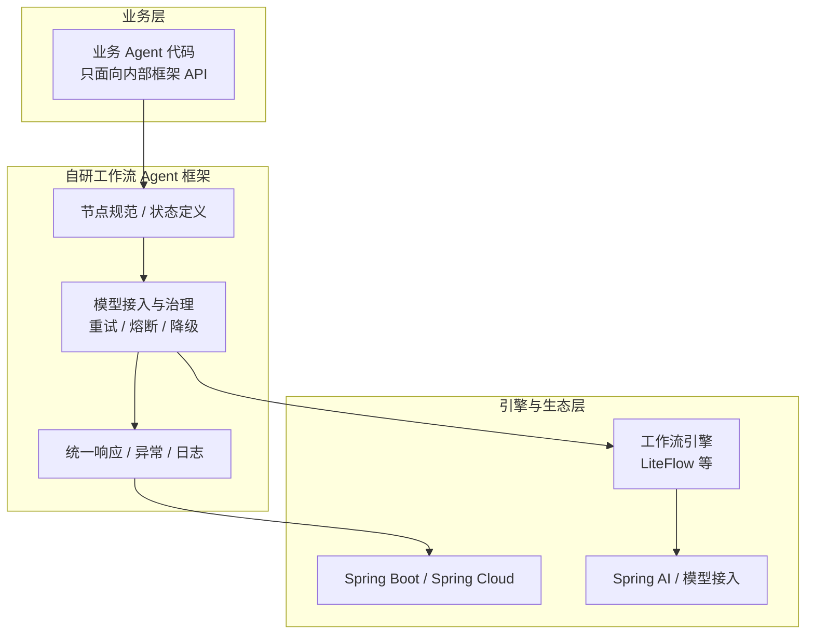

【学习目标】

- 说清 AI 工作流开发的第四条路线，自研工作流 Agent 开发框架，及其与前面三条路线的定位差异。
- 理解「在原生框架之上二次封装」为何是大厂的通行做法，以及内部框架解决的具体问题。
- 掌握把「自研工作流 Agent 引擎」写成简历亮点与面试话术的方法。

【正文】

前面几节把选项摆得差不多了：Dify、Coze 这类低代码平台，以及 Spring AI Alibaba Graph 这样的工作流开发方式。这里先抛出一个问题：难道就没有别的路线了吗？难道只有这两类选择？

答案是有的。本节要讲的第四条路线，就是**自研工作流 Agent 开发框架**。

## 一、第四条路线的来历

在 Spring AI Alibaba 出现之前，业界就已经通过工作流引擎实现过 Agent 开发。课程的最后章节会把之前录制的一些视频补充进来，换句话说，之前已经提供过一种思路：使用某种工作流引擎来开发 Agent。课程补入的第 14 章（LiteFlow 工作流引擎与组件化编排）就是这条路线的完整展开，先借成熟引擎获得编排能力，再在其上做面向 Agent 的二次封装。

之所以把这部分补充进来，也是为了给简历增加含金量。四条路线的定位差异可以放在一张表里对照：

| 路线 | 形态 | 掌控力 | 典型场景 |
|---|---|---|---|
| Dify / Coze | 低代码平台 | 受平台预设能力约束 | 原型验证、快速演示 |
| Spring AI Alibaba Graph | 开源框架直接使用 | 高，但遵循框架自身抽象 | 企业级 AI 应用开发 |
| 自研工作流 Agent 框架 | 工作流引擎 + 内部二次封装 | 最高，抽象由自己定义 | 大厂多团队规模化铺开 |
| （本课主线） | 用 Graph 把项目做深 | 高 | 课程两个实战 Agent |

注意第四条路线不是对第三条的否定，而是「同一种能力、不同成熟度」：当 AI 工作流需求从一个团队扩散到整个公司、从单个项目变成一类项目时，直接在开源框架上写业务代码会暴露出重复问题，每个团队都自己搭一遍节点规范、状态定义、模型接入，造出一堆形状相似却互不兼容的轮子。内部框架就是把「已经验证过的最佳实践」固化成公司级基础设施，让业务团队只面向框架编程。

判断自己该走第三条还是第四条，看的不是公司大小，而是复用面：需求只来一次，直接用开源框架最划算；需求会来十次、来自身边十个团队，才值得把共同部分抽成框架。大厂走第四条的根本原因也在这里，不是技术崇拜，是需求密度逼出来的规模经济。

## 二、为什么大厂都在自研框架

这里有一个业内共识：大厂里，大家都不会直接使用传统的原生开发框架进行开发。一些中小企业会使用 Spring Boot 或者 Spring Cloud 来做项目开发；而在大厂中，通常不会直接使用这些原生框架，而是在原生框架之上进行二次开发，创造出一个公司自己内部的开发框架。

原因可以归纳为三点：

1. **统一技术栈与规范**。原生框架只约束到「用 Spring」这一层，不约束「Controller 怎么写、异常怎么处理、日志怎么打、模型怎么接」。内部框架把这些全部收口，代码评审从「审风格」变成「审逻辑」，跨团队代码的可读性大幅提升。
2. **屏蔽底层细节**。业务团队不需要关心底层用哪个工作流引擎、模型端点怎么配、重试熔断怎么加，框架层统一封装，业务层拿到的是一套贴合物料的 API。
3. **沉淀复用**。权限、审计、埋点、监控这类横切能力，在原生框架里每个项目各做一遍；在内部框架里做一遍，全公司复用。

讲解这第四条路线，也就是自研路线，其形态就类似于大厂的做法：使用某种工作流引擎进行封装，打造一套企业内部自有的、用于工作流 Agent 开发的框架。分层结构如下：

这张图也是阅读课程第 14 章时的导航图：LiteFlow 相关篇章对应引擎层，组件化与上下文对应框架层的节点规范与状态定义，而文生图、图片编辑组件则是业务层的能力样例。

## 三、雏形就在配套工程里

「自研框架」听起来是大厂专属，其实它的最小形态在每个认真分层的项目里都存在。课程配套的 980-demo 就是一个缩小版样例，把「自然语言 → 抽取 → 转换 → 入库」这条链路封装成业务方无感知的内部能力：

- `agent/TransferAgent.java` 是业务层唯一入口：外部只调 `createTransferFromText`，不需要知道内部有几个节点、顺序如何。
- `extract/TransferOrderExtractor.java` 封装模型调用：提示词、结构化绑定、熔断降级都收在这一层，业务层不接触模型细节。
- `config/ChatModelConfig.java` 与 `config/OfflineChatModel.java` 屏蔽模型差异：业务代码面向 `ChatClient` 抽象编程，default profile 下是离线 Mock，prod profile 下是真实端点，业务层零改动。
- `convert/TransferOrderConvert.java` 固化转换规范：`param` 与 `model` 的字段映射（含 `LocalDate` 边界的正确处理）由框架层统一保证，不会在每个业务类里重复实现。

把这些特点连起来，就是内部框架的定义：**统一抽象 + 规范约束 + 细节屏蔽**。规模小时它是「项目里的几个分层包」，规模大时它是「公司级 SDK + 脚手架 + 规约文档」，本质是同一件事，只是受众从一个人变成一个部门。

## 四、落地路线：从封装到铺开

「自研框架」不是一次性工程，通常沿着固定的台阶逐级落地：

1. **选引擎**。挑一个成熟的工作流引擎作为编排底座（课程第 14 章演示的 LiteFlow 即属此类），引擎负责状态流转与调度，自研层不重复造这些能力。
2. **定节点与状态规范**。规定节点怎么定义（输入输出契约）、状态怎么声明（哪些 key、用什么 `KeyStrategy`）、边怎么编排。规范先行，后面所有业务才长得像同一套代码。
3. **封装模型接入与治理**。把模型端点、提示词模板、重试、熔断、降级收进框架层（对应 980-demo 中 `config/ChatModelConfig.java` 与 `extract/TransferOrderExtractor.java` 的职责划分），业务层零感知。
4. **横切能力收口**。统一响应体、异常处理、日志规范、监控埋点，这些在原生框架里每个项目各做一遍，在内部框架里只做一遍。
5. **脚手架与试点推广**。给出项目模板与示例组件，先在一个业务上试点，打磨 API 手感，再向其他团队铺开。

这条路线与课程章节的对应关系是：第 3 章到第 11 章用 Spring AI Alibaba Graph 把两个项目级 Agent 做深，解决「一个人怎么把项目做对」；第 14 章用 LiteFlow 演示引擎封装，解决「一类需求怎么横向铺开」。先深后广，是这条能力线的自然顺序。

【易错点 / 面试题】

1. **「有没有自研或封装框架的经验？」**：这是高级/资深岗位的高频题。答题结构：先讲动机（多团队复用、规范收口），再讲抽象设计（节点怎么定义、状态怎么流转、模型接入怎么屏蔽），最后讲落地成效（几个业务接入、开发周期缩短多少、问题率变化）。如果能在简历上体现「推动并主导了公司内部落地一个二次封装的工作流 Agent 开发引擎」，无论定位为高级工程师还是资深工程师，都是站得住脚的。讲抽象设计时，可以引 `980-demo/src/main/java/com/carl/ai/transfer/agent/TransferAgent.java` 作为「入口收口」的最小样例。
2. **「自研框架和直接用开源框架，投入产出比怎么算？」**：关键变量是「复用次数」。一个项目直接用开源框架最划算；一类项目（多个团队、多个场景）自研框架才回本。答题时主动问清面试官所处的团队规模，再给结论，比一刀切地回答更显成熟。
3. **「第四条路线和课程主线的 Graph 开发矛盾吗？」**：不矛盾。课程先用 Spring AI Alibaba Graph 把两个项目级 Agent 做深，第 14 章再用 LiteFlow 演示「引擎 + 二次封装」的自研路线。一个是把项目做深的功底，一个是把能力横向铺开的手段，简历上两者互补。

【小结】

本节补齐了 AI 工作流开发的第四条路线：在原生框架与工作流引擎之上做二次封装，打造企业内部自有的工作流 Agent 开发框架。它解决的是一类项目规模化时的重复建设问题，形态上分三层，业务层只面向内部框架 API，框架层收口节点规范、模型治理与横切能力，引擎与生态层由 LiteFlow、Spring Boot、Spring AI 支撑。这一形态在 980-demo 的 `agent` / `extract` / `config` / `convert` 分层里有最小雏形，在第 14 章有完整展开。回到个人成长视角：第四条路线真正的门槛不在技术，在于有没有机会参与「定规范」的过程，因此自学阶段能做的，是先把引擎与封装分层的思想吃透，把课程第 14 章的组件化编排跟做一遍，等真实需求来临时，你至少知道一套内部框架应该长成什么样、从哪几层开始搭。下一章进入 Spring AI Alibaba Graph 的核心精讲，先把「什么是 Graph」这一问题彻底讲清楚。
