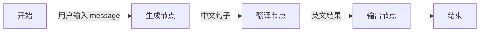

【学习目标】

- 复刻课程在 Dify 上演示的「测试 222」工作流：输入一个单词，大模型生成一句话，再翻译成英文输出。
- 独立搭建 `simple-ai-alibaba-demo` 工程：选版本、引 BOM、加依赖、写配置。
- 说清每个依赖与每行配置的职责，以及「企业版本通常降一档」的选型逻辑。

【正文】

从本节课开始，来体会一下如何通过 Spring AI Alibaba 框架简单地构建一个智能工作流。

## 一、先复刻 Dify 上的工作流

先在 Dify 平台上搭建一个工作流（就是前面演示的「测试 222」），实现这样的功能：用户输入一个内容，这里起名叫做 `message`；然后由大模型根据输入的内容生成一句话，用户给出一个单词，大模型根据该单词生成一句话；接着再到下一个大模型，该大模型根据上一个大模型生成的这句话把它翻译成英文；最后进行输出。

先演示一下运行效果：点击测试运行，给 `message` 传入「天空」，希望第一个节点根据给出的「天空」这一单词生成一句话，下一个大模型再根据上一句结果翻译成英文并输出。

点击开始运行，可以看到节点依次处于「正在运行」状态，运行完成后最终输出的结果是 「the sky」 这样的英文。

可以追踪一下各个节点做了什么：用户输入的是「天空」；第一个节点的要求是「根据输入的内容生成一句话」，它的输出是「天空湛蓝如洗，云朵悠然飘过」；下一个大模型拿到这句话，要求是翻译成英文，于是输出了对应的英文；最后由输出节点把这段英文输出出来。

用 Graph 的语言描述，这条链路就是「开始 → 生成节点 → 翻译节点 → 输出节点 → 结束」，节点之间用固定边串联，状态里流转的分别是原始输入、中文句子、英文结果。接下来要做的事情，就是将该图通过 Spring AI Alibaba 框架用代码生成出来。



## 二、创建项目与选版本

打开 IDEA，先创建一个项目。为了快速演示，这里创建一个 Spring Boot 项目（Maven 项目也可以），命名为 `simple-ai-alibaba-demo`，也就是一个简单的 Spring AI Alibaba 演示工程。

使用该框架需要 Spring Boot 的版本为 3，对应的 JDK 版本为 17 或者 17 以上，这里选择 17；构建时选一个 quick start 模板，坐标使用 `com.car`，然后点击创建，等待依赖下载完成。

项目创建好之后，在引入 POM 依赖之前，先确认版本：我们需要使用 Spring AI 和 Spring AI Alibaba，二者最新的版本分别是什么？可以直接去 Spring AI 的官网查看，最新版是 1.0。

一般企业中使用的版本都不会直接用最新版，通常会降一个版本来使用，因此这里选择使用 1.0.3。对应 Spring AI 1.0.3 这一版本，可以使用的 Spring AI Alibaba 的版本是 1.0.4（依赖管理中写作 1.0.0.4）。可以去 Maven 仓库中确认 Spring AI Alibaba 是否有 1.0.4 这一版本，确认存在之后，就确定使用 Spring AI 1.0.3 + Spring AI Alibaba 1.0.4 这一组版本。

「降一档使用」是企业选型的常见保守策略：最新版往往意味着未经充分验证的边界情况，而周边生态（CI 镜像、内部私服、既有依赖）对新版本的适配总有滞后。等一个版本在社区里跑过一段时间、周边跟上了，再升级，试错成本最低。

## 三、用 BOM 统一管理版本

首先要使用它们的 POM 来进行版本管理。为什么用 POM 管理版本呢？因为通过 POM 可以把下面所有组件的版本统一在这里升级，只需要声明定义一次版本号，下面引入所有组件时就都不需要再定义版本了，可以直接引入组件。

因此在这里定义一下 Spring AI 的版本以及 Spring AI Alibaba 的版本：Spring AI 的版本是 1.0.3，Spring AI Alibaba 的版本是 1.0.0.4。

在 `dependencyManagement` 里面引入它们的 POM 来进行管理。Spring AI 的坐标是 `spring-ai-bom`，version 通过 `${}` 来引用，即 `${spring-ai.version}`；下面要写明它的类型，类型为 `pom`，以及 scope 需要是 `import`。这样 Spring AI 的 POM 依赖就定义好了。

下面再定义 Spring AI Alibaba 的 POM：`spring-ai-alibaba-bom`，版本引用 `${spring-ai-alibaba.version}`。该 POM 就是用来帮我们自动管理版本号的，所以才会使用它。

BOM（Bill of Materials）的本质是「版本托管」：它自己不引入代码，只在 `dependencyManagement` 里登记一批「坐标 → 版本」的映射。之后工程里再引入这批坐标下的任何组件，版本全部由 BOM 统一供给。这么做有三个直接好处：升级只改一处；不会出现两个传递依赖拉到不同版本的情况；团队所有人的版本一致，减少「我这能跑你那不能跑」类的环境问题。

先刷新一下看看有没有报错，没有报错就可以在 `dependencies` 里面引入 `spring-ai-alibaba-graph-core` 依赖。引入该依赖，就是让项目具备使用 Spring AI Alibaba Graph 的能力。

由于在 Dify 里的定义是需要有两个大模型对话来得到我们想要的东西，所以还需要加一些依赖。比如需要加一个让 Spring 帮我们自动装配 `ChatClient` 的依赖，这样就不必在代码中自己去写对应的 bean，而只需要在 YAML 配置文件里配置一下，它会帮我们完成自动装配。

该依赖是 `spring-ai-autoconfigure-model-chat-client`，从名字也能看出它是用来自动装配 `ChatClient` 的。

本次使用的是 Qwen（千问）作为大模型，而千问使用的是 OpenAI 的协议，所以还需要引入 OpenAI 的 model：`spring-ai-autoconfigure-model-openai`，也就是引入 OpenAI 的自动装配模型。

引入这两个依赖的原因很简单：引入前者之后，只需要在配置文件里通过 OpenAI 协议配置好千问的模型，它就可以帮我们自动装配成对应的 bean，交给 Spring 容器管理；通过后者则可以直接帮我们装配成 `ChatClient`，而不需要在代码中通过 `@Bean` 注解来定义该 bean，从而减少一部分代码开发量。

把这一节的依赖与职责整理成表：

| 依赖 | 提供的能力 | 为什么需要 |
|---|---|---|
| `spring-ai-alibaba-bom` | 版本托管（`dependencyManagement`） | 统一管理 Spring AI Alibaba 全家桶版本 |
| `spring-ai-bom` | 版本托管（`dependencyManagement`，`type=pom`，`scope=import`） | 统一管理 Spring AI 组件版本 |
| `spring-ai-alibaba-graph-core` | Graph 编排能力（StateGraph / 节点 / 边） | 把 Dify 工作流变成代码 |
| `spring-ai-autoconfigure-model-chat-client` | `ChatClient` 自动装配 | 免去手写 `@Bean`，配置化即可用 |
| `spring-ai-autoconfigure-model-openai` | OpenAI 协议模型接入 | 千问走 OpenAI 协议，按该协议对接 |

然后需要创建配置文件：在 `resource` 里面创建 `application.yml`。

在此之前还少引入了一些东西，还缺少 Spring Boot 的版本号，因此需要在上面加上 `parent`，`groupId` 为 `org.springframework.boot`，版本使用 3.3.4。

使用了 parent 之后，还需要引入一些依赖，比如 web 依赖：在 `dependencies` 里加上 `spring-boot-starter-web`。刷新之后，还可以再加上测试类依赖 `spring-boot-starter-test`，这样后面可以在测试方法里很方便地进行测试。测试依赖需要加上 scope 为 `test`。再次刷新 Maven，没有报错。

以下是课程演示时展示的 POM 片段（逐字保留讲课时内容）：

```xml
<properties>
    <project.build.sourceEncoding>UTF-8</project.build.sourceEncoding>
    <spring.ai.version>1.0.3</spring.ai.version>
    <spring-ai-alibaba.version>1.0.0.4</spring-ai-alibaba.version>
</properties>

<dependencies>
    <dependency>
        <groupId>com.alibaba.cloud.ai</groupId>
        <artifactId>spring-ai-alibaba-graph-core</artifactId>
        <version>${spring-ai-alibaba.version}</version>
    </dependency>

    <dependency>
        <groupId>org.springframework.boot</groupId>
        <artifactId>spring-boot-starter-web</artifactId>
    </dependency>

    <dependency>
        <groupId>org.springframework.ai</groupId>
        <artifactId>spring-ai-autoconfigure-model-openai</artifactId>
        <version>${spring.ai.version}</version>
    </dependency>
</dependencies>
```

需要如实说明一点：该片段是讲解过程中逐步追加依赖时的阶段性快照，只包含 `graph-core`、`starter-web` 与 `autoconfigure-model-openai` 三项；上面正文里讲到的 `spring-ai-autoconfigure-model-chat-client` 与 `spring-boot-starter-test`（`scope=test`）未包含在这段快照中，实际工程需要按正文描述补全。`spring-ai-bom` 与 `spring-ai-alibaba-bom` 属于 `dependencyManagement` 声明，也不在这段 `dependencies` 快照里。

## 四、配置文件

接着在配置文件里给应用起个名字：`simple-ai-alibaba-demo`，并定义端口为 8873。

还需要定义 AI 大模型相关的配置：定义 `spring.ai` 下面的 `openai` 配置，其中有 `api-key`，以及 `chat` 的 `base-url`。至于如何获取 api-key 以及对应的 base-url，放到下一小节来说。

这里的配置结构体现了「模型接入全部外置」的思路：换模型、换端点、换 Key 都只动 YAML，不动代码。配套工程 980-demo 把这一思想推得更远，`config/ChatModelConfig.java` 通过 `@ConditionalOnProperty` 把模型分成两个 profile：`transfer.offline=true`（default）时用 `config/OfflineChatModel.java` 返回固定 JSON，不联网、不填 Key 也能跑通整条链路；`transfer.offline=false`（prod）时才接真实端点。对初学者而言，「离线先把链路跑通、再接真实模型」是值得一开始就养成的习惯：它把「环境问题」和「逻辑问题」拆开了，排查效率天差地别。

版本线补充一句：课程演示基线为 JDK 17 + Spring Boot 3.3.4 + Spring AI 1.0.3 + Spring AI Alibaba 1.0.0.4，按课程走即可；配套 980-demo 的基线则是 Java 21 + Spring Boot 4.1.1 + Spring AI 2.0.1（`groupId` 为 `com.carl.ai`），其中 `ChatClient`、`call().entity()` 等开发者 API 与课程所讲一致，工具循环改由 `ToolCallingAdvisor` 在 Advisor 链中驱动，属底层机制变化，不影响按课程学习的 API 认知。

【易错点 / 面试题】

1. **「为什么用 BOM 管理版本，不直接写死每个依赖的 version？」**：BOM 把版本收敛到一处，升级只改一行；同时避免传递依赖引入版本冲突，保证团队版本一致。延伸一问「`type=pom`、`scope=import` 是什么意思」，引入的是 POM 型产物（非 jar），且只参与版本管理、不引入代码。
2. **「企业里为什么通常不追最新版？」**：最新版的边界情况未经充分验证，且 CI 镜像、内部私服、既有依赖的适配总有滞后；降一档使用是平衡新特性与稳定性的常见保守策略。回答时补一句「等社区跑一段时间、周边跟上再升级」，体现的是风险意识而非守旧。
3. **「千问为什么要引 OpenAI 的 starter？」**：千问对外提供 OpenAI 兼容协议，所以按 OpenAI 协议的客户端接入即可，不需要单独客户端。这是「协议标准化降低适配成本」的典型案例，可以顺带对比：若换一个不兼容该协议的模型，才需要引入对应 model 依赖。

【小结】

本节完成了 `simple-ai-alibaba-demo` 的环境搭建：确定 JDK 17 + Spring Boot 3.3.4 + Spring AI 1.0.3 + Spring AI Alibaba 1.0.0.4 的版本组合，用两个 BOM 统一管理版本，引入 `graph-core` 获得编排能力、`autoconfigure-model-chat-client` 自动装配 `ChatClient`、`autoconfigure-model-openai` 按 OpenAI 协议接入千问，最后在 `application.yml` 里配好应用名、端口 8873 与模型端点。需要记住的不只是步骤，还有两个选型逻辑：企业版本降一档、模型接入全部外置。下一节配置大模型参数，正式定义节点与边，把「测试 222」工作流用代码跑起来。
