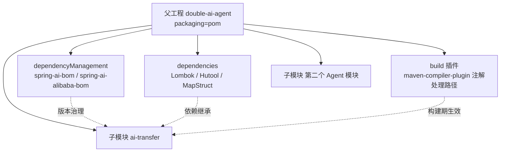

## 【学习目标】

- 独立搭建 `Double-AI-Agent` 父工程：`packaging=pom`、Spring Boot 父版本、Spring AI / Spring AI Alibaba BOM 管理。
- 理解父工程 `dependencies` 与子模块继承机制，会把 Lombok、Hutool、MapStruct 这类公共依赖收敛到父层。
- 理解 Lombok / MapStruct 这类注解处理器为何必须配 `maven-compiler-plugin`，以及 `dependencyManagement` 与 `dependencies` 的本质区别。

## 【正文】

### 一、创建父工程 Double-AI-Agent

打开 IDEA 创建新工程，先把第三章 Graph 讲解用的 Demo 工程关掉。依然创建 Maven 项目，命名为 `Double-AI-Agent`，因为要在一个系统中集成两个 AI Agent（智能库存调拨优化系统之外还有一个并行的 Agent 系统），故取此名。JDK 选择 17，Quick Start 方式创建。

等 Maven 刷新完成后，先处理父工程自身：父工程不需要 `src` 目录，删掉；`packaging` 从 `jar` 改为 `pom`；Spring Boot 版本与第三章 Demo 保持一致，仍使用 Spring Boot 3.3.4。这是多模块工程的基本修养，父工程只做版本治理与依赖收敛，不装任何业务代码。

### 二、用 BOM 管理 Spring AI 版本

第三章 Demo 已经演示过：使用 Spring AI 和 Spring AI Alibaba 的 BOM 来管理版本号。父工程同样引入这两个 BOM，统一管理整个项目的 Spring AI 与 Spring AI Alibaba 版本，课程使用的组合是 Spring AI 1.0.3、Spring AI Alibaba 1.0.0.4。版本管理走 `dependencyManagement`，把 Demo 中验证过的配置直接拷进父 POM。

但真正的企业级项目，父工程只引入这些还不够。考虑实际开发诉求，至少还要补三类东西：

1. **简化样板代码**：自动生成实体类的 get/set，引入 Lombok，版本 1.18.30。两个 Agent 子模块都会用到，直接放进父工程的 `dependencies`（而非 `dependencyManagement`），所有子项目自动继承，无需重复声明。
2. **通用工具包**：Hutool，很多公司都在用，版本 5.8.23，同样放父工程 `dependencies` 全局继承。为此需要补一个属性 `hutool.version`。
3. **POJO 转换工具**：减少「new 出实体后连续调用一串 setter」的重复代码，引入 MapStruct 1.6.2。它与 Lombok 一样被两个子模块共用，放父工程 `dependencies`。注意 MapStruct 是双坐标：除 `org.mapstruct:mapstruct` 外，还必须引入 `mapstruct-processor`，否则注解处理不生效、生成的转换实现类是空的。

父工程 POM 如下（如实保留课程手稿）：

```xml
<project xmlns="http://maven.apache.org/POM/4.0.0"
         xmlns:xsi="http://www.w3.org/2001/XMLSchema-instance"
         xsi:schemaLocation="http://maven.apache.org/POM/4.0.0 http://maven.apache.org/xsd/maven-4.0.0.xsd">
    <modelVersion>4.0.0</modelVersion>
    <parent>
        <groupId>com.cn</groupId>
        <artifactId>double-ai-agent</artifactId>
        <version>1.0-SNAPSHOT</version>
        <packaging>jar</packaging>
    </parent>
    <properties>
        <project.build.sourceEncoding>UTF-8</project.build.sourceEncoding>
        <spring-ai-alibaba.version>1.0.3</spring-ai-alibaba.version>
        <lombok.version>1.18.20</lombok.version>
        <hutool-all.version>5.8.23</hutool-all.version>
        <mapstruct.version>1.6.2</mapstruct.version>
    </properties>
    <dependencies>
        <dependency>
            <groupId>junit</groupId>
            <artifactId>junit</artifactId>
            <version>5.8.1</version>
            <scope>test</scope>
        </dependency>
        <dependency>
            <groupId>org.projectlombok</groupId>
            <artifactId>lombok</artifactId>
            <version>${lombok.version}</version>
        </dependency>
        <dependency>
            <groupId>cn.hutool</groupId>
            <artifactId>hutool-all</artifactId>
            <version>${hutool-all.version}</version>
        </dependency>
        <dependency>
            <groupId>org.mapstruct</groupId>
            <artifactId>mapstruct</artifactId>
            <version>${mapstruct.version}</version>
        </dependency>
        <dependency>
            <groupId>com.alibaba.cloud.ai</groupId>
            <artifactId>spring-ai-alibaba-bom</artifactId>
            <version>${spring-ai-alibaba.version}</version>
            <type>pom</type>
            <scope>import</scope>
        </dependency>
        <dependency>
            <groupId>org.springframework.ai</groupId>
            <artifactId>spring-ai-bom</artifactId>
            <version>${spring-ai-alibaba.version}</version>
            <type>pom</type>
            <scope>import</scope>
        </dependency>
    </dependencies>
    <build>
        <!-- 配置插件等 -->
    </build>
</project>
```

如实说明该手稿与正文叙述之间的出入，实建时按注释修正：其一，`packaging` 应为 `pom`（正文已说明），手稿中残留 `jar`；其二，正文给的版本组合是 Spring AI 1.0.3 + Spring AI Alibaba 1.0.0.4，但代码里两个 BOM 都引用了 `${spring-ai-alibaba.version}`，实际应拆成 `spring-ai.version` 与 `spring-ai-alibaba.version` 两个属性分别管理，否则 Spring AI 的版本会被 Alibaba 的版本号带偏；其三，`lombok.version` 属性写 1.18.20，正文口述为 1.18.30，以较新的 1.18.30 为准；其四，`junit:junit:5.8.1` 这组坐标与版本是错配的，`junit:junit` 是 JUnit 4 的坐标，不会有 5.x 版本号，JUnit 5 的正确坐标是 `org.junit.jupiter:junit-jupiter`，企业实践中直接用 `spring-boot-starter-test` 统一纳入即可，这行是 IDE Quick Start 模板残留，建议删除。

### 三、注解处理器：maven-compiler-plugin

还差最后一块拼图。Lombok 和 MapStruct 都靠注解生效，编译器必须知道去加载这两个注解处理器，否则代码里 `@Data` 不生成方法、`@Mapper` 不生成实现类，且往往要到运行期才暴露问题。因此父工程需要定义 `maven-compiler-plugin`，配置 `annotationProcessorPaths` 注解处理路径，让整个构建能识别这两个注解：

```xml
<build>
    <!-- 用于配置插件，如 Maven Compiler Plugin -->
</build>
```

如实说明：原视频此处展示了完整的 `maven-compiler-plugin` 配置（`annotationProcessorPaths` 中声明 `lombok`、`lombok-mapstruct-binding`、`mapstruct-processor` 三个处理器，`lombok-mapstruct-binding` 用于解决两者联合处理时的注解顺序问题），但转录稿只保留了占位注释，完整内容未捕获。实建时可按此结构补齐：处理器路径不配、版本不受管理，是企业项目里 Lombok + MapStruct 组合最常翻车的地方。

### 四、父工程职责总览



| 机制 | 作用范围 | 语义 | 本节用例 |
|---|---|---|---|
| `dependencyManagement` + BOM import | 仅管理版本，不引入依赖 | 子模块声明坐标时不写 version | Spring AI / Spring AI Alibaba |
| 父工程 `dependencies` | 强制继承 | 子模块无需声明即可用 | Lombok / Hutool / MapStruct |
| `build/plugins` | 构建期行为 | 编译期注解处理 | Lombok + MapStruct |

该三层结构回答了企业工程的核心问题：版本在哪里统一、公共依赖在哪里收敛、构建行为在哪里统一，后续新增子模块时，POM 只需写业务坐标。

## 【易错点 / 面试题】

1. **面试题：`dependencyManagement` 和 `dependencies` 的区别？** 答：前者只「管理版本、不引入依赖」，子模块用到时必须自己声明坐标（但可省略 version）；后者「引入且强制继承」，子模块不声明也能用，想排除得显式 exclusion。把公共工具放 `dependencies`、把版本敏感的基础设施放 `dependencyManagement`，是兼顾统一与灵活的分层。
2. **面试题：为什么 MapStruct 必须同时引 `mapstruct` 和 `mapstruct-processor`？** 答：前者是运行时 API（`@Mapper` 注解），后者是编译期注解处理器，负责生成 `XxxImpl` 实现类。只引前者，编译不报错、运行期找不到实现类，属于典型的「静默故障」。
3. **易错点：把 BOM 的 `import` scope 用成普通依赖。** `<type>pom</type>` + `<scope>import</scope>` 只对 `dependencyManagement` 有效；写进 `dependencies` 不会生效，还会引入奇怪的传递依赖。另外版本属性名不要复用（如两个 BOM 共用一个 `${spring-ai-alibaba.version}`），否则一个组件的版本会被另一个带偏。

## 【小结】

本节完成了 `Double-AI-Agent` 父工程：`packaging=pom` 定位纯版本治理角色，Spring Boot 3.3.4 作父版本，Spring AI / Spring AI Alibaba BOM 走 `dependencyManagement` 统一版本，Lombok、Hutool、MapStruct 下沉到父层 `dependencies` 全局继承，再用 `maven-compiler-plugin` 的注解处理路径把两个注解处理器接进构建。下一节在此骨架上创建第一个业务子模块 `ai-transfer`，落地统一响应体、异常处理与日志规范。

配套工程 `980-demo` 用单模块形态落地了同一套分层思想：`src/main/java/com/carl/ai/transfer/` 下 `domain/model`（数据库实体）、`domain/param`（接口入参）、`convert`（MapStruct 转换层）、`extract`（结构化抽取）、`repository`、`service`、`controller`、`config`、`agent` 各司其职，父工程的「依赖收敛 + 注解处理 + 分层包结构」正是企业多模块项目的缩影，可直接对照 `980-demo/src/main/java/com/carl/ai/transfer/convert/TransferOrderConvert.java` 看 MapStruct 转换层的真实写法。
