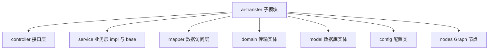

## 【学习目标】

- 按「用到哪儿先定义哪儿」的策略创建业务子模块 `ai-transfer`，并说清每类依赖的来由。
- 搭建企业级分层目录：controller / service（impl + base）/ mapper / domain / model / config / nodes。
- 理解 logback 配置文件在日志规范中的作用，以及统一返回结果 `R<T>` 的设计与重载矩阵。
- 掌握通用模块 `ai-common` 的抽法：哪些代码值得下沉为全项目共享资产。

## 【正文】

### 一、创建子模块 ai-transfer

父工程就绪后，创建第一个子项目 `ai-transfer`（AI 调拨系统），parent 指向 `double-ai-agent`，Quick Start 方式创建。

依赖策略上刻意「用到哪儿就先定义哪儿」：一次性堆齐所有依赖，容易说不清每个依赖的来由，后面排查冲突也困难。当前阶段依赖分三块：

1. 测试依赖，指定 Spring 的 test；
2. `spring-boot-starter-web`，因为后续要创建 Controller 并进行接口调用；
3. Spring AI Alibaba 的 Graph 组件，本项目正是用它来开发 Agent 工作流。

`ai-transfer` 的 `pom.xml` 如下（如实保留课程手稿）：

```xml
<project xmlns="http://maven.apache.org/POM/4.0.0"
         xmlns:xsi="http://www.w3.org/2001/XMLSchema-instance"
         xsi:schemaLocation="http://maven.apache.org/POM/4.0.0 http://maven.apache.org/xsd/maven-4.0.0.xsd">
    <modelVersion>4.0.0</modelVersion>
    <parent>
        <groupId>com.carl</groupId>
        <artifactId>double-ai-agent</artifactId>
        <version>1.0-SNAPSHOT</version>
    </parent>
    <artifactId>ai-transfer</artifactId>
    <packaging>jar</packaging>
    <name>ai-transfer</name>
    <properties>
        <project.build.sourceEncoding>UTF-8</project.build.sourceEncoding>
    </properties>
    <dependencies>
        <dependency>
            <groupId>junit</groupId>
            <artifactId>junit</artifactId>
            <version>3.8.1</version>
            <scope>test</scope>
        </dependency>
        <dependency>
            <groupId>org.springframework.boot</groupId>
            <artifactId>spring-boot-starter-test</artifactId>
            <scope>test</scope>
        </dependency>
    </dependencies>
</project>
```

如实说明两点：其一，`junit:junit:3.8.1` 是 IDE Quick Start 模板的残留坐标（JUnit 3 时代的古董），`spring-boot-starter-test` 已经覆盖了 JUnit 5 测试能力，这行应删除；其二，手稿定格在「测试依赖」这一阶段，正文提到的 `spring-boot-starter-web` 与 Graph 组件将在用到 Controller 与工作流节点时再补，这正是「用到哪儿先定义哪儿」策略的执行现场。

### 二、定义工程目录结构

默认生成的目录结构不够清晰，按企业惯例重组。先创建 `resource` 文件夹存放配置文件，沿用 YAML 风格；创建 `ai.transfer` 两层包，把启动类挪进去，重命名为 `TransferApp`，加上 Spring Boot 注解，主方法同步改为 `TransferApp.class` 与 `args`。

基础包结构及职责如下：

| 包 | 职责 |
|---|---|
| `controller` | 接口层，对外 REST 入口 |
| `service` | 业务层，下分 `impl`（实现类）与 `base`（代码生成器产出的通用 service） |
| `mapper` | 数据访问层 |
| `domain` | param、VO 等传输实体 |
| `model` | 从 `domain` 拆出，专门存放与数据库实体直接对应的 model |
| `config` | 配置类 |
| `nodes` | 后续开发的 Graph 节点 |



`domain` 与 `model` 的拆分值得特别说明：入参（param）与出参（VO）是接口契约，随前端需求变化；`model` 是数据库结构的镜像，随表结构变化。两者分开，改表结构不会波及接口契约，改接口也不会触发数据库迁移，这也是本课配套工程 `980-demo` 中 `domain/param` 与 `domain/model` 分包的原因（见「小结」）。

### 三、定义日志输出格式

引入 logback 配置文件，该文件通用性强，直接拿过来稍作修改即可：其中定义了日志文件的存储路径、应用名字（改成当前项目的名字）、日志输出的格式以及文件日志输出。它本质上是一个「定义日志输出格式」的配置文件，把日志从默认的裸输出规范为带时间、级别、线程、类名的结构化行，为后续排查问题提供统一线索。企业实践中此文件还会进一步扩展分级归档（按天/按大小切分）、级别控制（生产 INFO、调试 DEBUG），本节先落地基础格式。

### 四、通用模块 ai-common 与统一响应体 R

企业级项目必须定义统一的返回结果：给前端的返回格式必须统一，不能每个接口各写一套。为此创建通用 module `ai-common`，parent 同样是父工程。该模块非常简单，POM 可以几乎为空，不需要启动类；目录结构改为 `ai.common` 两层包，在其中定义 `domain` 包，存放 VO 和 param 这类实体。

在 `com.carl.ai.common.domain.vo` 下创建全局统一返回结果 `R<T>`，后续所有接口都会返回它。写法上：`@Data` 注解自动生成 get/set；类上加泛型以容纳任意业务数据；属性包含状态码、消息 `msg` 与数据 `data`：

```java
package com.carl.ai.common.domain.vo;

import lombok.Data;

/**
 * @description: 统一返回结果实体类
 * @author: carl
 * @createDate: 2025-11-24 16:05
 * @since: 1.0
 */
@Data
public class R<T> {
    private String msg;
    private T data;

    public static <T> R<T> success() {
        return r;
    }

    public static <T> R<T> success(T data) {
        R<T> r = new R<>();
        r.setCode(200);
        r.setMsg("success");
        r.setData(data);
        return r;
    }

    public static <T> R<T> success(String msg, T data) {
        R<T> r = new R<>();
        r.setCode(200);
        r.setMsg(msg);
        r.setData(data);
        return r;
    }
}
```

如实说明转录稿的缺漏，实建时补齐：类体中只声明了 `msg` 与 `data`，但 `success(T data)` 等方法调用了 `setCode(...)`，`code` 字段的声明在转录中丢失，完整类应补上 `private Integer code;`；无参 `success()` 的方法体只有一句 `return r;`，缺少前置的 `R<T> r = new R<>(); r.setCode(200); r.setMsg("success");` 三行，无法编译。把握设计意图即可：状态码、消息、数据三位一体，工厂方法收拢构造细节。

### 五、成功与失败的静态方法重载矩阵

静态方法分「成功」与「失败」两族，套路一致、逐层重载。

成功族共三个重载，code 一律写死 200，不对外暴露（成功场景不需要太多变体）：

1. 无参：`R<T> r = new R<>()`，code=200、msg=「success」、data 不传，直接返回；
2. 收 data：new 出来，set 进 data；
3. 收 msg + data：把 msg 改成传过来的值。

失败族默认 code=500、msg=「fail」，再逐层重载：

1. 收 data（泛型），set 进去即可；
2. 收 code + data，失败要把错误码透出去，如参数校验失败 400、业务冲突 409；
3. 收 code + msg + data，状态码、失败消息、数据全量；
4. 只收 code，msg 保持默认 「fail」。

设计原则：成功重载不带 code（省得调用方乱传），失败重载必带 code（错误码是前端分支处理与监控告警的依据）。后面实际用到时若不够，再自行增加，重载矩阵是演进出来的，不是一次设计完美的。

### 六、在 ai-transfer 中引入 ai-common

回到 `ai-transfer`，在依赖中直接写 `ai-common`（注意是作为 `dependency` 引入，不是配 parent），版本由父工程自动生成，刷新即可。验证方式：在启动类里敲 `R.` 能看到静态方法提示，说明引入无误。

## 【易错点 / 面试题】

1. **面试题：为什么要统一返回结果，直接返回 POJO / Map 不行吗？** 答：统一响应体把「状态码、消息、数据」的契约固定下来，前端可以写一套拦截器统一处理错误码与登录过期；接口监控、日志埋点也有一致的抓手。返回裸 POJO 的接口，错误只能靠 HTTP 状态码与异常栈表达，前后端联调成本陡增。配套工程 `980-demo/src/main/java/com/carl/ai/transfer/controller/TransferController.java` 即遵循该分层，接口层只做参数接收与编排触发。
2. **面试题：`ai-common` 这种通用模块该放什么、不该放什么？** 答：放与业务无关的横切资产：统一响应体、错误码枚举、工具类、基础注解。不放任何业务实体，一旦 `ai-common` 反向依赖某个业务模块，多模块工程就会成环，Maven 直接构建失败。
3. **易错点：把 `R` 当异常处理机制用。** 统一响应体只负责「正常返回时的格式统一」，异常要走 `@RestControllerAdvice` 全局捕获后也转成 `R` 返回，两者是配合关系。只定义 `R` 而不配全局异常处理，接口抛异常时仍然是 Spring 默认的 500 + 栈信息，前后端契约依旧不一致。

## 【小结】

本节完成基础框架封装三件套：按「用到哪儿先定义哪儿」创建 `ai-transfer` 子模块；重组企业分层目录（controller / service·impl·base / mapper / domain / model / config / nodes）；引入 logback 规范日志输出；抽出 `ai-common` 通用模块并定义统一返回结果 `R<T>` 及成功/失败重载矩阵。日志规范与统一响应体是接口质量的底线，后续章节的 Controller 都将复用这套底座。

配套工程 `980-demo` 落地了同一套分层：`src/main/java/com/carl/ai/transfer/controller/TransferController.java` 是接口层（自然语言创建调拨单入口），`src/main/java/com/carl/ai/transfer/service/TransferOrderServiceImpl.java` 是业务层（抽取 → MapStruct 转换 → 落库编排），`src/main/java/com/carl/ai/transfer/domain/param/TransferOrderParam.java` 与 `domain/model/BbTransferOrder.java` 则演示了本节「domain 与 model 拆分」的落地形态，入参契约与数据库实体各改各的，互不波及。
