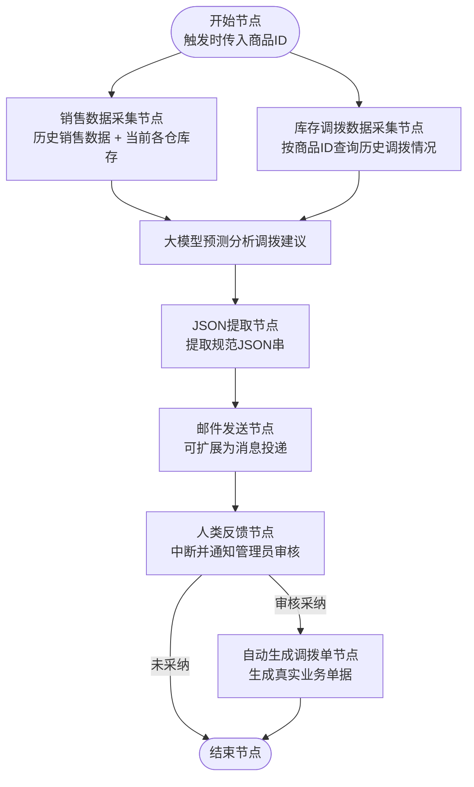

## 【学习目标】

- 理解「先图纸后代码」的 Graph 工作流设计方法，能独立画出智能库存调拨 Agent 的全链路图。
- 掌握七个节点的职责划分：哪些节点接触大模型，哪些只做业务数据整合。
- 理解并行采集、数据汇合、人类反馈中断、条件分支四类控制在流程中的作用。
- 能根据企业实际（数据维度、消息渠道）对流程做合理扩展。

## 【正文】

### 1. 为什么先画图纸

本节讲解绘制智能调拨的执行图纸，也就是 Graph 工作流的全链路设计。

在进行真正的 Agent 开发之前，应先规划好 Agent 如何执行：明确有多少个节点、各节点承担什么任务。设计思路清晰之后，代码只是设计的翻译。这正是选用 Spring AI Alibaba Graph 开发工作流的架构价值，它把开发者从「接到需求就 CRUD」的惯性中拉出来，转而思考怎样在传统业务中整合引入 AI Agent。

本课程的重心正在于此：重心放在如何把 AI Agent 开发整合到原有企业级系统当中，而不是放在原有企业级项目如何开发上。用 Spring Boot 或 Spring Cloud 搭 CRUD 系统的资料已足够多，那些属于传统系统；这里要解决的是 Agent 与存量业务的整合。

还有一点承接关系：图纸中的每个采集节点，最终都落在 4-5 用代码生成器生成的 Mapper / Service 之上，先有数据层地基，图纸才落得下去；图纸又是后续 5-1 全局状态机 key 规划的依据。

### 2. 全链路流程设计

触发方式：传统业务系统触发 Agent 执行时，流程从开始节点出发，并行进入两个采集节点，汇合后交给大模型节点，再经 JSON 提取、消息投递、人类反馈中断，最终按审核结果分流。

各节点职责与是否接触大模型的划分：

| 节点 | 职责 | 是否接触大模型 | 输入 → 输出 |
|---|---|---|---|
| 销售数据采集 | 采集商品历史销售数据、当前各仓剩余库存 | 否 | 商品ID → 销售/库存数据 |
| 库存调拨数据采集 | 按商品ID查询历史库存调拨记录 | 否 | 商品ID → 调拨历史 |
| 大模型预测分析调拨建议 | 基于整合后的数据上下文预测调拨建议 | 是 | 上下文数据 → 建议文本 |
| JSON 提取节点 | 从建议文本中提取规范 JSON | 是 | 建议文本 → JSON 串 |
| 邮件发送（消息投递） | 把建议与依据投递给管理员 | 否 | JSON → 邮件/消息 |
| 人类反馈节点 | 中断流程，等待管理员审核 | 否 | - → 审核结论 |
| 自动生成调拨单 | 生成业务系统真实调拨单并入库 | 否 | JSON → 调拨单记录 |

### 3. 设计要点拆解

**并行采集。** 开始节点之后并行进入两个节点。第一个节点「销售数据采集」负责采集触发此行为的商品的历史销售数据情况，以及该商品当前在各个仓库剩余的库存情况；第二个节点「库存调拨数据采集节点」根据触发时传过来的商品 ID，查询该商品在历史上发生过的库存调拨情况。两者互不依赖，并行执行缩短整体耗时，采集结果汇合后统一交给下一个节点。

**前两个节点不接触大模型。** 它们是纯业务层开发：从原有系统查出企业内部数据，作为一种上下文提供给大模型，让大模型知道；到第三个节点才需要和大模型交互，借助其思考能力，根据给定的数据上下文进行分析，预测出一种调拨建议。

该分工值得强调：大模型本身不掌握任何企业数据，喂给它的上下文质量直接决定建议质量。「AI 整合原有系统」的典型形态正是如此，AI 负责思考，原有系统负责事实。

**JSON 提取节点。** 为什么单独设计一个提取节点？因为后续「自动生成调拨单」节点要生成业务系统真正的业务调拨单：通过 JSON 对象转成对应实体，保存到数据库。大模型输出是自由文本，直接转实体随时可能失败。提取节点从调拨建议中提取出想要的 JSON 格式，保证后续转实体这一硬依赖不出错。

**邮件发送节点。** 该节点本质是消息推送节点，渠道按公司实际替换：公司使用企业微信，就在这里整合企业微信的消息投递；使用飞书或钉钉，就结合内部办公软件做消息投递；外企日常邮件使用频率高，课程选用邮件。节点对外只依赖「发送内容」与「收件人」两个抽象，换渠道不改动上游节点。

**人类反馈节点。** 流程执行到此处发生中断：让它不要继续往下走，而是通知管理员，等待审核。这是 Human-in-the-loop（人类在环）设计，调拨单涉及真实库存变动，不能由模型单独拍板。审核通过则经条件分支判断，进入「自动生成调拨单」节点，生成真正的业务调拨单据；管理员未采纳大模型生成的调拨意见，流程直接走到结束节点。条件分支把人的决策变成了流程的一条显式路径。

### 4. 从图纸到 Graph：概念映射

图纸上的每种控制结构，在 Spring AI Alibaba Graph 中都有对应物。提前建立这层映射，编码时就不会「拿着图找不到 API」：

| 图纸概念 | Graph 对应物 | 说明 |
|---|---|---|
| 节点 | `NodeAction`（经 `AsyncNodeAction` 包装为异步） | 每个节点实现 `apply(OverallState)`，读状态、写状态 |
| 全局数据 | `OverallState` + `KeyStrategyFactory` | 节点间不直接传参，统一经状态机读写 |
| 顺序边 | `addEdge(from, to)` | 单向直连 |
| 并行分叉 | 同一 START 连出多条边 | 两个采集节点并行执行，结果汇合 |
| 汇合 | 下游节点依赖多个上游 key | 预测节点同时用到两类采集结果 |
| 条件分支 | 条件边 | 按人类反馈的审核结论选择走向 |
| 中断等待 | 外部事件回填后驱动后续 | 管理员审核即中断恢复事件 |
| 结束 | 结束节点 | 流程终点 |

并行执行的价值在本流程中很直观：两个采集节点彼此无依赖，串行会让总耗时翻倍；包装成 `AsyncNodeAction` 后由框架并行调度、汇合后再进入预测节点。

中断 + 条件分支的组合是「Human-in-the-loop」的标准形态：模型给出建议，人做决策，流程按决策分流。这类设计在企业场景几乎是刚需，任何涉及资金、库存、对外消息的自动化，都必须留人工确认位。

### 5. 消息渠道对照

邮件发送节点可替换为任意办公软件投递，选型只看公司现状：

| 渠道 | 适用场景 | 改造点 |
|---|---|---|
| 邮件 | 外企、正式通知留痕 | 课程默认实现 |
| 企业微信 | 国内企业默认办公工具 | 替换发送实现为企业微信 Webhook |
| 钉钉 | 已建钉钉审批流的企业 | 替换发送实现为钉钉机器人 |
| 飞书 | 使用飞书套件的团队 | 替换发送实现为飞书机器人 |

共同点：上游只交付「内容 + 收件人」，渠道差异全部收敛在发送实现内。

### 6. 可扩展点

流程保留了两个明确的扩展位：

1. **采集维度可扩展。** 销售数据与调拨历史只是引子：把商品的这两种数据作为上下文告诉大模型进行分析。公司实际情况需要与业务部门对齐，他们如何分析、需要什么前置数据，可能还会有更多数据采集节点，这里可以扩展。每个新维度就是一个新的并行采集节点。
2. **消息渠道可扩展。** 邮件发送节点可泛化为消息投递节点，按公司办公软件接入企业微信 / 飞书 / 钉钉。

## 【易错点 / 面试题】

1. **面试题：为什么前两个采集节点不让大模型参与？**
   两个节点的职责是「取事实」而非「做判断」。大模型不掌握企业内部数据，把查询交给它反而引入幻觉风险；先由业务系统查准数据，再把数据作为上下文喂给模型，是可控性最高的分工。
2. **面试题：人类反馈节点中断后，流程靠什么恢复？**
   靠外部事件驱动：管理员审核后调用接口回填结果，条件分支依据回填的审核结论选择后续路径。设计上要保证中断态可持久化，否则服务重启后流程丢失，待审单据无人跟进。
3. **面试题：并行采集节点如何保证数据完整汇合？**
   两个采集节点经 `AsyncNodeAction` 并行执行，各自把结果写入状态机的不同 key；下游预测节点依赖这些 key，框架在汇合点等待全部上游完成后再放行。节点间不直接传对象，全部经状态机解耦。
4. **易错点：把消息发送写死成单一渠道。** 公司改用企业微信时节点就得返工。对外只依赖内容与收件人两个抽象，渠道做成可替换实现。

## 【设计评审清单】

图纸定稿前，用四个问题自查：

1. **节点职责是否单一？** 一个节点只做一件事，取数、调模型、提取、投递、确认，不混逻辑。
2. **大模型接触面是否最小？** 只有必须「思考」的节点才接触模型；取事实的节点一律走业务系统。
3. **关键依赖是否有兜底？** 下一步强依赖上一步格式时（建议 → JSON → 实体），中间必须有格式收敛节点。
4. **人的决策位是否显式？** 涉及真实业务后果的动作（生成调拨单、对外发送）必须经人类反馈节点确认。

## 【小结】

本节给出智能库存调拨 Agent 的全链路图纸：并行采集 → 汇合 → 大模型预测 → JSON 提取 → 消息投递 → 人类反馈中断 → 条件分支决定是否生成真实调拨单。

从下一节 5-1 开始进入编码：先定义全局状态机（`KeyStrategyFactory`、各节点读写的 key），再按本节图纸逐个实现节点。工程侧 `980-demo/src/main/java/com/carl/ai/transfer/agent/TransferAgent.java` 把「大模型生成 → 抽取 → 入库」串成可运行的最小闭环，与图纸后半段一一对应。
