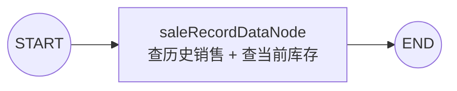

## 【学习目标】

- 把采集节点接入 `StateGraph`：`addNode` + `addEdge` + `compile` 的全流程。
- 掌握 `KeyStrategyFactory` 与 `ReplaceStrategy` 对状态机 key 写入语义的控制。
- 编写触发接口：初始 `Map` 只放 `productId`，用 `graph.execute` 驱动工作流。
- 建立节点测试方法：`@MapperScan` 补扫、日志分级、SQL 打印、JSON 结构核验。

## 【正文】

### 1. 补上 DAO 注入与调用

`group by` 写完之后回头看实现类，会发现 DAO 层还没有注入、也没有实际调用，不调用肯定是不行的。所以在 Service 实现里注入 DAO 并真正调用它，直接把查询结果 `return` 回去，这样前面这几步才能正常串起来执行。

### 2. 采集库存并转成 JSON

接着继续：查询商品当前的所有库存。这里只需要加一个 `where` 条件，库存表里的商品 ID 和传入的商品 ID 相等即可，通过 `list` 方法就能拿到对应的库存数据列表。

同样地，把库存列表也规范地转成 JSON 数据格式再传给大模型，让大模型更好理解。转换依然使用 Hutool 工具包的 `JSONUtil` 完成。

该 key 叫什么名字？到图的 key 定义里看一下，对应的是 `nowProductInventoryData`，直接沿用该名称；同时照例加上日志，方便打印查看。返回的 `Map` 里也要将该 key 补上：

```java
@Override
public Map<String, Object> apply(OverallState state) throws Exception {
    String productId = state.value("productId", defaultValue = "");
    if (StringUtils.isBlank(productId)) {
        return Map.of();
    }
    List<SaleRecordVo> saleRecordVos = saleRecordService.collectSaleRecordByProductId(Integer.parseInt(productId));
    String saleRecordData = JSONUtil.toJsonStr(saleRecordVos);
    log.info("saleRecordData={}", saleRecordData);

    List<BIInventory> inventoryList = bbInventoryService.list(Wrapper.<BIInventory>lambdaQuery().eq(BIInventory::getProductId, productId));
    String nonProductInventoryData = JSONUtil.toJsonStr(inventoryList);
    log.info("nonProductInventoryData={}", nonProductInventoryData);

    return Map.of(
        "saleRecordData", saleRecordData,
        "nonProductInventoryData", nonProductInventoryData
    );
}
```

代码块里库存数据的 key 写作 `nonProductInventoryData`，与正文说明的 `nowProductInventoryData` 不一致。命名漂移的后果是静默的：写入端与读取端对不上时，`state` 里取出来是 `null`，不报错但数据丢失，直到下游节点拿不到数据才暴露。以图的 key 定义为准统一两端，是接入新节点时的必查项。另外，`state.value("productId", defaultValue = "")` 中的命名参数写法不是合法 Java，应为 `state.value("productId", "")`，按语言规范修正后才能编译。

到这一步其实还不能测试：因为新增了一个 DAO 层，它是通过 `@Mapper` 注解标识的，所以还需要在主启动类的 `@MapperScan` 里将该包路径也加上，让 DAO 里的 Mapper 也能被扫描到。

加上之后再检查一遍两个查询：商品的历史销售数据查了，商品现在的库存数据也查了，都齐了。

### 3. 把节点接入图

接下来怎么测试？先在图里增加该节点，命名为 `saleRecordDataNode`，还是通过 `NodeAction` 的静态方法把自定义的节点传进去。节点需要接收两个接口，所以在配置里做注入：第一个注入自己写的 `SaleRecordService`，第二个通过 `@Resource` 注入 `BbInventoryService`，然后把这两个接口传给节点即可，异常照常往外抛：

```java
@Configuration
public class GraphConfig {
    @Resource
    private SaleRecordService saleRecordService;
    @Resource
    private BIInventoryService bbInventoryService;

    public void graph() throws GraphException {
        KeyStrategyFactory keyStrategyFactory = new KeyStrategyFactory();
        @Override
        public Map<String, KeyStrategy> apply() {
            return Map.of(
                "productId", new ReplaceStrategy(),
                "nonProductInventoryData", new ReplaceStrategy()
            );
        }
    }

    StateGraph stateGraph = new StateGraph(name = "InventoryTransferGraph", keyStrategyFactory);
    stateGraph.addNode("saleRecordDataNode", new CollectSaleRecordNode(saleRecordService, bbInventoryService));
    stateGraph.addEdge(StateGraph.START, "saleRecordDataNode");
}
```

这段图配置草稿带着明显的未完成痕迹：`apply` 方法体内出现 `@Override`、`new StateGraph(name = "InventoryTransferGraph", keyStrategyFactory)` 使用命名参数写法，都不是合法 Java；key 列表也漏了 `saleRecordData` 的策略声明。按课程意图，这段应整理为标准 Java 写法：`KeyStrategyFactory` 以匿名内部类或 lambda 提供「key → 策略」映射，`StateGraph` 构造使用位置参数，节点通过静态工厂注册后用 `addEdge` 串联，最后 `compile` 返回 `CompiledGraph`。

节点加好之后往图里加边：先加一条边，让 `START` 连向该节点；再加一条边，让第一个节点直接连到结束。这样当前工作流里其实只含一个节点，可以先验证该节点执行起来是什么效果。

图配置完之后调用 `compile` 方法进行编译，把编译后的返回值 `return` 出去。



状态机 key 一览：

| key | 写入方 | 策略 | 用途 |
|---|---|---|---|
| `productId` | 接口初始值 | `ReplaceStrategy` | 触发参数 |
| `saleRecordData` | `saleRecordDataNode` | `ReplaceStrategy` | 历史销售 JSON |
| `nowProductInventoryData` | `saleRecordDataNode` | `ReplaceStrategy` | 当前库存 JSON |

`ReplaceStrategy` 的含义：同一 key 被再次写入时整体覆盖。本图中三个 key 各由单一来源写入，覆盖语义最直接；`KeyStrategyFactory` 在图编译期确定，运行期不可变，这也解释了为什么 key 声明必须提前想全，漏声明的 key 连写入都会成问题。

### 4. 编写测试接口

然后在 Controller 里写对应的测试方法。新建 `SaleProductController`，作为商品销售时的接口，加上 `@RequestMapping("/saleProduct")`。先把定义好的图注入进来，再写一个 `@GetMapping("/sale")` 用于测试，返回值先用 `void`，等后面确定要返回什么之后再补上：

```java
@RestController
@RequestMapping("/saleProduct")
public class SaleProductController {
    @Resource
    private CompiledGraph graph;

    @GetMapping("/sale")
    public void sale(@RequestParam String productId) {
        // 调用编译好的状态图
        graph.execute(Map.of("productId", productId));
    }
}
```

接口需要接收一个参数，也就是传过来的商品 ID `productId`。拿到之后就可以调用图的执行方法，把 `Map` 传进去作为状态机的初始值（key-value 形式的初始值）这里只需要往状态机里初始化 `productId` 就够了。执行完之后通过 `get` 方法可以拿到 `OverallState`，把里面的 `data` 返回即可。

「初始值最小化」是状态机编程的要点：初始 `Map` 只放触发参数，其余数据全部由节点产出。好处是节点职责清晰、状态可回放，同一份初始输入必然走出同一条路径，便于测试与复盘。

另外，虽然这里加了 slf4j 注解并在节点里打印了日志，但最好还是在配置文件里把日志级别明确定义一下：`logging.level` 的 `root` 开到 `info`，同时把 `com.carl.ai.transfer` 下面的日志也开到 `info` 级别。

日志级别分两层配：`root` 管框架（Spring、MyBatis 的 SQL 打印），包级管业务。业务日志被框架日志淹没时，先提包级、再压框架级，是联调期的基本功。

### 5. 启动验证

到这里就可以启动项目跑一下了。项目端口是 `8876`，请求地址就是 `localhost:8876` 加上 Controller 的前缀，再加上 `/sale`，传入 `productId`。该值不能随便写，需要去数据库里看通过 SQL 插入脚本生成的商品数据有哪些，id 为 1 的商品是存在的，如果写 6，那肯定是查不到的。

请求回车之后，接口已经返回结果了。看一下日志：先是执行的 SQL（因为开启了 MyBatis Plus 的 SQL 打印，所以日志里会有完整语句），再是这里定义的日志打印出来的内容。

把生成的 JSON 拷出来，打开 `json.cn` 看一下结构。先看历史销售数据，例如这两条：

```json
{
  "productId": "P001",
  "productName": "智能手环",
  "warehouseId": 2,
  "warehouseCode": "WH002",
  "warehouseName": "华南仓",
  "totalSaleQty": 185
}
```

```json
{
  "productId": "P001",
  "productName": "智能手环",
  "warehouseId": 3,
  "warehouseCode": "WH003",
  "warehouseName": "华东仓",
  "totalSaleQty": 237
}
```

23 年第一季度、1 号仓库卖了 378；23 年第一季度、2 号仓库卖了 195；24 年第二季度、3 号仓库卖了 237，这就是商品的历史销售数据。

再看当前的库存数据：该商品在 3 个仓库当中都有库存，分别是 128、221 和 160，查询结果也没有问题。

JSON 结构核验看三点：字段名与 VO 声明一致（无丢失）、值与数据库原始记录对得上（无错映射）、时间维度（`year`/`quarter`）正确（分组生效）。三项都对，「采集 → JSON 化」这段才能交给下一个节点使用。

接下来就按照这些数据的情况，继续开发工作流里的下一个节点，商品对应的历史库存调拨情况，同样把它喂给大模型，让大模型拿到更多的数据，从而更好地分析并预测将来的库存调拨单。

## 【易错点 / 面试题】

1. **面试题：`KeyStrategyFactory` 是做什么的？** 它为状态机每个 key 声明写入策略（如 `ReplaceStrategy` 覆盖写），在图编译期固化，运行期不可变。多个节点写同一 key 时，策略决定最终值是覆盖还是保留首个，是工作流数据一致性的第一道闸。
2. **易错点：新增 `@Mapper` DAO 后忘记配 `@MapperScan`。** 启动不报错，调用时抛「Invalid bound statement (not found)」。DAO 包路径与启动类扫描范围不一致是经典联调坑，报错栈指向 statement id，根因却在扫描配置。
3. **易错点：节点写入 key 与图定义 key 命名漂移。** 写入 `nonProductInventoryData`、读取 `nowProductInventoryData`，结果静默为 `null`。接入新节点时，对照 key 定义表逐项核对写入端与读取端。

## 【小结】

本节把采集节点接入状态机并跑通首次测试：`saleRecordDataNode` 一次采集「历史销售 + 当前库存」两份 JSON，`START → 节点 → END` 的最简图验证了「DAO 查询 → `JSONUtil` 序列化 → 写入 `state`」的链路；`@MapperScan` 补扫 DAO 包、日志分级、初始值最小化三个细节，决定了测试能否一次通过。

节点编排的等价实现可对照 `980-demo/src/main/java/com/carl/ai/transfer/agent/TransferAgent.java`（把「抽取 → 入库」封装为单个节点动作）与 `980-demo/src/main/java/com/carl/ai/transfer/controller/TransferController.java`（入口触发）。

下一篇继续补数据：把商品的历史库存调拨情况也喂给大模型。
