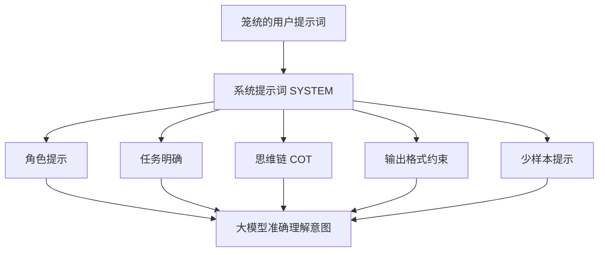

## 【学习目标】

- 复现「大模型听不懂要求」的三类典型失败：自由发挥、答非所问、复述投喂数据
- 掌握五种提示词优化技术：角色提示、任务明确、思维链（COT）、输出格式约束、少样本提示
- 能把「提示词调优」讲成面试中的项目亮点，而不是一句轻描淡写的「我会写 Prompt」

## 【正文】

### 一、问题复现：三次翻车现场

上一节演示的 IO 超时问题说明了一件事：调用大模型时必须使用流式编程，而不能直接用 `call()` 做阻塞式调用，否则大模型就可能超时。

接下来再演示另一个比较坑的地方。这里已经提前把大模型改回了 Ollama 的 `qwen2:0.5b`，执行一下 `ollama list` 可以看到，它只有三百多兆，是一个非常小的模型，正好用它来复现问题。

启动项目（端口 `8876`），在浏览器里调用销售接口，传入 `productId`（数据库里还是选商品一），多执行几次，把每次生成的建议保存下来对比分析。

第一次执行返回的结果里，开头是「尊敬的销售团队和管理层……严格遵守订单处理流程」。问题是，我们根本没有给它提供过这样的文件，它却自己按「订单处理流程」发挥了；而且它也没有说明具体怎么调拨，虽然列了几点支持，但完全没有说把什么商品、从什么仓库、调到什么仓库。

第二次生成的内容更离谱：让我们「创建一个公司账户，并设置授权码」，这根本不是我们想要的东西。

第三次虽然看起来像模像样，但注意那一段其实是我们投递给它的调拨单数据，不信可以搜一下 `P001`，那正是我们喂给它的原始数据，它只是把投喂的内容又展示了一遍，同样没有给出具体的调拨方案。

三次失败归纳如下：

| 失败类型 | 现场表现 | 根因 |
|---|---|---|
| 自由发挥 | 按「订单处理流程」自行作文，引入从未提供的背景 | 没有角色与任务边界，模型用先验知识填空 |
| 答非所问 | 让创建公司账户、设置授权码 | 需求描述缺失，模型自行猜测目标 |
| 复述输入 | 把投喂的 `P001` 调拨数据原样贴回 | 只给了材料、没给指令，模型默认「整理材料」 |

三种失败指向同一个诊断：不是模型坏了，是「要求」缺位。把同样的输入配上一份结构完整的系统提示词，同一个 0.5B 模型的输出会发生质变，这句话是下一节代码演示的预言。

### 二、关键认知：先修提示词，再谈换模型

这就引出了一个关键问题点：**当大模型听不懂你的要求时怎么办？**

这也是 PPT 里列出的问题点，这些点很可能就是面试时面试官提问的地方，同时也是你的项目亮点。面试官可能会问「项目有什么亮点」「有什么优化点」，也可能直接问「大模型听不懂要求时怎么办」。

先自己思考一下，再来看怎么对线面试官：**使用提示词优化技术来实现大模型输出准确率的提升**。具体到代码层面，就是通过多种提示词优化技术对提示词做调优，让大模型能够更好地读懂我们的要求。

关键问题其实出在程序员身上，我们没有给它一个好的提示词模板，所以它听不懂要求。回到大模型的代码里看：定义提示词时我们只给了一个用户输入，直接说「你帮我生成这样的一个调拨意见」。提示词太笼统、太宽泛，需求不明确，导致大模型不能很好地理解我们想要什么。

一个反直觉但重要的结论：**输出质量的上限由提示词决定，模型只是执行者**。同样的 0.5B 模型，提示词从一句「帮我生成调拨意见」升级为带角色、任务、步骤、格式、样本的系统提示词后，输出可用性会发生质变。把责任推给「模型不够聪明」是最省事的归因，也是最没有增长的解释，聪明的用法能让普通模型达标，笨拙的用法能让顶级模型跑偏。

解决方法是给它加上系统级别的提示词，也就是 `SYSTEM`。在系统提示词里，可以使用多种提示词优化技术来做优化。文档中已经提供了这份系统提示词，但建议大家不要直接复制粘贴，一定要自己手动编写，刚开始做 AI 开发时提示词可能写不好，但它极其重要：提示词写得好，大模型就能准确理解你的意图并执行；写得笼统不明确，大模型不知道你想要什么，生成的东西自然不是你想要的。

为什么强调「自己手动编写」？因为提示词是与业务契约绑定的工程产物，不是可搬运的文本。抄来的提示词没有经过你对「模型哪里会误解」的预判，出了问题也无从改起。自己写一遍、被模型打脸几次，才知道每个条款在防哪一种失败。

### 三、五种提示词优化技术逐段拆解

下面逐段拆解这份系统提示词用到的优化技术。

**第一，角色限制。** 这本身就是一种提示词优化技术，叫做角色提示。这里我们给它的角色是：「你是一个专业的供应链分析师和库存管理专家，擅长基于销售数据和季节趋势，然后进行精准的库存预测和调拨规划」。给它明确的角色定位，就属于角色提示的优化方案。

角色提示为什么有效？模型训练数据里，「供应链分析师」语境下的文本分布，术语、口径、分析框架，与「通用助手」截然不同。角色声明相当于在推理时把模型的条件分布切换到更贴近任务的区域，无需任何训练。这也是投入产出比最高的一招：一句话，换一个专家。

**第二，明确任务。** 让它清楚自己要干什么：基于提供的商品历史销售数据和商品历史库存调拨数据、当前库存状况和日期信息，严格基于用户提供的销售数据和库存数据进行分析，分析销售模式、预测未来需求，并生成一份科学合理的库存调拨单。通过任务定义把大模型要做的事情讲清楚，比之前简简单单一句「帮我生成一份调拨意见」要详细得多。提示词越详细越精准，对大模型的生成效果就越好。

「严格基于用户提供的数据」这句不是客套，是防幻觉的第一道闸，它把模型的素材范围从「全部训练知识」收缩到「本次输入」，超出范围的内容应当被标注为假设而非事实。素材边界不清，是模型开始「自由发挥」的直接诱因。

**第三，给出分析要求。** 这里用到的是分步思考，术语上属于思维链，也就是 COT（Chain of Thought）的提示词优化方案：让大模型根据逻辑一步一步推理复杂问题。我们告诉它第一步怎么做、第二步怎么做，等于手把手教它思考：

- 第一步，分析销售模式：识别销售的季节性规律和趋势，分析促销活动对销售的影响程度，计算季度环比增长率和同比增长率；
- 第二步，需求预测：基于历史数据和当前季度位置，预测未来周期的需求量，考虑季节性因素和增长趋势，评估预测的不确定性范围；
- 第三步，库存优化计算：计算各仓库的安全库存水平，减少库存积压与缺货的风险，识别库存过剩或不足的仓库，确定所有的库存分配方案。

三步拆解把「生成调拨建议」黑箱目标拆成了可执行清单。COT 有效的直觉：调拨建议是「先分析、再预测、后计算」的复合任务，模型若跳过中间步骤直接输出结论，中间量的缺失会让结论失去依据；显式给出步骤，等于要求模型把中间推理也生成出来，结论质量随之提升。这与人工分析调拨问题的思路完全一致，照着老师傅的 checklist 走，新手也不会漏项。

**第四，指定输出格式。** 回头看刚才 Word 文档里保存的三次结果，每次生成的格式都不一样：有纯文本的，有 Markdown 风格带代码块的，还有另外一种纯文本的，格式完全不固定。所以我们要通过输出要求来约束它，让它以严格的格式输出：生成一份格式化的库存调拨单，输出结果以 JSON 格式输出，便于系统解析，明确规定必须以 JSON 格式返回，不要给纯文本。

同时一定要告诉它边界：不可凭空虚构数据，若数据不足请说明假设。这在一定程度上可以防止幻觉，但幻觉问题无法彻底规避，仅靠这么一句规定肯定不能完全避免，不过能起到一定的改善作用。此外还要要求它始终输出清晰、可直接用于业务系统的数据结构，JSON 格式数据中禁止出现运算。

「禁止出现运算」这一条尤其值得圈出来：大模型做算术并不可靠，`245 - 98 = 147` 这种中间计算一旦口算错误，整条建议的数据基础就塌了。正确姿势是把计算放进代码里，Java 侧算完再喂，模型只负责基于数字做判断。这是「LLM 负责理解、程序负责精确」分工原则的缩影，也是面试中区分「玩具玩家」与「工程选手」的一道暗线。

这里的演示只涉及两个仓库之间的调拨，也就是由一个仓库调到另一个仓库。如果想扩展，可能会涉及从一个仓库调到两个仓库，比如从华北仓调到华东仓和华南仓，当前只是简单演示，只让它做两个仓库之间的调拨。

另外，我们要求它把详细的解释说明放到 `comment` 字段当中。

把解释塞进 `comment` 字段是一举两得的设计：对外它是结构里的字段，机器可解析；对内它是模型的「思考留痕」，出了问题能溯源它当时基于什么数据得出结论。缺少该字段，调拨建议就是一个只能盲信的黑箱数字。

**最后是输出的示例结构**，这又是一种提示词优化方案，叫做**少样本提示**：给它少量样本，教它该怎么生成。通俗易懂地说，就是我们去教它。这部分内容现在看着可能有点模糊，等后面讲完再回头看就会更明确：这里给它指定的 JSON 输出结构，完全对应后续创建实际调拨单时需要的 `param` 参数，我要生成什么样的参数，就让它按什么格式输出。这里先有个印象，等到讲如何生成实际业务单据时，可以再翻回来看这份提示词。

五种技术的分工可以归纳成一张表：

| 技术 | 解决的问题 | 本项目中的对应 |
|---|---|---|
| 角色提示 | 模型用通用知识跑偏 | 供应链分析师与库存管理专家 |
| 任务明确 | 目标模糊、素材边界不清 | 基于四类数据生成调拨单，严格基于所给数据 |
| 思维链（COT） | 复合推理跳步、结论无依据 | 销售模式 → 需求预测 → 库存优化三步 |
| 输出格式约束 | 结果机器不可解析、算术不可靠 | 严格 JSON、禁止运算、解释入 `comment` |
| 少样本提示 | 结构与风格不确定 | 给出 JSON 输出结构样本 |

少样本提示的样本不是随手写的：示例结构对应后续 `param` 参数，希望模型产出什么，就按什么格式示范。这形成了一条隐藏的对齐链：提示词示例 → 模型输出 → `param` POJO → MapStruct 转换 → 落库字段。链条每一环的形状，都在提示词里预先声明。这也解释了 5-9 中「生成结构示意」代码块的价值：契约先行，实现随后。

搞清楚这些之后，就可以做代码层面的演示了。

## 【易错点 / 面试题】

1. **面试题：大模型听不懂你的要求怎么办？** 分三层回答：① 提示词层，补角色、任务、步骤、格式、样本五件套（本节内容）；② 模型层，换用指令遵循能力更强的模型（下一节演示 0.5B 到 3B 的对比）；③ 工程层，结构化输出约束加重试降级，如 `980-demo/src/main/java/com/carl/ai/transfer/extract/TransferOrderExtractor.java` 中用 `call().entity(TransferOrderParam.class)` 把输出直接绑定 POJO。三层递进，比单说「写提示词」完整得多。
2. **面试题：为什么「禁止出现运算」要写进提示词？** 模型算术不可靠，口算错误会污染整条建议。精确计算必须前移到代码侧。面试里能主动区分「模型的活」与「代码的活」，是工程成熟度的信号。
3. **面试题：少样本提示的样本从哪来？** 从下游消费方的数据结构反推，本例即后续建单需要的 `param`。凭空编样本会让模型学会一个系统里并不存在的结构，反而制造返工。

## 【小结】

本节复现了 0.5B 模型的三类失败表现，把根因定位到提示词缺位，并逐段拆解了系统提示词中的五种优化技术：角色提示、任务明确、思维链、输出格式约束、少样本提示。下一节进入代码层：把这套提示词组装进 `ChatClient` 调用，换用更聪明的模型，并对比输出质量的变化。
