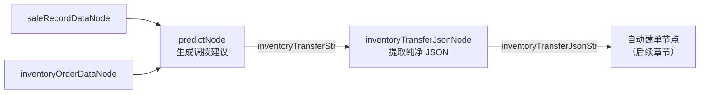

## 【学习目标】

- 理解「模型输出夹带非 JSON 文本」对下游自动建单的阻塞，确立 JSON 提取节点的必要性
- 完成从 Ollama 到云端千问3 Max 的模型切换：依赖、配置，以及对 `api-key` 管理的工程认知
- 开发提取节点：从状态机取上游产出，再借一次模型调用提取纯净 JSON，写回新的 key

## 【正文】

### 一、问题：JSON 串被「私货」包围

大模型生成的两次调拨情况每次都不一样，也无法判断哪个对哪个错。PPT 里已列出该问题点：调拨建议生成时，如果大模型胡编乱造怎么办，也就是出现了幻觉怎么办。这部分后面会讲，为了保证课程连贯性先放在后面，这里还是按原定安排往下走。

先打开代码看：大模型生成的内容里确实有一个 JSON 串，但除了该 JSON 串之外，它还输出了一些其他东西，而它们并非全部被需要，真正要拿走的是其中的 JSON 串，方便后续自动建单节点转成实体、保存到数据库。

所以接下来进入下一个节点的开发。至于它生成得是否正确先不管，反正它已经按要求生成了 JSON 串，先把 JSON 串拿到手，怎么优化放到后续章节讲解。

该推进顺序本身就是工程纪律：先保证「拿得到」，再追求「拿得对」，链路没打通就纠结质量，往往两头落空。另外注意责任边界：提取节点只负责分离 JSON，「内容是否符合业务事实」是后续评估节点的职责。

### 二、换用满血版大模型

进入 JSON 提取节点的开发之前，因为本机性能跑不动更聪明的模型，为了演示效果更好，这里先做一个调整：不使用 Ollama，把 Ollama 的配置注释掉，改成和之前 demo 一样使用阿里的千问3 Max。那就需要引入 OpenAI 的 model 依赖 `spring-ai-autoconfigure-model-openai`，刷新之后就可以使用更聪明的大模型了，其输出出现严重幻觉的概率也会下降：

```xml
<dependency>
    <groupId>org.springframework.ai</groupId>
    <artifactId>spring-ai-autoconfigure-model-openai</artifactId>
    <version>0.1.0</version>
</dependency>
```

这里藏着一个 Spring AI 的关键设计：通义千问（百炼平台）兼容 OpenAI 协议，因此复用 OpenAI 依赖，只需把 `base-url` 指向百炼端点、`api-key` 换成百炼密钥，调用代码一行不改。Spring AI 把「模型差异」收敛到配置层，换模型从「改代码加回归测试」降级为「改配置」。

依赖加完还要修改 AI 相关的配置，按之前案例里讲的方式来配：配置项改成 `openai`，给它一个 `api-key`，再配置 `base-url`（该值从百炼平台直接粘过来），然后指定使用的模型，这里用千问3 Max，这是阿里现在主推、性能比较好的大模型。

关于 `api-key` 写明文是否安全，可能有人会说应该放到环境变量里再取。这里先剧透一下：真实的企业级项目部署大模型时，依赖 `api-key` 的场景已基本消失，有时根本不需要 `api-key`。不要因为网上课程说不能写明文、要配环境变量，就认为一定得配环境变量，知道这一点即可。

正确理解是：密钥管理的形态取决于部署形态。内网私有化部署（Ollama、vLLM）本就没有云端密钥一说；企业级接入通常走统一网关或模型代理层，应用侧拿到的只是网关地址。「一律环境变量」是通行最佳实践，但不是唯一答案。

配置好之后先启动看会不会报错。用阿里的千问输出应该会很快，因为它不受本机性能限制。调用之后（第一次连接可能稍慢）生成的结果出来了：因为它是满血版，比较聪明，直接就给了一个 JSON 串，没有多余的内容。

通过这一点就能明显感受到不同大模型「聪明和不聪明」的区别：提示词里要求「输出结果以 JSON 格式输出」「严格按照 JSON 输出」，此前的小模型还会额外生成文本说明，而满血版的大模型能更好地理解要求，直接按要求给出 JSON，毕竟已经在提示词里限制了输出 JSON。还是聪明的大模型省心。

但满血模型这次没产出私货，不代表永远没有：提取节点是输出稳定化的兜底，与模型强弱无关。

简单看一下它生成的内容：最终是从 3 号仓调到 1 号仓，也就是从华南仓调到华北仓。核对一下数据：1 号商品在华南仓是 227，在华北仓是 245。它的分析是：华北销量显著下滑，但当前库存 245 件，库存周转天数偏高；华南仓第四季度历史销量最低，23 年第四季度、24 年、25 年分别卖了这些，它现在的库存是 3 号仓 227，预计 Q4 会下降；华东仓第四季度没有直接的销售记录，没查到，但第二季度和第三季度也是下降的，当前库存相对来说比较充足。

生成出来的结构大致是这样：

```java
public class PredictNode implements Node {
    @Override
    public Map<String, Object> apply(GraphState graphState) throws Exception {
        // 业务逻辑和 AI 模型调用
        // 例如：根据历史数据和当前库存，计算最优调拨方案
        // 返回结果 Map
        return Map.of(
            "sourceWarehouseId", 1,
            "targetWarehouseId", 2,
            "status", 0,
            "createdBy", "AI智能助手",
            "transferType", 1,
            "transferDate", "2025-11-25",
            "comment", "根据当前销售和历史数据...（此处为业务规则描述）",
            "items", List.of(
                Map.of("productId", 1, "transferQuantity", 37, "actualQuantity", 0, "remark", "")
            )
        );
    }
}
```

如实说明：这段是「目标结构示意」而非真实实现，注释写明业务逻辑待实现，字段值为演示占位（文字结论是从 3 号仓调到 1 号仓，并未体现在 `sourceWarehouseId` 上）。其价值在于提前锚定输出形状：这套 key 与后续自动建单节点的 `param` 参数一一对应，等于在提示词、模型输出、建单入参之间先立好契约。

对照这段结构，正好验证 5-7 埋下的伏笔：少样本提示里给的 JSON 示例，完全对应这里 `param` 需要的字段，提示词示例不是示例，是下游契约的上游投影。

### 三、开发 JSON 提取节点

言归正传，回到节点开发。该节点要做的是 JSON 提取：当大模型返回的结果不只是 JSON、还夹杂其他文本内容时，再借助一个大模型，帮我们从这一堆文本数据中把想要的 JSON 数据提取出来。

当然，两个节点其实可以合二为一，把 JSON 提取直接放到预测节点里也完全可以，取决于实际需求。但为了把需求和设计思路表达得更明确，这里还是决定将其单独拆出。

拆与不拆的权衡：合并省一次模型调用，时延与成本双降；拆开则职责单一、可独立测试、可单独替换。课程选择拆分，换来的是每个环节都可观测、可替换的链路图。

给节点起个名字叫 `ExtractNode`，也就是提取 JSON 数据的节点，同样实现 `NodeAction` 并重写 `apply` 方法。因为该节点里依然要接入大模型做提取，所以还是要引入 `ChatClient`，通过构造方法注入。

业务逻辑分两步想：第一步，把上一个节点（大模型预测生成的内容）从状态机里取出来；第二步，接入大模型，把这段文本中的 JSON 串提取出来，再放回状态机，供后续节点，也就是自动生成调拨单，使用。

要取出来，前提是预测节点得把它放进去，而之前预测节点并没有做返回，所以先补上。状态机的 key 定义里目前尚无该 key，先加上：命名为 `inventoryTransferStr`，依然使用替换策略；同时还需要定义提取节点产出的 key，命名为 `inventoryTransferJsonStr`，同样使用替换策略。

把 key 复制过来，到预测节点里做返回。

提取节点里，第一步就是获取状态机中该 key，第二步就是接入大模型提取 JSON 数据。实现思路就是这两步，接下来开始写：先获取该 key 并给默认值，下一步再接入大模型。

两个 key 的分工体现数据流的状态管理：`inventoryTransferStr` 是「原始产出」（可能夹带私货的全文），`inventoryTransferJsonStr` 是「提纯产出」（纯净 JSON）。原始产出不覆盖，提纯失败还能回到原文重试，保留中间态，就是保留退路。

图的结构在这一步大致是这样：

```java
public class GraphConfig {
    @Resource
    private BInventoryService bbInventoryService;
    @Resource
    private InventoryOrderService inventoryOrderService;

    public CompiledGraph graph(ChatClient.Builder chatClientBuild) throws GraphStateException {
        StateGraph stateGraph = new StateGraph("InventoryTransferGraph", keyStrategyFactory);

        stateGraph.addNode("saleRecordDataNode", AsyncNodeAction.node_async(new CollectSaleRecordNode(...)));
        stateGraph.addNode("predictNode", AsyncNodeAction.node_async(new PredictNode(...)));
        stateGraph.addNode("inventoryTransferJsonNode", AsyncNodeAction.node_async(new InventoryTransferJsonNode(...)));

        stateGraph.addEdge("START", "saleRecordDataNode");
        stateGraph.addEdge("saleRecordDataNode", "predictNode");
        stateGraph.addEdge("predictNode", "inventoryTransferJsonNode");

        return stateGraph;
    }
}
```

如实说明：这段同为中间态，`addEdge("START", ...)` 用字符串字面量而非 `StateGraph.START` 常量，结尾 `return stateGraph` 少了 `.compile()`，节点构造参数被省略号占位，采集与预测节点间的连接也还在收敛（双分支汇合的边尚未画全）。它如实反映课程这一帧的构图进度。



到这里，「采集 → 预测 → 提取」的主链已经成形。另外别忘了主启动类上的 Mapper 扫描路径要把 `dao` 包一起带上：

```java
@SpringBootApplication
@MapperScan({"com.carl.ai.transfer.mapper", "com.carl.ai.transfer.dao"})
public class TransferApp {
    public static void main(String[] args) {
        SpringApplication.run(TransferApp.class, args);
    }
}
```

该细节是典型的「差一步就跑不起来」：项目里同时存在代码生成器产出的 `mapper` 包与手写的 `dao` 包，MyBatis 只扫描启动类上声明的路径，漏掉 `dao` 包，`InventoryOrderDao` 就不会被注册为 Bean，采集节点注入 Service 时直接启动失败。`@MapperScan` 支持传入多个包路径，多包扫描是企业项目标配。

### 四、从「再调一次模型」到「结构化输出」的演进视角

本节用「二次模型调用提取 JSON」的方式解决问题。课程后续章节与 `980-demo` 工程给出了同一问题的更优雅解法：Spring AI 的结构化输出。`980-demo/src/main/java/com/carl/ai/transfer/extract/TransferOrderExtractor.java` 中，`chatClient.prompt().user(...).call().entity(TransferOrderParam.class)` 一行即可把模型输出直接绑定为 POJO，底层由 `BeanOutputConverter` 在提示词中注入格式指令、在响应侧完成解析，开发者不写任何提取代码。两种方案对照：

| 方案 | 做法 | 代价 | 适用 |
|---|---|---|---|
| 二次提取 | 再调一次模型，从混杂文本中抠 JSON | 多一次调用（时延加成本），仍可能失败 | 输出格式不可控、需人工兜底的老链路 |
| 结构化输出 | `entity()` / `BeanOutputConverter` 直接绑定 POJO | 对模型指令遵循能力有要求 | 新链路首选，与重试、熔断配合使用 |

该对照不是推翻课程做法，而是给出演进方向：先建立「输出需要被结构化」的问题意识，再用框架能力收敛重复劳动。面试中两者并谈，体现的是「知道手工怎么做，也知道框架为什么好」。

## 【易错点 / 面试题】

1. **面试题：模型输出的 JSON 夹带 Markdown 代码块标记或解释文字，怎么处理？** 三个层次：① 提示词层，明确「只输出 JSON，不要任何其他内容、不要代码块标记」；② 工程层，用 `entity()` 结构化输出让框架解析，或编写带容错的提取逻辑（定位首个 `{` 与末个 `}`）；③ 兜底层，提取失败走重试或降级到规则模板。只做第①层，生产环境必然偶发解析失败。
2. **面试题：预测节点与提取节点为什么拆成两个？** 职责单一、可独立测试与替换；预测换模型、调提示词不影响提取环节。代价是多一次 LLM 调用，时延与成本敏感场景可合并，以可配置开关保留两种形态。
3. **面试题：`inventoryTransferStr` 与 `inventoryTransferJsonStr` 为什么要保留两个 key？** 原始产出是提纯的输入，也是失败重试的素材；覆盖原文等于销毁现场。中间态保留是数据流可回溯的基本要求。

工程侧参考：`980-demo/src/main/java/com/carl/ai/transfer/extract/TransferOrderExtractor.java`（`entity()` 结构化输出加 resilience4j 熔断降级）、`convert/TransferOrderConvert.java`（MapStruct 把 `param` 转 `model`，自动处理 `String` 到 `LocalDate`）、`repository/BbTransferOrderRepository.java` 与 `service/TransferOrderServiceImpl.java`（落库编排）共同构成「提取 → 转换 → 入库」的完整闭环。

## 【小结】

本节明确了提取节点的使命：把模型输出中的 JSON 从混杂文本中分离，为自动建单供给纯净输入；完成了从 Ollama 到千问3 Max 的模型切换，体会到「聪明模型更省心，但不可依赖」；并通过 `inventoryTransferStr` 与 `inventoryTransferJsonStr` 双 key、`ExtractNode` 落地了提纯链路。下一章进入自动生成调拨单节点，JSON 将经由 MapStruct 转换为实体并落库，5-7 节埋下的「提示词示例对应 param」伏笔，到那时会完整闭环。
