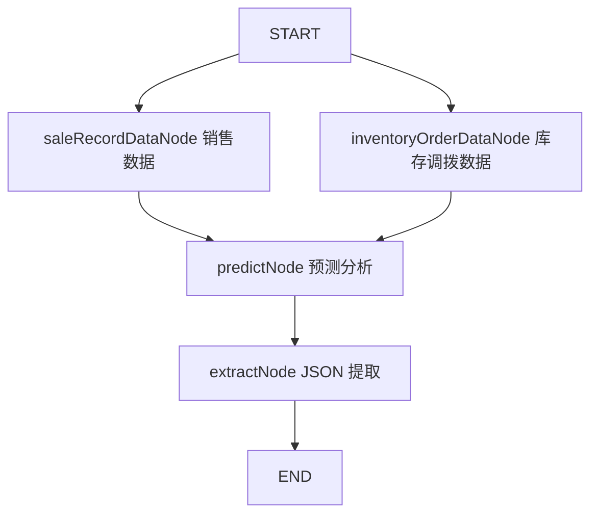

## 【学习目标】

- 掌握 JSON 提取节点的提示词设计：角色定义 + 输出约束如何压制 markdown 污染与类型漂移。
- 理解 `chatClient.prompt(...)` 流式聚合（`doOnNext` + `blockLast`）在节点中的用法与原因。
- 能在 `StateGraph` 中新增节点与边，并跑通四节点链路完成验证。
- 理解「双保险」节点在关键链路中的工程价值，以及大模型输出不稳定的来源。

## 【正文】

### 1. 提取节点的职责与提示词设计

预测节点产出的是自由文本形式的调拨建议，后续「自动生成调拨单」节点需要把建议转成实体入库，因此在其间插入 JSON 提取节点，把文本收敛为规范 JSON 串。

先通过 `ChatClient` 设置 system 提示词，定义角色与任务：

> 你是一个数据处理专家，能够从文本数据中提取 JSON 数据，并且修正格式。

该角色同时定义了任务：从文本中提取 JSON 数据并校正格式。

随后定义输出要求：

- 仅输出 JSON 数据；
- 禁止改变原来的数据类型；
- 不输出任何解释、任何备注或者 markdown 标记；
- 输出时不包含 markdown 的代码包裹符号，也不包含多余文字。

为什么要逐条约束？大模型默认倾向于用 json 代码围栏包裹 JSON，并附上「以下是提取结果」之类的说明，这些包装字符会让下游 JSON 解析直接失败，因此明确「只要纯 JSON 文本」。「禁止改变原来的数据类型」则防止模型把字符串 `"3"` 改成数字 `3`、把数组改成对象，保证字段类型与目标实体一致，反序列化才不会炸。

system 提示词定义如下：

```java
public Map<String, Object> apply(OverallState state) throws Exception {
    String inventoryTransferStr = state.value(key: "InventoryTransferStr", defaultValue: "");
    chatClient.prompt(
        text: """
        # 角色：
        你是一个数据处理专家，能够从文本数据中提取JSON数据并校正格式
        # 输出要求：
        输出JSON数据，禁止改变原来的JSON类型，并且不要输出由任何备注或者Markdown标记。
        输出时不要包含“json”或者“`json`”之类的标记
        """
        );
    return Map.of();
}
```

如实说明：该代码块按课程原稿保留，其中 `text:`、`key:`、`defaultValue:` 为讲稿中记录的命名参数风格写法，`chatClient.prompt(` 后的括号亦未完全闭合，属课程演示时的节选示意；正式代码中以位置参数书写、补齐括号即可，逻辑不变。

接着定义 user 提示词，使用 Lambda 写法，直接写一段文本内容，数据命名为 `content`。由于只有一个参数，直接传 key-value 键值对：key 就是该变量的名字，value 是从状态机里面拿到的该值，作为输入的文本。

输出采用流式：`content.doOnNext` 然后 `blockLast`，一直阻塞在这里。选流式而非一次性 `call()` 的原因是沿用预测节点的取数方式，边收边处理；`blockLast` 把异步流转成节点内的同步语义，保证拿全最终结果后再往下走。类上加 `@Slf4j` 注解，打印日志「提取节点的 result 等于」，先不返回，调试观察效果。

### 2. 修改图结构

节点定义好后，在图里注册并接线。新增节点命名为 `extractNode`，依然使用 `AsyncNodeAction` 的静态方法创建，它需要接收一个 `chatClient`。

然后加一条边。按全链路图，预测节点不再连结束节点，而是去连现在该 JSON 提取节点，让 JSON 提取节点再去连结束节点：

```java
public class GraphConfig {
    public CompiledGraph graphState(ChatClient.Builder chatClientBuild) throws GraphStateException {
        KeyStrategyFactory keyStrategyFactory = new KeyStrategyFactory();
        public Map<String, KeyStrategy> apply() {
            return Map.of(
                "InventoryTransferStr", new ReplaceStrategy(),
                "InventoryTransferJsonStr", new ReplaceStrategy()
            );
        }
    }
    StateGraph stateGraph = new StateGraph(name: "InventoryTransferGraph", keyStrategyFactory);
    stateGraph.addNode("saleRecordDataNode", new SaleRecordDataNode(saleRecordService, ...));
    stateGraph.addNode("inventoryOrderDataNode", new InventoryOrderDataNode(inventoryOrderService, ...));
    stateGraph.addNode("predictNode", new PredictNode(chatClientBuild.build()));
    stateGraph.addNode("extractNode", new ExtractNode(chatClientBuild.build()));
    stateGraph.addEdge(StateGraph.START, "saleRecordDataNode");
    stateGraph.addEdge(StateGraph.START, "inventoryOrderDataNode");
    stateGraph.addEdge("inventoryOrderDataNode", "predictNode");
    stateGraph.addEdge("predictNode", "extractNode");
    return stateGraph.compile();
}
```

如实说明：该代码块为课程讲稿节选，`KeyStrategyFactory` 的匿名内部类定义嵌在方法体内、方法收尾括号等按原稿呈现；重点是看 `addNode` 注册与 `addEdge` 连边的写法，Graph 采用「先逐个加节点、再逐条连边、最后 compile」的建图节奏。



策略工厂为提取链路新增两个 key：`InventoryTransferStr`（上游建议文本，提取节点的输入）与 `InventoryTransferJsonStr`（提取产出的 JSON 串），均为替换策略，提取节点是这两个 key 的唯一写入方。

### 3. 链路测试与结果验证

把项目启动，启动成功后再调用一次。当前流程有点长：首先并行查询销售数据、库存调拨数据、库存数据，然后进行大模型的预测分析，再进行一次 JSON 提取，一共走到四个节点，所以时间可能会久一点，需要稍等片刻。

等待后执行完毕，在日志中搜索结果，可以看到已经产出了结果。把它拷贝出来，直接放到 JSON 可视化工具里面，可以发现确实是提取出来的一个 JSON 串：

```json
{
    "sourceWarehouseId": 3,
    "targetWarehouseId": 1,
    "status": 0,
    "createdBy": "AI智能助手",
    "transferType": 1,
    "transferDate": "2025-11-25",
    "comment": "基于历史销售数据，华北仓（WH001）在Q4历史销量呈现下滑趋势（2023年Q4销量286，2024年Q4销量220），2025年Q4销量预计147，远低于历史峰值。而华南仓（WH002）当前库存227，高于历史销售水平（2025年Q1销量286，2024年Q4销量220），2025年Q4销量预计147，考虑到当前Q4（2025年11月）的销售数据，华北仓（WH001）Q4销量预计227，华南仓（WH002）Q4销量预计285。Q4销量预计227，2025年Q1销量预计286。2025年Q1销量预计286，2026年Q1销量预计286，预计库存水平持平。"
}
```

### 4. 为什么要加「双保险」

可能有读者会问：上一个节点生成的已经是类似这样的 JSON 串了，为什么还要多创建一个节点？

再创建这样一个节点，相当于给工作流加了一个双保险。因为一旦 JSON 提取出了问题，后续节点生成业务单据时就会报错，最核心的东西都没有生成，整条工作流就失去意义。为了保证能真实成功地生成业务调拨单，必须加双保险，保证 JSON 格式没问题、能成功转成实体。

生产级链路中，凡是「下一步强依赖上一步格式」的节点，都应做类似兜底，而不是赌模型的发挥。

工程侧 `980-demo` 提供了另一种等价思路：`980-demo/src/main/java/com/carl/ai/transfer/extract/TransferOrderExtractor.java` 直接用 `chatClient.prompt().user(...).call().entity(TransferOrderParam.class)` 让框架完成文本到 POJO 的绑定（底层即 `BeanOutputConverter`），并用 `@CircuitBreaker` 包裹，抽取失败走降级返回空对象，把「双保险」从提示词层做进了框架层。

### 5. 一个值得注意的现象：输出不稳定

看演示中发现的现象：这次生成的建议是从华北调拨 50 件到华南。先记一下，再调用一次，之前调用时说的也是从华北调拨 50 件到华南。

再次调用，等它生成完之后看这次的建议：方向反了，变成从华南仓调到华北仓。

而且每一次的建议，怎么看都觉得说得挺有道理：感觉从华南调华北也说得通，从华北调华南也说得通。

这不是提示词写错，而是生成式模型的固有特性：同样的上下文，采样结果仍可能不同，且模型总会为结论配上一套自洽的解释。模型的说服力与结论的正确性并不绑定，具体的问题会在后续课程中讲解，再有几节课就会讲到这一块。

## 【易错点 / 面试题】

1. **面试题：如何让大模型稳定输出可解析的 JSON？**
   三层手段：提示词层约束（仅输出 JSON、禁 markdown 标记、禁改类型）；框架层用 `BeanOutputConverter` / `call().entity()` 让绑定由框架完成并自带重试；兜底层单独设置提取节点做格式校验与修复。课程采用提示词 + 独立提取节点的组合。
2. **面试题：`blockLast()` 在这里的作用？**
   流式接口返回 `Flux<String>`，`doOnNext` 逐片消费日志或聚合，`blockLast` 阻塞至流结束并取最后一片，把异步流转成节点内的同步语义，保证返回值完整后再写入状态机。
3. **易错点：把预测节点的文本直接当 JSON 用。** 未做提取 / 校验直接反序列化，格式波动时下游连环报错。关键链路必须留格式兜底节点。

## 【小结】

本节完成 JSON 提取节点：system 提示词用「角色 + 输出约束」压制 markdown 污染与类型漂移；图结构上把预测节点改接提取节点再连结束；四节点链路实测跑通，结果经 JSON 可视化工具验证。

注意演示中暴露的模型输出不稳定性：同一问题两次调用给出方向相反的调拨建议，这是后续评估节点的引入动机。工程侧对应实现见 `980-demo/src/main/java/com/carl/ai/transfer/extract/TransferOrderExtractor.java`（`call().entity()` + 熔断降级）与 `980-demo/src/main/java/com/carl/ai/transfer/agent/TransferAgent.java`（把抽取结果接入入库动作）。

下一节进入邮件发送节点的开发。
