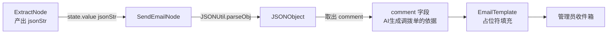

## 【学习目标】

- 掌握消息投递节点的渠道选型思路，以及邮件渠道所需的依赖组合。
- 理解模板化邮件的必要性，能说清 Thymeleaf 在邮件链路中的位置。
- 掌握 QQ 邮箱 SMTP 服务的开启方式与授权码机制，完成邮件发送配置。
- 理解节点内容的来源：`comment` 字段如何承载「AI 生成依据」。

## 【正文】

### 1. 渠道选型与依赖引入

从本节开始进入消息投递节点的开发。投递方式选用邮件发送，实际项目中可以根据公司情况替换为其他渠道，比如企业微信、钉钉、飞书等，节点对外只依赖「发送内容」与「收件人」，渠道是可替换的实现细节。

要发邮件，第一步自然是引入发送邮件所需的依赖 `spring-boot-starter-mail`，引入之后 Spring Boot 项目就具备了发送邮件的能力：

```xml
<dependency>
    <groupId>org.springframework.boot</groupId>
    <artifactId>spring-boot-starter-mail</artifactId>
</dependency>
<dependency>
    <groupId>org.springframework.ai</groupId>
    <artifactId>spring-ai-starter-model-ollama</artifactId>
</dependency>
```

### 2. 为什么还要引入模板引擎

在此之前，先回看一下课程第一章演示过的最终效果：要生成的是智能库存调拨单的通知邮件。它并不是一段简单文本，而是走了一套模板，有标题，带 CSS 样式，正文里放的是 AI 生成这张调拨单的依据，也就是它为什么这么生成；下方还有「采纳」和「拒绝」两个按钮，点击后会分别调用不同的接口。

这种效果单靠 `spring-boot-starter-mail` 是做不出来的，还需要引入模板引擎，这里使用 Thymeleaf。在 POM 文件里把对应的 Starter 加上：`spring-boot-starter-thymeleaf`。该依赖的作用是支撑邮件发送时的模板渲染。Thymeleaf 平时用得不算多，企业内部也不常见，但做模板化邮件足够用。

为什么选模板引擎而不是字符串拼接？HTML 邮件包含 CSS、按钮、链接，用字符串拼 HTML 很快变得不可维护；模板引擎把结构与数据分离，占位符由 `Map` 注入，改样式不动代码。

### 3. 配置邮件发送服务

依赖就位之后，就要配置发送邮件的基本信息：用哪台服务器发、发件人是谁等等。这里以 QQ 邮箱作为邮件发送服务商，也可以按需选择其他服务商。

配置之前需要先到 QQ 邮箱里开启服务并获取授权码，也就是对应的密码。打开浏览器进入 QQ 邮箱并登录，右上角有「设置」入口，点进去选择「账号与安全」，里面有一项「安全设置」，可以找到 POP3 / IMAP / SMTP 这类服务。如果尚未开启，需要先开启；已开启的话会直接显示「已开启」。

开启之后页面上会有「配置方法」，点开能看到官方给出的指引：作为发送邮件服务器时主机怎么填、端口号怎么填、使用哪种协议发送。一般都使用 SMTP 协议发送，服务器用它给出的地址，端口这里使用 `587`。

回到配置文件，在 `spring` 下面配置 `mail` 节点：`host` 填它提供的主机地址，`port` 使用 `587`，再配置 `username`，也就是刚才开启邮件发送服务的邮箱地址。接着填 `password`，注意此处密码不是 QQ 的登录密码，而是在页面上点击「生成授权码」、按提示发送短信之后得到的那串授权码，把它填进来即可：

```yaml
spring:
  application:
    name: ai-transfer
ai:
  ollama:
    api-key: sk-...
    base-url: http://localhost:1144
    chat:
      model: qwen-7b
mail:
  host: smtp.qq.com
  port: 587
  username: 123@qq.com
  password: 123456
```

授权码是邮件服务商的安全机制：第三方客户端只持有授权码，不接触账号密码，且授权码可随时吊销。填登录密码会认证失败，授权码属于敏感配置，生产环境应通过环境变量注入，不写死在代码库中。

邮件还有一些属性配置，比如 SMTP 相关配置、是否开启认证、是否开启 TLS 等。其中 TLS 那一项可写可不写，不写也能正常使用。

### 4. 节点骨架与内容来源

配置就绪，就可以进入节点本身的业务开发了。按惯例在 `node` 包下定义节点类 `SendEmailNode`，实现 `NodeAction`：

```java
public class SendEmailNode implements NodeAction {
    @Override
    public Map<String, Object> apply(OverallState state) throws Exception {
        return Map.of();
    }
}
```

先想清楚该节点要做什么：第一，拿到要发送的内容，也就是要把什么东西发给管理员，这需要一个前置的发送内容；第二，发送邮件，而发送这一步又进一步扩展为使用模板发送。

要发给管理员的内容从哪来？回顾一下大模型生成库存调拨意见时的提示词，里面要求「将详细的解释说明放在 comment 字段当中」。演示里也能看到，返回的 JSON 的 `comment` 字段里就放着解释说明，讲清楚它为什么这样生成这张调拨单。所以在发送节点里，直接取上一个 JSON 提取节点产出的 JSON 串，把 `comment` 字段取出来作为邮件正文发给管理员，管理员就能看到大模型给出这条预测和建议的理由了。

提取节点产出的 JSON 串如下：

```java
public class ExtractNode implements NodeAction {
    @Override
    public Map<String, Object> apply(OverallState state) throws Exception {
        String inventoryTransferStr = state.value(key: "inventoryTransfer", defaultValue: "");
        Flux<String> content = chatClient.prompt(...);
        // ... 处理文本并构建 JSON ...
        return Map.of("inventoryTransfer.jsonStr", content.toString());
    }
}
```

如实说明：该代码块为课程讲稿节选，`Flux` 消费与 JSON 构建过程以 `...` 省略，重点呈现写入状态机的 key，`inventoryTransfer.jsonStr`，即发送邮件节点的数据来源。

思路清楚后开始写代码。第一步还是从 `OverallState` 里拿到提取节点放入的内容。此前提取 JSON 之后并没有做返回：预测节点返回的是 `str`，同时还定义了一个 key 叫 `jsonStr`，现在需要在返回处补上，把该 key 放进去。这样在发送邮件节点里就能通过 `state.value("jsonStr", "")` 拿到它，默认值给空字符串。

拿到 JSON 串之后，把它转成 `JSONObject`，再从 `JSONObject` 中取出对应的 `comment` 字段。这里使用 Hutool 工具包的 `JSONUtil.parseObj`，把 JSON 字符串传进去就能得到 `JSONObject` 对象，然后从里面取出 `comment` 字符串。

拿到 `comment` 之后，就可以进入第二步的开发了。

本节点的数据流：



## 【易错点 / 面试题】

1. **面试题：SMTP 端口 587 与 465 的区别？**
   465 是全程 SSL（SMTPS），连接建立即加密；587 是 STARTTLS，明文连接后升级为加密通道。现代邮件服务商推荐 587，课程配置同样使用 587。
2. **面试题：授权码能否替代密码用于客户端登录？**
   不能也不应。授权码仅限 SMTP / POP / IMAP 协议使用，权限范围窄且可随时吊销，是「最小权限 + 可撤销」的凭证设计，比暴露账号密码更安全。
3. **易错点：`password` 填成邮箱登录密码。** QQ 邮箱 SMTP 认证只认授权码，填登录密码会认证失败；另外授权码属敏感配置，应走环境变量，不进代码库。
4. **面试题：消息投递节点失败会影响主流程吗？**
   取决于设计。邮件通知是旁路逻辑，调拨单入库才是主链路；节点内应捕获发送异常并记录，不因通知失败回滚主流程。反过来，若公司要求「通知必达」，则需把失败状态落库并走重试。

## 【小结】

本节完成消息投递节点的依赖与配置：引入 `spring-boot-starter-mail` 与 Thymeleaf 模板引擎，开启 QQ 邮箱 SMTP 服务并用授权码完成 `mail` 配置，明确了邮件内容取自提取节点 JSON 的 `comment` 字段，管理员看到的不仅是结论，还有大模型给出建议的依据。

下一篇编写 `EmailService` / `EmailServiceImpl`，把发送逻辑落到 Service 层。工程侧可对照 `980-demo/src/main/java/com/carl/ai/transfer/service/TransferOrderServiceImpl.java` 的分层方式：节点类只做编排，发送、事务、日志由 Service 承担。
