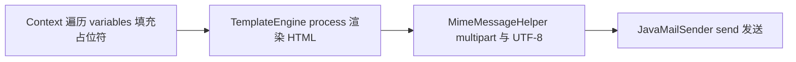

## 【学习目标】

- 掌握「节点编排」与「业务实现」的分层边界，能把发送逻辑抽到 Service。
- 理解 `sendTemplateEmail(to, variables)` 的参数设计：`Map` 承载模板占位符变量。
- 掌握 Thymeleaf 模板邮件的完整链路：`Context` → `process` → `MimeMessageHelper` → `send`。
- 理解捕获异常后为何仍要向上抛，以及 HTML 邮件编码的注意点。

## 【正文】

### 1. 分层与接口设计

发送逻辑不能全部堆在节点类里，应该抽到 Service 中。目前项目里还没有对应 Service，所以先定义接口 `EmailService`，再创建对应的实现类 `EmailServiceImpl`，打上 `@Service` 注解。

接口里该有什么方法？首先要接收邮件内容，拿到内容之后才能把它填进模板；其次还得知道这封邮件发给谁。按此思路定义方法 `sendTemplateEmail`，因为是通过模板填充数据来发送邮件的，所以需要两个参数：第一个是收件人，第二个是模板里占位符所需的变量。模板中会留有占位符，发送时只要把具体数据传到占位符对应的变量上即可，所以第二个参数定义成一个 `Map`：它的 key 就是模板占位符里的变量名，value 是实际要传过去的值。

### 2. 准备邮件模板

在动手实现之前，还差一个关键的东西：模板本身。课程笔记中已经提供了这份邮件模板，格式和第一章 PPT 里展示的效果一致。它是一个 HTML 文件，`title` 为「AI智能库存调拨单通知」，头部是一段 CSS 样式，页面里的配色、按钮的不同颜色都由这段 CSS 控制，这些属于前端的活儿，不展开细看。

模板主体部分是一个 `header`，标题为「AI智能库存调拨单通知」，下面是具体文本内容：开头是「尊敬的用户」，接着是「这是AI智能库存调拨优化系统推送的一份调拨单，请您审核」。再往下是正文内容，这里用了一个占位符，需要把具体内容传进来塞进去。之后是「请点击下方按钮处理此调拨单」，下面提供「采纳」和「拒绝」两个按钮，两个按钮各自带一个链接地址，也就是实际会调用的接口，点采纳调用一个接口，点拒绝调用另一个接口。再往下是一些备注信息，可以删掉也可以保留，比如页脚的「本邮件由系统自动发送，请勿回复，如有疑问请联系系统管理员」。

直接把这份模板拷贝到项目中即可，想改的话可以改占位符的名字，不改的话就按默认命名来用。回到代码，在 `resources` 下面创建模板文件夹，把内容粘进去，模板文件命名为 `EmailTemplate`：

```html
<!DOCTYPE html>
<html>
<head>
    <meta charset="UTF-8">
    <title>AI智能库存调拨通知</title>
</head>
<body>
    <h2>AI智能库存调拨通知</h2>
    <p>尊敬的用户：</p>
    <p>这是AI智能库存调拨通知，基于物料数量统计，${materialCount}台，存在独占风险，${warehouse}仓。</p>
    <p>请在${deadline}前完成调拨。</p>
    <p>如有任何疑问，请联系管理员。</p>
</body>
</html>
```

注意：模板中的占位符为 `${materialCount}`、`${warehouse}`、`${deadline}` 一类命名，发送时 `variables` 的 key 必须与之逐个对应，大小写不一致会导致渲染后占位符原样残留。

### 3. Service 接口与实现类

有了模板就可以写实现了。实现类中首先要从配置文件里取一个变量，邮件由谁发送，也就是 `from` 是什么。该值取的是 `spring.mail.username`，也就是前文配置的用户名，用它作为发件人，字段命名为 `from`。

接下来还需要注入发送能力：引入 `spring-boot-starter-mail` 之后，Spring 会提供 `JavaMailSender` 发送器，邮件的实际发送由它完成。此外因为要使用 Thymeleaf 做模板发送，还需要注入模板引擎 `TemplateEngine`，注意选包时要选 Thymeleaf 的包（`org.thymeleaf`），别引错了。

接口定义如下：

```java
package com.carl.ai.transfer.service;

/**
 * @Description: 邮件服务接口
 * @Author: carl
 * @CreateDate: 2025-11-26 20:31
 * @Since: 1.0
 */
public interface EmailService {
    void send();
}
```

三个依赖（`from`、`JavaMailSender`、`TemplateEngine`）就位后就可以开始实际编写实现类：

```java
package com.carl.ai.transfer.service;

import org.springframework.beans.factory.annotation.Value;
import org.springframework.stereotype.Service;
import java.util.Map;

/**
 * @Description: 邮件服务实现类
 * @Author: carl
 * @CreateDate: 2025-11-26 20:31
 * @Since: 1.0
 */
@Service
public class EmailServiceImpl implements EmailService {
    @Value("${spring.mail.username}")
    private String from;

    @Resource
    private JavaMailSender javaMailSender;

    @Resource
    private TemplateEngine templateEngine;

    @Override
    public void sendTemplateEmail(String to, Map<String, Object> variables) {
        Context context = new Context();
        variables.forEach(context::setVariable);
        String htmlContent = templateEngine.process("EmailTemplate", context);
        this.sendHtmlEmail(to, htmlContent);
    }

    private void sendHtmlEmail(String to, String htmlContent) {
        try {
            MimeMessage mimeMessage = javaMailSender.createMimeMessage();
            MimeMessageHelper helper = new MimeMessageHelper(mimeMessage, true, "UTF-8");
            helper.setTo(to);
            helper.setFrom(from);
            helper.setSubject("AI智能库存调拨通知");
            helper.setText(htmlContent, true);
            javaMailSender.send(mimeMessage);
        } catch (Exception e) {
            log.error("Failed to send html email", e);
            throw new RuntimeException("Failed to send html email", e);
        }
    }
}
```



### 4. 实现要点说明

**模板渲染。** 先创建一个 `Context`，把传进来的 `variables` 遍历一遍，通过 `context.setVariable` 把值塞进去，也就是把 key 对应的值填充到模板中同名的占位符上。简单理解，就是把占位符需要的内容填进模板。注意 `Context` 同样要引 Thymeleaf 的包（`org.thymeleaf.context.Context`），引错了会报错。

然后调用模板引擎的 `process` 方法，它需要两个参数：一个是使用的模板名字，另一个就是上面定义的 `Context`。模板名字就是刚才创建的 `EmailTemplate`，注意模板必须放在 `resources` 下面、再建一层模板目录才生效；传名字时只写名字本身，不要带后缀。`process` 的返回值就是渲染好的 HTML 内容，命名为 `htmlContent`。

**发送。** 为了避免一个方法过长，单独再定义一个方法 `sendHtmlEmail`，两个参数分别是收件人和内容，没有返回值。

实现上，先用 `javaMailSender.createMimeMessage()` 拿到 `MimeMessage`，再 `new` 一个 `MimeMessageHelper`，传入该 `MimeMessage`，第二个参数传 `true`，第三个参数指定编码为 `UTF-8`。这一段属于 Spring Boot 整合邮件发送的标准流程化编码。`createMimeMessage` 会抛异常，这里用 `try...catch` 直接捕获 `Exception`，并通过 slf4j 打印错误日志 `Failed to send html email`；捕获异常之后还要把它抛出去，这里直接抛运行时异常 `Failed to send html email`。

创建好 `helper` 之后就可以对它做各种设置了：设置发件人 `setFrom`、设置收件人 `setTo`、设置主题 `setSubject`，主题这里给的是「AI智能库存调拨通知」。接着设置正文内容，内容就是前面通过模板生成的 `htmlContent`，因为是 HTML 格式，第二个参数传 `true`。最后调用 `javaMailSender.send(mimeMessage)` 完成真正的发送。

**异常为什么捕获后还要抛。** 邮件发送失败是必须让上层感知的事件：节点需要知道发送结果，才能决定记录失败状态、重试还是中断流程。若就地吞掉异常，节点会「假成功」，管理员永远等不到通知。包装成运行时异常上抛，由编排层（节点或调用方）决策。

**待完成。** 这里引用了模板引擎，但还没有配置模板所在的位置。先按上面的写法把代码写完，下一节再来补 Thymeleaf 的配置，配置好之后再做测试。

## 【易错点 / 面试题】

1. **面试题：`MimeMessageHelper` 第二个参数为什么传 `true`？**
   它表示创建 multipart 消息，才能发送 HTML 正文、携带附件与内嵌资源。传 `false` 只能发纯文本，HTML 标签会原样出现在邮件里。
2. **面试题：为什么捕获异常后还要抛出去？**
   邮件失败是业务事件，需要上层（节点 / 编排）感知并决策：重试、告警或中断流程。吞异常会导致假成功，通知链路静默失效。
3. **易错点：模板位置或命名错误。** 模板未放 `resources` 下的模板目录、或 `process` 传了带后缀的名字，都会抛模板解析异常；占位符 key 与 `variables` 不一致则渲染后残留 `${...}`。

## 【小结】

本节完成邮件推送的 Service 层实现：`sendTemplateEmail(to, variables)` 以 `Map` 承载占位符变量，经 Thymeleaf `Context` → `process` 渲染 HTML，再由 `MimeMessageHelper`（multipart + UTF-8）发送，异常捕获后包装上抛供上层决策。

分层边界值得复盘：节点类只做「取内容、调 Service」的编排，模板渲染、异常、日志都在 Service 内闭环。工程侧可对照 `980-demo/src/main/java/com/carl/ai/transfer/service/TransferOrderServiceImpl.java` 与 `980-demo/src/main/java/com/carl/ai/transfer/controller/TransferController.java` 的分层。

下一篇补 Thymeleaf 配置并实测邮件发送。
