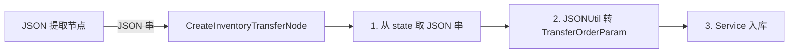

## 【学习目标】

- 掌握「从状态机取数 → 转实体 → 落库」的节点开发三段式，以及每一步各自的风险点。
- 理解 `domain/param` 层的设计意图：接口入参（对外契约）与持久层模型（表结构镜像）分离。
- 能对照 `bb_transfer_order` / `bb_transfer_order_item` 主子表定义参数对象，并做出类型选型（`Integer`/`Long`、`LocalDate`、集合）。
- 理解提示词里的 JSON 示例与 `param` 定义的契约关系：示例是照着 `param` 写出来的。

## 【正文】

### 1. 节点业务拆解

从这里开始进入「自动生成调拨单」节点的开发。前面的人类反馈以及条件边放到后面讲解，那部分稍微复杂一些，属于优化环节，同时也是面试官常问的问题解决方案和代码亮点，所以单独放到后面。

先来编写该节点。回到代码，还是先在 `nodes` 包下创建节点，命名为创建库存调拨单的节点，同样实现 `NodeAction` 并重写 `apply` 方法。

先想清楚该节点要做什么业务逻辑：第一步，从状态机里取出 JSON 提取节点得到的 JSON 串；第二步，把 JSON 串转成实体对象；第三步，保存到数据库。整体难度不高。

三步各自的风险点并不相同：取数考验 key 命名是否与上游节点严格一致；转换考验字段类型声明是否匹配模型输出；落库考验主子表关联与事务边界。拆开看，每一步都有独立的失败模式。



### 2. 从状态机取出 JSON 串

按上述思路开始写。先从状态机中取出 JSON 串，key 使用提取节点已定义的名称，默认值给空字符串。

给默认值是个值得保留的习惯：`state.value(key, "")` 保证上游异常时节点拿到空串而非 `null`，后续转换会抛出内容明确的解析错误，而不是 `NullPointerException` 这种难以定位的栈。状态机节点之间的数据契约，靠的就是「key 名 + 默认值」两件事同时写对。

### 3. 对照表结构定义 param

接下来要把 JSON 串转成实体，实体有哪些字段取决于入库时表结构里有什么字段，所以先看一下表结构。打开数据库，`ai_transfer` 库下最终要落库的是 `bb_transfer_order` 和 `bb_transfer_order_item` 这两张主子表：主表是调拨单主表，子表是调拨单明细表。

主表字段依次是：`id`（自增字段，肯定不需要传）、`order_no`（调拨单号）、源仓库、目标仓库、`status`（调拨状态）、调拨类型、调拨日期、说明、创建人、审核人，以及创建时间和更新时间。`update_time` 不用管，它是按当前时间自动更新的；`update_time` 和 `id` 都不需要传，只需要从 `order_no` 一直到 `create_time` 中间的这些字段。

把表结构翻译成参数对象时，逐字段过一遍「谁负责赋值」：

| 表字段 | param 字段 | 类型 | 是否传入 | 赋值来源 |
|---|---|---|---|---|
| `id` | - | bigint 自增 | 否 | 数据库生成 |
| `order_no` | `orderNo` | String | 否（节点生成） | `IdUtil.simpleUUID` 随机单号 |
| 源仓库 | `sourceWarehouseId` | Integer | 是 | 大模型 JSON |
| 目标仓库 | `targetWarehouseId` | Integer | 是 | 大模型 JSON |
| `status` | `status` | Integer | 是 | 大模型 JSON |
| 调拨类型 | `transferType` | Integer | 是 | 大模型 JSON |
| 调拨日期 | `transferDate` | LocalDate | 是 | 大模型 JSON |
| 说明 | `comment` | String | 是 | 大模型分析结论 |
| 创建人 | `createdBy` | String | 是 | 大模型 JSON |
| 审核人 | - | - | 否 | 当前场景未知，后续写死默认值 |
| `create_time` | `createdTime` | LocalDateTime | 否 | 入库时自动填充 |
| `update_time` | - | - | 否 | 按当前时间自动更新 |

有了表结构就可以定义调拨主单对应的实体了。这里不建议直接转成 model 层的东西，而是在 `domain` 下再建一个 `param` 包，把所有接口传进来的参数都放在这里。

为什么不直接复用 model：model 与表结构一一对应，字段随表结构演进；`param` 是对外交付契约，应该按「大模型输出什么、接口传入什么」定义。两层分离之后，改表不必动接口契约，接口加字段也不必先改表，这是最基础的防腐层（Anti-Corruption Layer）思路，也是面试中「你怎么设计分层」的标准答案素材。

先定义主单参数 `TransferOrderParam`，加上 `@Data` 注解，然后按表字段逐个定义：接收 `String` 类型的订单编号 `orderNo`；接收仓库 ID `sourceWarehouseId`，表里是 `bigint` 类型，但这里数据量很小，直接用 `Integer` 接收，实际项目中可以根据业务情况换成 `Long`；再定义 `targetWarehouseId`，也就是调拨到哪个仓库的 ID；接着是 `Integer` 类型的状态值 `status`、调拨类型 `transferType`；调拨日期在表里是日期类型，这里直接声明为 `LocalDate` 类型的 `transferDate`，这样省掉日期类型之间的转换，也不用去处理时区之类的麻烦事；再往下是大文本说明 `comment`，以及创建人 `createdBy`。审核人这里暂不定义，当前场景还不知道审核人是谁，后面直接写死一个值即可；企业内部一定有对应的审核人，只是这里没有指定。

`Integer` 还是 `Long` 的选型逻辑：表里是 `bigint`，按列类型本该用 `Long`；演示数据量小，`Integer` 也能跑。但真实项目里 ID 类字段一旦用过 `Integer`，后期数据量上涨再改类型，接口、缓存、序列化全链路都要动，成本远高于一开始用 `Long`。课程这里的取舍是「演示从简」，自己写项目时按上限选。

主表参数定义完，再按子表结构定义子表参数 `TransferOrderItemParam`，同样加上 `@Data`。子表的 `id` 也是自增的，不用传，只需要接收这几个参数：`Integer` 类型的 `transferOrderId`（调拨主单 ID）、`productId`（商品 ID）、调拨数量以及 `remark`。至于实际到货数量，这里不定义，直接写死为 0，生成调拨单的时候肯定还没有真正执行到货，此时接收该字段没有意义。

子表参数定义完之后，把它放到主单参数里，而且要用集合来定义，因为调拨单可能涉及多个商品。当前演示只涉及一个商品的调拨，触发销售时只传进来一个商品 ID，所以只会生成这一个商品对应的调拨数据。如果想扩展，触发时传多个商品 ID 让它一起分析，子表里就可能会生成多条商品数据。

于是在主单参数里定义 `List<TransferOrderItemParam> items`：

```java
package com.carl.ai.transfer.domain.param;

import lombok.Data;
import java.time.LocalDate;

/**
 * @Description:
 * @Author: carl
 * @CreateDate: 2025-11-26 22:16
 * @Since: 1.0
 */
@Data
public class TransferOrderParam {
    private String orderNo;
    private Integer sourceWarehouseId;
    private Integer targetWarehouseId;
    private Integer status;
    private Integer transferType;
    private LocalDate transferDate;
    private String comment;
    private String createdBy;
    private LocalDateTime createdTime;
    private List<TransferOrderItemParam> items;
}
```

说明：这段代码块用到了 `LocalDateTime`，但 import 只有 `LocalDate`，属于草稿未补全，直接编译会报「找不到符号」；另外 `transferDate` 声明为 `LocalDate` 的写法在 5-16 会被证明与 MapStruct 冲突，正确形态是 `String` 接收，两处都按后续篇章的结论修正。

「字段按需裁剪」在这两段里体现得很直接：`id`、`update_time` 由数据库负责，审核人、到货数量由业务默认值负责，`param` 只接收「外部真正要传进来的东西」。入参对象每多一个无主字段，调用方就多一分困惑，字段该由谁填？填错会不会覆盖默认值？

### 4. JSON 示例与 param 的契约关系

定义完这两个 `param` 之后再回头看：当初让大模型做预测分析、生成调拨单时，给它指定了输出要求并提供了 JSON 示例，现在应该明白该 JSON 示例是怎么来的了。开发到「自动生成调拨单」节点之后，需要接收哪些参数、有哪些字段就一清二楚了：来源、目标、状态、调拨类型、调拨日期、`comment`、`createdBy`，还有 `items`；`items` 里面又是 `productId`、调拨数量、`remark`。该 JSON 示例正是根据这两个 `param` 定义出来的。

这条前后依赖关系是整门课的设计主线，也是面试高频题「怎么保证大模型的输出能直接落库」的答案：先定义入参结构（`param`），再把 `param` 的字段清单翻译成提示词里的 JSON 示例要求模型遵守，最后用 `JSONUtil` 把模型输出原样转成 `param`。契约先行，模型只是契约的填充者。反过来做，先让模型自由输出、再照着输出写解析，每次调提示词都要改解析代码，永远在打补丁。

两个 `param` 定义好之后，回到节点开发：直接通过 Hutool 工具包的 `JSONUtil` 把 JSON 串转成 `TransferOrderParam.class`，它会自动完成转换。

这里用 Hutool 的 `JSONUtil` 而非自己接 `ObjectMapper`，图的是省事：一行调用完成「JSON 串 → POJO」，字段名自动映射。代价是它对非标准 JSON 的容忍度需要使用时留意，模型偶尔输出带多余文字或尾逗号的内容时，解析会失败，这类鲁棒性问题在后续的抽取节点里还会遇到。

转换完成之后，就该进入业务层编写、让它真正入库了，这部分在下一小节继续。

## 【易错点 / 面试题】

1. **面试题：接口入参为什么不直接用 model/entity？** model 是表结构镜像，随库表演进；param 是对外契约，按调用方（这里是模型输出）定义。分离之后，改表不动契约、加字段不改表，持久化细节不会泄漏到接口层。反过来直接复用 entity，表结构一改，接口调用方全部受影响。
2. **面试题：怎么保证大模型输出能直接转成对象？** 契约先行：先用 param 定好字段与类型，再把字段清单写成提示词中的 JSON 示例约束模型输出，最后按同一结构解析。三者字段名、类型严格一致，转换才不会丢字段。
3. **易错点：日期类型想当然。** 本节 `param` 日期用 `LocalDate` 图省事，5-16 会证明它与 MapStruct 的转换实现冲突，正确做法是 `String` 接收、由 MapStruct 自动完成 `LocalDate.parse`。选型时多问一句「该字段的上游是谁」，上游是模型，就是字符串。

## 【小结】

本节完成「自动生成调拨单」节点的前半段：从状态机按 key 取出 JSON 串（默认值兜底），对照主子表定义 `TransferOrderParam` 与 `TransferOrderItemParam`（自增 ID、更新时间、审核人等字段按「谁赋值」逐项裁剪），并用 `JSONUtil` 完成 JSON 到实体的转换。JSON 示例照 param 定义书写的契约关系，是「模型输出可直接落库」的根本保障。

工程侧的对应实现见 `980-demo/src/main/java/com/carl/ai/transfer/domain/param/TransferOrderParam.java` 与 `980-demo/src/main/java/com/carl/ai/transfer/domain/param/TransferOrderItemParam.java`，入库编排见 `980-demo/src/main/java/com/carl/ai/transfer/service/TransferOrderServiceImpl.java`（param → MapStruct → 主单存换取回自增 ID → 子单回填 ID 批量存，`@Transactional` 整体回滚）。

下一篇补齐 Service 层，引入 MapStruct 完成 param 到 model 的转换。
