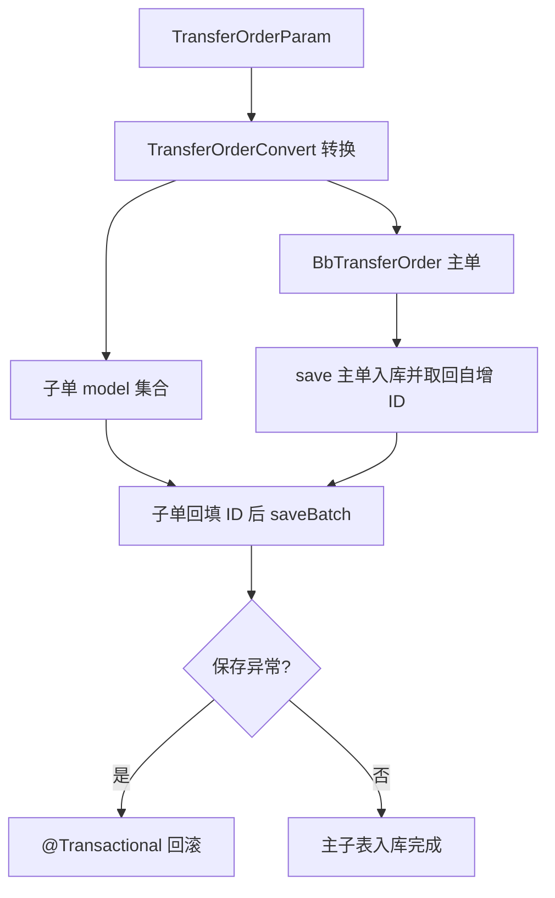

## 【学习目标】

- 掌握 MapStruct 的接入方式：`@Mapper` + `Mappers.getMapper` 拿到转换器实例，以及 `@Mapper` 引错包（引成 MyBatis Plus 的）的后果。
- 能编写单对象与集合两种 POJO 转换方法，理解集合转换的自动生成原理。
- 理解 `param → model` 转换层的定位，以及「补齐字段」的职责划分（模型负责分析结论，系统负责业务标识）。
- 牢记 LocalDate 坑：`param` 必须用 `String` 接日期，MapStruct 才会生成正确的 `LocalDate.parse`。

## 【正文】

### 1. Service 层定义

在编写 Service 之前，为了方便后面调试，先在节点里加上日志：用 slf4j 的注解，然后用 `log.info` 把转换出来的 `param` 打印出来。

调试期日志打在「转换之后、入库之前」，出问题时能直接看到 `param` 的实际内容，区分是「模型给的数据不对」还是「转换/入库不对」。

接下来就可以开发 Service 层了。先定义接口 `TransferOrderService`，再创建对应的实现类 `TransferOrderServiceImpl`，加上 `@Service` 注解。

接口里该有什么方法？这里要做的是创建调拨单，所以定义一个 `create` 方法，返回值为空，接收的参数就是调拨单主单的 `TransferOrderParam`。用快捷键生成实现方法即可：

```java
public interface TransferOrderService {
    void create(TransferOrderParam param);
}
```

实现类里要真正做入库操作，所以需要引入 MyBatis Plus 自动生成的 `BBTransferOrderService` 和 `BBTransferOrderItemService`，一个对应主单，一个对应子单，通过 `@Resource` 注入进来。

Service 接口只暴露 `create(TransferOrderParam param)` 一个动作，入参用的是 `param` 而不是 model，业务层的输入仍然是「调用方的契约」，转换（param → model）发生在业务层内部，Controller、节点、定时任务均可复用同一入口。

### 2. 补齐缺失字段

注入之后，结合预测节点给出的 JSON 来看一下该怎么处理：大模型传过来的数据里有源仓库 ID、目标仓库 ID，但是调拨单号 `orderNo` 是没有的，所以需要我们自己生成。做法很简单，调用 Hutool 工具包的 `IdUtil`，生成一个 `simpleUUID`，用这串随机字符串作为调拨单号 `set` 进去。

哪些字段由模型负责、哪些由系统负责，是该节点设计的核心分界：模型负责「分析结论」（`comment`、调拨建议），系统负责「业务标识」（`orderNo`、`createdBy` 默认值、状态初值）。让模型生成单号有隐患：模型可能编造重复或不合规的单号，而单号要求全局唯一、可追溯，必须由系统用 `IdUtil` 这类工具生成。

再对比一下 JSON 里剩下的字段：调拨类型、日期，大模型传过来的日期是一个字符串，所以把 `param` 里的 `transferDate` 改成字符串类型，这样在做 JSON 转 bean 的时候就不会报错了。

调整之后的 `param` 大致是这样（其中日期用字符串接收），对应的 JSON 示例形如 `sourceWarehouseId`、`targetWarehouseId`、`status`、`transferType`、`transferDate`、`createdBy`、`comment` 以及 `items`：

```java
public class TransferOrderParam {
    private Integer sourceWarehouseId;
    private Integer targetWarehouseId;
    private Integer status;
    private Integer transferType;
    private LocalDate transferDate;
    private String comment;
    private String createdBy;
    private List<TransferOrderItemParam> items;
}
```

说明：本代码块中 `transferDate` 仍写着 `LocalDate`，与正文「改成字符串类型」的描述不一致，属于草稿未同步。按文字意图与 5-16 的实测结论，此处应为 `String`，原因见下文「LocalDate 坑」。

### 3. 用 MapStruct 做 POJO 转换

补齐这些字段之后，还需要把 `param` 实体转成真正要入库的 `BbTransferOrder` 和 `BbTransferOrderItem`。这种 POJO 之间的转换就要用到项目一开始引入的 MapStruct 了。

MapStruct 是编译期代码生成器：按接口方法签名生成 `XxxImpl` 实现类，字段同名的直接赋值，类型不同的按内置转换规则生成转换代码（如 `String` 转 `LocalDate` 生成 `LocalDate.parse`）。相比运行期反射的方案，它零反射开销，且类型错配在编译期就会暴露。三种常见 POJO 转换方案对照：

| 方案 | 原理 | 类型转换 | 性能 | 类型安全 |
|---|---|---|---|---|
| MapStruct | 编译期生成 Impl 类 | 按规则生成 `parse`/`format` 代码 | 高（无反射） | 编译期检查 |
| `BeanUtils.copyProperties` | 运行期反射 | 同名同型才成功，失败静默 | 低 | 弱，错配不报错 |
| 手写 getter/setter | 人工 | 完全可控 | 最高 | 强，但字段多时易漏 |

`BeanUtils.copyProperties` 的静默失败最危险：字段名相同、类型不同时它直接跳过，不报错也不拷贝，线上排查极其困难。

先在 `domain` 下面建一个 `convert` 包，在里面定义接口 `TransferOrderConvert`，并加上 `@Mapper` 注解，注意这里要引 MapStruct 的 `@Mapper`，不要引成 MyBatis Plus 的。然后定义 `INSTANCE`，通过 `Mappers.getMapper(TransferOrderConvert.class)` 拿到实例。

两个 `@Mapper` 包名不同：`org.mapstruct.Mapper` 是转换器工厂注解，触发注解处理器生成转换实现；MyBatis Plus 的 `@Mapper` 让 DAO 接口被扫描注册。引错的典型现象是注解处理器不生成 Impl，运行期 `Mappers.getMapper` 抛「找不到实现类」异常。排查先看 import。

接着在接口里写方法实现 POJO 之间的转换：把 `TransferOrderParam` 转成 `BbTransferOrder`，以及把子表 `param` 集合转成子表 model 集合：

```java
public interface TransferOrderConvert {
    BbTransferOrder paramToModel(TransferOrderParam param);
    List<BbTransferOrderItem> itemParamsToModel(List<TransferOrderItemParam> params);
}
```

首先是 `param2model`：把 `TransferOrderParam` 转成 `BbTransferOrder`，即把 `param` 转成 model 层实体。

这里有个要注意的点：`param` 里的日期定义成的是字符串类型，而代码生成器帮我们生成的 model 里，调拨日期是 `Date` 类型。可以把它改成 `LocalDate`，其他几个日期字段同理也改成 `LocalDate`。但即便如此，从字符串直接转 `LocalDate` 一定转换失败，这里先不处理，直接写这样一个方法，MapStruct 就能实现从 `param` 实体到 model 层实体的转换，这就是 MapStruct 的方便之处，POJO 之间的转换大多会用它。

**LocalDate 坑（本节重点）。** 日期字段的类型声明决定 MapStruct 生成什么代码：

- `param` 声明 `String transferDate`、model 声明 `LocalDate transferDate`：MapStruct 生成 `LocalDate.parse(param.getTransferDate())`，`parse` 收到字符串，转换成功；
- `param` 也声明 `LocalDate transferDate`：生成的转换实现与运行期实际类型错位，`parse` 收到的是 `LocalDate` 对象而非字符串，直接抛异常。

正确写法只有一种：`param` 用 `String` 接收日期，MapStruct 自动完成 `LocalDate.parse`。这也符合事实，大模型返回的 JSON 里，日期本来就是字符串。5-16 会用一次真实的报错栈复现「两边都声明 `LocalDate`」的失败形态，并给出修复后的验证结果。

同理，子表也需要一个转换方法：`itemParam2Model`，接收 `TransferOrderItemParam`，返回 `BbTransferOrderItem`。但上面这些方法只能处理单个实体之间的转换，实际业务里还需要集合之间的转换，所以再定义一个 `itemParam2Models`：接收 `List` 集合，返回 `List` 集合。只要把单个实体之间的转换规则写好，直接照着再定义一个集合版本的方法即可。

集合转换是 MapStruct 的便利点：声明 `List<A>` 转 `List<B>` 之后，生成的实现会遍历元素逐个调用单对象转换方法，无需手写循环；元素内部的日期等字段同样按单对象规则生成转换代码。

### 4. 在 Service 实现类中完成入库

转换层写好之后，就可以在实现类里使用了：

```java
@Service
public class TransferOrderServiceImpl implements TransferOrderService {
    @Resource
    private BbTransferOrderService bbTransferOrderService;
    @Resource
    private BbTransferOrderItemService bbTransferOrderItemService;

    @Override
    public void create(TransferOrderParam param) {
        // 调用转换器
        BbTransferOrder bbTransfer = TransferOrderConvert.INSTANCE.paramToModel(param);
        // 调用业务服务
        bbTransferOrderService.create(bbTransfer);
        // 处理子项
        List<BbTransferOrderItem> bbTransferOrderItems = TransferOrderConvert.INSTANCE.itemParamsToModel(param.getItems());
        bbTransferOrderItemService.create(bbTransferOrderItems);
    }
}
```

通过 `TransferOrderConvert.INSTANCE` 调用对应方法：先把主单做转换，再把子单做转换，子单用 `itemParam2Models`，因为要的是一个集合，直接把 `param.getItems()` 传进去转换，这样就得到了入库时需要的 model 层数据。

有了 model 层数据，就可以调用 Service 存储了：`BBTransferOrderService` 里有 `save` 方法，把主单实体传进去就会执行保存，这是 MyBatis Plus 帮我们封装好的能力。

保存之后就能拿到主单的 ID 了，该 ID 并没有传，是数据库自动生成的，调用 `save` 之后实体上就有值，直接取出来即可。MyBatis Plus 的 `save` 会把自增主键回填到实体，不需要再查一次库。

保存子单之前，需要先遍历子项集合，用 lambda 表达式给每个子项 `set` 上调拨主单的 ID（主单 ID 就是刚才拿到的值），然后调用 `saveBatch` 做批量保存。

这里要特别注意：这里同时操作了两张表，如果其中一张表保存报错，事务必须回滚，所以加上事务注解，并指定对任何异常都回滚。

`@Transactional(rollbackFor = Exception.class)` 里的 `rollbackFor` 不能省：Spring 默认只对 `RuntimeException` 回滚，受检异常不在默认范围。显式指定 `Exception.class` 之后，任何异常都触发回滚，主子表不会出现「主单进了、子单没进」的中间态，这种中间态是库存系统里最难清理的脏数据。



代码块与正文的一处差异需要说明：上面的 Service 实现里调用的是 `create`，而正文描述的是 `save` / `saveBatch`，两者指向同一套 MyBatis Plus `IService` 能力（草稿中方法名未统一）。落到自己项目时，以实际生成代码的方法名为准，模式不变：主单保存 → 取回自增 ID → 子单回填 ID → 批量保存。

到这里可以先测一下，它肯定会报错，下节就来实际演示报错出现在什么地方。

### 5. 改造图结构：接入创建调拨单节点

演示之前依然要先修改图的结构。按照工作流的设计，到邮件发送节点之后就不能直接结束了，应该走到自动生成调拨单节点，再由它结束。回到代码里改造图：新增一个节点 `CreateInventoryTransferNode`，还是通过 `NodeAction` 的静态方法注册并将该节点传入：

```java
public class CreateInventoryTransferNode implements NodeAction {
    private final TransferOrderService transferOrderService;

    @Override
    public Map<String, Object> apply(OverallState state) throws Exception {
        TransferOrderParam param = new TransferOrderParam();
        // 从 state 中获取参数
        param.setSourceWarehouseId(...);
        param.setTargetWarehouseId(...);
        // ... 设置其他参数
        // 调用服务
        transferOrderService.create(param);
        return Map.of();
    }
}
```

这段节点代码是骨架示意：`setSourceWarehouseId(...)` 处的省略号表示字段值待补全，不能直接编译。

传进去之后会发现，该节点还没有写完，没有做实际的调用，所以补上：节点需要引入 `TransferOrderService`，通过构造方法注入，然后在 `apply` 里调用它的 `create` 方法，把 `param` 传进去即可，此处不需要返回东西。节点注册时将该 Service 传入完成注入。

节点加好了，边也要改：发送邮件节点不再直接结束，而是连到创建调拨单的节点；再新增一条边，起点是创建调拨单节点，终点是整个图的终点。至此图也改造完毕，下一节就来实际调用，把问题暴露出来再做修改。

## 【易错点 / 面试题】

1. **面试题：MapStruct 的实现原理？为什么性能比反射好？** 编译期根据 `@Mapper` 接口生成 `TransferOrderConvertImpl`，字段同名直接赋值、类型不同生成转换代码，运行期零反射。代价是类型声明必须准确，声明错，生成的代码也错，报错栈指向生成类而非接口。
2. **面试题：LocalDate 坑怎么答？** `param` 与 model 都声明 `LocalDate` 时，生成的实现对日期字段调用 `LocalDate.parse`，运行期收到 `LocalDate` 对象而 `parse` 只接受 `CharSequence`，抛异常；修复是把 `param` 的日期改回 `String`，让 MapStruct 自动 parse。追问「为什么模型侧用 String」，LLM 输出的 JSON 里日期本来就是字符串，`param` 的形态应该迁就上游。
3. **易错点：`@Mapper` 引错包。** MyBatis Plus 的 `@Mapper` 让 DAO 接口被扫描；MapStruct 的 `@Mapper` 触发注解处理器生成转换实现。引错后不报编译错，只在运行期「找不到实现类」，第一排查动作是看 import 的包名。

## 【小结】

本节完成 POJO 转换层与入库 Service：MapStruct 按接口签名在编译期生成转换实现，单对象与集合两种方法覆盖主子表；`orderNo` 由 `IdUtil.simpleUUID` 补齐，主单 `save` 后取回自增 ID 回填子单，`@Transactional(rollbackFor = Exception.class)` 保证主子表一致。

LocalDate 坑是面试高频：`param` 必须用 `String` 接收日期，MapStruct 才会生成正确的 `LocalDate.parse`。工程侧可对照 `980-demo/src/main/java/com/carl/ai/transfer/convert/TransferOrderConvert.java`（`@Mapping(target = "id", ignore = true)` 忽略自增主键、`componentModel = "spring"` 支持注入式使用）与 `980-demo/src/main/java/com/carl/ai/transfer/service/TransferOrderServiceImpl.java`，单测 `TransferOrderConvertTest` 覆盖 LocalDate 边界。

下一篇故意把日期类型改回 `LocalDate`，复现报错栈并完成修复验证。
