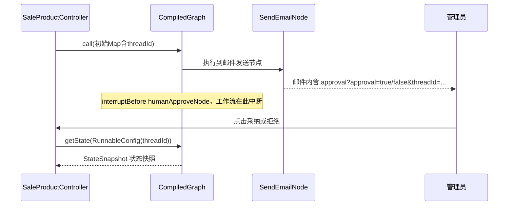

> 标题中的 `RunableConfig` 为课程原始命名，正文统一使用正确类名 `RunnableConfig`。

## 【学习目标】

- 在图状态中新增 `threadId` key，并在触发工作流时生成初始值。
- 把 `threadId` 拼进邮件「采纳 / 拒绝」链接，让审批接口能带回会话标识。
- 构建 `RunnableConfig` 并调用 `graph.getState(...)` 拿到 `StateSnapshot`，理解为什么对话隔离是恢复工作流的前提。

## 【正文】

### 一、新增 threadId 状态 key

首先在图里增加一个 key，用来存放 `threadId`。语义很明确：不同的执行是不同的会话，不同的会话就要做对话隔离。key 的名字就叫 `threadId`，依然使用替换策略。

这一步和图里其他 key 的定义没有任何区别，但它承载的是「身份信息」而非「业务信息」：业务 key（如调拨 JSON）随节点执行不断被覆盖，`threadId` 从触发那一刻起就是固定的，全程只读，它是这次执行的身份证号，不是业务数据。

初始 `Map` 还承担着「种子状态」的角色：工作流启动时的全部上下文都在这一份不可变 `Map` 里（`Map.of` 产出的是不可变对象，节点内只能读、不能改，要更新必须 `return` 新 `Map` 由框架合并）。理解这一点，就能解释一个常见困惑，为什么节点里不能直接 `state.data().put(...)` 修改状态：状态的流转必须走「return 合并」这条正路，不可变初始值 + 显式返回，是状态机可回溯、可检查的前提。

区分「身份 key」与「业务 key」有实际意义：调试时看到状态机里 `threadId` 缺失，可以直接推断问题出在触发端；而业务 key 缺失，则要顺着节点链路逐个排查。把身份的生成点收敛在唯一入口（触发方法），是让排查路径保持简短的前提。

### 二、生成 threadId 并放入初始状态

生成时机：工作流一触发时就应把 `threadId` 传过来。借助 Hutool 工具包的 `IdUtil.simpleUUID()` 生成一个随机字符串作为 `threadId`，在工作流开始节点把它作为初始变量放进状态机。此前初始变量只有 `productId`，现在把 `threadId` 也加进去：

```java
@RequestMapping("/sale")
public Map<String, Object> sale(@RequestParam String productId) {
    String threadId = IdUtil.simpleUUID();
    OverallState overallState = graph.call(
        Map.of("productId", productId, "threadId", threadId).get();
    return overallState.data();
}
```

如实说明：以上代码按课程讲稿原样保留，`graph.call(` 处缺少一个右括号、`.get();` 位置随转写错位，属讲稿痕迹；正确写法为 `graph.call(Map.of("productId", productId, "threadId", threadId)).get()`。核心意图不变：**每次触发都生成全新的随机 `threadId`，随初始状态进入工作流**，后续所有节点都能从状态机里拿到它。

两个细节：

- **为什么用 `IdUtil.simpleUUID()` 而不是 `UUID.randomUUID()`**：`simpleUUID` 生成的是去掉横线的 UUID 字符串，更短，且不含 `-`，拼进 URL 参数时无需转义，可读性也好。`threadId` 只做隔离标识，不需要标准 UUID 格式。
- **为什么用随机串而不是业务单号**：`threadId` 的职责是「唯一定位一次工作流执行」，不承担任何业务含义。随机串可以避免与业务 ID 混淆，也杜绝碰撞风险。这与 Spring AI 中 `ChatMemory` 按会话隔离多轮对话的思路一致：会话 ID 只做隔离，不做查询键。

放进初始 Map 只是第一步：此时 `threadId` 只存在于状态机里，执行框架还不知道「要按该身份建检查点」。触发端还需要在 `call` 时传 `RunnableConfig`，那是下一篇修复 `missing checkpoint` 的关键，这里先记住「身份要登记两次：状态机里一份、执行配置里一份」。

顺带说明触发接口的返回设计：`sale` 方法最后返回 `overallState.data()`，把状态机全量数据回给调用方。开发期这很有用，可以直接从响应里核对「初始状态是否包含 `threadId`、各节点产出是否齐全」，不必翻日志；上线后则可以按需裁剪为只回关键字段，避免把内部状态暴露给前端。

### 三、审批接口接收 threadId

审批接口除了接收是否审核通过，再加一个 `@RequestParam` 接收 `threadId`，该参数由发送邮件节点拼进链接带过来：

```java
@RequestMapping("/approval")
public R approval(@RequestParam(value = "approval") Boolean approval,
                  @RequestParam(value = "threadId") String threadId) {
    graph.getState();
    // ... (后续代码用于获取状态并构建 RunnableConfig)
}
```

注意此处的 `graph.getState();` 还是空壳：不传 `RunnableConfig` 根本无法定位到具体哪次执行，下一篇补全。这里先搭好参数骨架：`approval` 决定采纳或拒绝，`threadId` 决定找回哪一次对话。

命名对齐提醒：讲稿中邮件按钮与接口参数在 `approve` / `approval` 两种写法间出现过混用。工程惯例是**邮件链接参数名、`@RequestParam` 名、审核节点读取 key 三处逐字一致**，建议提为常量；否则参数静默丢失，审批结果恒为默认值，是最难发现的那类故障。

参数类型选 `Boolean` 包装类型而非基本类型 `boolean`，也有考量：包装类型能表达「未传参」这一第三态（`null`），配合节点里的默认值 `false`，「链接没带参数」与「显式传了 false」都能被安全处理；若用基本类型，缺参时框架绑定失败会直接报错，错误暴露在离根因最远的地方。

参数骨架搭好之后，顺带明确两个参数的分工：`approval` 是「决策内容」，`threadId` 是「决策归属」。缺前者，工作流不知道该采纳还是拒绝；缺后者，工作流根本找不到该为哪一次执行续命。审批接口本质上就是「把人的一次点击，翻译成某次执行的一句续跑指令」，两个参数正好对应这句话的两个要素。

### 四、拼接邮件的采纳 / 拒绝链接

有了 Controller 方法，回到邮件发送节点补全 URL：接口路径不再写空，而是拼成 `http://localhost:8876/saleProduct/approval?approval=true&threadId=...` 的形式，`threadId` 直接从状态机里取初始化时传进来的初始值，默认值给空字符串：

```java
public Map<String, Object> apply(OverallState state) throws Exception {
    String inventoryTransferJsonStr = state.value(key: "inventoryTransferJsonStr", default: "");
    JSONObject jsonObject = JSONUtil.parseObj(inventoryTransferJsonStr);
    String comment = jsonObject.getStr("comment");
    emailService.sendTemplateEmail(to: "13054820154@163.com", comment, 
        Map.of(k2: "adoptLink", v2: "http://localhost:8876/saleProduct/approval?productId=1", 
               k3: "rejectLink", v3: ""));
    return Map.of();
}
```

如实说明：以上代码按课程讲稿原样保留，`to:`、`k2:`、`v2:` 等是转写痕迹，且代码中的 URL 与正文描述的 `approval?approval=true&threadId=...` 不一致（转写时带入的是旧版占位地址）。按正文语义理解：**采纳链接传 `approval=true`，拒绝链接把 `true` 改成 `false`，二者都带上 `threadId`**。

邮件事例中两个按钮各自对应一个链接地址：采纳传 `adoptLink`，拒绝传 `rejectLink`，直接塞进模板。管理员一点击，就会调到 Controller 层的审批方法，并把两个参数都传过来。从状态机取 `threadId` 时给空字符串默认值，是为了在链接拼装阶段不因缺值抛异常，真正发现「没带 threadId」应该发生在审批接口定位失败时，错误要暴露在离根因最近的地方。

模板与节点之间有一条清晰的分工线：邮件模板（HTML）只负责展示，按钮 href 由节点拼装后以变量形式注入；节点不关心邮件长什么样，模板不关心参数从哪来。这种「数据在节点、展示在模板」的结构，换模板样式时业务代码零改动。另外拼 URL 时注意参数值要做 URL 编码，`threadId` 虽是简单随机串暂无特殊字符，但这是必须养成的习惯，一旦换成带业务含义的标识，未编码的 `&`、`#` 会静默截断参数。

模板变量的命名也值得推敲：`adoptLink` / `rejectLink` 这两个名字把「用途」写进了变量名，模板作者一眼知道该往哪个按钮上塞。若图省事叫 `link1` / `link2`，换人维护时对着模板 HTML 猜半天。命名即文档，在模板变量这种「离代码最远、离运营最近」的位置尤其重要。

有开发者会觉得用加号拼接字符串太陈旧，为什么不用 `StringBuilder` 的 `append`？课程给出的结论是：项目跑在 JDK 17 上，编译器对字符串加号拼接已做过优化（`invokedynamic` + `StringConcatFactory`）；只要不是在 `for` 循环里反复拼接，普通方法里用加号与用 `append` 相比，性能没有太大区别。为可读性选择加号是合理取舍，但若拼接发生在循环内或高频路径上，仍应显式使用 `StringBuilder`。

生产环境提醒：公司里这段链接肯定不会写 `localhost`，而是写测试环境或生产环境的域名，并且可能需要配置白名单、加签名或令牌认证。邮件链接本质是一条「未登录即可触发的写操作入口」：任何人拿到链接都能代表管理员审批。安全设计要按自己公司的实际系统来定，至少保证链接中的 `threadId` 不可枚举（随机 UUID 正是为此）。

顺带讨论一个方法论问题：审批接口为什么用 GET？因为邮件按钮的本质是「浏览器导航」，用户点一下就要发起请求，GET 是唯一不需要表单、不需要 JS 的自然选择。但 GET 承载状态变更，天生带着副作用风险，邮件客户端会预取链接、爬虫会扫链接、转发邮件等于转发审批权。生产上的改良方向是：保留 GET 作入口，但接口内校验来源（如一次性 token、Referer 白名单），或者干脆让按钮指向一个带确认动作的中间页，由中间页转发真正的审批请求。课程用 GET 是为跑通主链路，安全加固层留给自己公司的规范。

### 五、构建 RunnableConfig 获取状态快照

有了 `threadId`，就可以创建 `RunnableConfig`。它同样是建造者模式，把 `threadId` 传进去，调用 `build()` 完成构建：

```java
RunnableConfig runnableConfig = RunnableConfig.builder()
    .threadId(threadId)
    .build();
StateSnapshot stateSnapshot = graph.getState(runnableConfig);
OverallState state = stateSnapshot.state();
```

这段配置的含义：传入 `threadId` 是为了做对话隔离，让 Agent 知道要处理哪个对话。一个贴切的类比是身份证：每个人都有一张身份证，办事时凭身份证找到对应的人；每一次工作流执行有一个唯一标识，用的就是 `threadId`。

随后通过 `graph.getState(runnableConfig)` 把配置传进去，返回的是一个状态快照（`StateSnapshot`）。快照里包含 `state`，从中可以拿到具体的 `OverallState`，工作流阻塞在什么地方、此前各节点产出了什么，全部可见。如果说 `threadId` 是身份证，`StateSnapshot` 就是户籍档案：凭身份证查到人，档案里记着他此前的全部经历。

为什么顺序是「先查快照、再激活」，而不是直接提交审批？因为激活的前提是「确认有东西可恢复」：先凭 `threadId` 拿到快照，校验它确实停在预期的审核节点，再提交人类反馈驱动恢复。顺序反过来的话，反馈数据可能因为找不到对应执行而悬空，提交了，却没有任何工作流接收它。先查后办，是这一类「找回型接口」的通用套路。

快照对象除 `state` 之外还携带检查点相关的元信息（如检查点标识），本节只用到 `state()` 一个方法，其余属性在检查点章节会展开讲。`RunnableConfig` 的其他字段（`checkpointId`、`nextNode`、`streamMode` 等）同理按需再补：当前场景一个 `threadId` 就够用，配置的哲学是「用到什么传什么」，而不是把建造者能调的方法全调一遍。



### 六、实际调用与第一个坑

重启项目后完整走一遍触发流程。执行过程依次是：预测完成、JSON 提取、邮件发送。邮箱收到新邮件，「采纳」「拒绝」两个按钮的链接地址已带上了随机生成的 `threadId`：采纳对应 `approval=true`，拒绝对应 `approval=false`。

点击「采纳」，接口返回 500，且控制台没有任何错误信息，再次点击依旧「内部服务错误 500」。这里埋的坑是在模拟真实开发过程，面试官问到「踩过什么隐性问题」时，这些正是答案素材。

先解决第一个现象：**接口返回 500，为什么控制台没有错误信息？** 在方法入口打断点重启复现，放行后看到异常为 `missing checkpoint`（检查点缺失）。而控制台之所以安静，是因为异常被直接抛出了，代码里没有任何捕获处理。两个问题一条线：先把 try...catch 加上让日志能打印出来，再查 `missing checkpoint` 的根因。

顺带说明成本意识：课程演示连的是阿里千问，按 token 计费，多轮调试会持续消耗额度；本地开发时应尽量用完整的单次调用覆盖多个验证点，减少重复触发。调大模型就像调外部供应商接口，每一次调用都有成本，调试更要讲方法。

最后固化一个日志习惯：审批接口的入口处打印 `threadId` 与 `approval`。多会话并行的场景下，日志里只有「审批成功」四个字是无法定位的，必须带上「哪一次执行、批了什么」。这也是有状态系统日志的基本规范：**日志要能自解释归属，否则并行一多，日志就成了噪音。**

排查方法论上，这次故障的正确顺序是：先 Debug 断点看异常类型（拿到 `missing checkpoint` 这一命名），再回头审查「该异常可能在哪些环节产生」的候选清单，最后用代码比对锁定根因。猜是效率最低的方式，500 有几十种成因，断点一放行，候选清单立刻缩短到一个。

## 【易错点 / 面试题】

**面试题 1：为什么 `getState` 一定要传 `RunnableConfig`？不能直接拿状态吗？**

参考回答：因为工作流执行是有状态的，同一条图可能同时有多次未完成的执行（不同商品、不同审批人）。`RunnableConfig.threadId` 就是区分这些执行的身份证，不传就无法定位到具体哪一次执行的快照，框架只能报 `missing checkpoint`。这与 Spring AI 多轮对话必须带会话 ID 是同一原理：有状态系统必须先解决「找得到」，再解决「做得对」。

**易错点 2：只在初始 Map 里放 `threadId`，不在 `call` 时传 `RunnableConfig`。**

状态机里确实能读到 `threadId`，但检查点（checkpoint）的建立依赖执行时传入的 `RunnableConfig`。触发端只把身份证放进包里、没在入口登记，恢复时自然查不到记录，这正是 `missing checkpoint` 的根因，下一篇修复。

**易错点 3：邮件链接写死 `localhost` 或不带 `threadId`。**

写死地址换环境即失效；漏带 `threadId` 则审批接口无法定位对话。链接中的参数应与审批接口的 `@RequestParam` 严格对齐：`approval` 与 `threadId`，一个都不能少。

**面试题 2：`threadId` 用业务单号（如订单号）生成，行不行？**

参考回答：能用但不推荐。`threadId` 的职责是唯一定位一次执行，与业务含义解耦更稳：业务单号可能重复（重试、补单）、可能变更（改单），任何业务侧的变化都会泄漏到执行标识上；随机 UUID 则与业务完全隔离，也不会向外部暴露「系统里存在哪些单号」这类信息。除非有「按单号反查工作流」的强需求，否则坚持用无业务语义的随机串。

## 【小结】

本节落地了对话隔离：图状态新增 `threadId` key，触发端用 `IdUtil.simpleUUID()` 生成初始值，邮件节点把 `threadId` 拼进「采纳 / 拒绝」链接，审批接口用 `RunnableConfig.builder().threadId(...)` 构建配置并调 `graph.getState(...)` 拿到 `StateSnapshot`。调试中暴露了 500 无日志与 `missing checkpoint` 两个问题，根因分别指向「异常未捕获」与「触发端未传 `RunnableConfig`」。下一篇补上异常日志与触发端配置，走完「激活 → 恢复 → 入库」全链路。配套工程见 `980-demo/src/main/java/com/carl/ai/transfer/controller/TransferController.java`：对应课程的触发入口，把一次有状态执行的入口参数（含会话标识）显式管理起来，是本节思想在工程中的落点。
