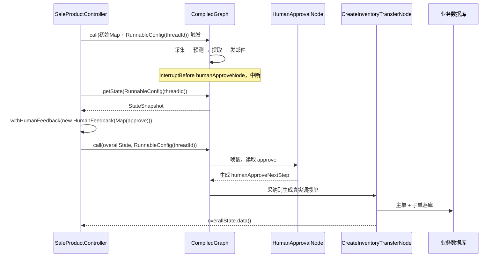
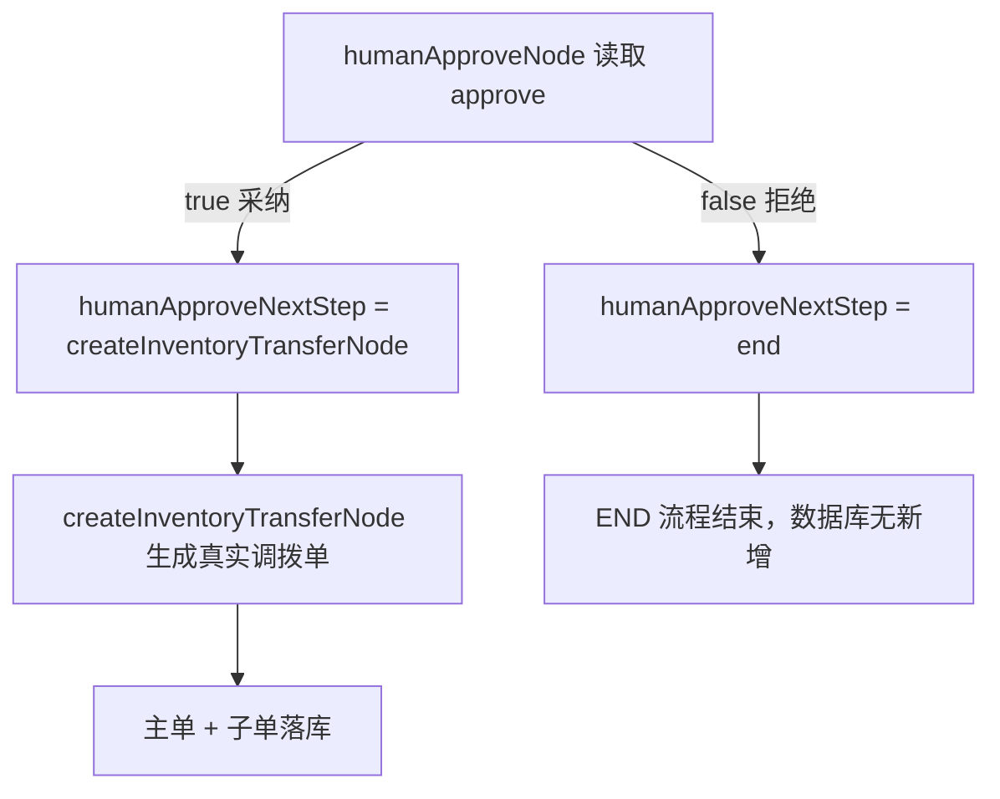

## 【学习目标】

- 补上 try...catch 让异常可见，建立「先让错误打印出来，再谈定位」的调试习惯。
- 讲清 `missing checkpoint` 的根因：有状态的执行必须在触发端就登记 `RunnableConfig`。
- 走完激活全链路：`getState` 拿快照 → `withHumanFeedback` 塞审批结果 → `call(state, config)` 恢复执行，并在数据库侧验证真实单据生成。

## 【正文】

### 一、先让异常信息打印出来

上一篇结尾留下两个问题：接口 500、控制台却一片安静。修复第一步最简单也最重要：把审批逻辑包进 try...catch，在 catch 里打印 `e.getMessage()`。

该动作值得单独强调：**框架不会替你把异常暴露到日志里，被直接抛出的异常在无人捕获时就是静默的 500。** 生产代码中每个入口方法都应有异常边界，日志是后续所有排查的地基；没有日志，`missing checkpoint` 这类错误连名字都看不到。进一步的要求是：日志要打全栈而非只打 `getMessage()`，否则丢栈顶信息，定位时又得再跑一遍。本课为演示简洁只打了消息内容，工程实现中建议 `log.error("审批激活失败, threadId={}", threadId, e)`，带上业务标识，带上异常对象。

try...catch 的包裹范围也有分寸：只包「可能抛异常的调用」（`getState`、`withHumanFeedback`、`call`），不把整个方法体一裹了之。范围过大，会把参数绑定之类的错误也吞进同一种处理，日志里分不清是哪种失败；范围合适，catch 到的每一个异常都指向明确的调用点，处理动作也能区别设计，恢复类异常提示会话问题，系统类异常走告警。

### 二、missing checkpoint 的根因

异常名是 `missing checkpoint`，检查点缺失。理解它只需一个类比：

> 相当于去 4S 店提车。你拿着身份证去验车，4S 店要凭身份证查下单记录，结果系统里根本没有用这张身份证下过的订单，车当然提不出来。

把类比补完整，对应三个阶段：

| 生活类比 | 系统动作 |
|---|---|
| 拿着身份证去店里下单 | 触发端 `call` 执行工作流，登记 `threadId` |
| 车辆生产、运输，中途等待 | 工作流执行到审核节点前中断，状态落检查点 |
| 凭身份证到店提车 | 审批接口凭 `threadId` 找回快照，恢复执行 |

问题出在第一阶段：审批接口拿着 `threadId`（身份证）去找那次工作流执行（订单），但触发端，销售触发 Agent 的方法，只把 `threadId` 放进了初始状态机，并没有创建 `RunnableConfig` 传给执行。身份证有了，下单记录里却没登记此人，恢复时自然找不到，于是报 `missing checkpoint`。

修复方式：触发端也要把 `threadId` 放进 `RunnableConfig` 再调用。图的 `call` 方法除了接收一个 `Map`，还有一个接收 `RunnableConfig` 参数的重载，与审批接口里用法相同，直接在触发端补上即可。这样触发端就完成了「我是拿着身份证来执行的」设定：下单时登记了身份证，中间中断多久都没关系，激活时凭身份证就能找回这次执行，继续往下走。

修复后的触发端语义用自然语言描述是：生成 `threadId` → 构造携带该 `threadId` 的 `RunnableConfig` → 以「初始 Map + 配置」双参数调用 `call` → 同步等待本次执行返回（中断时返回中断态状态）。四步里没有任何魔法，关键在于「配置」这一参数从无到有，它正是检查点得以建立的登记动作。

一句话总结：**状态机里的 `threadId` 是给节点读的，`RunnableConfig` 里的 `threadId` 是给执行框架建检查点的，两边都要有。**

### 三、第一次验证：日志有了，单据还没来

重启后完整执行一遍。点击「采纳」前先打开数据库，记录库存调拨单表当前最新 ID 为 11。点击「采纳」，返回 200，控制台无报错，日志也打印出了内容。但刷新数据库，**没有新数据**。

看日志确认执行确实往下走了，没有错误，还成功返回了值。把返回的 `overallState.data()` 展开看，状态机里各节点的产出都在：

| 状态 key | 内容 | 产出节点 |
|---|---|---|
| `inventoryTransferJsonStr` | 调拨建议 JSON 串 | 提取节点 |
| `threadId` | 本次执行的会话标识 | 触发端初始状态 |
| `saleRecordData` | 商品销售采集数据 | 采集节点 |
| `inventoryOrderData` | 库存调拨信息 | 采集节点 |
| `nowProductInventoryData` | 当前商品库存数据 | 采集节点 |

为什么返回 200、状态齐全，却没有插库？因为到此为止只做了两件事：拿到状态快照、打印状态。**激活动作还没写**，没有调用恢复执行的方法，工作流仍停在中断点。200 只代表「查询状态成功」，不代表「工作流被恢复」。

这一轮验证暴露了一个常见误区：把「接口不报错」当成「功能已实现」。判断人机协同是否真的跑通，唯一可信的信号是**数据库里有没有出现经过人工确认的单据**。接口状态码、日志内容都可能是中间态，落库结果才是终态。

顺带解释一个读者常有的疑问：为什么 `overallState.data()` 里能看到所有节点的产出？因为每个节点 `apply` 方法返回的 `Map` 都会被合并进 `OverallState`，采集节点放入销售数据、提取节点放入调拨 JSON、审核节点放入路由 key，全部汇入同一个容器。这也是前面反复强调「key 定义要集中」的原因：合并是自动的，命名对齐是手工的，框架不会替你检查拼写。

### 四、激活：resume + withHumanFeedback

Spring AI Alibaba Graph 为「从中断点恢复」提供了完整三件套：

1. **通知工作流要激活**：拿到状态后调用 `resume` 方法，语义上就是告知工作流「我要从这里继续」。
2. **塞入人类反馈数据**：调用 `withHumanFeedback`，传入一个 `HumanFeedback` 对象。`HumanFeedback` 需要两部分：一个 `Map`（key 是审核节点约定读取的 `approve`，value 是 `true` 或 `false`），以及一个可选的 `nextNodeId` 参数，此处先不传，因为工作流已完整编排，执行到审核节点后它自己能识别走向，不需要外部指定下一个节点。
3. **驱动继续执行**：调用 `call` 的第二个重载，传入 `OverallState` 与 `RunnableConfig`，再 `get()` 触发。

为什么第二个重载要传 `OverallState`？因为 `graph.getState(...)` 拿到的是「此刻整个工作流状态机的快照」，恢复必须建立在该快照基础上，而不是凭空重启一份新状态，此前的采集、预测、提取结果全靠它延续。`RunnableConfig` 依然携带 `threadId`，指明是哪个人（哪个会话）在触发，与触发端保持同一套身份体系。

三步的时序可以这样理解：`resume` 是「打招呼」，`withHumanFeedback` 是「递交材料」，`call(state, config)` 是「正式办理」。少任何一步，窗口都不受理，只打招呼不交材料，审核节点读不到审批值；交了材料不办理，工作流不会离开中断点。

这里还藏着一个并发模型的结论：恢复执行发生在审批请求的线程里，与触发请求的线程无关。触发线程早在中断时就已返回（拿的是中断时的状态），审批线程负责把工作流「推」到终点。两个请求、两条线程、一段共享的状态机，这就是人机协同的并发全貌：**没有线程被「睡」在审核节点上，占住的只有状态，不是线程。** 对比「起一个定时任务轮询审批结果」的方案，声明式中断省掉的是轮询开销、时序竞争和状态同步三笔成本。

`nextNodeId` 此处留空的理由再强调一次：工作流已经完整编排（审核节点之后有条件边接管路由），恢复执行照编排走即可；外部强行指定下一个节点，相当于绕过条件边手动搬道岔，短期能跑通，长期一定和编排脱节。只有一种场景值得显式传 `nextNodeId`：编排本身留了「外部强制路由」的口子，且业务明确要求，本课程不涉及。

执行完成后，从返回的 `overallState` 中取 `data()` 返回的 `Map` 直接返回给前端，一次完整的人机协同执行闭环成形。分支走向如下图所示：采纳走左侧生成单据并落库，拒绝走右侧直接结束。

### 五、第二次验证：真实单据落库

再次完整走一遍。点击「采纳」前刷新数据库，当前最新 ID 仍是 11。点击「采纳」，返回 200 且带回数据。刷新数据库：**ID 变成 12，主表字段完整，子表也同步出现一条 12 的记录。**

这两个数字是本节最重要的验收证据：它证明「人类审核 → 对话召回 → 工作流激活 → 生成真实单据」整条链路真的通了，且模型生成的调拨建议是经过人工采纳才进入业务库的。若点击「拒绝」，工作流则在审核节点后直接走向结束，数据库不会出现任何新记录，两条分支的行为都符合风控设计。

往后续章节看，触发端的形态还会变：商品销售事件后续改为经 Kafka 消息触发（生产者发商品 ID、消费者触发工作流），届时 `threadId` 的生成点随之挪到消费端，但「生成即登记、登记即入配置」的原则不变。读到这里可以自己推演：消息重复消费会导致重复触发，那时的 `threadId` 该怎么设计才能既隔离会话、又支持幂等？带着这一问读后续章节，会比单纯跟着敲代码收获大得多。

「记录前后 ID 再对比」这一验证手法值得固化：涉及写库的链路，验收标准永远是数据本身，不是接口返回。可以再往前推一步：把「刷新主表 + 刷新子表 + 核对字段」列为固定动作，本案例中子表记录与主单 ID 联动（12 号主单对应 12 号子单），只验主表会漏掉「子单未生成」这类半截故障。

落库环节本身也有讲究：主单先生成、取回自增 ID，子单回填该 ID 后再批量入库，两表操作包在一个事务里，任何一步失败整体回滚。这正是 `980-demo` 中 `TransferOrderServiceImpl.create` 的写法（`@Transactional(rollbackFor = Exception.class)`）。放到人机协同语境下，事务边界还多一层含义：审核通过后的落库要么完整成功，要么完全没发生，绝不会留下「主单有了、子单没了」的中间态，人工确认过的数据，值得被完整地对待。

### 六、全链路回顾

把四轮调试连起来看，这条链路踩的坑恰好构成一条完整的排查路径，也是面试中最值得讲的故事线：

| 轮次 | 现象 | 根因 | 修复 |
|---|---|---|---|
| 1 | 500，无日志 | 异常未捕获 | try...catch 打印 `e.getMessage()` |
| 2 | `missing checkpoint` | 触发端未传 `RunnableConfig` | `call(Map, RunnableConfig)` 重载 |
| 3 | 200 但不插库 | 只查了快照，未执行激活 | `resume` + `withHumanFeedback` |
| 4 | 拒绝分支未验证 | 只测了采纳 | 点击「拒绝」确认走向 `END` |

面试中讲这条链路，建议按「现象 → 定位 → 根因 → 修复」四步组织，比平铺直叙「我用了 interruptBefore」有说服力得多。面试官想听到的不是你用了什么 API，而是**你如何在不熟悉的框架里定位一个没有错误信息的静默故障**，这是生产能力的直接证据。

收尾前给出一份上线检查清单，人机协同链路验收时逐项打勾即可：

| # | 检查项 | 通过标准 |
|---|---|---|
| 1 | 中断点生效 | Debug 断点无法进入审核节点 |
| 2 | 邮件链接完整 | 链接含 `approval` 与 `threadId` 两个参数 |
| 3 | 日志可定位 | 审批日志带 `threadId`，异常打全栈 |
| 4 | 采纳分支 | 数据库新增主单与子单，ID 递增 |
| 5 | 拒绝分支 | 返回正常但数据库无新增记录 |
| 6 | 异常路径 | 缺参、错误 `threadId` 均返回明确错误而非 500 静默 |

六项全过，这条链路才算真正「敢上线」，其中第 5、6 项最常被跳过，而它们恰恰是线上事故的高发区。

## 【易错点 / 面试题】

**面试题 1：`HumanFeedback` 到底是什么？和 `OverallState` 什么关系？**

参考回答：`HumanFeedback` 本质就是一个 `Map` 的封装，激活工作流时传进来的审批数据。Spring AI Alibaba Graph 给它起了专有名字，容易造成理解混乱。它通过 `withHumanFeedback` 挂到状态快照上，最终由审核节点从 `state.humanFeedback().data()` 取出。关系上：`OverallState` 是工作流全程的状态容器，`HumanFeedback` 是其中「人类本次输入」那一部分的载体。

**易错点 2：以为 `getState` 返回 200 就算激活成功。**

`getState` 只是查询快照，不驱动执行。必须再走 `resume`（或携带 `HumanFeedback` 的恢复调用）+ `call(state, config)`，工作流才会离开中断点。数据库 ID 不变，就是最直接的验证信号。

**易错点 3：`nextNodeId` 随意指定。**

`withHumanFeedback` 可传 `nextNodeId` 指定下一个节点，但工作流已编排时应留空，让流程按自身定义走。强行指定会绕过条件边，使「采纳 / 拒绝」的分支语义失效，也让中断点的编排失去意义。

**面试题 2：管理员重复点击「采纳」，会重复落库吗？**

参考思路：链路本身是「一次中断 → 一次恢复」的单次续跑，重复点击会发起第二次恢复调用，能否重复落库，取决于检查点状态在首次恢复后的变化与框架对已消费检查点的处理，工程上不能赌这一点，要主动做幂等：常见做法是把审批动作与 `threadId` 绑定（同一 `threadId` 只接受一次有效审批），或落库前校验业务单据是否已存在。这类「外部入口可重入」的防御意识，是生产系统和演示系统分道扬镳的地方。

**面试题 3：为什么不把审批结果写进数据库，让工作流轮询读取，而要「接口主动唤醒」？**

参考回答：那是拉模式，本课程用的是推模式，差别在实时性与复杂度。轮询方案下，工作流要常驻一个等待中的执行，靠定时任务扫数据库，延迟取决于轮询间隔，且每次轮询都是一次无谓的状态加载；推方案下，审批动作直接驱动恢复，延迟是毫秒级，等待期间执行完全挂起、零资源占用。推模式的代价是激活链路必须健壮（`threadId` 要管好、检查点不能丢），本课程后面整章都在补这块，恰好说明它才是难点。

## 【小结】

本节完成了人机协同的最后一环：try...catch 让异常可见；触发端补传 `RunnableConfig` 修复 `missing checkpoint`；`withHumanFeedback` 把 `approve` 键值对交给审核节点；`call(overallState, config)` 驱动工作流恢复，最终在业务库生成 ID 12 的主单与子单。至此「中断 → 等待 → 唤醒 → 分支 → 落库」全链路闭环，验收以数据库记录为准。下一篇用流程图把整套机制再梳理一遍，并引出条件边开发。配套工程见 `980-demo/src/main/java/com/carl/ai/transfer/service/TransferOrderServiceImpl.java` 与 `repository/BbTransferOrderRepository.java`：主单入库后取回自增 ID、子单回填主单 ID 再批量入库的两表事务写法，正是课程「自动生成调拨单」节点落库环节的生产级实现；`extract/TransferOrderExtractor` 对应其上游的 JSON 提取节点，`convert/TransferOrderConvert` 则复刻了 param→model 的 MapStruct 转换层。
