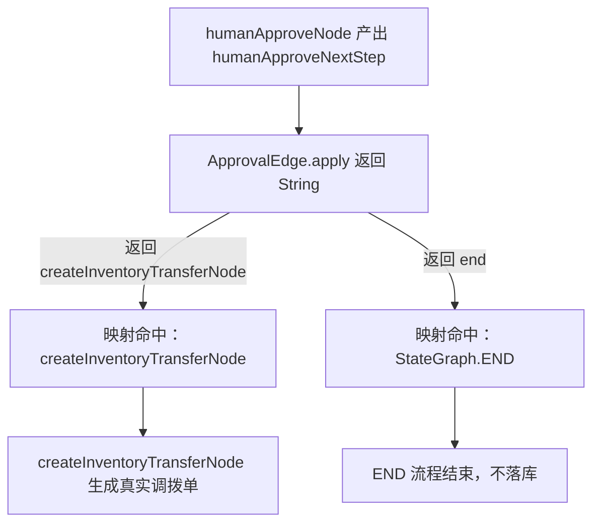

## 【学习目标】

- 读懂 `addConditionalEdges` 的签名与框架侧校验逻辑，理解「边 action 返回值 + 映射表」的协作机制。
- 独立实现审核条件边：从状态机读路由 key，返回分支标识，并完成在图中的配置。
- 掌握「一个条件边 = N 种执行路径」的扩展方法，能把任意多分支业务决策搬进工作流。

## 【正文】

### 一、addEdge 与 addConditionalEdges

回到图定义：此前给图中加边用的都是 `addEdge(sourceId, targetId)`，静态边，写死目标节点，任何输入都走同一条路。而 `addConditionalEdges` 是条件边：目标节点不再固定，由边 action 的返回值经映射表动态决定。前者是「铁路」，后者是「道岔」，铁路只有一条轨道，道岔根据信号决定列车去哪条股道。

| 维度 | `addEdge`（静态边） | `addConditionalEdges`（条件边） |
|---|---|---|
| 目标节点 | 编译期写死 | 运行时经映射表解析 |
| 判断逻辑 | 无 | `EdgeAction.apply` 返回字符串 |
| 适用场景 | 顺序执行的固定链路 | 人工审核、规则分流、循环重试 |
| 本课程用途 | 采集 → 预测 → 提取等主链路 | 审核结果分支路由 |

条件边的典型战场可以归纳为四类：**人工审核**（本课程，路由值来自人的点击）、**规则分流**（按金额、库存等状态字段走不同处理节点）、**循环重试**（评估不达标则送回上游，达标才放行，后续 BI 章节的「评估-循环」即此类）、**降级与超时**（满足兜底条件时走向兜底节点）。四类场景的机制完全相同，都是「读状态、下判断、查映射」，变的只是 `apply` 里那几行业务代码。这也是条件边值得专门成章的原因：它一门通，门门通。

一句话记法：**流程固定的部分用静态边，需要「看情况」的部分用条件边。** 人机协同的审核分支，天然属于后者。

先看框架源码：

```java
public StateGraph addConditionalEdges(String sourceId, AsyncCommandAction condition, Map<String, String> mappings) throws GraphStateException {
    if (Objects.equals(sourceId, StateGraph.END)) {
        throw Errors.invalidEdgeIdentifier.exception(new Object[]{"_END_"});
    } else if (mappings == null || mappings.isEmpty()) {
        throw Errors.edgeMappingIsEmpty.exception(new Object[]{sourceId});
    } else {
        Edge newEdge = new EdgeValue(new EdgeCondition(condition, mappings));
        if (this.edges.elements.contains(newEdge)) {
            throw Errors.duplicateConditionEdge.exception(new Object[]{sourceId});
        } else {
            this.edges.elements.add(newEdge);
            return this;
        }
    }
}
```

三个参数：

| 参数 | 含义 |
|---|---|
| `sourceId` | 条件边的起始节点 ID |
| `condition` | 边 action（`AsyncCommandAction`），执行业务判断并返回字符串 |
| `mappings` | 映射表：key 是边 action 的返回值，value 是目标节点 ID |

源码里的 `EdgeValue(new EdgeCondition(condition, mappings))` 一行点明了机制本质：**一条条件边 = 一个判断逻辑 + 一张映射表**，两者打包注册进图的边集合。

框架的三重校验分别对应三条使用纪律：

1. **`sourceId` 不能是 `END`**：结束节点没有「下一跳」，拿它当条件边起点无意义，直接抛 `invalidEdgeIdentifier`。
2. **`mappings` 不能为空**：没有映射表，边 action 返回什么都不知道去哪，抛 `edgeMappingIsEmpty`。
3. **同一 `sourceId` 不能重复添加同一条件边**：重复注册会抛 `duplicateConditionEdge`，防止两条规则互相覆盖、行为不确定。

注意 `condition` 的挂载方式与节点同构：添加节点时是 `AsyncNodeAction.node_async(nodeAction)`，这里是 `AsyncCommandAction.edge_async(edgeAction)`，`node` 换成边，内部同样是函数式接口的 `apply` 方法。**节点与边在框架眼里是同一套抽象，只是一个被状态机调度、一个被路由决策调用。** 掌握这种对称性能省不少记忆成本：会写节点就会写边。

这种对称性还延伸到测试上：边 action 是纯函数式的「状态进、字符串出」，单测极其便宜，构造一个塞了 `humanApproveNextStep` 值的 `OverallState`，调用 `apply`，断言返回值，不需要启动图、不需要连模型。对比「起整条流程验证分支」，前者的执行时间是毫秒级。工程上建议把每条条件边都配上这种单测，它是工作流里性价比最高的测试点。

### 二、实现条件边 ApprovalEdge

清楚了这些，就可以仿照节点的开发来开发这条边。先创建一个 `edge` 包，在里面定义条件边，命名为 `ApprovalEdge`，也就是审核边。它同样实现边的 action（`EdgeAction`，和 `NodeAction` 非常像），也实现 `apply` 方法。

先对比两种 action 的差异，这是本节最易混的地方：

| 维度 | `NodeAction` | `EdgeAction` |
|---|---|---|
| 方法签名 | `apply(OverallState)` 返回 `Map<String, Object>` | `apply(OverallState)` 返回 `String` |
| 返回值用途 | 合并进状态机，更新状态 | 作为映射表的 key，决定下一跳 |
| 职责 | 产出状态 | 消费状态做路由 |
| 挂载方式 | `AsyncNodeAction.node_async(...)` | `AsyncCommandAction.edge_async(...)` |

关键差异在返回值：`NodeAction.apply` 返回 `Map<String, Object>`（要合并进状态的数据）；`EdgeAction.apply` 返回 `String`，**该返回值就是映射表的 key**，框架拿它去 `mappings` 里查目标节点。

边 action 的签名同样声明 `throws Exception`，这意味着路由判断中抛出的异常会中断路由、向上传播。由此得出一条编写纪律：**边 action 里只放轻量判断**，读一个 key、比一个值、返回一个字符串，几行结束；需要查库、算指标、调接口的判断，应该沉到节点里先算成状态，边只做「看状态下结论」。把重逻辑塞进边 action，既拖慢路由，又让异常处理边界模糊。

业务逻辑：取出人类审核节点写入的路由 key（课程命名为 `humanApproveNextStep`，默认空字符串），值为 `createInventoryTransferNode` 说明审核通过，返回该 key；否则返回结束：

```java
public String apply(OverallState state) throws Exception {
    String humanApprovalNextStep = state.value(key: "humanApprovalNextStep");
    if ("createInventoryTransferNode".equals(humanApprovalNextStep)) {
        return "createInventoryTransferNode";
    }
    return StateGraph.END;
}
```

如实说明：以上代码按课程讲稿原样保留，`state.value(key: "humanApprovalNextStep")` 的具名参数写法为转写痕迹，实际应为 `state.value("humanApproveNextStep", "")`；读取的 key 名（`humanApprovalNextStep`）与图中定义的 `humanApproveNextStep` 存在一字之差，工程中必须统一，否则读取恒为空串、分支永远走不到「生成单据」。主线逻辑不变：**读路由 key → 命中通过值则返回通过标识，否则返回结束。**

### 三、在图里配置条件边

定义完后挂进图里：起始节点是人类审核节点；第二个参数用 `AsyncCommandAction` 的静态方法把边的实现传过去；第三个参数是映射表：

```java
stateGraph.addConditionalEdges(
    "humanApprovalNode",
    AsyncCommandAction.edge_async(
        new HumanApprovalNode().getHumanApprovalAction(),
        Map.of("createInventoryTransferNode", StateGraph.END)
    )
);
```

如实说明：以上代码按课程讲稿原样保留，`new HumanApprovalNode().getHumanApprovalAction()` 是转写痕迹（边 action 应直接 `new ApprovalEdge()` 传入 `edge_async`）；`Map.of(...)` 只写了一项，而按正文语义映射表应含两项：边返回 `createInventoryTransferNode` 时连到 `createInventoryTransferNode` 节点，边返回 `end` 时连到结束节点。阅读时以映射语义为准：**`Map` 的 key 是条件边返回值，value 是拿到该值时要去的节点。**

中断点同样在编译期声明，与条件边共用同一个审核节点：

```java
CompileConfig compileConfig = CompileConfig.builder()
    .interruptBefore("humanApprovalNode")
    .build();
stateGraph.compile(compileConfig);
```

至此人机协同的拼图完整了：`interruptBefore` 负责「停」，审核节点负责「读反馈、产路由 key」，条件边负责「按 key 选路」。三个部件各管一段，互不侵入，这正是声明式编排的价值。

配置层面的对称性也值得总结，它和前面节点/边的对称是同一套思想：

| 配置对象 | 建造入口 | 关键参数 | 所属层 |
|---|---|---|---|
| `KeyStrategyFactory` | 直接 new | key 名与更新策略 | 状态层 |
| `addNode` | `AsyncNodeAction.node_async` | 节点 ID + `NodeAction` | 节点层 |
| `addEdge` | 直接调用 | 起点 + 终点 | 边层 |
| `addConditionalEdges` | `AsyncCommandAction.edge_async` | 起点 + 边 action + 映射表 | 边层 |
| `CompileConfig` | `builder()` | `interruptBefore` 等 | 编译层 |

五类配置各司其职，改任何一个都不波及其他，这也是工作流代码能随业务长年演进的原因：新增一种审批状态，改的是边 action 与映射表两处，节点、状态、编译配置纹丝不动。

### 四、1 个条件边 = N 种执行路径

「N 种路径」的含义就在映射表里：映射表有几组键值对，条件边就能分出几条分支。当前业务只有两个出口：



扩展到多分支时机制完全不变：假设性示例，若业务把审批细化为「通过、驳回修改、超时关闭」三种，边 action 按状态返回三个不同字符串，映射表相应配置三项即可。分支与目标的对应关系可以这样摆：

| 边 action 返回值 | 业务含义 | 映射目标 |
|---|---|---|
| `createInventoryTransferNode` | 审核通过 | 生成调拨单节点 |
| `resendEmailNode` | 驳回，需补充材料重新发起 | 邮件发送节点 |
| `end` | 超时未审或明确拒绝 | 结束节点 |

三行配置就是三级审批路由。**分支数量的增加只改映射表与边 action 的返回值，图结构、节点代码都不用动**，这就是条件边被称为「轻松搞定复杂业务决策逻辑」的原因。

与「多个 if-else 塞进一个巨型节点」的写法相比，条件边方案的优势：

| 维度 | 条件边 | 节点内 if-else |
|---|---|---|
| 路由可视性 | 映射表集中声明，图结构即文档 | 逻辑埋在节点内部，需读代码 |
| 节点复用 | 节点只产状态，可被任何边复用 | 节点与路由耦合，难复用 |
| 分支扩展 | 加一组映射即可 | 改节点代码，回归风险大 |
| 与人工审核衔接 | 天然支持（路由值来自人类反馈） | 需手动把人工输入接进判断 |
| 测试方式 | 边 action 可单测（给定状态验返回值） | 必须起整条流程才能验证分支 |

映射表的设计原则，三条足够：

1. **返回值集合封闭**：边 action 只能返回有限个约定值（最好是常量或枚举），杜绝「拼错一个字符串就静默走错分支」。
2. **key 与节点 ID 对齐**：映射表的 key 用边 action 的返回值，value 用图中真实存在的节点 ID，两边都从同一份常量取，不从字面量取。
3. **覆盖全部分支**：设计边 action 时列出全部可能返回值，逐一在映射表中配置对应目标；宁可显式配一个「兜底 → END」，也不要留下未定义行为。

映射表的 value 侧同样有纪律：必须是图中真实存在的节点 ID。拼错一个字母的表现很典型，编译期不报错（映射表只是普通 `Map`），运行到该分支时才因找不到目标节点而失败。所以 value 侧也要从同一份节点 ID 常量取，不写字面量。这与「key 侧返回值要封闭」合起来，构成条件边的双侧防线：**返回的值封闭，映射的目标真实，分支才不会在运行时才爆炸。**

### 五、整体梳理

1. 人类审核节点根据激活参数 `approve` 是 `true` 还是 `false`，往状态机写入 `humanApproveNextStep`：通过则值为 `createInventoryTransferNode`，拒绝则值为 `end`；
2. 条件边从状态机取出该值做判断：是「创建调拨单节点」就返回 `createInventoryTransferNode`，否则返回结束；
3. 映射表把返回值翻译成目标节点：返回 `createInventoryTransferNode` 走生成单据，返回 `end` 走结束；
4. 业务语义：管理员采纳 → 生成真实调拨单；管理员拒绝 → 流程结束，不碰数据库。

一句话收束全章：**人机协同 = 中断点（停）+ 人类反馈（输入）+ 条件边（选路）**，三者都是 Spring AI Alibaba Graph 的声明式配置，业务代码只负责「读状态、写状态」这一件事。

三个部件的分工可以用一张表钉死，这也是本章最值得带走的认知：

| 部件 | 声明位置 | 回答的问题 | 本课程配置 |
|---|---|---|---|
| `interruptBefore` | `CompileConfig` | 在哪停 | `humanApproveNode` 之前 |
| `HumanFeedback` | 审批接口 | 人的决策是什么 | `approve` 布尔值 |
| 条件边 `mappings` | `addConditionalEdges` | 停完之后去哪 | 采纳 → 生成单据，拒绝 → `END` |

最后向前看一步：条件边的战场远不止人机协同。后续智能 BI 章节会把同一机制用在「评估-循环」上，SQL 生成后交由评估节点判定，不达标则条件边把流程送回重新生成，达标才继续执行。那里的映射表对应的是「重试节点 / 继续节点 / 结束节点」，形状与本章完全一致。**学会一种分支机制，打通的是所有需要「看情况走路」的场景。**

## 【易错点 / 面试题】

**面试题 1：条件边的 `mappings` 是做什么的？漏配某一项会怎样？**

参考回答：`mappings` 把边 action 的返回值翻译成目标节点 ID，是「返回值 → 下一跳」的字典。使用时必须覆盖边 action 的全部可能返回值；从框架源码看，映射表为空会直接抛 `edgeMappingIsEmpty`，这是使用条件边的基本纪律，设计边 action 时就要问自己：该方法一共可能返回几个值，映射表是否都配了。追问「返回了没配的值怎么办」时，诚实回答：这属于使用契约之外的输入，正解是从源头保证返回值集合封闭（如枚举），而不是依赖框架兜底。

**面试题 2：`EdgeAction` 和 `NodeAction` 有什么区别？为什么条件边不直接返回节点 ID？**

参考回答：二者签名同源（都是 `apply(OverallState)`），差别在返回值语义：`NodeAction` 返回要合并进状态的 `Map`，`EdgeAction` 返回路由标识字符串，由框架经映射表解析成目标节点。不直接返回节点 ID，是为了把「判断逻辑」与「拓扑知识」分离，边 action 只回答「这是什么情况」，映射表回答「这种情况去哪」，改拓扑不用动判断代码，改判断不用动拓扑。这和图定义里 `addNode` / `addEdge` 分离是同一套设计哲学。

**易错点 2：路由 key 命名不一致（`humanApproveNextStep` vs `humanApprovalNextStep`）。**

讲稿中两类写法都出现过。节点写入、图中 key 定义、条件边读取三处必须逐字一致，建议把 key 定义为常量复用。一旦拼写漂移，读取侧拿到空串，分支永远走默认路径，且不报错，这是最难排查的一类静默故障。

**面试题 3：条件边返回的字符串，用字面量还是常量？映射表 value 呢？**

参考回答：两侧都应该是常量。返回值是边 action 与映射表 key 之间的契约，映射表 value 是 key 与节点 ID 之间的契约，两处契约只要有一侧用了字面量，改一处漏一处就是静默故障：字面量拼错时编译不报错，运行到对应分支才失败，且报错信息离根因远。工程做法是把节点 ID、路由 key 分别定义为常量（甚至一个 `GraphKeys` / `NodeIds` 常量类），边 action、`addNode`、`addEdge`、`interruptBefore`、映射表全部从常量取。这不是洁癖，是把「命名一致性」从人的记性手里交给编译器。

**易错点 3：把条件边当节点用。**

`EdgeAction.apply` 的返回值是路由标识（`String`），不是要合并进状态的数据；往状态里写数据是 `NodeAction` 的职责。二者混用会导致「该路由的没路由、该落状态的没落状态」，且因为类型不同（`String` vs `Map`）通常编译期就能发现，算幸运的那类错误。

## 【小结】

本节完成人机协同的最后一环：条件边。`addConditionalEdges(sourceId, condition, mappings)` 中，边 action 返回字符串、映射表把字符串翻译成目标节点，配合框架侧三重校验（禁 `END` 起点、禁空映射、禁重复注册），构成工作流的分支决策机制；`ApprovalEdge` 读取 `humanApproveNextStep` 决定「生成调拨单还是结束」，与 `interruptBefore`、审核节点共同拼成完整的人机协同链路。映射表配几项就有几条分支，「1 个条件边 = N 种执行路径」由此而来。至此第六章人机协同闭环：中断 → 唤醒 → 审核 → 路由 → 落库。配套工程见 `980-demo/src/main/java/com/carl/ai/transfer/agent/TransferAgent.java`：其「自然语言 → 抽取 → 入库」动作链即课程节点编排思想的最小实现，分支决策所依赖的结构化数据由 `extract/TransferOrderExtractor` 产出，与条件边消费路由 key 的模式同构。
