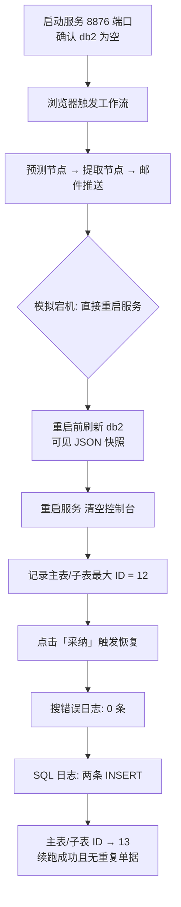

【学习目标】

- 独立编写 `RedissonConfig`，理解「自定义 Redisson Bean 而不是交给 Spring Boot 自动装配」的真实动机，接管序列化器；
- 在图定义类中完成 `RedissonClient` → `RedisSaver` → `SaverConfig` → `CompileConfig` 的完整装配；
- 跑通「中断 → 宕机重启 → 采纳续跑 → 单据落库」的全链路验证，并掌握自定义 `BaseCheckpointSaver` 把快照落到关系库的扩展路径。

## 【正文】

## 一、RedissonConfig：为什么不用自动装配的客户端

配置文件准备就绪之后，接下来要补的是一个独立的配置类，专门负责 Redis 客户端的构建与序列化行为。新建 `RedissonConfig`，标注 `@Configuration`，在其中用 `@Bean` 暴露一个 `RedissonClient`。

之所以要自定义 Redisson 的 Bean，而不是交给 Spring Boot 自动装配，核心目的是接管序列化器：把 key、value 的序列化方式统一改成 JSON 形式。

具体实现是先 `new Config()`，注意导包别引错，要用 Redisson 自己的 `Config`。随后调用 `setCodec(new JsonJacksonCodec())` 完成序列化器的替换。当前是单机部署，所以接着走 `useSingleServer()`，在这里设置连接地址。

地址不写死，直接从配置文件里取值：通过 `spring.data.redis.host` 拿到主机，通过 `spring.data.redis.port` 拿到端口，拼成 `redis://` 加主机、再加冒号加端口的完整地址。数据库编号同样从配置的 `database` 项读取，`setDatabase(database)` 设置进去。

到这里 `Config` 就配完了，调用 `Redisson.create(config)` 把配置传进去，返回的就是我们需要的 `RedissonClient`。

```java
        @Configuration
        public class RedissonConfig {
            @Bean
            public RedissonClient redissonClient() {
                Config config = new Config();
                config.setCodec(new JsonJacksonCodec());
                config.useSingleServer()
                    .setAddress("redis://"+host+":"+port)
                    .setDatabase(database);
                return Redisson.create(config);
            }
        }
```

需要如实说明：该代码块为讲稿节选，`host`、`port`、`database` 三个变量的来源（`@Value` 注入或配置属性绑定）未在节选中给出；理解时把它们视为来自 `application.yml` 中 `spring.data.redis` 节点下的三个配置项即可。

这里把「为什么要换 codec」讲透，因为它是面试可深挖的点。Redisson 默认的序列化器是 JDK 序列化（`JdkCodec` 一类的二进制方案），写入 Redis 的 value 是一串不可读的二进制。改用 `JsonJacksonCodec` 之后：

1. **可读性**：checkpoint 快照以 JSON 文本落库，用可视化工具打开 db2 就能直接看懂每个节点存了什么，排障效率大幅提升；
2. **跨语言边界**：JSON 是通用格式，未来若有其他语言的服务需要读取同一份快照（比如运维脚本、BI 项目），不存在 JDK 序列化的版本耦合问题；
3. **与 Spring 生态一致**：项目里序列化本来就走 Jackson，换 codec 不会引入第二套序列化语义。

代价是 JSON 序列化对某些类型（如无默认构造器的对象）更挑剔，这就要求状态通道里流转的对象保持「朴素 POJO」形态，这正是下一篇要强调的序列化边界。

## 二、装配图定义：从 RedissonClient 到 CompileConfig

`RedissonClient` 就绪之后，回到图的定义类里做注入。用 `@Resource` 注入进来，字段名保持 `redissonClient`，然后把它作为参数传给 `RedisSaver`，再通过 `SaverConfig.builder().register(...).build()` 构造出持久化配置。

`SaverConfig` 拿到之后，在编译配置类里组装 `CompileConfig`，把 saver 配置一起塞进去，最后执行 `build()` 并调用 `compile(compileConfig)` 生成 `CompiledGraph`。至此，整条工作流的状态信息就会被写入 Redis，而不是停留在内存里。

```java
        public class GraphConfig {
            public CompiledGraph graph(ChatClient.Builder chatClientBuild) throws GraphStateException {
                Map.of("createInventoryTransferMode", "createInventoryTransferMode",
                        "createTransferMode", "createTransferMode",
                        "stateGraph.END", "stateGraph.END");
                stateGraph.addEdge("createInventoryTransferMode", "stateGraph.END");
                // 创建持久化配置
                SaverConfig saverConfig = SaverConfig.builder()
                    .register(SaverEnum.REDIS.getValue(), new RedisSaver(redissonClient()))
                    .build();
                // 定义编译配置
                CompileConfig compileConfig = CompileConfig.builder()
                    .interruptBefore("humanApprovalMode")
                    .saverConfig(saverConfig)
                    .build();
                return stateGraph.compile(compileConfig);
            }
        }
```

需要如实说明：该代码块为讲稿节选，存在几处转写问题，`Map.of(...)` 的返回值没有被使用，属于悬空语句；`redissonClient()` 在本类中并未定义，实际应来自 7-3 前半段注入的 `redissonClient` 字段或 `RedissonConfig` 的 Bean；节点名 `createInventoryTransferMode` / `humanApprovalMode` 与此前篇章的 `createInventoryTransferNode` / `humanApprovalNode` 不一致，属转写漂移。理解装配意图即可：**`RedisSaver(redissonClient)` → `SaverConfig` → `CompileConfig.saverConfig(...)` → `stateGraph.compile(compileConfig)`**。

## 三、全链路验证：中断、重启、续跑、落库

接下来做一次完整链路验证。启动项目，服务跑在 8876 端口。留意一下此时 Redis 的 db2 库是空的，等演示跑完再看它有没有数据。

在浏览器里请求对应的接口地址并回车执行。从日志可以看到工作流开始运行：大模型预测节点已经结束，流转到下一个节点 JSON 提取节点，提取动作同样完成，随后邮件正常推送。邮箱里收到的最新一条就是这次的调拨单通知，时间显示 10 月 30 号 2 点 49。

现在模拟一次宕机重启：不点「采纳」或拒绝，直接重启服务。重启之前先刷新 Redis，db2 里已经有数据了，切换成 JSON 格式展示，可以看到里面正是整个工作流的状态信息，和之前存在内存里的内容结构一致，也就是代码里通过 `graph.getState` 拿到的状态快照，之前打印出来的东西现在原封不动地落到了 Redis 中，其中包含各个节点的状态明细。

服务重启成功，依旧是 8876 端口。清空控制台，然后去点「采纳」。点之前先看一下数据库现状：当前主表最新记录是 12，子表最新也是 12，对应的调拨主单 ID 是 12。

点击「采纳」，没有报错。如果出错的话代码里是打了日志的，直接搜日志关键字，结果是 0 个 result，说明确实没抛异常；同时能看到打印出来的 SQL 语句里有两个插入操作。回到主表刷新，ID 已经变成 13；子表刷新，记录也成功写入。

把这次验证的方法论提炼出来，它比「跑通了」三个字更有价值：



三个关键观察点：

1. **db2 快照与内存快照同构**：证明了持久化没有改变状态内容，只是换了存放位置；用 `graph.getState` 在内存里打印过的结构，在 Redis 里能一一对应。
2. **日志关键字搜索为 0**：比「肉眼没看到报错」更严格，用可复现的检索手段证明没有异常抛出。
3. **主表/子表 ID 从 12 变为 13**：这是最有说服力的一条。重启前单据停在 12，恢复后只新增了 1 条主单和对应的子表记录，说明恢复逻辑精确地从中断点继续，既没有丢单，也没有重复执行已完成的节点造成重复入库。若恢复时从头重跑，ID 会跳到 14 甚至出现多条重复单据。

这就意味着面试官问的问题被解决了：代码执行过程中宕机或者重启怎么办？答案是用 Redis 做持久化存储，并且已经在 demo 里跑通验证。

## 四、扩展：自定义 BaseCheckpointSaver，落到关系库

这里再做一个扩展。如果不想把工作流的状态快照存到 Redis，毕竟数据量一大，放 Redis 会消耗大量内存，想改存到数据库，该怎么实现？回到图的定义，看调用 `SaverConfig` 时传入的对象，它对应一个接口 `BaseCheckpointSaver`，Spring AI Alibaba 已经提供了若干内置实现，比如存 MongoDB 的实现，官方在 DB 存储这条路上默认选的就是 MongoDB。

要做定制化开发也很简单：在自己的包里写一个 `MySQLSaver` 或者 `PostgresSaver`，同样去实现 `BaseCheckpointSaver` 接口，把接口里的方法逐一补齐，就可以自定义存储，落到自己公司的数据库里。团队里可能用 MySQL，也可能用 PostgreSQL，甚至 Oracle，都可以按实际情况去实现该接口。

官方 MongoDB 实现的结构可以参考：

```java
        public class MongoSaver implements BaseCheckpointSaver {
            private static final String DB_NAME = "check_point_db";
            private static final String COLLECTION_NAME = "checkpoint_collection";
            private static final String DOCUMENT_PREFIX = "mongo:checkpoint:document:";
            private static final String DOCUMENT_CONTENT_KEY = "checkpoint_content";
            public MongoSaver(MongoClient client) {
                this.client = client;
                this.database = client.getDatabase(DB_NAME);
                this.txnOptions = TransactionOptions.builder()
                    .writeConcern(WriteConcern.MAJORITY)
                    .build();
            }
        }
```

需要如实说明：该代码块为讲稿节选，只给出构造函数片段，`client` / `database` / `txnOptions` 字段的声明与接口方法的实现均未展示；其参考价值在于揭示官方实现的三个设计要点，独立的库表命名（`check_point_db.checkpoint_collection`）、带前缀的文档键（`mongo:checkpoint:document:`）、以及写入关注级别 `WriteConcern.MAJORITY`（多数派确认，避免主节点宕机时快照写入丢失）。

以当前使用的版本来看，也就是 1.0.0.4，官方只实现了 MongoDB 这一套 DB 存储，没有做过其他扩展，想要更多就得自己动手实现。这也解释了一个常见疑问：`SaverEnum.DB` 存在，但直接 `register(SaverEnum.DB.getValue(), ...)` 并不能开箱即用地连上 MySQL，DB 通道需要开发者按 `BaseCheckpointSaver` 接口自行补齐实现。

## 【易错点 / 面试题】

1. **面试官问：宕机续跑是怎么测的，怎么证明真的续上了而不是重头跑？**
   答题要点：给出可复现的三步，重启前记录主表/子表最大 ID；重启后点「采纳」触发恢复；比对恢复后的 ID 增量。只增 1 说明精确续跑；搜错误日志为 0 说明无异常；db2 快照与内存快照同构说明持久化无损耗。

2. **面试官问：快照全放 Redis，数据量大了怎么办？**
   答题要点：三条路，给已终态会话的快照设 TTL 自动清理；把冷快照归档或改存 `SaverEnum.DB` 通道；深度定制 `BaseCheckpointSaver`，把热点状态留 Redis、历史状态落 MySQL，实现分级存储。

3. **易错点：自定义节点里往状态通道塞了不可序列化的对象。** 内存 checkpoint 时代不报错，一切换 Redis 写入就抛序列化异常。规则是：进状态通道的对象保持朴素 POJO；连接、线程池这类资源用构建期注入，不进快照。

## 【小结】

本节完成持久化的最后一层落地与验证：`RedissonConfig` 用 `JsonJacksonCodec` 接管序列化，图定义类完成 `RedisSaver` → `SaverConfig` → `CompileConfig` 的装配，全链路演示了「中断 → 重启 → 续跑 → ID 12→13」的验证方法论，并给出自定义 `BaseCheckpointSaver` 落关系库的扩展路径。至此，「宕机重启后工作流可恢复」这一面试高频问题点形成了完整闭环。接下来的篇章转向工程化呈现：7-4、7-5 讲如何用 PlantUML 把流程设计可视化。

完整的「大模型生成 → 提取 → 转换 → 入库」最小可部署闭环见工程模块 `980-demo/src/main/java/com/carl/ai/transfer/agent/TransferAgent.java`，其中 `extract/TransferOrderExtractor` 复刻 JSON 提取节点、`service/TransferOrderServiceImpl` 与 `repository/BbTransferOrderRepository` 复刻入库节点，可用于对照验证「恢复后只执行未完成节点」的幂等语义。
