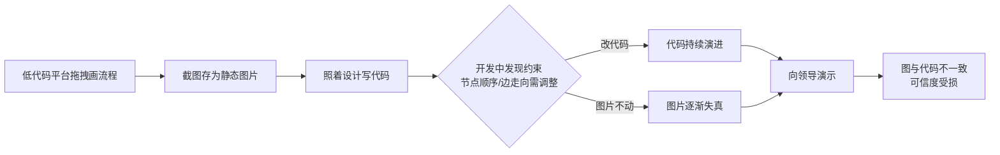

【学习目标】

- 理解「静态流程图截图」在真实开发中必然失效的原因，图与代码的漂移问题；
- 建立「图随代码走」（Diagrams as Code）的思路，并了解 PlantUML 作为代码化画图方案的核心特征；
- 学会在项目介绍与面试中，把「流程可视化」从一个附带动作包装成体现工程素养的亮点。

## 【正文】

## 一、问题提出：流程设计不该只活在开发者脑子里

工作流在机器宕机或重启之后如何继续执行，是面试高频问题（前两篇刚闭环）。从本节开始进入一个新的问题点，它同样可能出现在面试环节：**如何让用户或者领导更直观地看到你设计的流程。**

该问题直接被问到的概率不算高，但如果面试官让你介绍项目是怎么设计的，完全可以把它当作一个亮点抛出来。在实际工作中，尤其是 2B 项目，能让领导清楚地看到你的流程设计，反馈通常很正面。

为什么值得单独拿一节来讲？因为库存调拨这类 Agent 工作流有一个特点：**流程本身就是产品。** 用户买的不是一段代码，而是「预测 → 提取 → 邮件 → 人审 → 创单」这条业务链路。链路设计得合理与否、顺畅与否，决定了系统能不能落地。而链路又是跨角色沟通的产物，产品经理关心节点顺序，运营关心人审卡点，领导关心全貌。把流程清晰地呈现出来，是让各方对「系统到底怎么运转」达成共识的前提。

再把视线拉到 2B 项目的交付语境，这张图还承担着三个隐性职责：**验收依据**，合同或需求文档里的流程约定，最终要靠一张与实现一致的图来核对；**汇报素材**，领导不会读代码，一张专业架构图是三分钟讲清项目价值的最短路径；**跨部门接口**，仓储、供应链、财务等周边系统要对接调拨流程时，图是各方对齐边界的通用语言。一张过期或失真的图，在这三个场景里都会把沟通成本放大数倍。
## 二、常见做法及其失效原因：截图与代码的漂移

先不绕弯子，方案是用 PlantUML 这套代码化的方式一键生成专业架构图，让设计清晰可见。这也正是本节对应 PPT 标题所概括的：使用 PlantUML 一键生成专业架构图，让设计清晰可见。

在讲方案之前，先看大多数团队的真实做法，以及它为什么不够用。回想一下平时的设计流程：做代码设计之前，产品经理或者开发者自己会先通过 Dev、Code 这类工具，或者到低代码平台上拖拖拽拽，把工作流画出来；确认没问题之后，再照着设计去写代码。

既然如此，把产品经理或自己在低代码平台上画好的工作流流程图直接截个图、存张图片，到时候拿给领导或用户看，讲清楚整个工作流长什么样，是否就够了？

当然可以，但存在问题。真正动手开发时往往会发现，当初在低代码平台上设计的某些点实现不了，或者出现了不支持的场景，于是换成别的方案，边的走向会被调整，节点的执行顺序也会被改动。比如原本是 1、2 然后到 3，可能改成 2、1 再到 3，两种都可能是对的，取决于实现约束。

这种情况下，提前存一张静态图片去做演示，就做不到实时展示了。只要开发过程中有一次修改，就得把图重新保存一遍，还得专门去改图，维护成本明显偏高。

把失效链条完整画出来，可以看到问题不在「画图」这一动作，而在「图的载体与代码分离」：

一次两次忘了更新，后果可能只是尴尬；更危险的是「演示的图」和「运行的代码」长期不一致后，团队成员会默认「图仅供参考」，流程图随之失去评审价值，最后退化成没人维护的文档废墟。
## 三、方案：PlantUML 代码化生成，图跟着代码走

所以改用 PlantUML 来生成，图跟着代码走，改动即同步。

PlantUML 本质上是一门用脚本代码来画图的语言（7-5 会展开）：平时画图是在页面上可视化地拖拽，而 PlantUML 把这些图形抽象成了一段文本 script，由脚本驱动出图。对 Spring AI Alibaba Graph 而言，框架已经内置了对 PlantUML 的集成，它可以直接把图定义里的代码结构，添加了哪些节点、节点之间怎么连、哪里用了条件边，全部自动识别出来，生成对应的脚本代码，再由这份脚本渲染出整张工作流流程图。

这里值得多想一层：框架为什么能自动识别？因为 Graph 的图定义从来不是「约定俗成的隐性知识」，而是代码里的显式结构化数据，每个节点是一次注册，每条边是一次声明，条件边的路由逻辑挂在 `AsyncEdgeAction` 上。换言之，「工作流长什么样」这件事本来就有权威答案，只是此前缺少一种把它投影成图的手段。框架内置的 PlantUML 集成补上了投影这一环：编译产物 `CompiledGraph` 上调用 `getGraph`，传入呈现类型、标题与是否打印条件边，即可拿到脚本。图与代码因此不可能不一致，它们本就是同一份数据的两种视图。

这意味着「改图」这一动作消失了：开发者调整的是 `stateGraph.addEdge(...)` / `addConditionalEdges(...)` 这些代码，图是代码的编译产物，天然同步。领导看到的每一张图，都是当前代码的真实投影。

顺带把「代码化画图」的形态说具体，方便建立直觉：PlantUML 的脚本是纯文本，用少量固定标记声明图的开始与结束，中间用简洁的关键字描述「从哪个节点连到哪个节点」「条件分支如何走」。这段文本可以直接提交进 Git，可以写进注释，也可以在 CI 里校验。渲染环节由 PlantUML 引擎完成，本地工具、在线站点或服务端接口均可。对开发者而言，维护一图的工作量从「打开画布、拖拽、导出、替换文档里的旧图」压缩为「改一行代码」。

三种做法摆在一起对照，差异一目了然：

| 维度 | 静态截图 | 低代码平台实时画布 | PlantUML 代码化生成 |
|---|---|---|---|
| 产出方式 | 手工拖拽后截图 | 手工拖拽，画布即图 | 由工作流代码自动生成脚本 |
| 与代码的同步性 | 无同步，必然漂移 | 靠人记得更新 | 改动即同步，代码是唯一事实源 |
| 修改成本 | 每次改代码都要改图 | 每次改代码都要改画布 | 只改代码，图自动重绘 |
| 版本控制 | 二进制图片，diff 无意义 | 平台私有格式，难以 diff | 纯文本，可进 Git，diff 可读 |
| 评审嵌入 | 演示时口头讲解 | 演示时口头讲解 | 可放入代码评审流程 |
| 专业度观感 | 一般 | 一般 | 专业架构图观感 |

对求职语境还有一层价值：简历上写「设计了库存调拨 Agent 工作流」是陈述，能附上一张由代码自动生成的专业架构图是证据。面试现场展示这张图，再顺带讲出「图是从 `CompiledGraph` 的 `getGraph` 拿到的，改动节点代码后图自动重绘」，技术审美与工程习惯两个加分项一次拿满。这种「用工具把隐性工作显性化」的意识，正是初级开发者与 senior 候选人之间常见的分水岭。

## 四、落地形态：从日志打印到接口交付

方案的价值最终要靠「别人能看到」来兑现。课程中的落地形态分三步，层层递进：

1. **日志打印**：图编译完成后调用 `getGraph(GraphRepresentation.Type.PLANTUML, title, printConditionalEdges)` 拿到 PlantUML 脚本，用 `log.info` 打印。这一步解决「开发者自己能看到」。
2. **落库 + 接口**：编译时把 PlantUML 代码存到表里，额外提供一个接口按工作流查询其 PlantUML 代码。这一步解决「别人能按需拿到」。
3. **转图片**：拿到 PlantUML code 后调用渲染能力转成 PNG，可直接附在文档、邮件里，也可以做成下载接口让用户自助获取。这一步解决「非技术角色能直接看」。

三步走完，流程设计的可见性就形成了闭环：代码是事实源，脚本是中间产物，图片是交付形态。具体实现细节在 7-5 展开。

再补一个工程视角的细节：这套链路与代码评审可以天然融合。PlantUML 脚本是纯文本，意味着节点增删、边走向调整在 Git diff 里是一行行可读的变化；评审一个「调整人审路由」的 MR 时， reviewer 能同时看到代码改动与图结构改动两件事，而不是对着一张说不清年代的截图猜意图。这也是「图随代码走」在团队协作维度被低估的价值，它不只服务领导汇报，更服务日常研发协作。

## 【易错点 / 面试题】

1. **面试官问：你做的项目，流程图是怎么维护的？**
   答题要点：先点出常见做法的失效原因（静态截图与代码漂移，改一次代码就要手动改一次图，维护成本高且容易失真）；再给出方案（PlantUML 代码化生成，图随代码走）；最后给出落地链路（`getGraph` 拿脚本 → 日志打印 → 落库 → 接口查询 → 转 PNG）。能主动讲出「图是代码的编译产物、不是手工维护的文档」，就是加分回答。

2. **面试官问：低代码平台上已经能画流程图了，为什么还要代码化？**
   答题要点：低代码画布是人肉维护的独立事实源，与代码是两个世界，同步靠自觉；代码化生成只有代码一个事实源，评审可进 Git、diff 可读、演示永远真实。2B 项目里领导要看的不是「设计当时的图」，而是「现在跑着的图」。

3. **易错点：把「给领导看图」理解成一次性汇报材料。** 工作流的图始终处于变化之中（实现约束会迫使节点顺序、边走向调整），一次性截图必然过期；正确姿势是让图的生成自动化，汇报时取最新产物。

## 【小结】

本节确立了流程可视化的选型思路：静态截图因与代码漂移而失效，PlantUML 代码化生成让图跟着代码走、改动即同步，并梳理了「日志打印 → 落库 → 接口 → 转 PNG」的落地形态。下一篇（7-5）进入实现：如何调用 `getGraph` 生成 PlantUML 脚本、如何验证输出、如何把脚本转成图片。

工作流节点编排的最小可部署参照见工程模块 `980-demo/src/main/java/com/carl/ai/transfer/agent/TransferAgent.java`（自然语言 → 抽取 → 入库的节点串联），对外入口见同包 `controller/TransferController.java`，可作为「把流程设计讲清楚」时的代码底稿。
