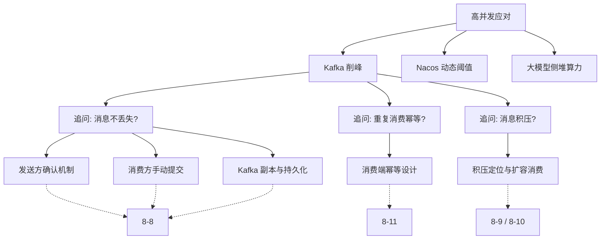

【学习目标】

- 建立库存调拨 Agent 高并发应对的整体框架：消息中间件削峰 + 动态触发阈值 + 大模型侧算力扩展；
- 预判面试官的追问链，消息不丢失、重复消费幂等、消息积压，并知道每个问题在后续章节的落点；
- 理解「引入新方案必须同时解决新方案带来的新问题」这一工程原则，能在项目介绍中系统化地讲清高并发设计。

## 【正文】

## 一、为什么高并发是简历上的必答题

从这节课开始进入第一个 Agent 开发环节，对应的也是简历上的面试官高频问点：**只要简历里写了做过智能库存调拨 Agent，面试官就一定会追问如何处理高并发场景。**

原因很直接：双 11 或大促活动期间，大量商品被销售，库存调拨会被频繁触发。面对这种高频触发场景，系统是怎么优化和处理的？

该问题之所以躲不掉，是由业务属性决定的。库存调拨不是「有人点一下才跑一次」的低频功能，而是与促销节奏强耦合的后台动作，大促期间订单量可能是平日的数十倍，每一次超卖风险、每一次区域间库存失衡，都可能触发一次调拨计算。调拨链路本身又重：要查商品与库存实时数据、调大模型做预测、提取结构化结果、发邮件通知、等人审、最后落库。同步直发的架构在大促流量面前会被瞬间打满，进而拖垮整个服务。

可以先把思路过一遍，再来看落地方案。

## 二、整体思路：中间件 + 动态触发阈值

整体的应对思路可以概括为一句话：**使用中间件以及动态触发阈值实现高并发业务。** 具体拆成三块：

| 层级 | 手段 | 解决的问题 | 课程对应篇章 |
|---|---|---|---|
| 业务层 · 削峰 | 引入 Kafka 作为消息中间件承接瞬时流量 | 流量高峰与系统处理能力之间的速率不匹配 | 8-5 ~ 8-7 |
| 业务层 · 控量 | Nacos 配置中心实现动态触发阈值 | 调拨触发频率需要按大促节奏实时收紧或放松 | 8-3 ~ 8-4 |
| 模型层 · 扩容 | 私有化部署大模型，堆 GPU、堆算力 | 模型推理本身的吞吐上限 | 本节第五小节 |

三块各管一层，组合起来构成完整的高并发应对体系。先分别讲清每层「解决什么、不解决什么」。

## 三、第一块：Kafka 消息削峰

第一，引入消息中间件做流量削峰。这里选用 Kafka 作为消息中间件来承接瞬时流量。

削峰的本质是**速率变换**：把「上游瞬时洪峰」转换为「下游匀速消费」。没有消息队列时，触发请求直接打到调拨处理逻辑，处理能力（尤其是大模型调用，单次数秒级）决定了系统吞吐上限，超出部分只能排队等待或直接失败；引入 Kafka 之后，触发请求写入消息队列即可返回，后端消费者按自身能力匀速拉取处理，洪峰被「摊平」到更长的时间窗口上。

对库存调拨场景，这还带来一个隐性收益：**触发与执行解耦**。大促期间允许「调拨任务排队中」的中间态，但不允许「用户触发的接口超时无响应」。异步化之后，接口侧延迟稳定，执行侧按部就班，系统的可用性观感完全不同于同步架构。

把链路的耗时构成摆出来，更能理解同步架构为何扛不住。一次完整的调拨执行包含：查询商品与库存实时数据、调用大模型生成预测（单次数秒级）、提取结构化 JSON、发送邮件通知、等待人类审核、创建业务单据落库。其中大模型调用与人审等待都是「秒级起步」的环节，人审更是以分钟甚至小时计。同步架构下，每个触发请求都要串行走完全程，系统吞吐被压到极低；即便忽略人审，仅大模型调用这一项就足以让接口在洪峰面前批量超时。异步化的价值不仅是「扛住流量」，更是把不同时间尺度的环节解耦，让快的环节先响应、慢的环节排队消化。

当然，代价也随之而来，只要链路里多了消息队列，就多了一整类新的生产问题，这正是本节第六节要展开的追问链。

## 四、第二块：Nacos 动态触发阈值

第二，使用 Nacos 作为配置中心，实现动态触发阈值。

真正的库存调拨执行是由一个阈值控制的：只有到达设定阈值之后才会触发。而该阈值放在 Nacos 里，可以动态实时修改，不需要重启服务。

为什么阈值必须动态？因为大促的流量曲线是不可预测的。零点开门红、上午补货、晚间高峰，每个时段的合理触发频率都不同：阈值定高了，大促期间超卖风险积聚；阈值定低了，日常时段频繁触发无意义的调拨计算，白白消耗大模型调用。把阈值放进配置中心后，运营或开发可以在大促现场实时调整触发灵敏度，改完即生效，无需发版重启，这对争分夺秒的大促保障是关键能力。

与 Nacos 的集成细节（服务搭建、配置规范）在 8-3、8-4 展开，这里先建立「配置中心服务的是动态调整能力」这一认知。

再从面试追问的角度预想一层：动态阈值的实现必然引出「配置变更如何被运行时感知」的问题，服务需要监听配置中心的变更事件并热更新本地缓存，而不是每次判断都远程拉取。这一机制在 8-4 的配置规范中落地，它与 Kafka 削峰形成互补：阈值控制「触发多少次」，削峰控制「每次触发多快地被执行」，两者共同决定系统在大促期间的实际负载。

## 五、第三块：大模型侧的高并发应对

需要注意的是，以上方案针对的是业务层的高并发应对。大模型侧怎么应对高并发？逻辑其实一样：**堆 GPU、堆算力。**

大模型在企业内部肯定是私有化部署的，买更多的 GPU、更多的服务器做分布式部署，应对高并发的能力自然更强。这一点可以在面试时主动和面试官沟通。

值得把这句话背后的取舍讲透：私有化部署意味着算力是自己买的，扩容就是加机器，没有按量付费的弹性可言。因此工程上的通常做法是「业务层尽量挡、模型层按峰值配」，业务层的削峰与阈值把无效调用挡在门外，模型层按可预期的峰值配置 GPU，必要时对模型服务做分布式部署摊薄单节点压力。反过来，如果业务层不削峰，再多的 GPU 也会被瞬时洪峰打穿，扩容成本会被无限放大。两层是配合关系，不是替代关系。

私有化部署方案（Ollama、vLLM、魔搭社区 Qwen 等）在 12-x 篇章展开。

## 六、追问链地图：引入消息队列之后的新问题

从下一节开始，就进入业务层高并发应对的代码编写部分。这一块涉及的内容比较多，因为引入消息中间件之后又会带来一系列新的生产问题。

一旦用了消息中间件，面试官的追问链就开始了：

1. **消息如何保证不丢失？** 而消息不丢失又分几个层面：发送方如何保证不丢失、消费方如何保证不丢失、Kafka 自身层面如何保证不丢失。
2. **消息重复消费带来的幂等问题怎么处理？**
3. **消息出现积压时怎么定位和处理？**

把追问链与后续章节的对应关系画出来，便于建立整章地图：

这也正是这一块比较复杂的原因：**引入一种新的技术方案去解决旧问题的同时，必须同步解决该新方案自身带来的新问题。** Kafka 解决了削峰，却带来了不丢失、幂等、积压三个新课题；每个课题背后又是一组可深挖的实现细节。能否系统化地回答这条追问链，直接决定面试官对你「是否真实做过」的判断。

## 七、面试视角：为什么这题答不上来就等于没做过

简历上写了这一段，面试官就一定会问到；如果这一块答不上来，面试官很容易判断项目不是你真实做过的，而是网上看来的、读几篇文章拼出来的。只有自己完整走一遍，才能真正应对得住追问。

把「答得上」的标准具体化，它其实分三个层次：

1. **能说清方案选型**：为什么是 Kafka 而不是其他消息中间件；为什么阈值要放配置中心而不是硬编码。
2. **能说清边界与代价**：削峰摊平了洪峰，但引入了最终一致性，触发与执行之间有了时间差，接口返回「已受理」而非「已完成」；大模型侧扩容受限于自有算力，因此业务层必须把无效调用挡在门外。
3. **能说清新问题的对策**：不丢失的三个层面分别怎么保证、幂等怎么做、积压怎么定位怎么扩容，这正是后续 8-8 至 8-11 四个篇章的主题。

三个层次都能覆盖，这道题就从「送命题」变成了「加分项」。

顺带交代一个本章的改造路线，帮助建立前后文的关联：8-2 先把单体项目改造为微服务项目，为拆分触发端与执行端做准备；8-3、8-4 搭建 Nacos 并落地配置规范，动态阈值随之有了承载；8-5 至 8-7 引入 Kafka 并打通生产消费全链路；8-8 至 8-11 逐一解决不丢失、积压、幂等三个追问链课题；8-12 做业务层开发与全流程联调验收。整章走完，「高并发应对」才从一句话方案变成可运行的系统。对学习者而言，紧跟这条路线比死记方案更有价值，每个环节的代码都会在对应小节落地。

## 【易错点 / 面试题】

1. **面试官问：你是如何应对高并发场景的？**
   答题要点：一句话总纲「中间件 + 动态触发阈值」；业务层用 Kafka 削峰把瞬时洪峰摊平，用 Nacos 动态阈值控制触发频率、大促现场可实时调整；模型层私有化部署、堆 GPU 堆算力，与业务层配合而非替代。

2. **面试官问：用了 Kafka 之后，消息不丢失怎么保证？**
   答题要点：分三个层面，发送方（确认机制）、消费方（处理完成再提交偏移）、Kafka 自身（副本与持久化配置）。此题在 8-8 有完整落地，本节先建立分层意识。

3. **易错点：只讲「用了 Kafka 削峰」就结束。** 削峰只是起点，面试官真正考察的是你能不能预见新方案带来的新问题（不丢失、幂等、积压）并给出对策。主动把追问链讲出来，比被问一个答一个印象分高得多。

## 【小结】

本节建立高并发应对的整体地图：业务层 Kafka 削峰 + Nacos 动态阈值，模型层私有化部署堆算力，并预演了「消息不丢失 / 重复消费幂等 / 消息积压」的完整追问链，对应后续 8-2 至 8-12 的代码落地。核心工程原则一句话：引入新方案解决旧问题的同时，必须同步解决新方案自身带来的新问题。

调拨链路各环节的最小可部署参照见工程模块 `980-demo/src/main/java/com/carl/ai/transfer/agent/TransferAgent.java`（自然语言 → 抽取 → 入库编排），对外触发入口见同包 `controller/TransferController.java`；下一篇（8-2）开始单体项目的微服务化改造，为消息中间件与配置中心的引入做准备。
