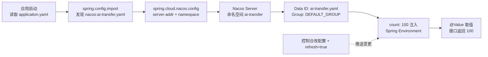

## 【学习目标】

- 掌握 Spring Cloud Alibaba 2023.0.1.3 及以上版本的两条接入变更：`spring.config.import` 导入、`bootstrap` 文件废弃。
- 理解命名空间、Group、Data ID 三层隔离结构，会为项目建命名空间与配置项。
- 能在 `application.yaml` 里写全 Nacos 连接信息（`server-addr`、`namespace`、`file-extension`）并完成取值验证。
- 说清新旧两套接入方式的差异，能应对「为什么我的 Nacos 配置不生效」类排查。

## 【正文】

### 一、两条官方变更：接入方式换了

回到 Spring Cloud Alibaba 官网，文档里明确写到：2023.0.1.3 及以上版本，默认加载 `application.name` 配置的方式已经废弃，以上版本请统一使用 `spring.config.import` 的方式导入 Nacos 配置。

紧接着下面还有一条同样重要：`bootstrap.yaml` 以及 `bootstrap.properties` 已不推荐使用，请改用 `application.yaml` 或者 `application.properties`。

回想一下老版本的做法：使用旧版本的 Spring Cloud Alibaba 和旧版本 Nacos 时，除了业务配置用的 yaml 文件，往往还要额外写一个 `bootstrap.yaml` 或者 `bootstrap.properties`。新版本将 bootstrap 废弃，不再推荐使用，好处是能少写一个配置文件，所有配置统一放到 `application.yaml` 里就行。

两套方式的差异不只是「少一个文件」：

| 维度 | 旧方式（bootstrap + application.name） | 新方式（spring.config.import） |
|---|---|---|
| 引导文件 | 需要独立的 `bootstrap.yaml` | 不需要，统一进 `application.yaml` |
| 导入声明 | 靠 `spring.application.name` 隐式拼 Data ID | 显式声明 `spring.config.import` |
| 多配置导入 | 扩展点分散 | import 接收列表，一行一个来源，原生支持多 Data ID |
| 维护成本 | 两套启动语义（bootstrap 上下文 vs application 上下文） | 单一上下文，与 Spring Boot 原生配置体系对齐 |

新方式把「配置导入」收敛回 Spring Boot 原生的 `spring.config.import` 机制：Nacos 只是被导入的一个配置来源，与 classpath、系统环境等来源并列，心智模型统一了。

### 二、Nacos 侧准备：命名空间与配置项

配置之前先到 Nacos 里做些准备。

首先新建一个命名空间，用于隔离不同的项目。新建一个名为 `ai-transfer` 的命名空间，名字就叫「智能库存调拨」，把智能库存调拨系统的配置统一放到该命名空间下。命名空间创建好之后，方便后续测试使用。

然后创建配置项：Data ID 直接用项目名 `ai-transfer`；因为是 YAML 风格，后缀写成 `yaml`；Group 保持不动；内容里写一个配置项 `count`，值给 100，点击发布。前期准备到这里完成。

Nacos 的配置定位是三层结构，本节用到了前两层：

| 层级 | 作用 | 本节取值 |
|---|---|---|
| 命名空间（Namespace） | 按项目/环境隔离，最高层 | `ai-transfer`（智能库存调拨） |
| Group | 配置分组，同命名空间下再分租户 | 默认 `DEFAULT_GROUP` |
| Data ID | 具体一条配置的标识，通常对应一个应用 | `ai-transfer.yaml` |

### 三、application.yaml 编写

接下来进到配置文件里编写。本地已有的基础配置如下：

```yaml
        spring:
          datasource:
            driver-class-name: com.mysql.cj.jdbc.Driver
            url: jdbc:mysql://localhost:3306/ai-transfer?useUnicode=true&characterEncoding=utf-8&useSSL=false&serverTimezone=Asia/Shanghai
            username: root
            password: 123456
            data:
              redis:
                database: 2
                host: localhost
                port: 6379
                timeout: 5s
        server:
          port: 8876
        mybatis-plus:
          configuration:
            log-impl: org.apache.ibatis.logging.stdout.StdOutImpl
        logging:
          level:
            root: info
```

在此基础上追加 Nacos 接入的三类配置。

**第一类：导入声明。** 通过 `config` 下的 `import` 来导入。注意 `import` 这里可以传入一个集合，这也解释了官方示例里短横线写法的含义：它可以接收一个列表。所以写成 `- nacos:` 开头，后面接 Data ID，也就是刚才创建的那条；再把开启自动刷新的参数也一并粘过来，形如 `- nacos:ai-transfer.yaml?refresh=true`。

写成短横线列表的价值在于「多来源一行一个」：后续 Kafka 阈值、邮件模板等配置各自拆成独立 Data ID，往列表里加一行即可，互不影响。`refresh=true` 是动态刷新的开关，不改它，配置变更要重启才生效；开了它，Nacos 推送变更后 Spring Environment 热更新，配合 `@Value` 或 `@ConfigurationProperties` 直接拿到新值。这正是 8-2 篇「动态阈值更新」愿景的落点。

**第二类：Nacos 基础信息。** 还需要配置 Nacos 在哪台机器上、使用哪个命名空间等等。这里有 `spring.cloud.nacos.config` 下的配置项，其中 `server-addr` 指定 Nacos 配置中心的地址，本机就是 `localhost:8848`；再加上前面统一好的 `file-extension: yaml`，以及 `namespace` 一项。

其中 `namespace` 填的是命名空间 **ID**（创建成功后控制台里那串 UUID），不是命名空间名称，这是最常踩的坑，填名称会导致静默回落到默认命名空间，表现为「配置明明发布了却取不到」。

**第三类：文件后缀。** 还可以统一指定配置文件的后缀：因为 Data ID 全部采用 YAML 风格，所以后缀统一写 `yaml`，通过文件后缀配置项加上即可。这样 import 里甚至可以只写 `nacos:ai-transfer`，后缀由 `file-extension` 统一裁决，多个 Data ID 不用重复写 `.yaml`。

先配这三个就够用了。账号密码暂时不配，本地单机暂时用不到，8-3 篇的 `application.properties` 里虽然开了 `nacos.core.auth.enabled=true`，本地单机直连且未强制登录态的场景可以暂缺省；连共享环境时必须补 `username`/`password`。Group 理论上也可以配，但因为大家用的都是默认分组，`group` 本身有默认值 `DEFAULT_GROUP`，配不配都行，这里就不配了。

### 四、取值验证

配置写完之后做个验证。刚才创建的配置里写了 `count: 100`，现在验证能否取到该值。

新建一个测试用的 controller，加上 `@RestController` 注解，简单写一个 `@GetMapping` 方法。要从 Nacos 里取到 count 的值，直接用 Spring 框架的 `@Value` 注解取值，用 `int` 接收。取到之后直接 `return R.success(count)` 把值传出去。

启动项目做测试。项目成功启动，没有任何报错，该步骤本身就说明 `spring.config.import` 声明的 Nacos 来源被成功加载（导入失败会在启动阶段直接抛错）。调用该接口，访问 `/测试nacos`，回车看返回的 data 是 100，说明成功取到了配置。

至此，项目中引入 Nacos 作为配置中心就成功了。整个装配链路如下：



### 五、取值的两种方式：@Value 与 @ConfigurationProperties

验证阶段用 `@Value` 取单个值最直接，配置项变多之后要换 `@ConfigurationProperties`：

| 维度 | `@Value` | `@ConfigurationProperties` |
|---|---|---|
| 适用规模 | 单个或少量配置 | 一组相关配置绑定到 POJO |
| 松散绑定 | 不支持 | 支持（kebab-case 转驼峰） |
| 校验 | 无 | 可加 JSR-303 注解 |
| 动态刷新 | 需配合 `@RefreshScope` | 同样需要 `@RefreshScope` |

阈值这类会持续增加的配置，建议按 `@ConfigurationProperties` 归组，例如销售阈值、批量大小各归一类，避免 `@Value` 散落各处难以盘点，配置中心的另一半价值是可治理，而可治理的前提是配置项有清晰的归属。

### 六、动态刷新是怎么发生的

`spring.config.import` 导入的配置之所以能热更新，背后是一条完整的监听链：Nacos 客户端与服务端保持长轮询，配置变更后服务端推送变更，客户端触发本地监听器，Spring Cloud 再把变更转成 `Environment` 的更新，并 rebind 标记了 `@RefreshScope` 的 Bean。普通单例 Bean（含未加 `@RefreshScope` 的 `@ConfigurationProperties`）不会重建，这是「改了配置却没生效」最常见的认知盲区。

配置变更的传播路径也可以作为排查线索：控制台确认已发布 → 客户端日志确认收到变更 → 检查 Bean 是否在 `@RefreshScope` 内。三步定位，就能分清是「没发出去」「没收到」还是「没 rebind」。

### 七、多环境划分建议

命名空间用满，是配置中心从「能跑」到「好维护」的分水岭：

| 环境 | 命名空间 | Data ID 约定 |
|---|---|---|
| 本地与联调 | dev | `ai-transfer-dev.yaml` |
| 测试 | test | `ai-transfer-test.yaml` |
| 生产 | prod | `ai-transfer-prod.yaml` |

Data ID 与 profile 对齐后，应用切换环境只需调整 `spring.profiles.active` 或命名空间配置，代码零改动。这正是 8-2 篇「动态阈值」愿景的完整形态：配置全部外移，环境差异收敛进命名空间。

### 八、常见接入报错与排查

接入 Nacos 的报错集中在前置条件上，按现象对照处置即可：

| 现象 | 大概率原因 | 处置 |
|---|---|---|
| 启动报占位符无法解析 | `spring.config.import` 未生效或命名空间填错 | 核对 namespace 填的是 ID、Data ID 与 file-extension 是否匹配 |
| 配置发布了却取不到值 | 命名空间/分组不对，或 key 层级写错 | 控制台按命名空间 → Group → Data ID 逐层核对 |
| 改了配置不热更新 | Bean 未在 `@RefreshScope` 内 | 加 `@RefreshScope`，或改用 `@ConfigurationProperties` 归组 |
| 连接超时 | `server-addr` 写错、端口不通或防火墙 | 先验证 8848 端口可达，再查地址与命名空间 |
| 控制台 403 | 8-3 篇开启了认证，应用侧未配账号密码 | 补 `username`/`password` 配置 |

把这张表与「控制台已发布 → 客户端已收到 → Bean 已 rebind」的排查链配合使用，大部分接入问题都能在五分钟内定位。

### 【易错点 / 面试题】

1. **面试：Nacos 的配置隔离是怎么分层的？**
   参考答法：命名空间 → Group → Data ID 三层。命名空间按项目或环境隔离（dev/test/prod 或不同系统），Group 在同命名空间下再分组，Data ID 定位具体一条配置。跨项目串配置，九成是命名空间填错。

2. **面试：`spring.config.import` 和 `bootstrap.yaml` 有什么区别？**
   参考答法：bootstrap 是老版本 Spring Cloud Alibaba 的私有引导机制，需要额外文件且早于 application 上下文加载；`spring.config.import` 是 Spring Boot 原生的配置导入机制，2023.0.1.3 之后官方统一推荐它，Nacos 降格为一个普通配置来源，import 还天然支持列表形式的多配置导入。

3. **易错：`namespace` 填了名称而不是 ID。** 控制台创建的命名空间有一列是 ID（UUID 串），配置里必须填它；填中文名称不会报错，但会静默落到默认命名空间，排查成本很高。

### 【小结】

本节把 Nacos 配置中心接进了应用：按新规范用 `spring.config.import` 声明导入、`bootstrap` 文件不再使用，配齐 `server-addr`、`namespace`、`file-extension` 三项基础信息，并用 `@Value` 取到 `count: 100` 完成验证。配合 8-3 部署的服务端，「配置外移 + 动态刷新」的闭环已经打通。

下一节开始引入消息中间件 Kafka，完成与项目的整合，包括实现消息发送、消息接收，以及消息不丢失如何保证、幂等如何处理等一系列方案。

配套工程参考：配置外部化的工程实践可对照 `980-demo/src/main/resources/application.yml` 与 `980-demo/src/main/resources/application-prod.yml`，密钥与端点全部走环境变量占位（如 `${OPENAI_API_KEY}`），default profile 离线可跑、prod profile 接真实服务，与「Nacos 管动态业务配置、profile 管环境差异」是同一套配置治理思路的两面。
