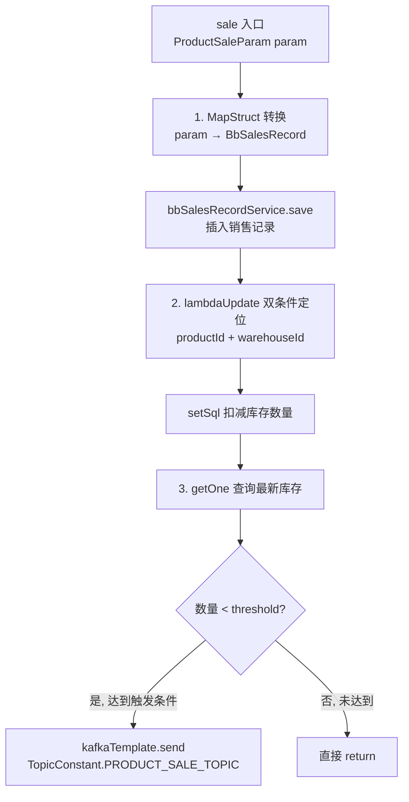

## 【学习目标】

- 掌握 `ProductSaleService` 的三步核心逻辑：保存销售记录、扣减库存、阈值判定后发送 Kafka 消息。
- 学会用 MapStruct 完成 `param` 到 `model` 的转换，理解 `INSTANCE.paramToModel(param)` 的用法。
- 理解 Nacos 配置 + `@RefreshScope` 实现的阈值动态刷新，以及 Kafka topic 常量化管理。
- 能预判「KafkaTemplate 发送 POJO 与 StringSerializer 不匹配」这类序列化陷阱。

## 【正文】

### 一、service 层职责划分与依赖注入

8-5 把 Controller 改造成了「收参数、调 service」的薄层，真正的业务逻辑在这一节下沉到 `ProductSaleService` 实现类。职责划分的理由很直接：Controller 负责协议适配（HTTP 映射、参数绑定、统一响应），service 负责业务编排（落库、阈值、发消息），两者关注点不同，混写在 Controller 里会让后续的测试与复用都变困难。

service 层首先要操作数据库：一次销售要往销售记录表插入一条数据，同时修改库存表里的数量。至于库存流水记录，本节先不处理，正常业务里库存一动，流水必然跟着变，而且往往拆分成销售入库、销售出库、退货入库等多种类型；但本项目后续给大模型做预测分析时用不到流水，因此先聚焦主线，避免范围蔓延。

依赖注入的是 MyBatis Plus 代码生成器生成的基础 service 接口，以及来自 Nacos 的阈值配置：

```java
@Service
public class ProductSaleServiceImpl implements ProductSaleService {
```

```java
@Resource
private BbSalesRecordService bbSalesRecordService;

@Resource
private BbInventoryService bbInventoryService;

@Value("${threshold_productCount}")
private Integer threshold;
```

三个注入项各司其职：`BbSalesRecordService` 管销售记录，`BbInventoryService` 管库存，`threshold` 从 Nacos 读取商品数量阈值。

### 二、三步流程总览



三条主线的顺序有讲究：先落销售记录保证业务数据不丢，再扣库存，最后才判断是否触发 AI 工作流。即使 Kafka 发送失败，前两步的业务数据也已经入库，最多损失一次 AI 触发，不会出现「卖了货却没记账」的严重不一致。

### 三、第一步：MapStruct 完成 param 到 model 的转换

`ProductSaleParam` 是接口入参，`BbSalesRecord` 是数据库实体，两层之间需要转换。这里借助 MapStruct：定义一个转换接口 `SaleRecordConvert`，加上 `@Mapper` 注解，并在接口内声明 `INSTANCE` 静态实例（`Mappers.getMapper(...)` 的惯用写法），提供 param 转 model 的方法，方法签名为 `BbSalesRecord paramToModel(ProductSaleParam param)`。

service 中调用 `SaleRecordConvert.INSTANCE.paramToModel(param)` 即可拿到 model 对象，随后 `bbSalesRecordService.save(bbSalesRecord)` 完成插入，第一步结束。

MapStruct 相比手写 setter 的优势在 5-15 已展开：编译期生成实现类、无反射开销、字段名不一致时编译报错而非运行时报错。工程模块 `980-demo/src/main/java/com/carl/ai/transfer/convert/TransferOrderConvert.java` 完整演示了这套写法，包括课程核心坑的正确处理：param 的 `transferDate` 用 `String`、model 的用 `LocalDate`，MapStruct 自动完成 `LocalDate.parse(String)` 转换；若两侧都用 `LocalDate` 反而会因「目标属性有多个源」报错。本节的 `ProductSaleParam` 与 `BbSalesRecord` 之间是同类字段直映射，属于最简单的一档。

### 四、第二步：库存扣减的 lambdaUpdate 写法

更新库存使用 MyBatis Plus 的快捷方法 `update` 搭配 `Wrappers.lambdaUpdate(BbInventory.class)`，两个 `.eq(...)` 分别按 productId 与 warehouseId 定位，末尾用 `.setSql(...)` 拼出自增/自减表达式（完整代码见本节末尾的 sale 实现）。

三个要点：

1. **定位条件双保险**：where 条件是 productId 相等且 warehouseId 相等。同一商品在不同仓库各有库存记录，单靠 productId 会更新多行，必须两个字段联合定位。
2. **`setSql` 拼原始 SQL 片段**：更新值不是 set 一个常量，而是「数量等于原数量减去/加上卖出的数量」这种自增/自减运算，必须走 `setSql` 直接拼 SQL 表达式。
3. **原稿口播与代码的差异说明**：讲课口播描述为「数量等于原数量减去卖出的数量」，但代码块中实际是 `"quantity=quantity+" + param.getQuantity()`（加法）。此处以代码块为准，保留原代码不动；从业务语义上讲，销售出库应对库存做扣减（应为减号），口播讲解与代码存在表述不一致，这类细节在复现课程代码时需要自行对齐业务口径。

该写法还有一个生产价值：`quantity=quantity±n` 是数据库层的原子运算，比「先查出来、在 JVM 里加减、再 update 回去」更安全，后者在高并发下会因两个线程读到同一旧值而丢失更新（典型的 read-modify-write 竞态）。如果项目并发量上来，扣减语句就应当保持这种原子 SQL 的形态。

### 五、第三步：阈值判定与 Kafka 发送

**阈值来自 Nacos**。先在 Nacos 控制台编辑配置，定义 `threshold_productCount`（商品数量阈值），演示环境配 245，测试用的商品 1 在仓库 1 的当前数量正好是 245，一次销售即可触发发送。真实企业项目的阈值体系会复杂得多：按日期的阈值、按数量的阈值、同一商品不同仓库配不同触发阈值，本节只是用「商品数量」这一个维度做引子。

读取配置用 `@Value("${threshold_productCount}")`。配置名直接复制粘贴过来，避免拼写错误；同时类上要加 `@RefreshScope`，Nacos 配置变更后，Spring Cloud 的 refresher 监听器会感知 change 事件，刷新该 Bean，实现不重启动态生效（8-9 会完整验证这一点）。

判定逻辑分两步：先用 `bbInventoryService.getOne(Wrappers.lambdaQuery(BbInventory.class)...)` 按 productId + warehouseId 查出最新库存，再把数量拆箱成 `intValue()` 与 `threshold` 比较；未达到触发条件就直接 `return`（完整代码见本节末尾的 sale 实现）。

- `getOne` 而非 `list`：productId + warehouseId 联合条件下库存记录唯一，用 `getOne` 直接取单条（多条会抛异常，反而起到校验作用）。
- `getQuantity()` 的包装类型转 `intValue()`：实体字段若是 `Integer`，与 `threshold` 比较前先拆箱成基本类型。
- 短路原则：判定条件写成「小于阈值就 return」，未达到触发条件时立即结束，避免执行发送逻辑；代码实际语义为「库存数量低于阈值才发送消息」，即库存越少越触发补货预测，符合「缺货风险越高越要预测」的业务直觉。口播中「小于等于阈值」与代码的严格小于略有出入，同样以代码块为准。

**发送消息**需要注入 `KafkaTemplate`。若 IDE 提示找不到该类，刷新 Maven/清除缓存即可恢复，一般是 IDE 索引问题而非依赖缺失。发送时两个参数：topic 与数据。

topic 不写死在代码里，字符串字面量满天飞就是魔法值泛滥。正确做法是建 `constants` 常量包，在其中定义 `TopicConstant`，声明 `public static final String PRODUCT_SALE_TOPIC = "sale-topic"`。

所有 topic 统一在常量类中声明，发送处通过 `TopicConstant.PRODUCT_SALE_TOPIC` 取值，后续改 topic 名只动一处。

消息内容只传商品 ID：消费者的职责是拿到消息后触发工作流（库存调拨分析、预测、生成调拨单），而此前触发工作流只需要商品 ID 一个参数，所以消息体保持最小集即可。

**一个必须提前预判的坑**：当前 `value-serializer` 配的是 `StringSerializer`（8-5 所配），而此处 `kafkaTemplate.send(TopicConstant.PRODUCT_SALE_TOPIC, param)` 发送的是 POJO 对象。序列化阶段就会因类型不匹配而失败，8-7 的 500 错误正是由此触发，修正方式是把商品 ID 转成 `String` 再传输。另外，首次发送时 topic 尚未创建，直接发会报「topic 不存在」，需要在 Kafka 的 `admin` 配置中开启自动创建（`auto-create` 相关配置置 `true`），执行时 Broker 自动建出 topic。

完整的 service 实现如下：

```java
@Override
public void sale(ProductSaleParam param) {
    // 1. 保存一个销售记录
    BbSalesRecord bbSalesRecord = SaleRecordConvert.INSTANCE.paramToModel(param);
    bbSalesRecordService.save(bbSalesRecord);

    // 2. 更新库存信息
    bbInventoryService.update(Wrappers.lambdaUpdate(BbInventory.class)
        .eq(BbInventory::getProductId, param.getProductId())
        .eq(BbInventory::getWarehouseId, param.getWarehouseId())
        .setSql("quantity=quantity+" + param.getQuantity()));

    // 3. 判断是否达到阈值，若没有达到阈值则直接结束，反之发送消息到kafka
    BbInventory inventory = bbInventoryService.getOne(Wrappers.lambdaQuery(BbInventory.class)
        .eq(BbInventory::getProductId, param.getProductId())
        .eq(BbInventory::getWarehouseId, param.getWarehouseId()));
    if (inventory.getQuantity().intValue() < threshold) {
        return;
    }

    // 发送消息到kafka
    kafkaTemplate.send(TopicConstant.PRODUCT_SALE_TOPIC, param);
}
```

与 8-5 留下的 `void sale(...)` 骨架相比，这里把「先写成 void、后面再定返回值」的占位落实成了完整的三步编排。返回值暂不调整，因为对调用方（Controller）而言，此阶段只需知道「请求已受理」，真正的结果由异步链路负责，这也是异步化改造的必然结果：同步返回值承载的信息量下降，业务结果改由消息链路与后续查询体现。

## 【易错点 / 面试题】

1. **面试官问：`@RefreshScope` 是怎么做到不重启生效的？**
   答：被 `@RefreshScope` 标注的 Bean 存进一个特殊作用域，Nacos 配置变更时 Spring Cloud Context 的 refresher 发布 `RefreshEvent`，该作用域下的 Bean 全部销毁重建，下次注入/调用时即读到新值。注意：刷新只影响 `@RefreshScope` Bean，普通单例 Bean 里的 `@Value` 不会更新，这就是阈值字段所在的实现类必须加 `@RefreshScope` 的原因。
2. **库存扣减为什么推荐 `setSql("quantity=quantity-n")` 而不是先查后改？**
   先查后改是 JVM 层的 read-modify-write，两个并发请求读到同一库存值时会互相覆盖，导致超卖或扣减丢失。把加减法放进 SQL 由数据库保证原子性，是低成本高收益的写法。
3. **发送 POJO 到配置了 `StringSerializer` 的 topic 会发生什么？**
   序列化阶段直接失败（ClassCastException/SerializationException 一类错误）。排障时看到生产者发送报错，先核对 `value-serializer` 与发送内容的类型是否匹配，比盲目翻日志更快。

## 【小结】

本节完成 Agent 触发接口的 service 层改造：MapStruct 转换 param 到 model、双条件定位的原子库存扣减、Nacos 阈值 + `@RefreshScope` 动态判定、常量化管理 topic 的 Kafka 发送。两步业务落库的写法可对照 `980-demo/src/main/java/com/carl/ai/transfer/service/TransferOrderServiceImpl.java`（`@Transactional` 包裹的多表落库编排）与 `980-demo/src/main/java/com/carl/ai/transfer/convert/TransferOrderConvert.java`（param→model 转换层）。发送 POJO 与 StringSerializer 的冲突已埋下伏笔，8-7 将在全链路联调中定位并修正它，随后补齐消费者侧的 Agent 触发。
