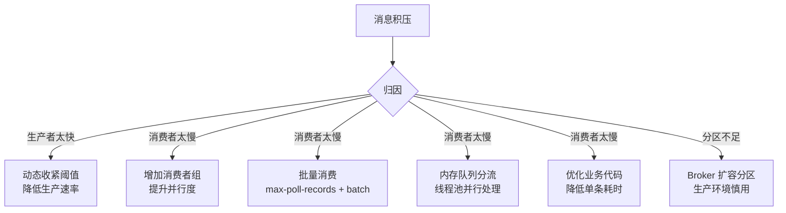

## 【学习目标】

- 验证 Nacos 阈值的实时动态刷新，理解「生产者侧降速」作为积压治理的第一道闸门。
- 建立消息积压的两类成因判断框架，掌握生产者/消费者/Broker 三端的治理手段。
- 掌握批量消费的关键配置（`max-poll-records`、`listener.type=batch`、`auto-offset-reset`）与逐条 ack 的语义。

## 【正文】

### 一、先验证：Nacos 动态刷新就是生产者侧的「调速阀」

消息积压的治理不止在消费者侧，**让该发的消息发出去，不该发的不发**，是更上游的手段。本节先用实验验证 Nacos 的实时刷新能力，再讲积压治理的完整方案。

实验设置：Nacos 里阈值配置为 245，数据库刷新可见库存 239。到 Nacos 把阈值改成 230 并发布，返回查看已是 230。**整个过程中项目一直运行，没有重启**。

推演一下：阈值 230，当前库存 239 > 230，不应触发 Kafka 发送；再消费一次库存变 238，仍大于 230，还是不触发。打断点实证：发起点前记录当前消息数为 4 条；注意日志中出现 `RefreshScope` 相关监听，refresher 感知到配置 change，这是实时刷新的实现基础。再次发起发送，断点里取到的阈值已是 230，代码直接 return；结果消息数依然为 4，未发送任何新消息。**项目自始至终没有重启，阈值动态实时刷新完成。**

放到企业级项目里，该能力的价值在大促期凸显：618、双 11、双 12 期间流量峰值陡增，运营或开发可以直接在 Nacos 调阈值，把触发条件收紧，让更少的销售行为去触发大模型预测、触发 Agent 执行，从而**降低生产端速率**，从源头缓解积压。相比之下，改代码发版走发布流程，时效性差太多。

「更新库存」这段逻辑的原稿代码块如下（保留原样）：

```java
public void sale(ProductSaleParam param) {
    // 2.更新库存信息
    bbInventoryService.update(Wrappers.lambdaUpdate(BbInventory.class)
            .eq(BbInventory::getProductId, param.getProductId())
            .eq(BbInventory::getWarehouseId, param.getWarehouseId())
            .setSql(/* 原稿此处为 ASR 转写坍缩成的 setSql 重复堆叠，无实际技术内容 */);
}
```

**关于代码块的如实说明**：原稿中 `.setSql(...)` 参数部分是语音转文字坍缩成的重复堆叠内容，无实际技术意义，此处按原稿保留并加注说明。该语句的完整可用写法见 8-6 的 sale 实现（`.setSql("quantity=quantity+" + param.getQuantity())`）。

### 二、消息积压的两类成因

「如何解决消息积压」是另一个面试高频题。分析之前先归因，积压无非两种情况：

1. **生产者太快**：生产速率持续高于消费能力（大促流量、阈值过松）；
2. **消费者太慢**：单条处理耗时过长（业务代码低效）或并行度不足（消费者数量/分区不足）。

归因决定方向：前者在入口减负，后者在处理端提速。

### 三、三端治理方案总览

| 端 | 手段 | 本项目落地 |
|---|---|---|
| 生产者侧 | 降低生产速率 | 通过 Nacos 动态调整阈值，减少触发 Agent 执行的销售行为 |
| 消费者侧 | 多消费组、批量消费、内存队列+线程池、优化业务代码 | 批量消费配置 + 后续逐条 ack 改造 |
| Broker 侧 | 拆分更多分区、同比例增加消费者 | 生产环境一般不推荐运行期改造 |



**消费者侧的四个手段**逐一看：

1. **创建更多消费者组**：Kafka 的限制是，同一个消费者组内，同一个 topic 的同一个分区只能由一个消费者消费。所以要加快消费速度，就创建更多消费者组去消费同一 topic（注意原稿表述为「创建更多消费者组」，组间互不影响、各自独立消费全量）。
2. **批量消费**：一次拉取一批数据，而不是一条一条拉，摊薄网络与提交开销。
3. **批量拉取 + 内存队列分流**：拉到一批后按业务特性拆进不同内存队列，用线程池分别消费。例如一次拉到 10 条，其中 3 条属业务 A、3 条属业务 B、4 条属业务 C，就分进三个队列，三个线程池并行处理，用多队列 + 多线程提高消费速率。
4. **优化业务代码**：单条处理耗时过长往往就是业务代码问题，需针对性优化。

**Broker 侧的谨慎态度**：一般按业务把 topic 拆出更多分区，并同比例增加分区与消费者。但要注意，只增加分区而不增加消费者，未必能明显提高消费速率，因为新增分区的消费仍落在原有消费者身上。更重要的是，**生产环境通常不推荐运行期改造 Broker**：新增分区后，老分区里积压的数据依然压在那里，处理本身就是新问题；很多 2C 业务数据量大，不允许运行期手动扩展 topic 分区。所以常规做法是停机处理，或改生产者/消费者，后者更常见。

代码层面，本节落地的是消费者侧的批量消费。

### 四、批量消费的关键配置

**`max-poll-records`**：consumer 下配置单次 poll 最大拉取条数，先设为 5，一批最多拉五条。

**`auto-offset-reset`**：指定重新消费时从哪个 offset 开始。一般选 `earliest`（从最早的位点重新消费）；也可选 `latest`（从最后的位点开始）。为保证消息不丢失，通常选 `earliest`，宁可重读，不可漏读。

**`ack-mode` 保持 `MANUAL_IMMEDIATE`**：8-8 已配置。这里要点破它在批量场景的语义：手动 ack 之后 offset 立即变化，批量消费同样适用。

**逐条 ack vs 批量 ack 的推演**：一次拉五条、逐个消费。若五条全部成功再一次提交五个 ack，一旦其中某条失败，已成功的几条是提交还是重消费？原稿推荐 `MANUAL_IMMEDIATE` 的逐条语义，**消费成功一条，立刻提交这一条的 ack**；即使后面某几条报错，也不影响已成功消息的 ack。

**`listener.type`**：配置为 `batch`，才算真正开启批量消费能力；同时在该批容器上指定最多消费条数（与 `max-poll-records` 呼应）。

### 五、Consumer 的改造方向

配置就绪后改造消费者：此前方法签名用单个 `String` 接收一条消息；支持批量后，改为接收 `List` 集合。拿到集合后**依然逐条处理**（业务触发工作流的逻辑不变，只是入参从单条变成遍历元素），每消费成功一条就提交一次 ack。这样一来，即使集合里靠后的消息消费失败，前面已成功消息的 ack 已经生效，不会被重复消费，可靠性不打折，速率靠批量拉取提升。这套批量消费的实跑验证在下一节演示。

## 【易错点 / 面试题】

1. **面试官问：分区数、消费者数、消费速率是什么关系？**
   答：同一消费者组内，分区是消费者的分配单元，组内消费者数超过分区数时，多出的消费者空闲；消费者数少于分区数时，一个消费者领多个分区。提速的标准动作是「分区与消费者同比例增加」；只加分区不加消费者，新增分区的消息仍由原消费者处理，提速有限。
2. **为什么生产环境不建议运行期扩展 topic 分区？**
   两个原因：其一，新增分区只影响新消息的分布，老分区的积压数据原地不动，清理积压本身成了新问题；其二，部分 2C 大流量业务不允许运行期手动扩分区，只能停机处理。所以更常见的方案是改生产者（降速）与消费者（提速），而不是动 Broker。
3. **`auto-offset-reset` 选 `earliest` 还是 `latest`？**
   取决于位点缺失时的取舍：`earliest` 从头读，可能重复消费但不会漏；`latest` 从最新读，会跳过积压消息。为保证不丢失，常规选 `earliest`，重复问题交给消费端幂等（8-11）兜底。

## 【小结】

本节从「防积压」与「治积压」两侧展开：Nacos 动态阈值在不重启的前提下收紧生产速率，是大促场景的第一道闸门；消费者侧则以批量消费（`max-poll-records` + `listener.type=batch` + `MANUAL_IMMEDIATE` 逐条 ack）加多消费组、内存队列分流为提速主轴；Broker 扩分区因积压迁移与业务约束，在生产环境需慎行。消费触发工作流后的抽取与落库主链路，可对照工程模块 `980-demo/src/main/java/com/carl/ai/transfer/extract/TransferOrderExtractor.java` 与 `980-demo/src/main/java/com/carl/ai/transfer/service/TransferOrderServiceImpl.java`（`@Transactional` 编排的入库实现）。下一节演示批量消费的实跑效果，随后进入重复消费的幂等处理。
