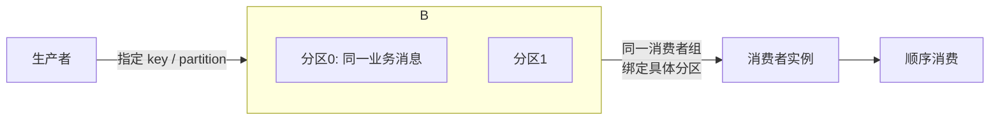

## 【学习目标】

- 能独立复现一次消息积压场景：注释消费端、调整触发条件、观察消费组 offset 滞后。
- 看懂批量消费日志 `batch size` 与 `max-poll-records` 配置的对应关系，理解一次拉取多条的处理方式。
- 给销售主链路补上事务，说清 `rollbackFor = Exception.class` 为什么必须显式声明。
- 讲清顺序消费在生产者、Broker、消费者三侧的保障手段，以及「既要顺序、又不积压」时的批量消费与死信队列方案。

## 【正文】

### 一、积压场景复现：先制造 5 条滞后

验证任何积压治理手段之前，先要能稳定制造积压。本节按以下步骤构造一次可控的积压：

1. 把消费端代码注释掉，服务只发送不消费，重启。
2. 调整触发条件。原阈值是 2300，而当前销售数量是 238，无论如何都不会触发。阈值可以不动，把销售数量直接改成卖 10 个，一样能触发。
3. 点发送，消息已经投递出去，放行之后数量变成 5。
4. 把销售数量改成 1 继续发送，变成 6 条；再发，7 条；再发，8 条；再发，9 条。
5. 刷新消费端的消费组信息：offset 依然是 4，末尾是 9，中间差了 5 条待消费。

此时积压已经构造完成。用消费组的两个核心指标来描述这次积压：

| 指标 | 含义 | 本次实测值 |
|---|---|---|
| committed offset | 消费组已提交的位点 | 4 |
| log end offset | 分区末尾位点 | 9 |
| lag（消费滞后量） | 两者之差，即待消费条数 | 5 |

积压治理的所有手段，最终都要体现在把 lag 压回 0。接下来打开消费端，验证它能否一次性消化这 5 条数据。

### 二、批量拉取验证：batch size = 5

打开 consumer，在 for 循环之前加一行日志 `batch size =`，记录这一批拉取到的消息数量。重启服务，在循环处打一个断点，避免消息一路跑完看不清过程。消费端代码如下：

```java
  @KafkaListener(topics = {TopicConstant.PRODUCT_SALE_TOPIC}, groupId = "group1")
  public void agentConsumer(List<String> messages, Acknowledgment acknowledgment) {
      try {
          for (String message : messages) {
              log.info("receive message: {}", message);
              // 创建线程池处理消息
              RunnableConfig runnableConfig = RunnableConfig.builder()
                      .threadId(IdUtil.simpleUUID())
                      .build();
              // 执行业务逻辑
              // ...
          }
      } catch (Exception e) {
          // 异常处理
          log.error("处理消息失败", e);
          acknowledgment.acknowledge(); // 手动确认消息已处理
      }
  }
```

断点命中后看日志，`batch size` 打出来是 5，完全按照配置一次性拉取了 5 条消息。放行让它继续执行即可。

这段代码里有三个值得展开的点：

- **入参是 `List<String>` 而不是单条 `String`**：Spring Kafka 的监听器支持按批接收，一批拉多少条由消费端的 `max-poll-records` 决定，后文 8-12 的配置块里可以看到它被设为 5。批量拉取是「不积压」的第一道闸门：一次网络往返拿到 5 条，比逐条拉取的吞吐高得多。
- **每条消息一个独立 `threadId`**：`RunnableConfig` 的 threadId 用 `IdUtil.simpleUUID()` 生成，与 6-3 篇「对话隔离」的做法一致，每条商品销售消息走独立的图执行线程，彼此状态互不污染。
- **catch 中的 `acknowledge()` 需要警惕**：原稿在异常分支里也做了手动确认，语义上等于「处理失败也认账」，失败消息会被直接跳过，存在丢失风险。生产环境更稳妥的做法是失败重试，超过重试次数后投递到死信队列，由人工兜底；这段代码按录制原样保留，落地时需要调整。

### 三、顺手补事务：销售主链路的原子性

趁着这一批消费，把之前代码里不完善的地方补上。回到 controller 层的商品销售接口实现类：这里操作数据库涉及一次保存、一次更新、一次查询，三者必须在同一个事务里，因此需要加上 `@Transactional` 注解，并用 `rollbackFor = Exception.class` 保证对任何类型的异常都会回滚。

```java
  @Transactional(rollbackFor = Exception.class)
  public void sale(ProductSaleParam param) {
      // 1. 转换销售记录
      BbSalesRecord bbSalesRecord = SaleRecordConvert.INSTANCE.paramToModel(param);
      // 2. 保存销售记录
      bbSalesRecordService.save(bbSalesRecord);
      // 3. 更新库存
      bbInventoryService.update(Wrappers.lambdaUpdate(BbInventory.class)
              .eq(BbInventory::getProductId, param.getProductId())
              .eq(BbInventory::getWarehouseId, param.getWarehouseId())
              .setSql("quantity=quantity-#{param.quantity}"));
      // 4. 查询库存
      BbInventory inventory = bbInventoryService.getOne(Wrappers.lambdaQuery(BbInventory.class)
              .eq(BbInventory::getProductId, param.getProductId())
              .eq(BbInventory::getWarehouseId, param.getWarehouseId()));
      // 5. 业务逻辑处理
      // ...
  }
```

`rollbackFor = Exception.class` 不能省：Spring 事务默认只对 `RuntimeException` 回滚，受检异常照样提交。库存扣减这类写操作一旦半途失败却不回滚，就会出现「销售记录在、库存没扣」的脏数据。方法内三步操作，保存销售记录、扣减库存、查回最新库存，要么全部成功，要么全部作废。

执行过程中邮箱开始持续收到通知邮件，说明下游链路（预测 → 提取 → 邮件）在正常跑。整批消费结束后刷新消费组，offset 已经和末尾对齐，5 条全部执行完毕，整体耗时也不算久。至此，消费者侧针对消息积压的基础改造就完成了。

### 四、消费并发的上限：堆资源与分区并行

这里顺带说清消费端提高并发的思路。课程给出的判断是：大模型要做分布式部署，并且购买更多 GPU 做多卡部署；GPU 越多，推理越快，支持的并发量越高；再加上分布式部署，并发能力会更好。本质上就是堆资源，配置上去了，消费性能自然更好。

落到 Kafka 消费侧，与之对应的两个杠杆是：

1. **分区数决定并行度**：同一个消费者组内，一个分区同一时刻只能被一个消费者消费，消费者数量不超过分区数才有意义。消费慢先加分区、再加消费者实例。
2. **消息内处理并行化**：代码注释里的「创建线程池处理消息」就是这一层的做法，单条消息内部若还有 IO 等待（例如等大模型推理），用线程池乃至 Java 21 虚拟线程承载，避免一条慢消息堵死整批。

大模型推理恰好是典型的「长耗时 IO」：一条消息从进来到预测完成可能要数秒，批量拉取后如果继续串行 for 循环处理，吞吐依然受限。这也是下一篇幂等方案里每条消息独立 `threadId` 的原因之一，并行处理的前提是状态隔离。

### 五、顺序消费扩展：三侧保障

本项目里并不涉及顺序消费：不同商品可能同时发生买卖，完全没必要严格做到先分析商品一、再分析商品二，业务上没有这种需求，所以对消息的顺序并不关心。但作为知识扩展，这部分依然要讲清楚。

顺序消费同样从三侧来看：生产者侧、Broker 侧、消费者侧。



- **生产者侧**：按照业务对消息做分类，发送时指定对应的 key 以及对应的分区，把同一个业务的消息发到同一个 topic 下的同一个分区。原因在于 Broker 端 topic 下面的分区天生保证顺序性，同一分区内的消息天然支持顺序消费。`send` 方法有多个重载，可以只传 topic，可以传 topic + key，也可以同时传入 topic、分区、key 和数据，用的就是最后一个重载。
- **Broker 侧**：分区内有序是 Kafka 的底层承诺，生产者把消息追加进同一分区，broker 按追加顺序落盘，顺序性由此而来。
- **消费者侧**：只使用一个消费者组，并且消费时指定消费 topic 下的某个具体分区。同一个消费者组里本来就有约束：同一个 topic 下的同一个分区，只能被消费者组中的一个消费者来消费。若 topic 下只有一个分区，再用一个消费者组消费该 topic，就形成了一对一的关系，从而保证消费的顺序性。

这里有一条必须记住的红线：**一旦一个分区对应了多个消费者，就一定无法保证消费顺序**。消费者 A 和消费者 B 可能部署在不同机器上，执行速率不一样，同一条消息有时候 A 处理得快，有时候 B 处理得快，顺序性就无从谈起。

### 六、顺序与不积压兼得：批量消费 + 死信队列

再往下还有一个扩展问题：既保证消息顺序性，又不产生消息积压，怎么实现？思路依旧集中在生产端和消费端这一业务层。

生产端不变：发送时指定相同的 key 或者相同的分区，把同一业务的消息打到同一 topic 的同一分区，靠分区的顺序性保证生产端的顺序。

消费端为了防止积压，可以批量拉取消息进行消费，拉到之后再用 for 循环做顺序消费。如果这一批里某条消息消费失败，先按重试规则重试；达到重试次数依然失败，就把这条消息投递到死信队列，然后继续消费后面的消息，最后依然批量提交这一批数据。第二种方式是批量拉取消息放进内存队列，利用线程池做线程处理，最后批量提交这一批。两种方式都是最后批量提交。

两种提交策略的差异，是面试高频追问点：

| 维度 | 批量提交（整批最后 ack） | 立即提交（失败即死信后 ack） |
|---|---|---|
| 某条消息失败时 | 整批不被确认，可能被重新消费 | 该条进死信队列，整批仍视为成功并 ack |
| 顺序性 | 强，失败重放整批 | 依赖死信队列人工补偿 |
| 适用场景 | 允许重放、无副作用的批处理 | 怕重复、要求尽快确认的场景 |
| 风险 | 一条坏消息反复重试导致堵死 | 死信无人消费会堆积，需配套告警 |

务必记住这条区别：如果采用最后批量提交，这一批中只要有某一条出现异常，整批都可能被重新消费、不会 ack；如果采用立即提交 ack，也就是第一种方案，某条失败后被丢进死信队列，依然认为这批是成功的，然后提交整批 ack。死信队列在这里既是「顺序不被打断」的泄洪口，也是「消息不丢」的最后防线，生产环境必须给死信队列配监控。

### 七、批量消费的隐藏约束：poll 间隔与再均衡

批量拉取不是免费的午餐，它引入了一组必须权衡的参数关系：**一批消息的处理总时长不能超过 `max.poll.interval.ms`**。消费者每次 poll 成功后启动一个倒计时，若在间隔内没有再次 poll，broker 就判定该消费者已死，把它踢出消费组并触发再均衡（rebalance）。

本项目的配置是 5 条一批，单条处理（含大模型推理）按秒计，一批通常几十秒，离默认的 5 分钟上限有安全边际。但假如把 `max-poll-records` 调到 500，或模型推理退化到分钟级，批处理时间就可能越过红线，症状是：消费周期性停顿、offset 回退、同一条消息被重复处理，与下一篇要解决的幂等问题叠加，脏数据风险成倍放大。

三个参数的平衡关系如下：

| 参数 | 作用 | 调大的收益 | 调大的代价 |
|---|---|---|---|
| `max-poll-records` | 单批拉取条数 | 吞吐上升、ack 批次减少 | 批处理时间变长，逼近 poll 间隔红线 |
| `max.poll.interval.ms` | 两次 poll 的最大间隔 | 容忍更慢的下游 | 真故障时消费者被踢出的检测变慢 |
| 消费者实例数 | 组内并行度 | 分区级并行提升 | 不超过分区数，否则有空转 |

再均衡本身就是积压的放大器：rebalance 期间相关分区停止消费，已拉到未提交的消息会被下一个消费者重新拉取。所以治理积压的真正目标不是「把一批做大」，而是让「批大小 × 单批耗时」稳定低于 poll 间隔，并把 rebalance 频率压到最低。

### 八、背压与可观测：lag 是唯一的体检指标

积压治理的最后一块是可观测性。Kafka 自带的消费组命令可以列出每个分区的 current offset、log end offset 与 lag，三者关系是：lag = log end offset − current offset。把 lag 接入监控并配告警（例如持续 5 分钟大于 100 即告警），才能在用户投诉之前发现问题。

发现 lag 上涨时，处置手段按代价从低到高：

1. **背压**：在生产者侧限流或降级，非关键链路（如批量补算）暂停发送，把流入压到与消费能力匹配；
2. **扩容**：加分区、加消费者实例，消费能力随分区线性扩展；
3. **提速下游**：课程给的方向，大模型侧分布式部署、多卡 GPU，本质是降低单条处理耗时，同样配置下吞吐自然上升。

至此，消费者侧的积压治理形成完整闭环：批量拉取提吞吐、并行处理提速度、poll 间隔保稳定、lag 监控兜底。消息能消费之后，重复消费的问题就浮出了水面。

### 【易错点 / 面试题】

1. **面试：你们项目是怎么保证 Kafka 消息不积压的？**
   参考答法：三个层面。消费侧批量拉取（`max-poll-records`）并提高并行度（分区数 = 消费者数，消息内用线程池或虚拟线程并行处理）；生产侧削峰，非实时链路先落库再异步补算；下游提速，课程里大模型推理侧的答案就是分布式部署 + 多卡 GPU 堆资源。最后兜底是死信队列 + 滞后量（lag）监控告警。

2. **面试：Kafka 如何保证顺序消费？**
   参考答法：生产者指定 key 或分区，把同一业务消息打到同一分区，利用分区内有序；消费者用单组并绑定具体分区，形成一对一。红线是一个分区不能被多个消费者同时消费，否则顺序必乱。

3. **易错：异常分支里直接 `acknowledge()`。** 处理失败也确认，等于主动丢消息。正确做法是重试 + 死信，确认只在「成功处理或已进死信」之后发生。

### 【小结】

本节把消费者侧的积压治理补齐：用 5 条积压验证了批量拉取，给销售主链路补了事务，并把顺序消费的三侧保障与「批量消费 + 死信队列」的兼得方案作为知识扩展讲透。消息被顺利消费之后，下一个必须面对的问题是「重复消费」，生产者重发、消费者重拉都会让同一条消息被处理多次，下一篇讲如何用 Redis 唯一 key 做幂等。

配套工程参考：消费链路最终触发的业务落库，与 `980-demo/src/main/java/com/carl/ai/transfer/service/TransferOrderServiceImpl.java` 中「主单 + 子单一个事务、异常整体回滚」的写法完全一致，`@Transactional(rollbackFor = Exception.class)` 的取舍可以直接对照阅读。
