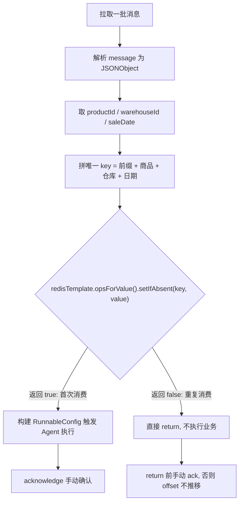

## 【学习目标】

- 说清重复消费的两个来源：生产者侧重发与消费者侧重拉，以及二者对应的不同防护思路。
- 掌握基于 Redis 的幂等方案：唯一 key 设计、`setIfAbsent` 的原子语义、过期时间取舍。
- 理解「短路返回」与「手动 ack」的关系，避开重复消费场景下 offset 不推移的坑。
- 能回答幂等键设计原则的常见面试题，并说出数据库唯一索引兜底的配套手段。

## 【正文】

### 一、先抛问题：两种重复场景

第一种：生产者出现异常，导致某一商品被频繁触发，不断投递相同的消息。消费者在消费时取到多条完全相同的消息，怎么保证消费侧的幂等性？

第二种：消费者在消费过程中发生异常，导致同一条数据被重复拉取到。针对这种重复消费，怎么保证幂等，不产生脏数据、脏的业务单？

两个场景的共同点是「同一条业务被处理多次」，但触发路径不同：前者病在生产端，后者病在消费端。Kafka 的投递语义是 at-least-once，生产者重试、消费者未提交 offset 就重启，都会造成重复。指望中间件保证 exactly-once 在跨系统的业务处理上并不现实，因此幂等必须由消费侧业务逻辑自己保证。

### 二、方案总览：Redis 唯一 key

核心思路是在 Redis 中存储一个唯一的 key：如果该 key 设置成功，说明它第一次出现，也就是第一次被消费，允许执行；如果设置时发现 key 已存在，说明这条消息已经被成功消费过，当前属于重复消费，直接拒绝执行。



选 Redis 的理由有三点：`SETNX` 语义天然适合「占位即放行」；Redis 单线程执行命令，判断与写入是原子的，没有并发窗口；支持 TTL，可以让幂等记录自动过期，无需人工清理。

### 三、幂等键设计：商品 ID + 仓库 ID + 销售日期

唯一 key 怎么定义？用商品 ID + 仓库 ID + 销售日期三个字段拼出全局唯一的 key，再设置一天的过期时间。

该设计对应业务判断的维度：业务是在「天」粒度上做调拨预测的，同一个商品在同一个仓库、同一天只会处理一次，后面再传过来的多条数据都不会再触发库存调拨预测，一天预测一次就够了。一天之后自然可以重新消费。

两个设计细节值得展开：

- **为什么不能只用商品 ID**：同一个商品可能在不同仓库发生销售，而不同仓库之间允许在同一天做不同的库存调拨预测。只传商品 ID，对消费者来说参数不够用，会把不同仓库的合法销售误判为重复。
- **为什么加日期维度**：预测是「按天」的业务，幂等记录的有效期就应该与业务周期对齐。TTL 设一天，既挡住同一天内的重复投递，又不会把第二天的正常销售永久挡死。TTL 设永久则会不断堆积无效 key，且业务规则一旦调整无法自愈。

落到代码上，先定义前缀常量：不同业务用不同前缀，在 constants 里新增 key 前缀常量类，`public static final String PRODUCT_SALE_ONLY_KEY`，即商品销售的唯一 key，取值 `product-sale-only-key:`，用冒号做分隔。前缀的意义在于避免不同业务线共用 Redis 时 key 撞车。

### 四、改造点一：消息体从单个 ID 到整个实体

第一处改动在 Sale 的 Controller 层对应的 service 实现。商品销售之后会触发往 Kafka 发送消息，接口传过来的是一个实体，包含四个属性。原来的实现发送消息时只传了一个商品 ID，仅靠商品 ID 是没法确定唯一性的，同一个商品可能在不同仓库发生销售。所以发送的参数要由单个商品 ID 换成整个实体转成的 JSON 串，用 Hutool 工具包的 `JSONUtil.toJSONStr(param)` 把实体转成 JSON 字符串再发给 Kafka。

```java
        @Data
        public class ProductSaleParam {
            private Integer productId;
            private Integer warehouseId;
            private Integer quantity;
            @DateTimeFormat(pattern = "yyyy-MM-dd")
            private Date saleDate;
        }
```

```java
        @Service
        public class ProductSaleServiceImpl implements ProductSaleService {
            @Override
            public void sale(ProductSaleParam param) {
                // 1. 创建销售记录
                BbSalesRecord bbSalesRecord = SaleRecordConvert.INSTANCE.paramToModel(param);
                BbSalesRecordService.save(bbSalesRecord);
                // 2. 更新库存
                bbInventoryService.update(Wrappers.lambdaUpdate(BbInventory.class)
                    .eq(BbInventory::getProductId, param.getProductId())
                    .eq(BbInventory::getWarehouseId, param.getWarehouseId())
                    .setSql("quantity=quantity-#{quantity}"));
                // 3. 发送 Kafka 消息
                kafkaTemplate.send(TopicConstant.PRODUCT_SALE_TOPIC, JSON.toJSONString(param));
            }
        }
```

消息体从「一个 ID」扩成「整个实体 JSON」，是幂等方案成立的前提：消费者手里必须有足够字段才能拼出业务唯一键。这也解释了为什么生产端参数设计时要问一句，下游要拿这些字段做什么。

### 五、改造点二：消费端解析与幂等判断

第二处改动在消费者。要在 Redis 里设置 key，成功即首次消费，失败即重复消费，所以先注入操作 Redis 的 template。拿到某条消息之后，在真正触发 Agent 执行之前做幂等判断：

1. 把 message 转成 JSONObject，调用 `JSONUtil.parseObj(message)`；
2. 从 JSON 对象里取属性：`getInt("productId")` 拿到商品 ID，`getInteger` 拿到仓库 ID，`getStr("saleDate")` 拿到销售日期，这些 key 就是调用时 param 里的属性名；
3. 拼 Redis 唯一 key：`KeyPrefixConstant.PRODUCT_SALE_ONLY_KEY + productId + warehouseId + saleDate`；
4. 操作 Redis：`redisTemplate.opsForValue().setIfAbsent(key, value, 过期时间)`，key 不存在时返回 true，表示首次插入成功；key 已存在时返回 false，说明这条消息之前被处理过，再消费就属于重复消费，不应该再执行。value 直接用 message 即可，具体值不重要，判断完全依赖 key；过期时间设置一天。

拿到返回结果 `result` 后：如果为 true，即第一次消费，继续触发 Agent 执行；反之直接 return，不重复消费。代码里遵循短路原则，判断不成功就直接 return。

```java
        @KafkaListener(topics = {TopicConstant.PRODUCT_SALE_TOPIC}, groupId = "group1")
        public void agentConsumer(List<String> messages, Acknowledgment acknowledgment) {
            try {
                log.info("batch size: {}", messages.size());
                for (String message : messages) {
                    log.info("receive message: {}", message);
                    JSONObject jsonObject = JSONUtil.parseObj(message);
                    Integer productId = jsonObject.getInt("productId");
                    Integer warehouseId = jsonObject.getInt("warehouseId");
                    String saleDate = jsonObject.getStr("saleDate");
                    // 1. 分布式锁
                    String threadId = IdUtil.simpleUUID();
                    RunnableConfig runnableConfig = RunnableConfig.builder()
                        .threadId(threadId)
                        .build();
                    Boolean result = redisTemplate.opsForValue().setIfAbsent(KeyPrefixConstant.PRODUCT_SALE_ONLY_KEY + productId + "_" + warehouseId + "_" + saleDate, threadId);
                    if (!result) {
                        return;
                    }
                    // 2. 写入 Graph 模型
                    OverAllState overAllState = graph.call(
                        Map.of(k1: "productId", productId, k2: "threadId", threadId, runnableConfig.get()));
                    acknowledgment.acknowledge();
                    log.info("consumer end...");
                }
            } catch (Exception e) {
                log.error("consumer error msg: {}", e.getMessage());
                throw e;
            }
        }
```

有一个细节要注意：这里走的是 return 而不是抛异常。抛异常会让整批消息的处理中断、offset 无法提交；return 是短路跳过当前这条，后续消息仍可继续处理，ack 也能正常提交。

### 六、联调验证：从报错到跑通

改造完成后开始运行，过程里踩了几个典型的坑，按顺序记录如下：

1. **启动报错**：提示使用 `StringRedisTemplate` 失败，于是去掉改用 `RedisTemplate`，重启后成功启动。
2. **首次消费报类型错**：发送商品 1、仓库 1、数量 1、日期 2025 年 11 月 30 号，消费时报 Integer 与 String 类型转换的问题。因此在 consumer 里取值时可以用 `String.valueOf` 包裹一下。
3. **确认 key 落库**：打开 Redis 可视化工具，本地已有 `product-sale-only-key:` 加商品、仓库和时间的 key。为了继续验证，先删除该 key，让它能重新消费一次，同时重启服务。
4. **断点观察**：再次发送，断点进来，JSONObject 里商品 ID、仓库 ID、数量、时间都在，其中时间是一个 long 类型的时间戳。直接按字符串获取日期，拿到的是 long 转成字符串的结果，也就是一串时间戳。这无妨，因为它只是作为唯一标识的一部分，不影响幂等判断。
5. **重复发送验证**：刷新 Kafka 可视化工具，此时是 12 条消息，偏移量也是 12。重新触发同样的请求，断点进来，这次 `setIfAbsent` 返回 false，说明 key 已存在，往下就直接 return 了。
6. **offset 不动的坑**：但刷新 Kafka 工具发现消息数变成了 13 条，而 offset 没有偏移，原因是直接 return 而没有 ack，导致 offset 没有推移。所以 return 之前其实是需要做一次手动 ack 的，这一步在开发过程中很容易忘，务必记得。
7. **补 ack 后复验**：当前是 13 条数据、offset 是 12，下次启动进来时还会再消费一次，但此时依然发现 key 已存在，判定为重复消费，不会触发 Agent 执行，而是直接 ack 并返回。放行后观察控制台，确实没有进行大模型预测，没有任何结果输出；刷新 offset，可以看到已经成功偏移。
8. **换日期再触发**：换成 12 月 1 号重新发送，大模型再次开始推理分析，日期进了幂等键，跨天自动放行，与设计预期一致。

至此，通过「Redis 唯一 key + 过期时间 + 短路返回 + 手动 ack」这套方案，消费侧消息的幂等性就实现了。

### 七、录制快照与落地差异的如实说明

上面三段代码块是课程录制的原始快照，为遵守「代码守恒」原样保留。其中有几处与最终可运行代码存在差异，如实列出，落地时按说明修正，不要照抄出错：

| 位置 | 录制快照中的样子 | 落地时的修正 |
|---|---|---|
| 保存销售记录 | `BbSalesRecordService.save(bbSalesRecord)`，直接写类名 | 类名直调只在方法为静态时成立，正常写法是注入的实例 `bbSalesRecordService.save(...)` |
| 库存扣减 SQL | `setSql("quantity=quantity-#{quantity}")` | MyBatis-Plus 的 SpEL 占位应指向参数对象，写成 `#{param.quantity}`（对照 8-10 的 sale 方法） |
| 序列化工具 | 发送用 `JSON.toJSONString(param)` | 正文讲解用的是 Hutool 的 `JSONUtil.toJSONStr`，同一链路内应统一，避免引入两套 JSON 依赖 |
| 取日期的类型包装 | 代码块中未见 `String.valueOf` | 正文第 6 节说明取值时用 `String.valueOf` 包裹以解决 Integer 与 String 转换报错，快照未体现，需自行补上 |
| key 分隔符 | 正文描述用冒号，代码块用下划线 `_` | 功能等价，以代码块为准即可，关键是三个字段顺序固定 |
| `setIfAbsent` 的过期参数 | 代码块只传了 key 和 value | 正文明确过期时间为一天，落地要用带 TTL 的重载 `setIfAbsent(key, value, 1, TimeUnit.DAYS)` |
| `graph.call(Map.of(...))` | `Map.of(k1: "productId", ...)` 含占位写法 | 这是录制时的示意写法，合法 Java 应为 `Map.of("productId", productId, "threadId", threadId)` 一类形式，且 `runnableConfig` 需真实传入 |
| `redisTemplate` 来源 | 快照中未见注入声明 | 消费类中需有 `@Resource` 或构造器注入的 `RedisTemplate` 字段 |

列出这些差异不是为了挑错，而是为了建立一个习惯：讲稿里的代码是「思路快照」，落库之前必须自己补全上下文再跑通。

### 八、生产级延伸：三个更深的问题

- **为什么不能「先查后写」**：先 `get(key)` 判断存在性、再 `set(key)` 分两步执行，两步之间存在竞态窗口，并发下两个线程可能同时查到不存在、双双放行。`setIfAbsent` 把判断与写入压缩成一条原子命令，这也是选它的根本原因。
- **数据库唯一索引兜底**：Redis 幂等挡在业务之前，但如果 Redis 抖动或 key 过期，重复仍可能穿透到写库。对「同一商品同一仓库同一天只允许一条调拨预测」这类硬约束，应在业务表上建对应唯一索引，让数据库做最后一道闸门。应用层幂等保体验，数据库约束保正确。
- **过期时间与消息延迟的配合**：TTL 是一天，意味着极端情况下一条延迟超过一天的消息会被放行、造成重复预测。若业务无法容忍，需要把幂等记录改为「持久化 + 对账」而非纯 TTL 方案；课程选 TTL 一天，是与「按天预测」的业务周期对齐后的取舍。

### 九、从投递语义看幂等的必要性

Kafka 的三种投递语义决定了幂等工作量：

| 语义 | 含义 | 实现代价 | 与本节的关系 |
|---|---|---|---|
| at-most-once | 最多一次，可能丢 | 关闭重试，提交即算数 | 业务不可接受 |
| at-least-once | 至少一次，可能重 | 重试 + 手动 ack | 本项目所处档位，重复靠幂等兜底 |
| exactly-once | 恰好一次 | Kafka 事务（`transactional.id`）+ `read_committed` | 跨系统业务处理中代价高，课程未采用 |

本项目链路横跨 Kafka、Redis、大模型、MySQL 四个系统，分布式事务成本极高，因此工程上选 at-least-once + 业务幂等：中间件保证消息送达，业务层保证只生效一次。这也是面试中被问「Kafka 不是有事务吗」时的标准回应，事务解决的是生产端与 broker 之间的一致，消费端与业务库之间的一致仍然要自己做。

### 十、幂等的三种落点对比

| 落点 | 手段 | 优点 | 缺点 |
|---|---|---|---|
| 缓存占位（本节） | Redis `setIfAbsent` + TTL | 快、原子、免改表结构 | Redis 故障即失守；TTL 到期存在窗口 |
| 数据库约束 | 业务表唯一索引 | 最可靠，与应用故障解耦 | 依赖异常回滚，侵入表设计 |
| 业务状态机 | 状态流转控制重复推进 | 贴合流程型业务 | 实现重，需梳理全状态 |

三者不是互斥关系：本节以 Redis 占位挡在入口，数据库唯一索引兜底（对应 `TransferOrderServiceImpl` 的事务写法），状态机层面由 threadId 隔离保证每条工作流独立。多层防御不是过度设计，任何单层都有失效场景，组合起来才够生产。

### 十一、RedisTemplate 与 StringRedisTemplate 的取舍

联调时报过一个错：使用 `StringRedisTemplate` 失败，改用 `RedisTemplate` 后启动成功。两个 template 的差别在 value 序列化器，前者强制 String 序列化，后者默认走 JDK 序列化。`setIfAbsent` 的 value 传的是 threadId 字符串，两种序列化器本都能容纳，报错更可能来自 Bean 装配与既有 Redis 配置的冲突；切换模板是当时最直接的绕法。落地更规范的做法是显式指定序列化器：

- key 用 `StringRedisSerializer`，保证 Redis 可视化工具里 key 可读；
- value 用 `StringRedisSerializer` 或 JSON 序列化器，与写入端保持一致；
- 全工程统一一套序列化配置，避免「写进去是 JDK 二进制、读出来按字符串解析」的错位。

### 【易错点 / 面试题】

1. **面试：你怎么保证消费端的幂等性？**
   参考答法：业务唯一键 + Redis `setIfAbsent` 原子占位。key 取能唯一标识一次业务处理的字段组合（商品 + 仓库 + 日期），命中即放行、未命中即短路；配 TTL 与业务周期对齐；return 前必须手动 ack；再用数据库唯一索引兜底。追问「先查后写行不行」，不行，有竞态，必须原子命令。

2. **面试：幂等键怎么设计？**
   参考答法：与业务判断维度对齐，不多不少。字段少了会误杀合法请求（只按商品 ID 会挡掉多仓库销售），字段多了会漏放重复请求；配上前缀隔离不同业务线。

3. **易错：短路 return 前忘了 ack。** 不 ack 则 offset 不推移，下次启动还会重复拉取，虽然靠 key 能挡住业务执行，但 lag 会持续虚高，监控上表现为「消费不进去」。

### 【小结】

本节给出了消费端幂等的完整闭环：消息体扩为整个实体 JSON → 消费端解析出三个业务字段 → 拼带前缀的唯一 key → `setIfAbsent` 原子判断 → 命中执行业务、未命中短路 return → return 前补手动 ack。至此 8-8 到 8-11 的 Kafka 四件套（不丢失、不积压、顺序、幂等）全部讲完。

配套工程参考：幂等闸门之后真正落库的一层，与 `980-demo/src/main/java/com/carl/ai/transfer/service/TransferOrderServiceImpl.java` 对应，`@Transactional(rollbackFor = Exception.class)` 保证主单、子单要么全成要么全败，配合 `980-demo/src/main/java/com/carl/ai/transfer/repository/BbTransferOrderRepository.java` 的仓储层，构成「幂等挡重 + 事务保一致」的两层防线。
