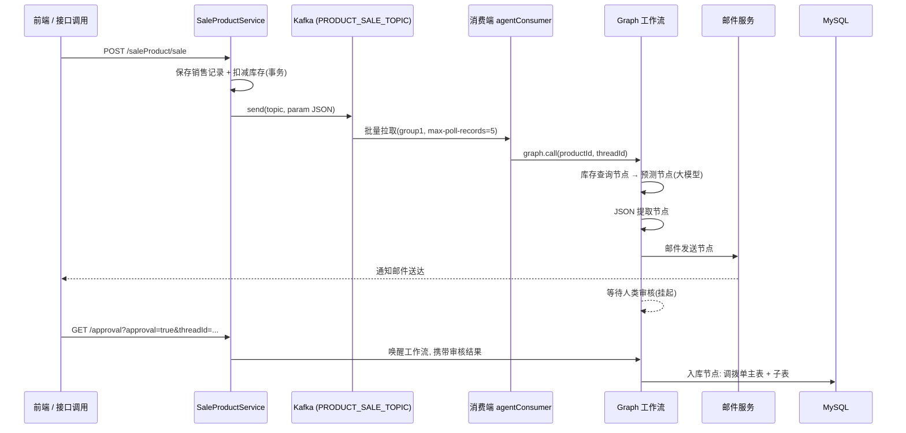

## 【学习目标】

- 掌握把 `approve` 人类审核逻辑从 controller 迁移到 service 的完整手法，包括图引用的注入迁移。
- 走通智能库存调拨系统的全流程联调：发送 → 消费 → 预测 → JSON 提取 → 邮件 → 人工审核 → 入库。
- 逐项讲清 Kafka 生产端配置（`acks`、`retries`、`enable-auto-commit`、`max-poll-records`）的含义。
- 记住两条生产红线：对话型大模型必须配人工审核；AI 整合从非核心业务线起步。

## 【正文】

本节是智能库存调拨 Agent 的收尾篇，做三件事：业务层收尾（`approve` 下沉）、全流程联调验收、课程总结与生产红线。

### 一、controller 瘦身：approve 逻辑下沉到 service

首先要把原来 controller 里的代码做一次改造：人类审核环节触发的 `approve` 方法，之前是直接写在 controller 层的，现在需要迁移到对应的 service 里。

迁移的方案是沿用同一个 service，也就是商品销售的 service，在其中定义 `approve` 方法，接收 `approval` 和 `threadId` 两个参数，返回空值，直接 `return R.success()`。

具体做法：把 controller 里那块逻辑剪切出来，在 service 接口处按 Alt + 回车创建方法，再按 Alt + 回车生成实现，把代码粘过去。粘贴之后会发现有几处报错，原因是找不到图的引用，图的注入原来在 controller 上，因此需要在 service 实现里注入该图，把 controller 的图注入也一并迁移到 `approve` 的实现类中。实现里有一处 log 日志输出，所以要加上 Slf4j 注解。返回值这里不需要额外处理，保持空即可。改造完成后 controller 只剩两个薄方法：

```java
    @RestController
    @RequestMapping("/saleProduct")
    public class SaleProductController {
        @PostMapping("/sale")
        public R sale(@RequestBody ProductSaleParam param) {
            productSaleService.sale(param);
            return R.success();
        }

        @GetMapping("/approval")
        public R approval(@RequestParam(value = "approval") Boolean approval,
                          @RequestParam(value = "threadId") String threadId) {
            productSaleService.approval(approval, threadId);
            return R.success();
        }
    }
```

这次下沉的价值在于分层回归本职：controller 只负责协议适配（参数接收、响应包装），业务编排（唤醒图、按审核结果决定继续还是终止）归 service。人类审核要操作图状态、可能涉及多步编排，放在 controller 里会让这一层越来越厚，也难以复用和单测。

### 二、全流程联调：从一次销售到一封邮件

等待项目启动成功后触发一次消费：一号商品，仓库 ID 为 1，数量为 1，销售日期 2025 年 11 月 30 号，点击发送。



可以看到消息已经投递并被消费，日志里已经出现查询库存调拨数据的输出。下一个节点走到预测节点，也就是大模型进行预测的节点，预测成功；再往下进入 JSON 提取节点，稍等片刻该节点执行完毕；接着执行邮件发送节点，随后消费结束。

启动阶段的日志确认 Nacos 配置已经就位：

```
        Java 17.8.6 with PID 1784 (E:\javaworkspace\double-al-agent-transfer\target\classes started by 86136 on DESKTOP-77H797C)
        2025-11-30 21:21:44.668 [main] INFO  com.carl.ai.transfer.TransferApp - No active profile set, falling back to 1 default profile: "default"
        2025-11-30 21:21:44.668 [main] INFO  c.a.cloud.nacos.configdata.NacosConfigDataLoader - [Nacos Config] Load config[data-al-transfer.yaml, group=DEFAULT_GROUP] success
```

第三行是 8-4 篇配置的验收标志：`spring.config.import` 把 `data-al-transfer.yaml` 从 Nacos 拉进了 Spring Environment，启动无报错，说明配置中心链路完整。

### 三、数据库验证：调拨单 14 → 15

到邮箱里确认，通知邮件已经成功收到，这是全流程里「Agent 产出被推送到人」的终点。回到数据库查看当前最新的调拨单，已经到 14 了。现在点一下采纳，观察是否有报错：没有报错，并且 insert 语句已经执行。刷新数据库，可以看到 14 变成了 15，对应的子表里也有匹配 15 的数据。

```
        .ConnectionImpl[2b7597c8] will be managed by Spring
        ==> Preparing: INSERT INTO do_transfer_order_item (transfer_order_id, product_id, transfer_quantity, remark) VALUES (?, ?, ?, ?)
        ==> Parameters: 15(Long), 1(Long), 100(BigDecimal), 从华北仓调拨100件至华南仓，平衡区域库存，应对华南年末销售旺季需求(String)
        Transaction synchronization committing SqlSession [org.apache.ibatis.session.defaults.DefaultSqlSession@39e54528]
```

这段 SQL 日志有三个信息量：主单自增 ID 15 已回填到子单的 `transfer_order_id`（对应 5-15 篇 MapStruct 转换 + 主从表关联写法）；`remark` 是大模型生成的调拨建议原文，说明预测节点产出被完整带到了落库；`Transaction synchronization committing` 确认整个入库在一个事务内提交。

### 四、Kafka 配置逐项解读

联调能跑通，依赖下面这份消费端与生产端配置：

```yaml
    spring:
      kafka:
        bootstrap-servers: localhost:9092
        producer:
          key-serializer: org.apache.kafka.common.serialization.StringSerializer
          value-serializer: org.apache.kafka.common.serialization.StringSerializer
          acks: all
          retries: 3
        consumer:
          key-deserializer: org.apache.kafka.common.serialization.StringDeserializer
          value-deserializer: org.apache.kafka.common.serialization.StringDeserializer
          enable-auto-commit: false
          max-poll-records: 5
```

逐项说明为什么这么配：

| 配置 | 取值 | 为什么 |
|---|---|---|
| `acks` | `all` | 生产者要求所有 ISR 副本确认才算发送成功，首领宕机不丢已确认消息，对应 8-8「不丢失」的最高档 |
| `retries` | `3` | 发送失败自动重试的次数上限，配合 acks=all 挡住瞬时网络抖动 |
| `enable-auto-commit` | `false` | 关闭自动提交，改由业务处理完手动 ack，自动提交按时间间隔走，会在「未处理完」时提交 offset，故障即丢消息 |
| `max-poll-records` | `5` | 单次 poll 最多拉 5 条，即 8-10 篇验证过的批量粒度：一批一次处理、一次 ack |
| 序列化器 | 两端都是 String | 消息体是 JSON 字符串，key/value 均按字符串收发 |

生产端开启幂等之后，每一个生产者会向 broker 申请一个唯一的编号 ID（PID），然后对投递的消息做序列号递增，第一次投递是 1，下一次投递是 2，再下一次投递是 3，两个值拼在一起来作为唯一键，从而保证消息的唯一性。前面 8-8 篇讲到生产者端要开启幂等性，这里补充说明：在当前使用的版本中，幂等性其实已经默认开启。如果想手动确认，可以查看 producer 下的 properties 属性，在里面自行开启幂等，配置项是 `enable.idempotence`，把它打开即可。开启幂等的作用是避免消息被重复发送，生产端重试时，broker 凭 PID + 序列号识别出「这条已经落过」，直接去重。

### 五、两条生产红线

还有一点必须说明：对于这种对话型语言交互的大模型，幻觉问题是无法避免的。因此在公司里做整合时一定要加上人工审核功能，才能保证数据具备一定的安全性，不会直接污染真实的业务数据。本系统的人类审核节点（6-1 到 6-5）就是这道闸门：大模型生成的调拨建议先发邮件给人看，人点「采纳」才走入库节点。

而且 AI 这一块如果要整合公司的业务，一定是从非核心业务线开始尝试。不可能一上来就动核心业务线，比如涉及金钱的交易类业务线，或者部分风控场景，这些都是最核心的东西，一旦出问题，公司面临的麻烦会非常大，可能造成大量资产损失。

所以之后面试的时候，这一块要说成：公司先是拿一些非核心业务线来做尝试。因为当前对话型大模型的整合能力是有限的，并没有传统认知里「AI 很聪明」的水平，它依然有自身的局限性。智能库存调拨恰好是理想的第一站：预测结果给人看、人点了才落库，错了也不直接伤钱。

### 六、人类审核的两种形态

本节的审核是「同步挂起」：工作流执行到审核节点即中断，等 `/approval` 接口携带 threadId 回来唤醒，再继续入库。与之相对的另一种形态是「异步事后校验」：流程不停，先出建议邮件，人工事后确认或追改。两种形态的取舍如下：

| 维度 | 同步挂起（本节） | 异步事后校验 |
|---|---|---|
| 数据安全 | 高，未审核不落库 | 依赖事后追改 |
| 链路延迟 | 受人工响应时间制约 | 无阻塞 |
| 实现复杂度 | 需要检查点与状态恢复（对应 7-1、7-2 篇） | 流程简单，补偿逻辑重 |
| 适用场景 | 调拨建议这类「值得等」的决策 | 大批量低风险建议 |

课程选同步挂起，与「AI 产出必须经人确认才进业务库」的红线一致；同步挂起的技术前提是 6-3 篇的 threadId 对话隔离与 7-2 篇的 Redis 持久化，工作流状态能存能恢复，中断等审核才成立。

### 七、联调验收清单

一次全流程联调至少覆盖以下检查点：

| 环节 | 检查点 | 本节实测 |
|---|---|---|
| 启动 | Nacos 配置加载 | `Load config[data-al-transfer.yaml] success` |
| 生产 | 消息投递 | 发送成功，topic 消息数递增 |
| 消费 | 批量拉取与 offset | 批量消费，offset 追平末尾 |
| 预测 | 大模型节点 | 预测成功，无报错 |
| 提取 | JSON 结构化 | 提取节点执行完毕 |
| 通知 | 邮件节点 | 邮箱收到通知 |
| 审核 | approve 下沉 service | 采纳无报错 |
| 入库 | 主表 + 子表 | 调拨单 14 → 15，子表关联 15 |

按清单逐项打勾，比「跑一遍没报错」更接近生产验收标准，清单上的每一项都对应一个可能静默失败的环节。

### 八、课程总结：重心在哪里

最后明确这门课的重心：重心是将 Agent 与传统业务系统进行整合。传统业务里大量功能本质上都是 CRUD 开发，关键是怎么通过 Spring AI Alibaba 这套体系把 Agent 接进来。所以这一阶段着重讲的是：Agent 的节点怎么定义、边怎么定义、如何通过人类反馈节点实现人工审核、如何通过条件边做多分支判断，以及图是怎么定义、怎么持久化的，等等这一整套 Agent 的实现思路。

而传统业务本身的开发细节没有投入过多笔墨，比如如何销售、如何扣减库存、如何加库存这些，没有展开细讲。这一点需要先明确，面试中被追问业务细节时，要知道课程的重点在 Agent 编排，CRUD 是配套。

到这里，第一个 Agent，智能库存调拨优化系统，就开发完成了。从下一节课开始，进入第二个 Agent 的开发，也就是 BI 助手。

### 九、从联调到面试：如何在面试中讲清项目

全流程跑通之后，还要能把项目的来龙去脉讲成面试官愿意听的故事。推荐的叙事结构是四段：

1. **背景与痛点**：销售高频触发预测，大模型推理慢，同步调用会拖垮主链路（8-1 的高并发问题）；
2. **方案选型**：阈值动态化（Nacos 配置中心）+ Kafka 异步化（生产消费解耦），单体改造为可接入微服务体系的模块；
3. **技术难点**：消息不丢失（acks=all + 手动提交）、不积压（批量消费 + 并行）、不重复（Redis 幂等）、顺序（分区保序），以及人类审核节点保安全；
4. **业务安全边界**：AI 只做建议、人工确认才落库、从非核心业务线起步。

四段各自对应课程里的一章，讲的时候每段都能落到具体机制而非「我们用了 AI」这种黑箱表述，这也呼应了 13-1 篇「从技术到业务的包装逻辑」：面试官想听的是决策过程与取舍，不是名词堆砌。

### 【易错点 / 面试题】

1. **面试：AI 要整合公司业务，你会怎么落地？**
   参考答法：从非核心业务线起步，保留人工审核节点，AI 产出只做建议不做决策；等准确率和可观测性都稳定后再评估扩大范围。直接动交易、风控等核心链路是把幻觉风险放大成资损风险。

2. **面试：Kafka 的 `acks=all` + `enable.idempotence` 解决什么问题？**
   参考答法：`acks=all` 保证已确认的消息不因首领副本宕机丢失，方向是「不丢」；`enable.idempotence`（新版本默认开启）用 PID + 序列号去重，方向是「不重发」。两者叠加，生产者侧做到不丢不重。

3. **易错：把审核逻辑留在 controller。** 业务编排进 controller 会导致分层失控、图引用散乱，且无法被其他链路复用。验收标准是 controller 只做协议适配。

### 【小结】

本节完成了第一个 Agent 的收尾：`approve` 下沉 service 让分层回归本职；一次完整联调验证了「销售 → Kafka → 消费 → 预测 → 提取 → 邮件 → 人工审核 → 入库」全链路；Kafka 生产端配置与 producer 幂等机制补全了消息侧的最后一课。下一章进入第二个 Agent，智能 BI 报表问答系统。

配套工程参考：本系统「大模型生成 → 结构化提取 → 转换 → 入库」的核心链路在 `980-demo` 中有对应实现，`980-demo/src/main/java/com/carl/ai/transfer/agent/TransferAgent.java` 封装「自然语言进、调拨单出」的节点动作，`980-demo/src/main/java/com/carl/ai/transfer/extract/TransferOrderExtractor.java` 负责 JSON 结构化提取，`980-demo/src/main/java/com/carl/ai/transfer/convert/TransferOrderConvert.java` 复刻 MapStruct 的 param→model 转换层，`980-demo/src/main/java/com/carl/ai/transfer/repository/BbTransferOrderRepository.java` 完成落库；模型侧配置见 `980-demo/src/main/java/com/carl/ai/transfer/config/ChatModelConfig.java`（default profile 离线可跑，prod profile 接真实端点）。
