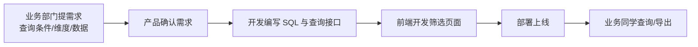
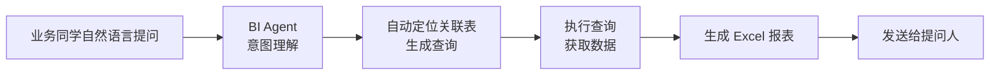

## 【学习目标】

- 掌握「痛点驱动」的架构设计方法论：现状盘点 → 痛点分级 → 能力映射。
- 深挖传统 BI 系统的三大痛点，理解为什么「使用门槛高」是其中的核心。
- 能应对面试高频追问「你是如何做架构设计的，依据是什么」，把 BI Agent 项目讲出架构深度。

## 【正文】

### 一、为什么架构设计要从痛点出发

从本节开始进入实战二，本项目第二个 Agent 的开发：**告别 SQL，构建自然语言 BI 系统引擎**。开篇第一课不讲代码，先讲架构设计，而这里的架构设计是从痛点出发的。

所谓「从痛点出发」，说得直白些：**传统 BI 系统存在哪些痛点，就基于这些痛点来做 Agent 的架构**。先停一下思考其重要性，面试场景中，如果你说自己完成了整个 Agent 的设计、开发、部署，面试官很可能紧接着追问：**你是如何做架构设计的，依据是什么？**

该问题的潜台词是：面试官要区分「照着教程拼功能的人」和「有设计意图的人」。前者的回答是「因为要用大模型，所以做了 Agent」；后者的回答是「因为传统方案在 X 环节存在 Y 问题，所以用 Agent 的 Z 能力做针对性升级」。本节讲的就是后者的答题素材：你是基于传统 BI 系统可能存在的问题提炼出痛点，进而做架构升级的。

缺少痛点视角的架构有一个典型病症，「玩具 Agent」：功能列表齐全，demo 跑得动，但每一个功能都回答不了「业务为什么需要它」。面试官只要追问一句「某功能解决什么问题」，叙事就会断档。痛点驱动正是给每一块功能预先准备好存在理由。

这套「痛点驱动」的思路可以迁移到任何 Agent 项目的架构答辩中：先证明你理解旧方案为什么不够好，再证明新方案的每一部分都在回应一个具体问题，架构的每一个决策都有出处，而不是技术名词的堆砌。

### 二、传统 BI 系统的三大痛点

传统 BI 系统的问题可以概括为「**数据处理与使用门槛**」，拆解为三点：

| 痛点 | 具体表现 | 直接后果 |
|---|---|---|
| 数据处理弱 | 对非结构化数据处理效率低 | 大量数据无法进入分析视野 |
| 实时性不强 | 批量处理模式，无法做到秒级决策 | 看到的数据永远是「过去时」 |
| 使用门槛高 | 需要专人操作，响应慢 | 业务等开发，开发等排期 |

三点之中，**最核心的是使用门槛高**。数据处理与实时性是「能力上限」问题，受限于技术手段，可以随着基础设施改善而缓解；而使用门槛是「生产关系」问题，它卡住的是数据到决策之间的最后一公里，且不会因为服务器升级而自动消失。

### 三、核心痛点深挖：使用门槛高为什么卡脖子

先建立共识：基本上每个系统都会有一个数据报表功能，能对数据做查询、导出，甚至按不同维度查询后再导出。这其实就是**简单版的 BI 系统、BI 功能**，无论 2B 还是 2C 产品都非常常见。两个推论：

1. 正因为常见，几乎每家公司都有这样的业务需求，做完该 Agent，可以顺理成章写进项目经历，不愁没有对口场景；
2. 正因为常见，它的痛点被反复验证过，架构答案有坚实的现实基础。

再看传统模式下企业里做报表查询的完整流程：

这条链路的问题一目了然：

- **专人操作**：每一步都需要特定角色参与，业务部门想查个数，要经过产品、开发、前端一整圈；
- **开发成本高**：程序员必须提前把 SQL 和接口写好，本质上只是把查询条件搬到前端页面上，让业务部门自己筛选，开发时间大量消耗在「预设查询组合」上；
- **响应慢**：需求排队、开发排期、发布上线，一个查询诉求从提出到可用以天计。

「预设查询组合」还隐含一个组合爆炸问题：业务方的查询维度是多样的，开发只能挑高频组合预先实现；任何落在预设之外的查询，依然要回到提需求的起点。可见传统模式并没有真正消灭流程，只是把一部分高频需求提前预制，长尾需求被系统性地挤回了慢车道。

用一句话概括：**传统 BI 把「问数据」变成了「提需求」**。业务的实时分析诉求与开发的供给节奏之间，存在结构性矛盾。

### 四、Agent 架构如何对症下药

该 Agent 要解决的就是开发的这块时间浪费：不再需要专人操作，**让 AI 代替程序员、代替「专人」**。业务部门通过对话、通过自然语言提出诉求，比如「帮我查询 2025 年的销售数据」，Agent 就会自动去查询关联的表，生成 Excel 报表，然后发送给提问的业务同学。

对应到架构图上：

与传统流程逐段对比，升级点非常清晰：

| 环节 | 传统 BI | 自然语言 BI Agent |
|---|---|---|
| 需求表达 | 提需求给产品，走流程 | 自然语言直接对话 |
| SQL 编写 | 开发提前手写 | Agent 按意图生成 |
| 查询接口/前端 | 开发 + 前端定制 | 统一对话入口 |
| 结果产出 | 页面查询、导出 | 自动生成 Excel 并送达 |
| 响应时效 | 天级（排期决定） | 秒级/分钟级（对话即得） |

「使用门槛高」被直接拆除：查询的前置专业动作全部收进 Agent；「响应慢」随排期消失而缓解；「数据处理弱」则通过大模型对非结构化诉求的理解能力部分对冲，自然语言本身就是非结构化输入，Agent 的解析过程正是对这类数据的处理。

把新方案的职责按层归纳，每一层都能对回一个痛点：

| 层 | 职责 | 回应的痛点 |
|---|---|---|
| 接入层 | 统一对话入口，接收自然语言诉求 | 使用门槛高 |
| 理解层 | 解析意图，定位关联表，生成查询 | 使用门槛高（消灭写 SQL 的专人环节） |
| 执行层 | 实际执行查询，获取数据 | 实时性不强（按需查询而非批量预设） |
| 交付层 | 生成 Excel 报表并发送给提问人 | 响应慢（结果直达，不经页面开发） |

还有一层工程视角：这套架构并不是从零起步。实战一已经建好了 Graph 工作流编排、结构化输出抽取、MapStruct 转换层、入库与消息能力，第二个 Agent 本质是**同一套方法论在新业务域的复制**：把「工作流节点编排 + LLM 结构化抽取 + 落库」的骨架，套上 BI 的数据表与报表诉求。这种「可复用的 Agent 骨架」本身也是架构能力的体现。

### 五、痛点驱动架构思维的可迁移框架

把本节的方法论抽象成三步，可用于任何 Agent 项目的架构设计：

1. **现状盘点**：把现有方案的完整流程画出来（谁、在什么环节、做什么），流程里的每个「专人」都是候选痛点；
2. **痛点分级**：区分「能力上限类」痛点（靠基础设施演进缓解）与「结构机制类」痛点（靠架构改造解决），后者才是 Agent 的切入点；
3. **能力映射**：把 Agent 的每一项能力（自然语言理解、自动查询、结构化生成、自动送达）对到具体痛点上，做不到映射的能力不硬上，避免「为了用 AI 而用 AI」。

与之相对的是「技术驱动」：先选定技术栈，再回头找场景。两种思维没有绝对的对错，但面试场景中，痛点驱动的回答更容易体现业务理解与设计意图，也更容易引导面试官进入你准备好的技术深水区。

落到答辩叙事上，建议按「旧流程 → 卡点数据/现象 → 分级归因 → 分层方案 → 能力对位」的顺序组织：前两步证明问题真实存在，第三步证明你会区分问题性质，后两步证明方案与问题一一对应。这套叙事结构与后面 RAG 召回、提示词优化、评估节点等技术章节形成「总-分」关系，架构篇立骨架，技术章节填肌肉。

## 【易错点 / 面试题】

1. **面试官问：你是如何做架构设计的，依据是什么？**
   答：先讲旧方案流程与卡点（专人操作、开发成本高、响应慢），再讲痛点分级（哪些是结构性问题），最后讲能力映射（自然语言理解拆门槛、自动查询拆开发、自动送达拆时效）。三个环节都落到具体业务事实，不空谈技术名词。
2. **为什么三大痛点里「使用门槛高」最核心？**
   数据处理弱与实时性不强属于能力上限问题，随基础设施改善可缓解；使用门槛高是结构机制问题，只要查询必须经过「开发预设」环节，成本与时效的瓶颈就永远存在，不会因硬件升级自动消失。
3. **痛点驱动和技术驱动的架构思维差别在哪？**
   痛点驱动是「问题 → 方案」，每个设计决策都能追溯到具体痛点；技术驱动是「方案 → 问题」，容易做出功能齐全但无人使用的系统。面试答问建议用前者组织叙事。

## 【小结】

本节作为实战二的开篇，确立了整套 BI Agent 的架构逻辑：以传统 BI「数据处理弱、实时性不强、使用门槛高」三大痛点为出发点，把「使用门槛高」定为核心矛盾，用自然语言对话替代「提需求-写 SQL-做前端」的专人链路，让 Agent 自动完成查表、生成 Excel 与送达。「自然语言 → 结构化参数 → 入库」这条主链路在工程中的最小实现见 `980-demo/src/main/java/com/carl/ai/transfer/controller/TransferController.java`（`create` 接口直接接收自然语言 requirement）、`980-demo/src/main/java/com/carl/ai/transfer/agent/TransferAgent.java`（自然语言 → 抽取 → 入库的节点动作）与 `980-demo/src/main/java/com/carl/ai/transfer/extract/TransferOrderExtractor.java`（LLM 输出到 POJO 的结构化抽取）。痛点分级与能力映射的三步框架，请直接带到面试答辩中使用。下一节进入 BI Agent 的技术解析起点：RAG 技术深度解析。
