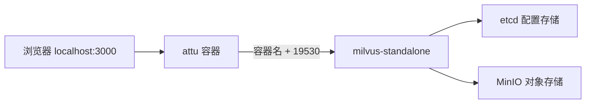

## 【学习目标】

- 说清 Milvus 的定位与官方给出的选型理由，理解课程「Redis + Milvus」双线演示的意图；
- 用 Docker Compose 独立完成单机版 Milvus 的启动，讲清 etcd、MinIO、milvus-standalone、Attu 四个服务各自的职责；
- 避开容器化部署的三个高频坑：目录放错、同名容器冲突、Attu 用 `127.0.0.1` 连 Milvus；
- 理解 Milvus 的 database / collection / schema 三层结构，为 9-10 的项目整合铺路。

## 【正文】

### 一、为什么再引入一个向量库

前面已经讲完用 Redis 作为向量数据库，接下来换成 Milvus。先了解 Milvus 是什么：它是由国人开发的一款开源、高性能、高扩展性的向量数据库。官方给出的说明里提到，Milvus 从设计之初就是一个高效的向量数据库，性能是其他向量数据库的 2 到 5 倍，具备硬件感知优化、高级搜索算法、C++ 搜索引擎、面向列等特性，还可以使用 GPU 来加速。

它支持的搜索类型也非常多：

| 搜索类型 | 用途 |
|---|---|
| ANN 搜索 | 近似最近邻，向量检索的主战场 |
| 过滤搜索 | 先按标量条件过滤，再走向量相似度 |
| 范围搜索 | 找出相似度落在某个区间内的结果 |
| 混合搜索 | 向量相似度与关键词等多路信号融合 |
| 全文搜索 | 传统文本检索能力 |

这些内容在做机器学习、深度学习、神经网络那一套（通常是 Python 技术栈）时会接触得比较多，传统 Java 开发者对这块可能不太熟悉。但这不影响使用：通过 Spring AI 的 starter，Java 侧面对的仍然是 `VectorStore` 接口与配置项，不需要直接写 Milvus 的 SDK。

### 二、为什么选 Milvus

官方列出的理由包括：高性能与高可用性、支持所有向量类型与硬件加速（也就是用 GPU 做性能加速）、多租户、冷热存储、权限与数据安全，以及全文搜索与混合搜索这类向量检索能力。

就向量存储这一块而言，Milvus 是很多公司优先选择的方案，Redis 反倒不是。业务向量比较少时可以用 Redis，但一旦公司本地私有知识库的文档变多、内容变大，再往 Redis 里放就不太合适了，一般都会把这类持久化放到 Milvus 里。

选型逻辑可以收敛成一句话：演示与中小规模用 Redis（团队熟悉、零新增组件），生产与大规模用 Milvus（专用引擎、可扩展、企业级能力齐全）。课程两条线都演示，目的是把选型权拿在手里，而不是只会一种。

### 三、Compose 服务构成：四个容器各干什么

安装方面，官方提供了多种方式，这里使用 Docker 启动单机版 Milvus。官网上可以下载到一个 Docker 脚本执行，也可以使用 Docker Compose。但官方这份 Compose 文件有个缺点：它没有把对应的可视化 UI 页面集成进来，想要用 UI 还得自己再单独安装一遍。

课程笔记里已经把这部分整合好了，提供了一个直接可用的 `docker-compose.yaml`：既有单机版 Milvus 的启动，也把对应的 UI 服务集成在其中，启动之后可以直接在浏览器里对 Milvus 做可视化管理。

具体做法：在电脑 E 盘的 `docker` 文件夹下新建一个 `milvus` 文件夹，在其中新建 `docker-compose.yml`，把笔记里的 YAML 内容粘进去。这份文件的服务构成是：

| 服务 | 职责 |
|---|---|
| `etcd` | 配置存储 |
| `MinIO` | 对象存储 |
| `milvus-standalone` | 单机版 Milvus 引擎本体 |
| `attu` | 可视化管理 UI（课程额外整合） |

这一段其实就是 Milvus 官方文档提供的 Docker Compose，只是在它的基础上额外把 UI 组件 `attu` 整合了进来，通过 Attu 就可以对 Milvus 做可视化管理。

### 四、部署实操与检查清单

执行之前，先检查一下本机上是否已经有同名的容器或镜像，避免冲突，比如本地已经有一个 `milvus-standalone`，就先把它删掉，然后重新完整演示一遍。

另外要注意网络：如果本地没有对应镜像，Docker 会去仓库拉取，这一步往往需要「魔法」才能顺畅完成，所以在开始之前先把网络环境准备好。

接下来在该文件夹下打开终端（务必是在 `docker-compose.yml` 所在目录下），先执行 `docker-compose build` 做一次校验，确认 YAML 文件格式没有问题；然后再执行 `docker-compose up -d` 启动，此时会开始拉取镜像，总共 900 多兆，稍等片刻即可全部拉完并启动成功。

把步骤连同「为什么」整理成清单：

| 步骤 | 命令 / 动作 | 目的 |
|---|---|---|
| 1 | 检查同名容器与镜像 | 避免端口冲突、旧实例干扰 |
| 2 | 准备网络环境 | 待拉取镜像 900 多兆，网络不通会卡死 |
| 3 | 进入 compose 文件所在目录 | Compose 按目录找 `docker-compose.yml`，目录不对直接报错 |
| 4 | `docker-compose build` | 先校验 YAML 格式，再启动 |
| 5 | `docker-compose up -d` | 后台拉取镜像并启动全部服务 |
| 6 | Docker 中检查容器状态 | 确认各容器正常、无报错 |

第 3 步是最容易翻车的一步：在别的目录执行 `docker-compose up`，Compose 找不到文件，报错信息却未必直白。

### 五、Attu 连不上 Milvus：一个容器网络的经典坑

启动完成后到 Docker 里检查一下，Milvus 相关的几个容器状态都正常、没有报错。其中 Attu 这一可视化管理工具暴露的是 3000 端口，在浏览器里访问 `localhost:3000`，就能成功进入 Milvus 的可视化管理页面。

进入页面后需要连接 Milvus 服务器。在 Docker Compose 文件里 Milvus 的端口是 19530，但这里不能填 `127.0.0.1`，因为 Attu 本身也是一个容器，用 `127.0.0.1` 去连 Milvus 是连不上的。正确做法是填 Milvus 容器的名字：这些容器之间的网络是互通的，直接用容器名加 19530 端口即可。填写后连接成功。

这一坑值得想透：浏览器访问 `localhost:3000` 能通，是因为 Attu 把端口映射到了宿主机；而 Attu 容器内部访问 `127.0.0.1:19530`，指向的是它自己，每个容器有独立的 network namespace。同一 Compose 项目下的容器共享一个默认网络，容器名即主机名，所以「容器名 + 端口」才能到达 Milvus。这是容器化部署的通用纪律：容器之间用服务名互访，永远不要用 localhost。

### 六、Milvus 数据层级与关系库的映射

连接进来可以看到它默认初始化了一个名为 `default` 的数据库，里面有 Collections，可以理解为「表」；Collections 里面又有对应的 Schema，可以理解为「列」。

| Milvus 概念 | 关系库类比 | 说明 |
|---|---|---|
| database | 库 | 默认 `default` |
| collection | 表 | 向量数据的容器 |
| schema | 列定义 | 字段名与字段类型 |

至此 Milvus 单机版加可视化界面就搭建完成了。下一步回到项目里做整合，把原来使用 Redis 作为向量存储的部分改成使用 Milvus，依赖、配置与两个启动坑，9-10 展开。

## 【易错点 / 面试题】

1. **易错点：Attu 里填 `127.0.0.1` 连 Milvus。** Attu 自己是容器，`127.0.0.1` 指向它自身；必须填 Milvus 容器名加 19530 端口。同类问题在任何多容器 Compose 里都会出现，记住「容器间用服务名互访」。

2. **易错点：在错误目录执行 `docker-compose up`。** Compose 依赖当前目录下的 `docker-compose.yml`，务必先进入文件所在文件夹；执行前用 `docker-compose build` 做一次格式校验，能提前暴露 YAML 问题。

3. **面试题：「Milvus 的 Compose 里 etcd、MinIO、milvus-standalone、Attu 分别干什么？」**
   答：`etcd` 负责配置存储，`MinIO` 负责对象存储，`milvus-standalone` 是单机版引擎本体，`attu` 是额外整合的可视化管理 UI。单机版把前三者打成一个 Compose，引擎依赖前两者完成元数据与数据文件的管理。

4. **面试题：「什么场景从 Redis 换 Milvus？」**
   答：知识库规模小、团队已有 Redis 基建时，Redis 上手快、成本低；一旦文档变多、内容变大，内存约束与检索性能成为瓶颈，且需要 ANN 索引、混合搜索、多租户、冷热存储等能力时，换专门的向量数据库 Milvus。选型看规模与能力要求，不看个人熟悉度。

## 【小结】

本节把 Milvus 单机版跑了起来：Docker Compose 拉起 etcd、MinIO、milvus-standalone 三个服务，并额外整合 Attu 可视化 UI；梳理了部署检查清单（同名容器、网络、目录、build 校验、up -d、状态检查），讲透了「Attu 填容器名而非 `127.0.0.1`」的容器网络原理，最后建立了 database / collection / schema 与关系库概念的映射。到此，向量数据库的两种形态，Redis 与 Milvus，都已就位。下一篇回到项目做整合：换依赖、配 `spring.ai.vectorstore.milvus`、踩集合命名与向量维度两个坑。

「服务名互访、健康检查、环境变量注入」这些容器化纪律，在配套工程 `980-demo/docker-compose.yml` 与 `980-demo/Dockerfile` 中同样体现：应用容器暴露 8080 端口、健康检查打 `/actuator/health`、模型 Key 走环境变量注入，可与本节的 Milvus Compose 对照阅读。
