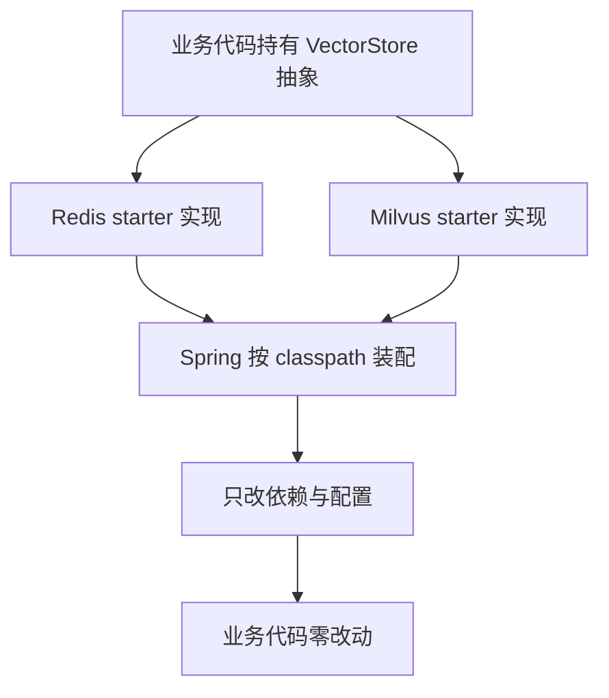

## 【学习目标】

学完本节，应当能够：

- 说清把向量存储从 Redis 切换到 Milvus 的完整改动面：依赖、配置、连接信息、集合 schema、向量维度五项，一项不落；
- 独立完成 `spring.ai.vectorstore.milvus` 节点下的各项配置，并解释每一项不配或配错会引发什么后果；
- 避开两个最高频的启动坑：集合命名不合规、向量维度与向量模型不匹配；
- 向面试官讲清「为什么换向量库不用改一行业务代码」，`VectorStore` 抽象层带来的收益。

## 【正文】

### 一、为什么要扩展一种向量存储

智能 BI 报表问答系统的私有知识库此前存放在 Redis 里。同一份代码，本节再把存储实现换成 Milvus，最终两种向量数据库都在项目里完整演示过。选型上两者各有位置：

| 维度 | Redis（向量检索） | Milvus |
|---|---|---|
| 定位 | 缓存/内存数据库顺带支持向量 | 专为向量检索设计的数据库 |
| 索引 | 基础 KNN | HNSW、IVF 等 ANN 索引体系 |
| 数据规模 | 中小规模、受内存约束 | 可扩展、面向大规模分片 |
| 运维成本 | 团队已有 Redis 基建时近乎零成本 | 独立组件，需容器化部署 |
| 与 Spring AI 集成 | `spring-ai-starter-vector-store-redis` | `spring-ai-starter-vector-store-milvus` |

真正值得关注的不是「哪个更强」，而是替换成本。Spring AI 对向量存储的统一抽象是 `VectorStore` 接口，业务代码里注入、调用的自始至终是这一层抽象。Redis 还是 Milvus，对上层只是配置不同。这正是本节最有价值的结论，第五节会专门展开。

### 二、依赖替换：三步确认依赖就绪

第一步，把 Redis 的 starter 依赖注释掉，加入 Milvus 的 starter `spring-ai-starter-vector-store-milvus`。

第二步，刷新 Maven，等待依赖拉取完成。第三步做一个快速自检：按住 Ctrl 加左键，如果能点进 starter 的源码或类，说明依赖解析成功、jar 已在本地仓库；点不进去，则优先排查依赖是否拉取完、私服配置是否正确。

Spring AI 官方维护了主流向量数据库的 starter，Java 工程师不用自己写客户端、写序列化、写相似度计算，这是它被称道的原因之一，集成的活儿框架做完了，开发者只面对配置。

### 三、配置逐项讲解

依赖就绪后，把配置文件里 Redis 相关的部分注释掉，在 `vector-store` 节点下编写 Milvus 的配置。

第一组是连接信息。Milvus 下面有一个 `client` 节点，配置 Milvus 服务器的地址和端口号：`host` 因为服务起在本地，填 `localhost`；端口是 Milvus 暴露出来的端口，默认 `19530`（gRPC 协议端口，与可视化工具使用的 Web 端口不是同一个，以自己容器映射为准）。

第二组是定位到哪张表。Milvus 里「库」的概念比较轻，默认只有一个 `default` 数据库，演示场景直接沿用，不必新建；库下的「表」在 Milvus 里叫 collection，通过 `collection-name` 指定，演示命名为 `bi-helper`。理解方式就是：`default` 数据库里有一张名为 `bi-helper` 的表。

第三组是字段映射。先在可视化页面里把这张表建出来观察结构：表里有 `id`、`vector` 等字段。接下来要告诉 Spring AI，主键列对应表里哪一列，`id-field-name` 填 `id`。围绕 id 还有一组开关：是否开启 `auto-id`（自增 ID），以及 id 的类型。这里选择关闭自增，原因是向量模型、文本分割器与文档读取器这一链路会自动为每个文档分片填充 id，且填充的是字符串类型 id，不需要 Milvus 代劳。

第四组是一个强烈建议打开的开关：`initialize-schema`。打开之后，Spring AI 依据 schema 定义自动创建集合及字段，不必再去可视化页面手动建表。框架「约定优于配置」的思路在这里体现得很直接。

第五组是最容易出错的一项：向量维度 `embedding-dimension`。它决定集合中向量列能容纳多少个浮点数，必须与所用向量模型的输出维度严格一致。演示使用的是智源的 BGE-M3 向量模型，到对应模型平台查模型卡可知，它把文本转成 1024 维向量，所以这里必须配置 1024。这一项不配、或与模型不匹配，启动或写入阶段就会报维度错误，没有商量余地。

首轮配置如下（演示原样，端口与集合名处留出的问题在下一节点名）：

```yaml
spring:
  ai:
    openai:
      model: BAAI/bge-m3
    vectorstore:
      milvus:
        host: localhost
        port: 19539
        collection-name: bi-helper
        # 向量维度设置
        embedding-dimension: 1024
```

需要说明两点：其一，配置里端口写作 `19539`，而 Milvus 默认端口是 `19530`，以自己环境容器映射出的端口为准；其二，`collection-name` 处的 `bi-helper` 会在启动时报错，下一节讲原因与修法。

### 四、启动踩坑：集合命名规范

配置齐后重启，启动失败。看最上面一条错误信息：表名 `bi-helper` 无效，格式不符合要求。把名字改成 `bi`，重启，这次成功启动。

Milvus 对集合名有明确规范：必须以字母开头，只能包含字母、数字和下划线，长度有限制。`bi-helper` 含连字符，因此被判为非法。这类「命名规范类」错误在中间件使用中很常见，读错误信息时优先看最顶上一条栈顶信息，往往直接指向根因，不要被后面一长串包装异常吓退。

启动成功后做一次端到端验证：上传此前用过的模板文件，点击发送，接口返回 200。回到 Milvus 可视化页面刷新，集合已经生成，表名叫 `bi`，注意不是配置里最初的 `bi-helper`。Milvus 里对应的概念叫 collections，里面的字段包括 `id`、`content`、`metadata` 以及向量列。

看具体数据，`content` 这一列是按照文档里的数字标号标题来切分的：页面上可以查看 3.2.4.5 这样的小节内容，也可以看到 3.1、3.2.1 等条目。切分由 Spring AI 的文本分割器按标题层级完成，每个分片最终落成一条文档，可视化效果比 Redis 那边更直观。

这些分片在代码里的统一模型是 `Document`，源码结构如下：

```java
package org.springframework.ai.document;

import ...;

@JsonIgnoreProperties({"contentFormatter", "embedding"})
public class Document {
    private final String id;
    private final String text;
    private final Media media;
    private final Map<String, Object> metadata;
    @Nullable
    private final Double score;
    @JsonIgnore
    private ContentFormatter contentFormatter;
}
```

片段省略了 import 细节，重点看字段：`id` 是分片标识（由前述链路自动填充，所以集合层关闭 auto-id）；`text` 是分片正文，对应 `content` 列；`metadata` 承载来源文件、标题层级等附加信息；`score` 只在检索结果中出现，表示与查询的相似度。理解 `Document` 模型，就理解了向量库里一行数据的全貌。

### 五、为什么业务代码零改动

本次切换只动了依赖与配置，业务代码一行未改。原因在第一节已埋下伏笔：节点里持有的是 `VectorStore` 抽象，而不是某个具体实现。Redis starter 与 Milvus starter 各自提供一个实现类，Spring 依据 classpath 上的依赖完成装配，容器里注入的始终是同一个接口。

这正是依赖倒置原则的典型收益，策略（用哪个向量库）被外置成配置，机制（怎么存取向量）被收敛到接口之后。换成面试语言：把「选择」关在配置层，把「使用」收在抽象层，替换成本就趋近于零。同理可推广到聊天模型：换一个 OpenAI 兼容端点，同样只改配置。



最后回应一个高频疑问：演示时代码写着写着就报错，是老师水平问题吗？任何代码都不敢保证每次运行都无问题，公司里长期无人改动的代码，某天在生产上也可能出问题。报错本身不可怕，重要的是建立排障习惯：读栈顶信息、定位根因、修复、回归。如果演示从头到尾零报错，照着敲的同学遇到自己的第一个报错反而容易懵。把排障过程完整看进去，比一路顺畅更有收获。

## 【易错点 / 面试题】

1. **易错点：`embedding-dimension` 与向量模型不匹配。** 这一项没有默认值兜底，必须查所用向量模型的模型卡确认输出维度（演示所用 BGE-M3 为 1024 维）。配错的后果不是启动警告，而是创建集合或写入向量时报维度错误，且报错信息未必直白。换模型=换维度，这是切换向量模型时最容易漏的配置。

2. **易错点：集合名含连字符。** Milvus 集合名必须以字母开头，仅含字母、数字、下划线。`bi-helper` 不合法，改为 `bi` 后启动通过。同类问题（库名、表名、索引名规范）在各中间件都有，建资源前先查命名规范。

3. **面试题：「为什么把向量库从 Redis 换成 Milvus，业务代码不用改？」**
   答：因为业务代码只依赖 Spring AI 的 `VectorStore` 抽象，具体实现由 starter 依赖决定，Spring 按 classpath 自动装配。替换动作发生在依赖与配置层，抽象层不变，所以上层零改动。可以顺势展开：这是依赖倒置与策略模式在框架设计中的应用，也是判断一个框架抽象是否优雅的标准，换实现是否需要惊动业务代码。

4. **面试题：「`initialize-schema` 打开很省事，生产环境能一直开着吗？」**
   答：不建议。自动建表适合开发与测试环境；生产环境应对 DDL 做权限管控与流程审批，自动 schema 可能掩盖结构漂移，或在多实例并发启动时产生竞态。生产上更稳妥的做法是结构变更走 migrations 脚本，应用只做校验不做创建。

## 【小结】

本节把向量存储从 Redis 平滑切换到了 Milvus：依赖换成 `spring-ai-starter-vector-store-milvus`，配置落在 `spring.ai.vectorstore.milvus` 节点下，关键项是连接信息、`collection-name`、`database-name`、`id-field-name`、`auto-id`、`initialize-schema` 与必须和模型匹配的 `embedding-dimension`。两个启动坑，集合命名规范、向量维度匹配，都已在实战中踩过并修复。最核心的收获是：换向量库零业务代码改动，靠的是 `VectorStore` 抽象。下一节进入智能 BI 报表问答系统的正式开发，先做数据准备。这种「实现可切换、配置驱动装配」的思路，在配套工程 `980-demo` 中同样贯穿：`980-demo/src/main/java/com/carl/ai/transfer/config/ChatModelConfig.java` 用 `@ConditionalOnProperty` 在离线与真实两套 `ChatModel` 实现之间切换，default profile 不填 Key 也能启动，与本节切换 `VectorStore` 实现是同一种手法。
