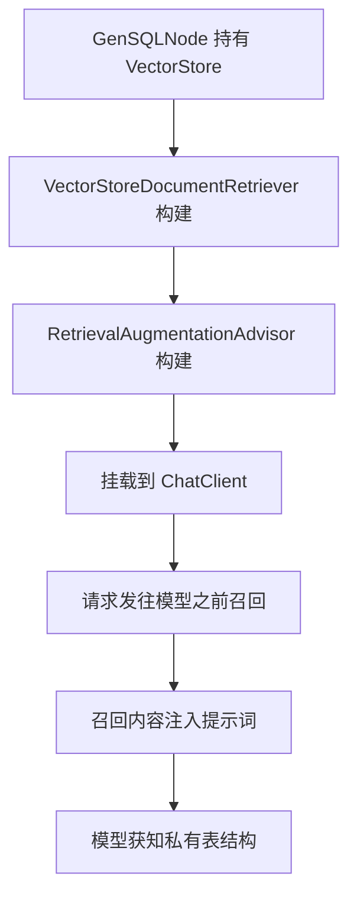

## 【学习目标】

学完本节，应当能够：

- 说清 `RetrievalAugmentationAdvisor`（检索增强顾问）的角色，以及 `DocumentRetriever` 接口下三种实现的适用场景；
- 独立装配 `VectorStoreDocumentRetriever`，把向量数据库接入 RAG 召回链路；
- 逐层解构一条 Text2SQL 系统提示词：角色、能力边界、七条输出要求各自防什么失败模式；
- 掌握「绝对化表述」这一提示词技巧，并建立「仿写练习」的提示词学习方法。

## 【正文】

### 一、先补上 `userInput` 键

进入实际的代码编写，先来完成第一步，也就是实现 RAG 的召回过程。刚上手就发现一个问题：实现 RAG 召回时必须有用户输入，得知道用户用自然语言输入了什么。所谓自然语言，比如用户说「帮我查询一下 25 年 11 月某个商品的销售金额是多少」，这就是自然语言。

所以要在 key 里补上一个用户输入的 key。这对应到开始节点：触发该 Agent 执行时，肯定需要用户输入一段自然语言来触发。该 key 就叫 `userInput`，依然使用替换策略：

```java
@Configuration
public class GraphConfig {
    @Bean
    public KeyStrategyFactory keyStrategyFactory() {
        return Map.of(
            "userInput",
            "genSQL",
            new ReplaceStrategy()
        );
    }
}
```

需要说明：该片段是讲稿速记，`Map.of` 中每个 key 都应各自绑定一个策略实例（正确形态如每个 key 后跟一个 `new ReplaceStrategy()`），9-15 节给出完整版。这里要建立的认知是：**开始节点写入的 key、生成节点消费与产出的 key，都必须在图初始化时声明策略**，漏声明一个，状态机里就少一条数据通道。

### 二、RAG 召回：选哪个文档检索器

拿到用户输入之后就可以做 RAG 的召回开发了。Spring AI 已经集成了召回能力，提供了一个「检索增强顾问」，`RetrievalAugmentationAdvisor`（该名称较长，直译即检索增强顾问）。它同样是建造者模式，通过 `builder()` 构建。里面有一个核心属性叫 `documentRetriever`，也就是文档检索器，这里必须使用文档检索器，因为向量数据存储在向量数据库当中。

点进 `DocumentRetriever` 看它是什么：它是一个接口。再看 Spring AI 生态帮我们做了哪些实现：

| 实现 | 所属 | 数据来源 | 本项目是否采用 |
|---|---|---|---|
| `VectorStoreDocumentRetriever` | Spring AI 默认 | 任意 `VectorStore`（Redis / Milvus 等） | 采用 |
| `DashScopeDocumentRetriever` | Spring AI Alibaba | 阿里云百炼私有知识库 | 不采用 |
| `CompositeDocumentRetriever` | Spring AI Alibaba | 组合多个检索器 | 不采用 |

三者的分工很清晰：向量数据在自家向量数据库里，用默认的 `VectorStoreDocumentRetriever`；知识库托管在阿里云，用 `DashScopeDocumentRetriever`；需要同时查多个来源再汇总，用 `CompositeDocumentRetriever`。接口留出扩展点，实现按数据所在地选择，这也是「面向接口编程」在框架层的示范。

### 三、装配检索器：节点持有 `VectorStore`

选定的实现叫 `VectorStoreDocumentRetriever`，即向量数据库文档检索器。它同样是建造者模式，通过 `builder()` 构建；因为它需要知道向量数据存在哪里，所以要持有一个 `VectorStore`。

持有 `VectorStore` 就需要一个对应参数，所在节点里通过 `final` 定义 `vectorStore`，并加进构造方法：

```java
public class GenSQLNode implements NodeAction {
    private final ChatClient chatClient;
    private final VectorStore vectorStore;

    @Override
    public Map<String, Object> apply(OverAllState state) throws Exception {
        String userInput = state.value(key: "userInput", defaultValue: "");
        RetrievalAugmentationAdvisor retrievalAugmentationAdvisor = RetrievalAugmentationAdvisor.builder()
            .documentRetriever(VectorStoreDocumentRetriever.builder()
                .vectorStore(vectorStore)
                .build())
            .build();
        chatClient.prompt(
            """
            # 角色
            你是一名精通的 SQL 专家，负责根据企业数据表结构生成 SQL 查询。用户将以自然语言提出数据需求。
            你有能力访问企业数据库表结构和表之间的关系（这些信息通过矢量数据库检索）。
            # 要求
            1. 仅生成可执行的 SQL，不输出任何与 SQL 无关的文字或解释。
            2. 在生成 SQL 前，首先理解用户需求和检索到的表结构信息。
            3. 根据表结构和需求，生成可执行的 SQL。
            4. 输出 SQL 时，禁止使用Markdown格式 “sql” 输出，直接以文本格式输出。
            5. 如果存在多种实现方式，优先选择简洁、性能较好的写法。
            6. 禁止输出与 SQL 无关的文字或解释。
            7. 不可凭空虚构数据，若数据不足，请返回空字符串。
            """
        );
        return Map.of();
    }
}
```

两处讲稿速记的说明：`state.value(key: ..., defaultValue: ...)` 的具名参数写法是速记形式，实际 API 是位置参数；`chatClient.prompt(...)` 之后尚未挂载顾问与调用动作，完整调用链在下一节补全。本节重点在两件事：**顾问的装配形态**，与 **提示词本身**。

通过 builder 指定使用向量存储文档检索器作为文档检索器之后，整个检索增强顾问就构建好了。这一步的本质是：选定「去哪召回」。至于「何时召回、召回后放哪」，是顾问被挂载到调用链之后的事，检索增强顾问是在和大模型交互的时候被调用的，请求发往模型之前，召回内容会作为上下文注入提示词，模型因此「知道」私有知识库里的表结构。具体挂载动作下一节落到 `advisors` 参数上。



### 四、系统提示词解构：七条要求各自防什么

提示词直接沿用智能库存调拨优化系统里打磨过的写法（那里已讲过如何使用多种提示词优化技术，5-7、5-8 两节有完整展开，此处不重复）。把这条 Text2SQL 提示词拆开看，是四层结构：

| 层次 | 内容 | 作用 |
|---|---|---|
| 角色 | 精通的 SQL 专家，负责根据企业数据表结构生成 SQL | 把模型的先验拉到「数据库专家」分布上 |
| 能力边界 | 表结构与表关系通过矢量数据库检索得到 | 明确知识来源，防凭记忆编造 |
| 输出要求 1–7 | 见下 | 逐条封堵失败模式 |
| 兜底 | 数据不足返回空字符串 | 明确的失败出口，优于硬编 |

七条要求不是凑数，逐条对应一个真实失败模式：

1. **仅生成可执行的 SQL，不输出任何与 SQL 无关的文字或解释**，防「教学式回答」：模型在 SQL 前后加「好的，以下是……」这类客套，下游无法直接执行；
2. **生成 SQL 前，先理解用户需求和检索到的表结构信息**，防「未读上下文就下笔」：RAG 召回的内容注入提示词后，强制模型先消化再生成；
3. **根据表结构和需求，生成可执行的 SQL**，防漏 JOIN、选错列；
4. **禁止使用 Markdown 格式输出，直接以文本格式输出**，防代码围栏：模型默认爱用 Markdown 代码块包裹 SQL，而本系统要的是裸 SQL 文本，围栏需要二次清洗才能执行；
5. **多种实现方式时，优先选择简洁、性能较好的写法**，防过度复杂化：一个需求常有多种 SQL 写法，不指定时模型可能给出冗长版本；
6. **禁止输出与 SQL 无关的文字或解释**，与第 1 条重复强调，重要约束说两遍；
7. **不可凭空虚构数据，若数据不足，请返回空字符串**，防 Text2SQL 幻觉：检索不到相关表时，明确的失败出口优于编一张表出来。

第四条值得单独说。BI 问答的交付物是「可执行的 SQL」，任何包装格式都是下游的负担。提示词里明确禁止 Markdown，是把「格式契约」前移到生成阶段，而不是靠后置正则清洗兜底，能在生成侧解决的问题，不要留给解析侧。

### 五、提示词技巧：把话写得绝对一些

这里顺便说一个写提示词的技巧：尽量把一句话写得绝对一些。「不要」可以写成「禁止」，「禁止输出与 SQL 无关的文字或解释」，确认级别更高，语气更重，直接让它禁止输出。

背后的机理值得琢磨：大模型是按概率采样的，「不要输出解释」留出的解释空间，在采样波动下仍可能被命中；「禁止输出」是更强的约束信号，压缩了违背行为的概率空间。工程上的对应说法是：**约束的严格程度，要与下游的容错程度匹配**，下游能容错（有正则清洗、有评估节点），提示词可以松；下游零容错（SQL 直接进执行层），提示词就必须绝对化。

最后必须强调的学习方法：不要照搬老师写好的提示词。和大模型打交道时，提示词非常非常非常重要。看到好的提示词，一定要自己手动去写，比如照着 1:1 仿写，多写几遍。写的次数多了就会有感觉，以后自然就知道该怎么写了。提示词是需要练的：先弄清里面用到了哪些优化技术，再多练。抄来的提示词是别人的，仿写过三遍才是自己的。

## 【易错点 / 面试题】

1. **面试题：「为什么提示词里要专门禁止 Markdown 格式的 SQL 输出？」**
   答：因为下游要的是裸 SQL 文本。模型默认倾向于用 Markdown 代码块包裹代码，围栏符号进了执行层就是语法错误。两个解法：后置清洗（正则剥围栏）或前置约束（提示词禁止）。前者是兜底、有漏网风险，后者是契约、成本为零，所以双管齐下时前置约束必做。

2. **面试题：「角色提示词为什么有效？模型不是被训练成通用助手吗？」**
   答：角色提示词做的是条件化，「你是一名 SQL 专家」把生成分布条件到「数据库专家写作」这一模式上：术语更专业、默认输出可执行代码而非教程、更倾向遵循 SQL 规范。它不是让模型「变成」专家，而是在采样时收窄了解空间。可以补一句：角色要和能力边界配合，只说角色不说数据来源，模型可能凭记忆编造表名。

3. **面试题：「提示词里『不要』和『禁止』有区别吗？」**
   答：有。采样模型下，「不要 X」仍留下输出 X 的概率质量；「禁止 X」是更强的约束信号。约束强度应与下游容错程度匹配：下游零容错的场景（SQL 直接执行），用绝对化表述；下游有清洗、有评估兜底时，可以适度放松。

4. **易错点：直接复制粘贴提示词，不消化。** 提示词是「与模型协作的语言」，抄来的句子不理解其防的失败模式，换一个业务场景就不会写了。正确做法是 1:1 仿写、逐个条款追问「这条在防什么」，写到有肌肉记忆。

## 【小结】

本节把 RAG 召回的工具链装配到位：`userInput` 键补入状态机；通过 `RetrievalAugmentationAdvisor.builder().documentRetriever(VectorStoreDocumentRetriever...)` 把向量数据库接入召回链路；系统提示词按「角色 + 能力边界 + 七条输出要求 + 兜底」四层组织，每条要求对应一个真实失败模式，并用绝对化表述收紧约束。下一节把顾问挂到 `advisors` 参数上，完成「召回 → 上下文注入 → 流式生成 → `genSQL` 落状态机」的完整落地。同款「提示词约束 + 结构化绑定」的写法在配套工程 `980-demo` 中可直接对照：`980-demo/src/main/java/com/carl/ai/transfer/extract/TransferOrderExtractor.java` 用一段约束明确的提示词（明确字段清单与「只输出 JSON」）配合 `call().entity(TransferOrderParam.class)` 完成结构化抽取，`980-demo/src/main/java/com/carl/ai/transfer/agent/TransferAgent.java` 在抽取结果为空时返回明确失败文案，提示词负责「让模型说对」，工程负责「说错之后怎么办」，两层都要有。
