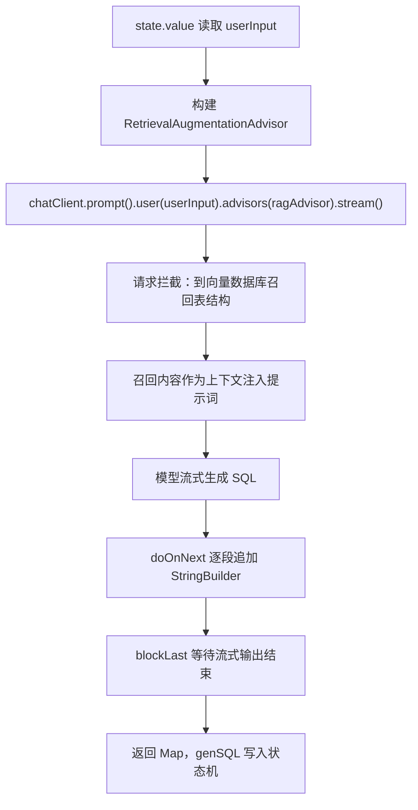

## 【学习目标】

学完本节，应当能够：

- 把上一节装配好的 `RetrievalAugmentationAdvisor` 挂载到 `ChatClient` 调用链上，完成「召回 → 上下文注入 → 生成」的完整闭环；
- 说清流式调用 `.stream().content()` 的消费方式，以及 `blockLast()` 与 `blockFirst()` 的本质区别；
- 独立补全图的装配：`addNode`、`addEdge`、编译返回 `CompiledGraph`，并写出可触发工作流的测试 controller；
- 建立「依赖前置」的联调习惯：向量库（Milvus）未就绪时项目起不来，如何排障。

## 【正文】

### 一、用户提示词：直接用自然语言本身

系统提示词定义好之后，接下来要定义用户提示词，也就是 user。这里其实不需要额外定义，直接把用户输入、也就是那段自然语言拿过来即可。用户一般会这么提问：「帮我查询 25 年某一个商品在各个月的销售情况」。所以直接拿用户输入作为用户提示词就行。

这里有一个提示词设计的分工原则：**系统提示词装「稳定不变的规则」（角色、输出要求、兜底），用户提示词装「每次变化的输入」（本次的问题）**。给用户问题再套一层模板，只会引入噪声。

### 二、必须流式调用

再往下要通过流式调用。为什么不能用普通调用？课程在库存调拨系统开发时已确立过这一约定，本节沿用：必须使用流式调用。调用 `.stream()` 方法，就能拿到响应式的 content 内容（`Flux<String>`）。到这里第二步、第三步其实已经完成，也就是定义提示词和与大模型的交互：

```java
public class GenSQLNode implements NodeAction {
    public Map<String, Object> apply(OverallState state) throws Exception {
        // 角色
        // 你是一名熟练的 SQL 专家...
        // 要求
        // 1. 仅生成可执行的 SQL...
        // 2. 在生成 SQL 前，首先理解用户需求和检查得到的表结构信息...
        // 3. 根据表结构和关系选择合适的表和字段，生成可执行的 SQL...
        // 4. 输出 SQL 时，禁止使用markdown格式“`sql”来输出，直接以文本格式输出...
        // 5. 如果有多种实现方式，优先选择易简洁、性能较优的写法...
        // 6. 禁止输出与 SQL 无关的文字或解释...
        // 7. 不可凭空虚构数据，若数据不足，返回空字符串...
        // ...
        .user(userInput)
        .stream().content();
        return Map.of();
    }
}
```

对该片段做三处速记说明：`apply(OverallState state)` 与前两节的 `OverAllState` 存在大小写差异，以引擎实际类型为准；`.user(userInput)` 之前省略了 `chatClient.prompt()` 前缀与系统提示词参数；`return Map.of()` 是占位空返回，实际应返回携带 `genSQL` 的 Map（下一段补全）。从工程视角补一句：生成 SQL 耗时在秒级，流式让首 token 尽早到达，界面无需长时间无响应。

### 三、挂载检索增强顾问：召回发生在模型调用之前

但第一步还没真正完成：检索增强顾问已定义，尚未实际调用。调用点在 prompt 之后的 `advisors` 参数，可以传入多个顾问，理解为增强器。把前述顾问直接传过去即可。

传进去之后，执行时序是这样的：



关键点：顾问不是「生成完再补充」，而是在请求发往模型**之前**被调用，先去向量数据库中做召回，召回到的内容放进提示词当中作为上下文传给大模型，模型因此「知道」私有知识库的表结构。这就是 RAG 的字面含义：用检索到的内容增强（augment）本次生成。

多个顾问可以串成一条链（日志、重试、检索各司其职），这也是 Spring AI 把横切能力收进 Advisor 机制的意义。

### 四、流式消费：`StringBuilder` 与 `blockLast`

接下来接收响应式结构。做法是创建一个 `StringBuilder`，因为输出是响应式的，所以要流式去取：拿到之后追加到 `StringBuilder` 里，用 `content.doOnNext(...)` 处理，这就是典型的响应式编程写法，每个片段到达时触发一次回调，片段拼接成完整 SQL。

这里一定要用 `blockLast()`。千万不要用 `blockFirst()`，`blockFirst()` 拿到第一个元素就结束了，后面的内容全部丢弃；必须用 `blockLast()`，一直阻塞在这里，直到流式输出全部返回结束，才继续往下走。两者的差别就是「拿到首 token 就交卷」与「等全文写完再交卷」。生成 SQL 要的是完整文本，没有第二个选择。

生产环境提醒：`blockLast` 是阻塞动作，占用调用线程直到流结束。高并发场景下，建议把这类节点动作放到 Java 21 虚拟线程上执行（`Executors.newVirtualThreadPerTaskExecutor()`），避免平台线程被长时间占满。

### 五、日志与状态落盘

往下走之后，最好把 `StringBuilder` 里的内容打一条日志。按照代码编写的惯例，加上 Slf4j 的注解，打印一条日志：`genSql = `，用 `toString()` 转成字符串。

图的定义里已声明过一个 key，即本节点最终产出的存放位置，供之后的节点使用。把它复制过来，在节点代码中返回：内容就是 `sb.toString()`。

到这里第一个节点的开发就结束了。回看整个节点：读 `userInput` → 召回 → 注入上下文 → 流式生成 → 拼装 → 打日志 → 返回 `genSQL` 写入状态机。输入输出都经状态机，节点自身无副作用。

### 六、补全图装配

为了测试，回到图的配置类把图补充完整。先添加节点：调用图的 `addNode` 方法，节点 ID 起名 `genSqlNode`。依然使用 `AsyncNodeAction` 的静态方法 `node_async`，把 `GenSqlNode` 传进去，异步节点是工作流节点的标准形态。

它需要两个参数：一个是 `ChatClient`，另一个是向量存储。向量存储在之前文档处理的接口里已经用过，可以通过 `@Resource` 直接注入进来，这里同样注入即可。`ChatClient` 则可以通过 `ChatClient.Builder` 来获取，把 builder 拿过来再 `build()` 一下就能得到一个 `ChatClient`，连同 `VectorStore` 一起传进去。如果忘了怎么写，可以回头看之前的定义。这一部分是 Spring AI 自动帮我们装配好的，我们只需要在配置文件里配置好 chat model，它就能自动完成装配。

另外该方法应该要抛出异常，直接抛出 `Exception` 即可。

节点加完就要添加边。当前只测试第一个节点，所以直接连：起点是图的 `START` 起始节点，终点是生成 SQL 的节点；再一条边，起点是生成 SQL 的节点，终点是 `END`。

千万别忘了一定要对图进行编译，编译之后才能使用。很多初学者在这里直接把图返回了，那样在 controller 里用的时候还得再编译一次。所以这里直接编译好：

```java
@Configuration
public class GraphConfig {
    @Bean
    public CompiledGraph graph() {
        KeyStrategyFactory keyStrategyFactory = new KeyStrategyFactory();
        keyStrategyFactory.apply() {
            return Map.of(
                k1: "userInput", new ReplaceStrategy(),
                k2: "genSQL", new ReplaceStrategy()
            );
        };
        StateGraph stateGraph = new StateGraph(name: "biHelperGraph", keyStrategyFactory);
        stateGraph.addNode(id: "GenSQLNode", AsyncNodeAction.node_async(new GenSQLNode()));
        stateGraph.addEdge(StateGraph.START, targetId: "GenSQLNode");
        stateGraph.addEdge(sourceId: "GenSQLNode", StateGraph.END);
        return stateGraph;
    }
}
```

对该片段做四处速记说明：`keyStrategyFactory.apply() { ... }` 省略了 `new` 关键字（正确写法见 9-13 节的 `new KeyStrategyFactory()`）；`new StateGraph(name: ...)`、`addNode(id: ...)` 的具名参数是速记形式；`new GenSQLNode()` 省略了构造参数，实际装配需传入 `ChatClient` 与 `VectorStore`；末尾 `return stateGraph;` 未体现编译调用，而方法声明返回 `CompiledGraph`，按正文要求，返回前应完成 `stateGraph.compile()`，编译后的图才能被 controller 直接使用。

### 七、测试 Controller

图编译完之后，就可以到 controller 里建一个测试用的 controller 来调用了。新建一个 controller，加上 `@RestController` 注解，再给一个 `@RequestMapping`。

首先要把定义好的图 Bean 注入进来，通过 `@Resource` 注入。接下来定义方法，用 GET 请求即可：`@GetMapping`，URL 就叫 `talk`，返回值用通用的返回结果 `R`，方法名也叫 `talk`（记得导包）。

该方法肯定要接收一个参数，就是触发 Agent 执行时用户输入的自然语言，也就是将来往状态机里存储的 `userInput`。所以通过 `@RequestParam` 来获取。

然后就可以在里面调用 `call` 方法了。此时需要传入一个 Map，因为只需要传入一个初始的 key-value，直接用 `of` 方法即可，key 是 `userInput`。

这样拿到执行之后的 `OverAllState`，也就是整个的状态。整个状态里可以通过 `data()` 拿到该 Map，并放进 `R` 里返回。因为返回值是泛型，最好在这里补充指定为 `Map` 类型的对象：

```java
@RestController
public class GenSQLController {
    @Resource
    private CompiledGraph graph;
    @GetMapping(value = "/talk")
    public R talk(@RequestParam String userInput) {
        // ...
    }
}
```

说明：代码片段中类名为 `GenSQLController`，与行文称呼的大小写差异以代码为准；`// ...` 处即上文讲述的 `graph.call(...)` 与组装 `R` 返回逻辑。

### 八、启动联调：依赖前置检查

至此 controller 就编写完了，启动项目看看执行效果。启动之前要先把一些基本配置配好，尤其是大模型相关的配置。

启动应该会报错：这里用 Milvus 作为向量存储，而 Milvus 尚未启动，连不上就会报 Milvus 的错误。打开 Docker，关掉不需要的容器，手动把 Milvus 的四个容器与可视化管理工具启动；就绪后再启动项目，稍等它完全起来。

这次报错值得记住：**上游依赖（向量库、模型端点）未就绪时，启动期快速失败优于运行期才发现**。开发联调先起依赖、后起应用；生产上用健康检查（`/actuator/health`）与依赖探测把这一检查自动化。

## 【易错点 / 面试题】

1. **面试题：「`blockFirst()` 和 `blockLast()` 有什么区别？这里为什么必须用后者？」**
   答：两者都用于把响应式流转为阻塞结果，区别在取哪个元素：`blockFirst` 拿到流的第一个元素就返回、后续元素全部丢弃；`blockLast` 一直阻塞到流结束，返回最后一个元素。生成 SQL 需要完整文本，首 token 只是开头，所以必须 `blockLast`。

2. **面试题：「`RetrievalAugmentationAdvisor` 挂上去之后，召回发生在什么时候？」**
   答：发生在请求发往模型之前。Advisor 是 `ChatClient` 调用链上的拦截机制：请求经过顾问时，先执行向量库召回，再把召回内容作为上下文注入提示词，之后才轮到模型生成。它不是事后补丁，而是请求管线的前置环节；多个顾问可串成链，各司其职。

3. **面试题：「图为什么要编译之后再返回，不能直接用 `StateGraph`？」**
   答：`StateGraph` 是图纸（节点、边、策略的定义态），`CompiledGraph` 是装配后的可执行态。controller 里要的是直接能 `call` 的编译产物；若返回未编译的图，使用方每次还得自己编译，既重复也不一致。在配置类里一次编译、到处注入，是单一事实来源的做法。

4. **易错点：上游依赖未起就启动应用，然后面对一屏报错无从下手。** 本项目依赖 Milvus（向量存储）与模型端点，任一未就绪都会启动失败。正确习惯：先确认依赖再启动应用；报错时读栈顶第一条信息，直指根因。

## 【小结】

本节完成了第一个节点的完整落地：用户输入直接作为用户提示词；`RetrievalAugmentationAdvisor` 挂载到 `advisors` 参数，在请求发往模型前完成召回并注入上下文；`.stream().content()` 流式生成，`doOnNext` 逐段拼装、`blockLast` 等待收尾；`genSQL` 经返回值写入状态机；图侧补齐 `addNode`、`addEdge` 与编译，测试 controller 通过 `graph.call(Map.of("userInput", ...))` 触发链路，执行结果经 `OverAllState.data()` 返回。下一节起进入第二个节点，执行 SQL 并动态生成 Excel。同款「提示词约束 + 结构化产出 + 落库」的完整闭环可运行示例见配套工程 `980-demo`：`980-demo/src/main/java/com/carl/ai/transfer/agent/TransferAgent.java` 封装节点动作，`980-demo/src/main/java/com/carl/ai/transfer/extract/TransferOrderExtractor.java` 负责 LLM 调用与结构化抽取，`980-demo/src/main/java/com/carl/ai/transfer/service/TransferOrderServiceImpl.java` 与 `repository/BbTransferOrderRepository.java` 承接落库；该工程 default profile 用 `OfflineChatModel` 返回固定 JSON，不依赖真实模型端点即可离线验证主链路，正是「依赖前置、离线可测」思路的落地。
