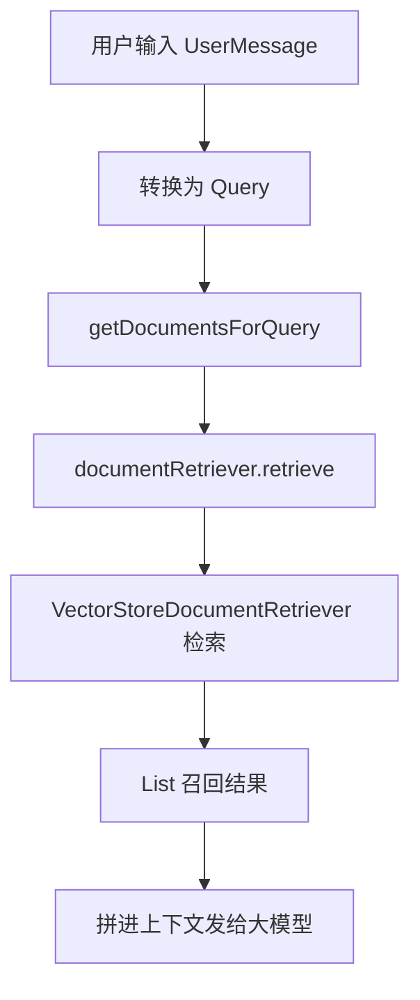

## 【学习目标】

- 独立完成向量库「清库 → 补文档 → 重传」的重建操作，说清每一步为什么必要。
- 逐项讲清 Milvus 连接配置的含义，特别是 `auto-id: false` 与幂等设计的关系。
- 能在源码级指出「用户输入 → Query → 召回 → 注入上下文」发生在 `RetrievalAugmentationAdvisor` 与 `VectorStoreDocumentRetriever` 的哪些位置。
- 掌握「执行 + 交叉核对」验证大模型生成 SQL 的方法，并能解释 topK 召回的行为。

## 【正文】

### 一、先补知识库，再谈召回

上一节把 RAG 召回链路接进了第一个节点。本节回到数据源头：此前讲解文档上传时漏了一张顾客维度表，向量库里的知识因此缺了一块。修补方式不是增量打补丁，而是清空重传，把 Milvus 里的向量数据清掉，重启项目，等 Milvus 重新就绪后错误不再复现。

清库的价值在于「干净」：带着缺陷的旧向量留在库里，检索时新旧内容混杂，结果差异说不清来源。重启完成后再确认一遍：文档里的顾客维度信息已补齐，销售事实表文档也带上了顾客维度，两端都对上了，才重新调用 `upload` 方法做文档上传。返回 200，到 Milvus 可视化页面刷新，出现集合 `bi-helper`，且数据里已带顾客维度，新文档这次真正进入了向量库。

工程上要把「删」与「重建」成对设计：同一份文档重复上传，若不先清理，集合里会堆积重复向量，同义内容在检索结果里霸榜，真正相关的文档被挤出 topK。生产做法是按文档维度先删后写，保证幂等；课程演示阶段直接清库重传，是等价的最干净操作。

### 二、Milvus 连接配置逐项拆解

```yaml
    spring:
      ai:
        vectorstore:
          milvus:
            client:
              host: localhost
              port: 19530
              collection-name: biHelper
              database-name: default
              id-field-name: id
              auto-id: false
```

逐项看：`host` 与 `port: 19530` 指向本地 Milvus 实例，19530 是 Milvus 的默认端口；`collection-name: biHelper` 指定承载 BI 知识库的集合，一个集合容纳全部表结构文档；`database-name: default` 使用 Milvus 默认数据库。

最值得盯的是最后两项：`id-field-name: id` 与 `auto-id: false` 组合起来表示，主键由 Spring AI 写入侧提供（即文档自身的 id），不由 Milvus 自动生成。该选择直接决定幂等能力：若 `auto-id` 为 `true`，主键由 Milvus 分配，写入侧拿不回 id，重复上传时无法按 id 定位删除，重复向量会无限堆积。两项取值还必须与建集合时的 schema 定义一致，否则写入阶段就会报错。

### 三、端到端验证：从自然语言到可执行 SQL

向量库就绪后，刷新接口列表，能看到多出一个 controller，即此前编写的问答入口。到浏览器里访问它，需要传一个 `userInput` 参数。输入这样一段自然语言：

> 查询 2025 年每个月的销售总额，并按月份升序排列。

这就是 RAG 的典型输入形态：用户想拿到什么报表，直接说出来。执行前先把日志清空，回车后稍等片刻即执行完毕。返回的 data 里有两项内容：用户输入，以及第一个节点生成的那条 SQL，大模型直接给出了一条可执行 SQL。第一个节点打印的 `genSql` 日志里，同样能看到这条 SQL 的全文。

拿这条 SQL 到数据库里执行，验证它是否与需求一致：

```sql
    SELECT
        d.month,
        SUM(s.sales_amount) AS total_sales
    FROM
        fact_sales s
    JOIN
        dim_date d ON s.date_id = d.date_id
    WHERE
        d.year = 2025
    GROUP BY
        d.month
    ORDER BY
        d.month ASC;
```

按查询意图逐项核对：需求要求「2025 年每个月」，SQL 用 `d.year = 2025` 限定年份、按 `d.month` 做 `GROUP BY` 分组，对；需求要求「销售总额」，SQL 对 `fact_sales.sales_amount` 做 `SUM` 聚合，对；需求要求「按月份升序」，SQL 用 `ORDER BY d.month ASC` 排序，对；月份字段来自日期维度表，SQL 通过 `s.date_id = d.date_id` 关联 `dim_date`，连表也没问题。

逐项通过后还要做数值级交叉核对：销售事实表里 2025 年 1 月的记录都在同一月份，直接对全表做一次 `SELECT SUM(sales_amount) FROM fact_sales`，结果为 3066980，与上面聚合 SQL 的一月结果一致，说明数字层面同样正确。

课程实录备注：当时想把某条记录的销售日期改成 2 月再验证一轮，因外键约束未修改，留到后续需要时再处理。

这套「执行 + 交叉核对」的方法论值得固化：大模型生成的 SQL 不能只看「像不像」，要先按查询意图逐项核对（过滤、分组、聚合、排序、连表），再用一条独立编写的核对 SQL 验证数值。两步都过，才能承认这条 SQL 可信。在 BI 场景里这是生命线，报表数字错了，下游的业务决策会跟着错。

### 四、断点调试：看召回到底带回了什么

测试通过不等于链路清楚。既然写了检索增强顾问，就有必要知道它到底召回了什么内容，召回结果会作为提示词的一部分传给大模型，模型答案的质量首先取决于这段上下文。

在 `RetrievalAugmentationAdvisor` 的 `getDocumentsForQuery` 方法上打断点：

```java
    public final class RetrievalAugmentationAdvisor implements BaseAdvisor {
        // ... 其他方法 ...
        private Map.Entry<Query, List<Document>> getDocumentsForQuery(Query query) {
            List<Document> documents = this.documentRetriever.retrieve(query);
            return Map.entry(query, documents);
        }
    }
```

可以看到，顾问把活儿委托给了 `documentRetriever.retrieve(query)`。`documentRetriever` 是接口，真正干活的是向量存储文档检索器 `VectorStoreDocumentRetriever`，它重写并实现了 `retrieve` 方法。在 `retrieve` 内部继续下断点，重新执行一次请求，调用实况如下：

1. 进入 `retrieve`，此时的 query 就是用户输入。回想召回链路图，UserMessage 正是作为 query 使用的，用户的那段自然语言到这里完成了「消息 → 查询」的身份转换。
2. 继续放行，方法内部构造出检索请求。
3. 再次回到 `getDocumentsForQuery` 时，`List<Document>` 已经拿到手，内容就是从向量数据库里检索、召回出来的文档。

源码级结论：RAG 召回不是黑箱。`RetrievalAugmentationAdvisor` 作为 `BaseAdvisor` 的实现，在模型调用前把 Query 交给 `DocumentRetriever`，检索到的文档经查询增强器拼进上下文，再随提示词一起发给大模型。每一环都能在 IDE 里断点验证，排查召回问题时有明确的着手点。



### 五、召回结果分析：七个文档为什么只回四条

断点里能看到本次召回的实况：库里一共有七个文档，实际召回四个，销售事实表、商品维度、库存事实表、顾客维度。

| 观察项 | 结果 | 说明 |
|---|---|---|
| 库内文档总数 | 7 | 含销售事实表、日期维度、商品维度、库存事实表、顾客维度等 |
| 实际召回 | 4 | 销售事实表、商品维度、库存事实表、顾客维度 |
| 筛选依据 | 语义相似度排序后取前 topK | 未显式配置时走框架默认值 |

「7 进 4 出」说明相似度过滤真实发生了：与「销售总额」语义更近的文档排在前面，尤其是销售事实表，`sales_amount` 等指标字段就在其中；商品维度、库存维度、顾客维度几段被一并召回后，才生成了那条正确 SQL。

该行为是 RAG 的核心设计而非缺憾：把库内文档全量塞进上下文，既撑爆 token 预算，又用大量无关内容稀释模型注意力。按相似度取 topK，把「知识库检索」转化为「相关性排序」问题，是标准做法。topK 因此成为召回优化的常用杠杆：调大，召回更全但噪声上升；调小，精准但可能漏召关键文档。9-18 讲的查询改写是另一个杠杆，让进检索的 query 本身更准，两条路径可以叠加使用。

### 六、生产视角：召回链路还要补三件事

第一，召回可观测。本节的断点调试法要固化为工程能力：把每次召回的文档 id、相似度得分、topK 打进日志，线上召回劣化时先看数据再猜原因，这正是 9-3 统一日志规范的兑现场景。

第二，混合检索。纯向量检索擅长语义泛化，弱在精确匹配（型号、编码、枚举值），生产常用「向量 + 关键词」混合检索，再加重排收敛，思路见 9-2。

第三，空召回降级。用户问到库里没有的知识时，流程不能中断，要靠查询增强器的空上下文策略兜底，见 9-18。

## 【易错点 / 面试题】

1. **面试官问：RAG 召回链路在源码里经过哪些类型？** 依次是：`RetrievalAugmentationAdvisor`（`BaseAdvisor` 实现）→ `QueryTransformer` 链 → `DocumentRetriever`（`VectorStoreDocumentRetriever`）→ `QueryAugmenter`（`ContextualQueryAugmenter`）注入上下文。整条链路可在 IDE 断点验证，不必停留在含糊的描述。
2. **面试官问：库里 7 个文档为什么只召回 4 个？** 相似度排序后按 topK 截断，不是全量注入。topK 是召回数量与噪声之间的核心权衡，也是面试官追问「召回率怎么调」时的标准切入点。
3. **易错点：把「测试通过」当「链路正确」。** 本节 SQL 正确只是结果，断点看到召回内容才是过程。只验结果不验过程，换一个提问就可能漏召关键文档，而这类失败在端到端测试里往往被笼统归因为「模型不行」。
4. **易错点：忽视 `auto-id` 与幂等的关系。** `auto-id: true` 时主键由 Milvus 生成，重复上传无法按 id 清理，重复向量会持续堆积。选 `false` 是为了让写入侧掌握主键，幂等的「删旧写新」才成立。

## 【小结】

本节把 9-15 落地的召回链路放到了源码级：Milvus 重建（清库 → 补顾客维度 → 重传）、连接配置逐项含义、生成 SQL 的执行与交叉核对、`RetrievalAugmentationAdvisor` 与 `VectorStoreDocumentRetriever` 的断点实录，以及「7 进 4 出」背后的 topK 行为。召回「带了什么回来」弄清楚之后，下一篇 9-17 转向召回质量本身：用户提问不标准时，如何用自动提示工程改造查询。RAG 章节与库存调拨主线的直接关联较弱，「大模型输出 → 结构化落地」的完整可部署写法可对照配套工程 `980-demo/src/main/java/com/carl/ai/transfer/extract/TransferOrderExtractor.java`。
