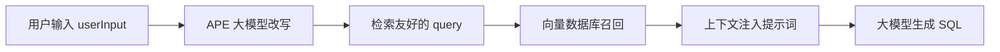

## 【学习目标】

- 说清「用户提问不标准」在 RAG 链路里具体伤害哪一环，为什么伤害发生在召回而非生成。
- 讲清自动提示工程（APE）的定义、在本项目链路中的插入位置与生效原理。
- 能对比三类查询转换手法（重写 / 压缩 / 翻译）的适用场景与主要风险。
- 建立「召回优化可度量」的工程习惯：用评测集给优化手段打分，而不是凭感觉。

## 【正文】

### 一、面试题：用户是不可控的

第一个节点已经写完：RAG 检索生成 SQL，既实现了召回过程，又完成了与大模型的对话。到这里，把面试官请出来，用户是不可控的，什么样的人都有，表达能力参差不齐，提问往往并不标准。如何保证不标准的提问依然被正确理解？如何做优化，让大模型清楚用户到底想问什么，从而更好地完成 RAG 召回以及与大模型的交流？

先把问题放到流程里定位。在第一个节点，需要从触发工作流执行时的全局状态中取出用户输入，即 `userInput` 键对应的 value。这段自然语言是整条 RAG 链路的入口原料，它的质量直接决定召回质量，上游原料出了问题，下游每一步都在放大错误。

### 二、不标准的提问，伤害发生在召回

要回答问题，先看清伤害发生在哪。检索按语义相似度工作，而用户的口语与文档里的 schema 词汇之间存在词汇鸿沟：用户说「看看每个月卖得怎么样」，文档里写的是 `fact_sales`、`sales_amount`、按 `month` 分组。向量模型能泛化一部分这种差距，但泛化不是无限的；提问表述越漂移，Top 文档的排序越不可靠，漏召关键表结构的概率越高。

一个直观类比：开卷考试，问题本身问得含糊，翻资料的人效率也会低。RAG 里的检索器正是翻资料的人，它不懂业务，只懂向量距离；真正懂业务语义的，是对话大模型。让懂语义的角色先插手一次，性价比极高。

把伤害链条画完整：用户表述漂移 → query 与文档的语义距离拉大 → TopK 结果里混入无关文档、关键表结构被挤出 → 注入给大模型的上下文缺信息 → 生成的 SQL 缺表或缺字段。端到端看，表现为「AI 答得不准」；分层看，根因在召回。定位到这一层，优化手段才不会用错地方，这也是面试中区分「背过 RAG 概念」与「真排查过 RAG 问题」的分水岭。

还要说清边界：提问不标准伤害的是召回；如果库里压根没有对应知识（例如 9-16 之前缺顾客维度表），再好的改写也无能为力，那属于文档补全问题。两类问题分开治理，别指望一个手段包打天下。

### 三、解法：自动提示工程（APE）

本项目使用自动提示工程以及多种 Prompt 技术，来实现召回率的提升。所谓自动提示工程，属于指示词优化工程中的一种：借助大模型，让大模型帮我们改造用户的提问。

回顾 9-16 看到的链路：用户输入被转换成 query，再拿 query 去做内容召回。APE 的做法就是在此位置插入一次「大模型预处理」，把用户输入改写成一个或多个更容易被检索系统理解的 query，再用这些 query 去查询。

生效原理可以概括为「词汇对齐」：大模型懂业务语义，能把口语映射到接近文档用语的中间表示；检索器只懂向量距离。先由懂语义的做一次翻译，再由懂距离的做排序，各司其职。本质上，这仍然是通过优化提示词来提高召回率，同时让 AI 更好地理解用户的提问。

改写前后的差异可以用一个示例直观呈现（示例为教学推演，非课程实录）：

| 阶段 | 内容 |
|---|---|
| 用户原始输入 | 查一下去年啥品类卖得最好，按月看 |
| 改写后 query | 查询上一年度各商品品类的销售额，按月份汇总并找出销售额最高的品类 |
| 改写解决的问题 | 「啥」「最好」等口语被明确为指标（销售额）与排序意图；「按月」被保留为分组条件 |
| 改写保留的实体 | 时间范围（上一年度）、维度（品类、月份） |

代价必须同时讲清楚，APE 不是免费午餐：

| 代价项 | 具体表现 | 缓解思路 |
|---|---|---|
| 延迟与成本 | 多一次模型调用，链路变长、token 消耗上升 | 只对置信度低的提问触发改写 |
| 改写跑偏 | 丢实体、加幻觉，改写后反而离真实意图更远 | 模板约束 + 实体一致性校验 |
| 收益不可见 | 「感觉变好了」无法沉淀为结论 | 建评测集，用召回率数字说话 |

### 四、三类查询转换手法

Spring AI 的 `RetrievalAugmentationAdvisor` 在构建阶段暴露 `queryTransformers` 属性，可接收多个查询转换器。`QueryTransformer` 接口自带三个默认实现，正好覆盖三类改造思路（接入代码见 9-18）：

| 手法 | 做什么 | 适用场景 | 主要风险 |
|---|---|---|---|
| 重写 `RewriteQueryTransformer` | 把用户输入重写为大模型更容易理解的提问形式 | 提问不规范的口语输入，本项目默认选择 | 改写丢失关键实体 |
| 压缩 `CompressionQueryTransformer` | 把用户输入的自然语言压缩成对应的 query | 多轮对话，把带指代的输入压成完整意图 | 过度压缩丢掉修饰条件 |
| 翻译 `TranslationQueryTransformer` | 按提示词模板把查询翻译成指定语言 | 跨语言知识库 | 中文库场景基本用不上 |

压缩转换器面向的是多轮对话场景：当用户的提问带着上一轮指代（如「它」「上个月」）时，先把指代压成完整表述，检索拿到的就是一条语义完整的独立查询，而不是半句指代。没有这一步，多轮场景的召回会持续跑偏。

翻译转换器的行为可以从它的提示词模板直读：「给定一个用户查询，把它翻译成指定的语言」，因此中文查询可经它转成英语、意大利语、西班牙语等。它在平时用得不多，把中文查询译成英文后，查询与中文文档的向量不在同一语义空间，召回反而更差。这与 9-4「写入与查询必须使用同一个向量模型」是同一条原理：语义空间错位，检索必然失效。

### 五、改写的边界：什么不能改

硬约束必须原样存活：时间（2025 年）、维度（按月）、指标（销售总额）这类实体，改写后一个都不能少。两个工程手段：

其一，在改写模板里显式约束保留实体，让大模型知道哪些信息不许动；其二，做改写前后的实体一致性校验，把时间词、数字、专有名词提取成集合，比对改写前后是否一致，不一致则回退用原始 query。

失败案例推演：用户说「帮我看看去年每个月卖得最好的品类」，若改写把「每个月」丢成「年度」，召回与生成的 SQL 都会错，且端到端测试只会显示「结果不对」，很难归因到改写环节。防住它的不是断点，是评测集。

评测闭环这样建：收集一批真实提问，标注每条提问应当命中哪些文档；分别用原始 query 与改写后 query 计算召回率，用数字决定开不开改写、用哪个转换器。指标不需要复杂，召回率就够用：对每条提问，看应命中的文档是否出现在前 K 条召回结果里，命中记 1，最后求全集平均；改写前后各跑一遍，两个数字放一起，净收益一目了然。这正是 9-2「生产落地的两个提前量」里评测习惯的直接应用，召回优化从玄学变成工程。

### 六、与后续章节的关系

9-18 把思路落成代码：`RewriteQueryTransformer` 负责改造提问，`ContextualQueryAugmenter` 的 `allowEmptyContext(true)` 负责空召回时流程不中断，两者组合成完整的提问优化链路。

三类手法可以组合，但有优先级：先重写（收益最确定），再按需压缩（多轮场景），翻译最后考虑（跨语言场景）。组合越多链路越长，每增加一个转换器，都要过一次评测集，用数字确认它是在帮忙而不是帮倒忙。

到本节为止，「怎么让 AI 听懂不标准的提问」有了分层答案：表达层靠查询改写，知识层靠文档补全，流程层靠空上下文兜底。

## 【易错点 / 面试题】

1. **面试官问：用户提问不标准，你怎么让 AI 理解？** 分层作答：表达层用查询改写（自动提示工程）对齐词汇；知识层补齐缺失文档；流程层用允许空上下文保证链路不中断。只答「优化 Prompt」会显得单薄，答「微调」则答错了方向，这是召回问题，不是模型风格问题。
2. **面试官问：查询改写的代价是什么？** 额外一次模型调用带来的延迟与成本；改写跑偏（丢实体、加幻觉）的风险；因此必须配评测集度量净收益，而不是凭感觉上线。
3. **易错点：把翻译转换器当万金油。** 中文知识库 + 中文查询，翻译成英文只会把查询推离文档的语义空间。转换器要对齐文档语言，不是对齐「更流行的语言」。

## 【小结】

本节回答了面试高频题「用户不可控怎么办」：在 `userInput` 变 query 的位置插入自动提示工程，用大模型把口语改写成检索友好的查询，同时讲清了代价、边界与度量方法。下一篇 9-18 给出 `RewriteQueryTransformer` 与 `allowEmptyContext(true)` 的接入代码，完成提问优化链路的最后一块。第 9 章的 RAG 主线至此闭环，下一章进入 Agent 安全话题。查询改写仍然依赖 `ChatClient` 发起模型调用，`ChatClient` 的装配与 profile 切换方式可对照配套工程 `980-demo/src/main/java/com/carl/ai/transfer/config/ChatModelConfig.java`。
