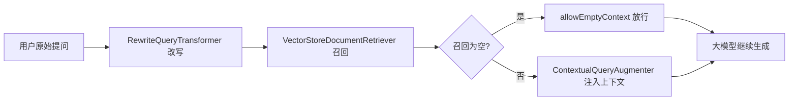

## 【学习目标】

- 说清 `RetrievalAugmentationAdvisor` 的两个构建期扩展点 `queryTransformers` 与 `queryAugmenter` 各自负责什么。
- 讲清 `QueryTransformer` 接口契约与三个默认实现（重写 / 压缩 / 翻译）的区别、选型与风险。
- 独立把 `RewriteQueryTransformer` 与 `allowEmptyContext(true)` 接进工作流节点，并解释每一行的意图。
- 能回答「多转换器是并行还是链式」「为什么收 `ChatClient.Builder`」等面试追问。

## 【正文】

### 一、两个扩展点：转换与增强

`RetrievalAugmentationAdvisor` 在构建阶段暴露两个关键属性：`queryTransformers`（查询转换）与 `queryAugmenter`（查询增强）。前者管「提问进检索之前怎么改造」，后者管「检索结果为空或非空时怎么拼进上下文」。两个扩展点分别对应 9-17 讲的表达层与流程层，组合起来才是完整的提问优化链路。

把它们设计成构建期属性而非运行期参数，原因在于 Advisor 的织入时机：9-16 的断点实录已经验证，召回发生在模型调用之前，由 Advisor 在请求阶段完成。转换与增强策略属于链路配置，构建期确定、运行期执行，与 `ChatClient` 的生命周期一致。

### 二、QueryTransformer 体系与三个默认实现

点进参数定义可以看到，`QueryTransformer` 本身是一个接口，契约很窄：输入一个 Query，输出一个 Query。Spring AI 默认提供了三个实现类：

| 实现 | 职责 | 典型场景 | 注意点 |
|---|---|---|---|
| `RewriteQueryTransformer` | 把用户输入重写为大模型更容易理解的提问形式 | 提问不规范的口语输入，本项目选择 | 需注入 `ChatClient.Builder` |
| `CompressionQueryTransformer` | 把用户输入的自然语言压缩成对应的 query | 多轮对话，消解指代 | 防过度压缩丢条件 |
| `TranslationQueryTransformer` | 按模板把查询翻译成指定语言 | 跨语言知识库 | 中文库基本不用 |

三个转换器的差异全在提示词模板与参数，读模板即可确认行为。以翻译转换器为例，从它的提示词模板可以看出，它做的事情是「给定一个用户查询，把它翻译成指定的语言」，因此中文查询可以经由它转成英语、意大利语、西班牙语等其他语言的查询。这一支转换器平时用得不多，具体行为可以直接读它的提示词模板确认，把模板读明白，比背结论可靠。

多个转换器传入 `queryTransformers` 时，按链式顺序执行：上一个的输出作为下一个的输入。因此「多个转换器」是一条流水线，不是并联广播；配置顺序即执行顺序，顺序不同，最终 query 可能不同。

### 三、接入 RewriteQueryTransformer

这里要接入的是重写查询转换器，代码注释上先标注「创建重写查询转换器」。它同样采用构建器模式，通过 `builder()` 创建，构造参数中需要传入 `chatClientBuilder`。

为什么要收 Builder 而不是收一个构建好的 `ChatClient`？课程给出的解释是：重写动作本身必须借助大模型完成，这里不能接收一个已经构建好的 `ChatClient`，而要改成接收 `ChatClient` 的 builder，在调用处再通过 `build()` 得到 `ChatClient` 实例。工程上还有一层好处：转换器内部自行构建实例，与业务主链路的 `ChatClient` 相互独立，改写调用不会重复挂载检索逻辑。

除 `chatClientBuilder` 之外，构建器还允许传入提示词模板来约束转换行为，不传则使用默认模板，最后调用 `build()` 就得到一个重写查询转换器。

翻译转换器的源码可以佐证「转换器本质是一次被模板约束的小调用」，`transform` 内部同样走 `chatClient.prompt().user(...).call().content()`，与普通对话别无二致：

```java
    public class TranslationQueryTransformer implements QueryTransformer {
        private final ChatClient chatClient;
        private final PromptTemplate promptTemplate;
        private final String targetLanguage;

        public Query transform(Query query) {
            Assert.notNull(query, "Query cannot be null");
            logger.debug("Translating query to target language: {}", this.targetLanguage);
            String translatedQueryText = this.chatClient.prompt().user(user -> {
                user.text(this.promptTemplate.getTemplate()).param(this.targetLanguage).param(query.getText());
            }).call().content();
            return new Query(translatedQueryText);
        }
    }
```

将该转换器传入 `queryTransformers`，就完成了一次基于自动提示工程的扩展：当用户提问不够规范时，先由大模型把提问重写成既能被更好地理解、又能提高检索召回率的查询。

### 四、queryAugmenter 与 allowEmptyContext

查询转换器之外，`RetrievalAugmentationAdvisor` 还有一个 `queryAugmenter` 属性，即查询增强。它对应的 `QueryAugmenter` 接口同样带有默认实现：上下文查询增强器 `ContextualQueryAugmenter`，依旧是构建器模式。构建时有一个 `allowEmptyContext` 属性，含义是允许空上下文，这里把它设为 `true`。

它的作用在于：从向量数据库召回时如果确实没有命中任何内容，召回结果为空也不会直接抛异常，后续流程仍然可以继续走完。

值得把「没有它会怎样」说透：不允许空上下文时，召回为空即抛错，整条工作流中断，用户问一个库里没有的问题，系统直接报错，这在演示和生产都不可接受。允许空上下文则把提示词照常发完，大模型基于「无私有知识」作答：好处是链路不断，代价是答案可能没有依据。生产做法是空召回时走降级话术（明确告知未检索到相关知识并给出建议），或引导用户补充文档。`allowEmptyContext` 保的是流程韧性，不是答案质量，该区分本身就是面试加分项。

命名说明（如实）：正文称 `ContextualQueryAugmenter`，下方节点代码块中写作 `ContextQueryAugmenter`，属课程原始写法的命名不一致，以 Spring AI 实际类名为准。

### 五、节点代码：把优化链路接进工作流

把上述两个扩展点接进第一个节点，完整代码如下：

```java
    @Override
    public Map<String, Object> apply(OverallState state) throws Exception {
        // 获取用户输入
        String userInput = state.value("userInput", defaultValue: "");

        // 构建检索增强顾问
        RetrievalAugmentationAdvisor retrievalAugmentationAdvisor = RetrievalAugmentationAdvisor.builder()
            .queryTransformers(
                // 添加翻译转换器
                new TranslationQueryTransformer(chatClientBuilder, promptTemplate, targetLanguage)
            )
            .documentRetriever(VectorStoreDocumentRetriever.builder()
                .vectorStore(vectorStore)
                .build()
            )
            // 添加查询增强器
            .queryAugmenter(ContextQueryAugmenter.builder()
                .allowEmptyContext(true)
                .build()
            )
            .build();

        // 调用 LLM 生成 SQL
        Flux<String> content = chatClientBuild.build().prompt()
            .advisors(retrievalAugmentationAdvisor)
            .system(text: """
                # 角色
                你是一名精通的 SQL 专家，负责根据企业数据库结构生成 SQL 查询。用户将以自然语言提出数据需求。
                你有能力访问向企业数据库表结构和表之间的关系（这些信息通过大矢量数据库检索得到）。
                
                # 要求
                1. 生成可执行的 SQL，不输出任何与 SQL 无关的文字或解释。
                2. 在生成 SQL 前，首先理解用户需求和检索到的表结构信息。
                3. 根据表结构和关系选择合适的表和字段，生成可执行的 SQL。
                """)
            .build();

        // 返回结果（此处省略实际的响应处理）
        return Map.of("sql", content);
    }
```

逐段解读这段节点代码：

- `state.value("userInput", ...)` 取出触发工作流的用户输入，与 9-17 定位的入口原料一致；
- `RetrievalAugmentationAdvisor.builder()` 上挂三个部件：`queryTransformers`（此处示例挂了翻译转换器，实际接入按 9-17 的选型换为重写转换器）、`documentRetriever`（`VectorStoreDocumentRetriever` 包装 `vectorStore`）、`queryAugmenter`（`allowEmptyContext(true)`）；
- `chatClientBuild.build().prompt().advisors(retrievalAugmentationAdvisor).system(...)` 把 Advisor 挂到 `ChatClient` 上，召回逻辑由此织入模型调用前后；
- system 提示词定义 SQL 专家角色与三条要求，是结构化输出的提示词侧保障。

片段风格说明（如实）：代码块沿用课程的简写风格，`state.value("userInput", defaultValue: "")` 的命名参数写法、`.system(text: """ ... """)` 的文本块写法、`Flux<String> content = ...build();` 之后省略了实际的响应处理（原注释即注明「此处省略实际的响应处理」）。落到工程时，按 IDE 补全与真实调用展开（`.call().content()` 或 `.stream().content()`）。代码块按课程原样保留，此处只在正文说明。

系统提示词为什么这样写，值得逐条看：「角色」一段把模型限定为 SQL 专家，并声明表结构知识来自向量库检索，这是让模型重视召回内容、别自由发挥；「要求」第一条「生成可执行的 SQL，不输出任何与 SQL 无关的文字或解释」直接防住 markdown 围栏与解释性废话，让输出可直接执行；第二、三条要求先理解需求与检索到的表结构、再选表字段，把「先读上下文后动手」变成显式指令。这与 9-14 的优质 Prompt 写法一脉相承。

### 六、链路总览与风险清单

把 `RewriteQueryTransformer` 与 `allowEmptyContext(true)` 组合起来，构成一条完整的提问优化链路：

| 环节 | 优化前 | 优化后 |
|---|---|---|
| 提问 | 原始口语直接作为 query | 大模型改写为检索友好的 query |
| 召回 | 词汇鸿沟导致排序不稳 | 词汇对齐，相关文档更靠前 |
| 空召回 | 抛异常，流程中断 | 空上下文放行，走降级话术 |



风险清单同样要记住，每条配一句缓解手段：

1. 改写丢实体：时间、维度、指标被改写吃掉，模板显式约束保留实体，改写前后做实体一致性校验，不一致则回退原始 query。
2. 翻译转换器用错场景：中文库配英文查询，语义空间错位，按文档语言选转换器。
3. 多转换器链顺序错误：先压缩后重写与先重写后压缩，结果不同，按「先补全语义、再收敛表述」排序，并以评测集确认。
4. `allowEmptyContext` 掩盖知识库缺口：流程韧性盖住「该补文档」的信号，空召回计数进监控，持续偏高的知识缺口要及时补文档（如 9-16 补顾客维度表）。

## 【易错点 / 面试题】

1. **面试官问：`queryTransformers` 传多个转换器是并行还是链式？** 链式：上一个的输出作为下一个的输入，配置顺序即执行顺序。答「并行」暴露没用过。
2. **面试官问：为什么 `RewriteQueryTransformer` 收 `ChatClient.Builder` 而不是 `ChatClient`？** 重写自身要调大模型；收 builder 是为了在内部 `build()` 出实例，与主链路 `ChatClient` 解耦，避免 Advisor 自引用。
3. **面试官问：`allowEmptyContext(true)` 是质量优化还是流程优化？** 流程韧性。答案质量靠召回与改写；空召回时的体面回答要靠降级策略，把两者混为一谈会答偏。

## 【小结】

本节把 9-17 的思路落成代码：`RewriteQueryTransformer` 改造提问，`ContextualQueryAugmenter` 的 `allowEmptyContext(true)` 兜底空召回，两者组合成完整提问优化链路；同时讲清了三个默认转换器的选型、链式执行语义与四条风险。至此第 9 章 RAG 主线（写入 9-2 至 9-10、召回 9-15 至 9-18）闭环，下一章进入 Agent 安全话题。`ChatClient` 与 Advisor 的装配方式可对照配套工程 `980-demo/src/main/java/com/carl/ai/transfer/config/ChatModelConfig.java`；「提示词约束 + 结构化输出」的落地写法见 `980-demo/src/main/java/com/carl/ai/transfer/extract/TransferOrderExtractor.java`。
