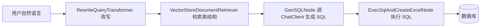
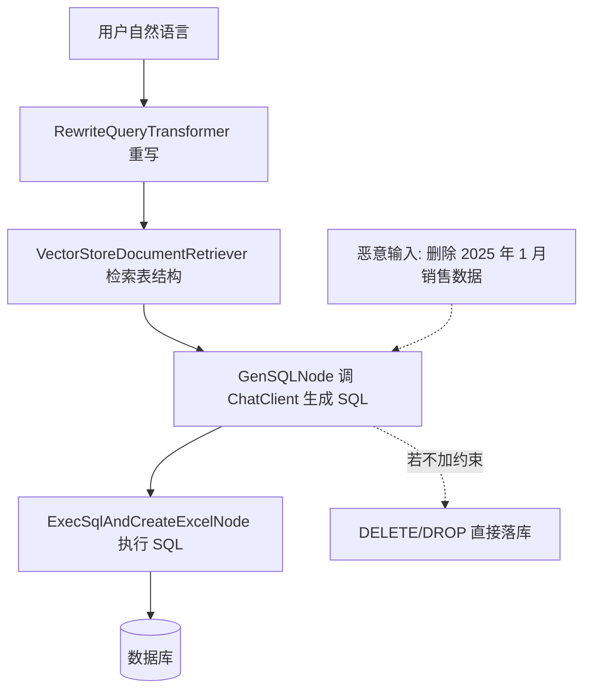

## 【学习目标】

学完本节，应当能够：

- 复述 BI 报表 Agent 的 RAG 检索增强链路：`RewriteQueryTransformer` → `VectorStoreDocumentRetriever` → `GenSQLNode`，并说清每一步的输入输出；
- 通过 Debug 验证「查询重写转换器」`RewriteQueryTransformer` 对 RAG 检索质量的提升，以及该提升对模型能力的依赖；
- 指出「大模型生成 SQL 并直接执行」这一设计最根本的安全隐患，画出攻击路径，并用面试官视角复述问题与解法。

## 【正文】

### 一、RAG 检索增强链路回顾

在正式引入安全隐患之前，先通过 Debug 验证上一个节点 `RewriteQueryTransformer` 的效果。该节点处于「生成 SQL」节点的检索增强链路中，作用是对用户原始自然语言做重写（rewrite），让送入向量检索的 query 更贴近表结构与业务术语，从而提升召回质量。

下面这段是生成 SQL 节点 `GenSQLNode` 的骨架，其中持有一个 `RetrievalAugmentationAdvisor`（检索增强顾问），它把「查询重写」与「文档检索」串成一条链路：

```java
public class GenSQLNode implements NodeAction {
    @Override
    public Map<String, Object> apply(OverallState state) throws Exception {
        String userInput = state.value("userInput", defaultValue: "");
        // ... 其他逻辑
        // 创建一个检索增强顾问
        RetrievalAugmentationAdvisor retrievalAugmentationAdvisor = RetrievalAugmentationAdvisor.builder()
            .queryTransformers(queryTransformer)
            .documentRetriever(VectorStoreDocumentRetriever
                .builder()
                .vectorStore(vectorStore)
                .build();
        // ... 启动查询流程
    }
}
```

（此为课程演示骨架，省略了链路挂载与执行细节，重点看两个协作者如何注入。）

`RetrievalAugmentationAdvisor` 在 Spring AI 里位于 Advisor 链上。2.0.1 中 Advisor 是一等公民：检索增强、记忆（`MessageChatMemoryAdvisor`）、工具循环（`ToolCallingAdvisor`）、日志与重试都以横切方式串在 `ChatClient` 调用前后，业务代码只声明「要哪些能力」，不用关心串接顺序。这里注入了两个协作者，职责边界如下：

| 组件 | 职责 | 输入 → 输出 |
|---|---|---|
| `RewriteQueryTransformer` | 用 `ChatClient` 把口语化 query 改写为贴近表结构与业务术语的表述 | `Query` → `Query` |
| `VectorStoreDocumentRetriever` | 把改写后的 query 送向量库做相似度检索，可附带过滤表达式 | `Query` → `List<Document>` |
| `GenSQLNode` | 拿着检索到的表结构调 `ChatClient` 生成 SQL | `OverallState` → SQL 文本 |

### 二、Debug 验证查询重写

在 `RewriteQueryTransformer` 的 `transform` 方法打上断点，重启项目后回到 Controller 层调用接口，大模型会进入该方法对用户输入做 rewrite。其核心就是拿 `ChatClient` 把原始 query 改写成更规范的表达：

```java
public class RewriteQueryTransformer implements QueryTransformer {
    // ... 构造函数和成员变量
    public Query transform(Query query) {
        // ... 校验查询
        String rewrittenQueryText = this.chatClient.prompt(this.user(user), this.promptTemplate.getTemplate()).param("target", this.targetSearchSystem).param("query", query.text()).content();
        if (StringUtils.hasText(rewrittenQueryText)) {
            return query.mutate().text(rewrittenQueryText).build();
        } else {
            logger.warn("Query rewrite result is null/empty. Returning the input query unchanged.");
            return query;
        }
    }
}
```

两个工程细节值得注意。其一，`query.mutate().text(...).build()` 是「复制改写」而非原地修改：`Query` 本身不可变，`mutate()` 派生出一个新对象，原 query 保持不变，链路上下游不会互相污染。其二，改写结果为空时走降级分支，记录 warning 后原样返回输入 query，保证检索链路不断裂，把「重写失败」的影响限制在召回质量层面，而不是让整个请求报错。

**为什么需要这一步？** RAG 的质量取决于「检索到的文档」是否切中用户意图。用户输入往往口语化、字段名模糊，直接拿去向量检索容易召回无关表结构。重写后的 query 更接近库内元数据的表述，召回更准，后续生成的 SQL 也更稳。

以「计算 25 年每个月的销售总额，并按月份升序排列」为例，用户输入本身已较准确，重写后变成「25 年各月销售总额按月份升序排列」，差别不大，只要用户表达清楚，重写前后差距很小；但如果原始自然语言写得差，重写的提升会更明显。

这里要强调一个工程事实：**重写效果高度依赖所选大模型**。本项目使用阿里的通义千问 Max，模型越「聪明」，重写质量通常越好，可以换其他模型对比。既然是借助大模型做 rewrite，模型能力本身就直接决定了重写质量。反过来这也是选型约束：重写节点多付出一次 LLM 调用的延迟与成本，只有在召回质量确实受益时才值得保留，生产上可以用「重写前后召回率对比」来量化这笔开销。

### 三、向量检索的执行

检索侧的 `VectorStoreDocumentRetriever` 负责把改写后的 query 真正发到向量库做相似度检索，它拿到 `Query` 后计算过滤表达式并调用 `vectorStore.similaritySearch`：

```java
public class VectorStoreDocumentRetriever implements DocumentRetriever {
    // ... 构造函数
    public List<Document> retrieve(Query query) {
        Assert.notNull(query, "query cannot be null");
        Filter.Expression requestFilterExpression = this.computeRequestFilterExpression(query);
        SearchRequest searchRequest = SearchRequest.builder().query(query.text()).filterExpression(requestFilterExpression);
        return this.vectorStore.similaritySearch(searchRequest);
    }
}
```

`Assert.notNull` 是入口防御，避免空 query 直接穿透到向量库；`computeRequestFilterExpression` 把请求级信息翻译成向量库的过滤表达式，实现「先按元数据缩小范围，再按语义排序」的两段式检索；`similaritySearch` 返回排好序的 `Document` 列表，交给生成节点拼进提示词。整条链路可以归纳成一张图：



### 四、安全隐患实测

调用链理顺后，把输入换成一句危险指令：「删除 2025 年 1 月的销售数据」，回车执行。注意看大模型生成的「思考」结果，它直接生成了 `DELETE FROM fact_sales WHERE sale_date BETWEEN '2025-01-01' AND '2025-01-31'`，把 2025 年 1 月的销售数据删除了。



生成的 SQL 在语义上「没错」，但它暴露了一个严重问题：**如果不加任何控制，大模型能直接生成 `DELETE` 这类危险语句，一旦执行就会删库，最后背锅的是开发。** 整条链路里没有任何一层拦住这条 `DELETE`，模型忠实执行了用户指令，执行节点又「来者不拒」地跑了它。

逐环节拆开看，失守是全面的：

| 环节 | 发生了什么 | 为什么会这样 |
|---|---|---|
| 重写 | 删除意图被忠实转写进 query | 重写只保语义，不区分读与写 |
| 检索 | 召回了 `fact_sales` 表结构 | 检索按相关性排序，不知道用户要删数据 |
| 生成 | 模型生成 `DELETE` 语句 | 提示词里没有任何安全约束 |
| 执行 | SQL 原样送达数据库 | 执行侧来者不拒，给什么跑什么 |

值得注意的是，危险输入甚至不需要「懂技术」：一句自然语言就能触发。传统 SQL 注入需要攻击者掌握注入语法，而这里攻击面是产品面向所有用户开放的自然语言入口，门槛更低、面更广，这也是面试中必须主动交代的风险点。

切换到面试官视角来复盘：你负责的智能 BI 报表问答系统，有没有什么安全隐患？如果有，你是怎么解决的？

显然是有的，刚才的演示本身就是典型隐患：能让大模型直接生成一条 `DELETE` 的 SQL，原样执行则后果不堪设想。

### 五、防御纵深总览

解法不是「让模型更乖」这一条路，而是分层设防，任何一层失效都不至于直接击穿：

| 防线 | 手段 | 位置 | 出处 |
|---|---|---|---|
| 第一道 | Prompt 禁止 DML、只允许 `SELECT` | 生成侧 | 10-2 |
| 第二道 | `JdbcTemplate.queryForList` 锁死只读 | 执行侧 | 10-3 / 10-4 |
| 第三道 | 评估节点校验 SQL 合法性与准确性 | 工作流 | 11-2 至 11-5 |
| 架构级替代 | 不让模型写 SQL，直接抽取结构化 POJO | 第 5 章调拨单 | `980-demo` |

最后一行是本课程另一条主线的思路：调拨单 Agent 从架构上取消了「LLM 生成 SQL」这一动作，模型只负责把自然语言填进结构化参数，执行侧永远走受控的参数化查询，注入攻击面随之消失。

解决方案先留个悬念，下一节给出第一套解法。

## 【易错点 / 面试题】

1. **面试官问：「你的 BI 问答系统，大模型生成的 SQL 直接执行，风险怎么控？」**
   答：采用防御纵深。生成侧用 Prompt 禁止 DML（DELETE/DROP/UPDATE/INSERT）并强制只输出 SELECT；执行侧不用 `JdbcTemplate.execute` 这类万能方法，而是写死 `queryForList`，从 API 层面锁死「只能查」。两层叠加，即使模型偶尔违反 Prompt，执行层也兜住。

2. **常见误区：「查询重写了，SQL 质量就稳了，不用再管安全。」**
   澄清：重写只是提升召回与生成质量，与安全是两件独立的事。重写甚至可能被恶意输入「诱导」去生成危险语句，因此安全约束必须独立于重写链路存在。

3. **易错点：`RetrievalAugmentationAdvisor` 负责检索增强，并不具备 SQL 安全过滤能力。** 把它误当成「安全层」是常见的认知偏差，安全要靠 Prompt 约束 + 执行层限制各自兜底。

4. **面试官问：「查询重写节点会不会被攻击者利用？」**
   答：会。重写节点忠实转写用户意图，包括恶意意图，它提升的是召回质量而不是安全性。所以安全约束必须独立于重写链路，分别放在生成侧提示词与执行侧两层，这也是防御纵深思想的直接应用。

## 【小结】

本节先验证了 `RewriteQueryTransformer` 在 RAG 链路中的价值，再用一个 `DELETE` 注入的实测，点出「大模型生成 SQL 并直接执行」这一设计的致命隐患：模型忠实执行指令、执行层来者不拒，整条链路无人拦截。下一节用「Prompt 工程 + 执行侧约束」做第一道、第二道防线。值得注意的是，本课程第 5 章的「AI 智能库存调拨单」用了一条更彻底的路子规避同类风险，它根本不让模型写 SQL，而是用 `ChatClient.call().entity()` 直接抽取结构化 POJO（`980-demo/src/main/java/com/carl/ai/transfer/extract/TransferOrderExtractor.java`），再经 `convert/TransferOrderConvert.java`（MapStruct）与受控 `repository` 入库，从根上消除了「LLM 写 SQL 被注入」的攻击面。
