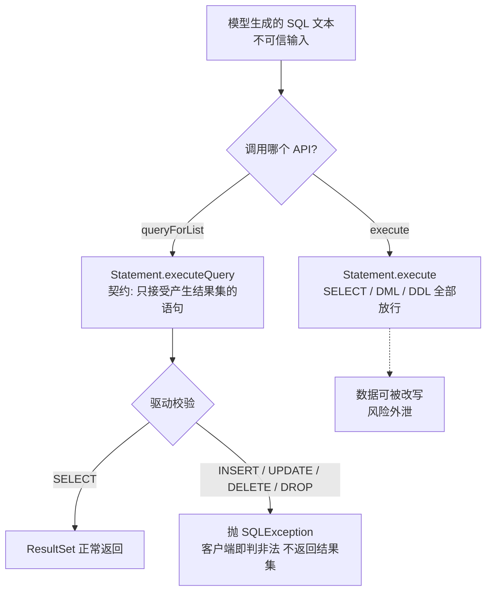

## 【学习目标】

学完本节，应当能够：

- 说清为什么执行侧**写死用 `queryForList`** 而非 `execute` 这类万能方法；
- 用单元测试证明 `INSERT`/`UPDATE`/`DELETE`/`DROP` 在 `queryForList` 下全部报错；
- 解释「API 层面锁死只读」为什么能兜住生成侧 Prompt 失守的情况；
- 向面试官讲清 `queryForList` 的安全边界，它防什么、不防什么。

## 【正文】

### 一、为什么写死 queryForList

上一节引入了 `JdbcTemplate`，这一节具体看它如何在执行侧进一步保障安全。

`JdbcTemplate` 提供了很多方法，但我们**不使用 `execute` 这种「万能」方法**，而是直接写死调用 `queryForList`。该方法只执行查询、返回一个 `List<Map<String, Object>>`（key 是列名，value 是字段值）。

这么做的目的很明确：**把可执行的操作锁死在「查询」上。** 哪怕大模型生成了 `INSERT`/`UPDATE`/`DELETE`/`DROP`，只要走 `queryForList`，就根本没机会执行它们，从源头限制了只能做 `SELECT` 查询。

```java
public class ExecSqlAndCreateExcelNode implements NodeAction {
    // ...
    @Override
    public Map<String, Object> apply(OverallState state) throws Exception {
        String genSQL = state.value("genSQL", defaultValue);
        // ...
        jdbcTemplate.queryForList(sql); // 用于执行 SQL 并返回结果集
        return Map.of();
    }
}
```

**为什么 `execute` 不行？** `execute(String)` 既能跑 SELECT 也能跑 DML/DDL，等于把「能不能写数据」的选择权交还给 SQL 文本本身，而 SQL 文本来自模型，不可信。反观 `queryForList`，Spring 在底层调用 `Statement.executeQuery`，JDBC 驱动遇到非查询语句会直接抛 `SQLException`，DML/DDL 在 API 层面就被拒。这正是「用类型安全的 API 约束行为」的生产实践。

把这条链路再往下拆一层，信任边界就很清楚了：



JDBC 规范对 `Statement.executeQuery` 的定义是「执行返回结果集的语句」；MySQL Connector/J 的实现遵循这一契约，期望结果集却收到「不产生结果集」的响应时，直接抛 `SQLException`。拦截发生在客户端驱动层：调用方拿不到结果集，链路在 `queryForList` 一行之内终止。API 选型即安全策略，这就是「写死 `queryForList`」的全部含义。

### 二、用单元测试验证

光说不够，用代码说话。在测试包下新建测试类（包结构要和项目一致，例如 `com.carl.ai.bi.helper`），加上 `@SpringBootTest`，直接 `@Resource` 注入 `JdbcTemplate`，然后逐个验证危险语句：

```java
package com.carl.ai.bi.helper;
import org.junit.jupiter.api.Test;
import org.springframework.boot.test.context.SpringBootTest;
import org.springframework.jdbc.core.JdbcTemplate;
import jakarta.annotation.Resource;

@SpringBootTest
public class BiAppTest {
    @Resource
    private JdbcTemplate jdbcTemplate;

    @Test
    public void testInsert() {
        jdbcTemplate.queryForList("INSERT INTO dim_customer VALUES (22,'carl','男','18','beijing','china')");
    }

    @Test
    public void testUpdate() {
        jdbcTemplate.queryForList("UPDATE dim_customer SET age=age+1 WHERE customer_id=22");
    }

    @Test
    public void testDelete() {
        jdbcTemplate.queryForList("DELETE FROM dim_customer WHERE customer_id=22");
    }

    @Test
    public void testUpdateMany() {
        jdbcTemplate.queryForList("UPDATE dim_customer SET age=age+1 WHERE customer_id IN (4,5,6)");
    }
}
```

**1. 测试 INSERT**

`jdbcTemplate.queryForList("INSERT INTO dim_customer VALUES (22,'carl','男','18','beijing','china')")`

执行后报错：`Statement.executeUpdate() cannot issue, statements that do not produce result sets`（执行查询时不能发出不产生结果集的语句）。说明 INSERT 被拦住了。

**2. 测试 UPDATE**

`jdbcTemplate.queryForList("UPDATE dim_customer SET age=age+1 WHERE customer_id=22")`

同样报错，且 `customer_id=22` 的记录年龄仍是原值，SQL 并未真正执行。

**3. 测试 DELETE**

`jdbcTemplate.queryForList("DELETE FROM dim_customer WHERE customer_id=22")`

同样报错，删除未成功。

**4. 测试 DROP**

`jdbcTemplate.queryForList("DROP TABLE dim_customer")`

同样报错，删表未成功。

可能有人质疑：上面只更新了一条数据才报错，那批量更新一批数据呢？再加一个 `testUpdateMany`：

`jdbcTemplate.queryForList("UPDATE dim_customer SET age=age+1 WHERE customer_id IN (4,5,6)")`

结果依然是同样的错误。

| 危险操作 | 示例 SQL | 执行结果 |
|---|---|---|
| INSERT | `INSERT INTO dim_customer VALUES (...)` | 抛异常，未插入 |
| UPDATE（单条） | `UPDATE dim_customer SET age=age+1 WHERE customer_id=22` | 抛异常，原值不变 |
| DELETE | `DELETE FROM dim_customer WHERE customer_id=22` | 抛异常，未删除 |
| DROP | `DROP TABLE dim_customer` | 抛异常，表仍在 |
| UPDATE（批量） | `UPDATE ... WHERE customer_id IN (4,5,6)` | 抛异常，原值不变 |

批量用例的存在很有必要：它排除了「拦截逻辑依赖 WHERE 条件形态」的侥幸。无论影响行数是一条还是一批，拦截都发生在语句解析阶段，与数据规模无关。

测试写法上还有两点工程要点。其一，`@SpringBootTest` 会启动完整容器，注入的 `JdbcTemplate` 与生产链路同源，验证的是真实装配而非 mock 行为；其二，严格来说这些用例应当用 `assertThrows(SQLException.class, ...)` 包裹，把「必须抛异常」变成断言，当前写法依赖肉眼看报错，作为安全回归测试的强度是不够的。面试里被追问「如何把安全测试做成可持续的」，这就是现成的改进点。

### 三、结论

通过这五个测试方法可以确认：用 `queryForList` 去执行 `INSERT`、`UPDATE`、`DELETE`、`DROP` 全部会报错。而我们的诉求本来就是「只执行一条查询命令，不希望执行其他任何命令」，所以坚持使用 `queryForList`，就能在执行侧进一步保证系统的安全性。配合生成侧的 Prompt 约束，形成「生成侧软约束 + 执行侧硬约束」的防御纵深。

## 【易错点 / 面试题】

1. **面试官问：「queryForList 真能 100% 防 SQL 注入吗？」**
   答：它防的是「模型生成 DML/DDL 被误执行」，属于行为约束；SQL 注入（在 SELECT 里拼接恶意条件）它管不了。若要防注入，SQL 本身应走参数化（`?` 占位），这正是 `JdbcTemplate` 的 `query(String, Object... args)` 族方法的价值。本节点因为 SQL 由模型生成、难以参数化，所以优先级是把「写操作」直接堵死。

2. **易错点：把 `queryForList` 当成「万能查询安全」。** 它只保证「不执行非查询语句」，不保证查询本身无害（如 `SELECT * FROM users WHERE ...` 仍可拖库）。生产上还需配权限账号（只读库账号）、行数上限等。

3. **易错点：测试里直接对真实库跑 DML 验证。** 正确做法是用 `@SpringBootTest` + 测试库/内存库隔离，避免污染业务数据。本测试仅验证异常抛出，不依赖数据落盘。

4. **面试官问：「API 约束和数据库只读账号，有什么区别？」**
   答：API 约束拦的是「本服务发起的语句形态」，只读账号拦的是「该连接能做的全部事」，后者覆盖面更广（包括未来新增的代码路径），但粒度粗、报错晚。两者是纵深关系：本课程工程 `980-demo` 对同类风险给出了更彻底的答案，见小结。

## 【小结】

本节用五个单元测试坐实了执行侧硬约束：`queryForList` 在 API 层面只认查询，INSERT/UPDATE/DELETE/DROP 一律抛异常，从而兜住生成侧 Prompt 可能失守的情况。至此 BI 报表系统形成了「生成侧 Prompt 禁 DML + 执行侧 `queryForList` 锁只读」的防御纵深。

对照本课程第 5 章的「AI 智能库存调拨单」工程 `980-demo/`：它用更彻底的方式规避同类风险，`980-demo/src/main/java/com/carl/ai/transfer/extract/TransferOrderExtractor.java` 通过 `ChatClient.prompt().user(...).call().entity(TransferOrderParam.class)` 直接抽取结构化 POJO（底层是 `BeanOutputConverter`），连 SQL 都不让模型生成；`980-demo/src/main/java/com/carl/ai/transfer/repository/BbTransferOrderRepository.java` 受控入库，从架构上消除了「SQL 注入/DML 越权」整类问题。两条路线没有高下之分，BI 系统必须让模型碰 SQL（问题是动态的），调拨系统可以不让模型碰 SQL（结构是固定的）；判断标准是：**能不能把不可信的输出收敛到结构化的、可校验的边界内**。下一节回到 BI 主线，把查询结果动态生成 Excel 报表。
