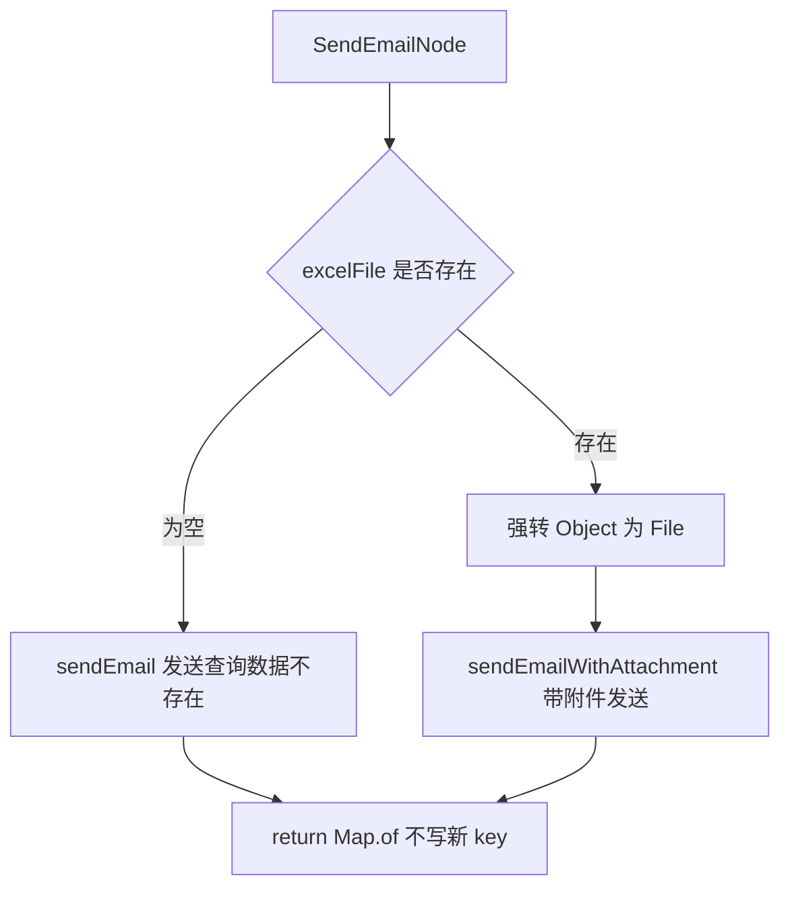

## 【学习目标】

学完本节，应当能够：

- 在 `EmailServiceImpl` 中用 `JavaMailSender` + `MimeMessageHelper` 落地纯文本与带附件两种邮件发送；
- 说清 `MimeMessage`（而非 `SimpleMailMessage`）与 `multipart=true`、`UTF-8` 编码的必要性；
- 解释 try-catch 包裹、转 `RuntimeException` 的异常处理取舍；
- 在 `SendEmailNode` 中按 Excel 是否存在分流调用，并强转 `Object` 为 `File`。

## 【正文】

接口定义好了，这一节在 `EmailServiceImpl` 里把两个方法落地。

### 一、实现纯文本邮件发送

先用快捷键实现 `sendEmail(String to, String content)`（另一个方法也一并实现，否则编译报错）。

- 通过 `@Resource` 注入 `JavaMailSender`（也就是 `mailSender`）；
- 通过 `@Value("${spring.mail.username}")` 注入发件人地址，定义为 `from`；
- 用 `mailSender.createMimeMessage()` 创建 `MimeMessage`，再创建 `MimeMessageHelper`（传入 message，开启 `multipart`，字符编码指定为 `UTF-8`）；
- 设置属性：`setTo(to)`、`setText(content)`、`setSubject("AI生成报表")`、`setFrom(from)`；
- 调用 `mailSender.send(message)` 发送。

整个逻辑用 try-catch 包起来（不在方法签名上抛异常）：成功时打 `log.info("Email send success")`；`catch` 里打 `log.error("Email send error, error msg={}", e.getMessage())`，并 `throw new RuntimeException(...)`。别忘了类上加 `@Slf4j`。

三个选型的「为什么」：

1. **为什么是 `MimeMessage` 而不是 `SimpleMailMessage`？** `SimpleMailMessage` 只能发纯文本，连附件都不支持；两种邮件统一走 MIME 路线，代码结构一致，后续要加 HTML 正文、内嵌图片也不用换骨架。
2. **为什么 `multipart=true`？** `MimeMessageHelper` 的 `addAttachment` 只在 multipart 模式下可用。纯文本方法也开 multipart，是为了和方法二共用同一套构建流程，少一条分叉，少一类 bug。
3. **为什么指定 `UTF-8`？** 邮件主题和正文含中文（「AI生成报表」、「附件中的内容由AI报表助手生成，请查收!!!」），不显式指定编码，中文在部分邮件客户端里会显示为乱码。这是国内邮件功能最高频的坑，编码必须写死。

异常处理同样有讲究：`EmailService` 接口方法没有声明受检异常，实现里就不能把 `MessagingException` 直接往外抛；try-catch 转成 `RuntimeException`，既保留了「失败即中止」的语义（调用方不会以为邮件发出去了），又不污染接口契约。`log.error` 带上 `e.getMessage()`，SMTP 的失败原因（认证失败、连接超时、拒收）才能落到日志里。

### 二、实现带附件邮件发送

`sendEmailWithAttachment(String to, File file)` 与上面大差不差，区别就是往 helper 里把附件加进去：

- 同样创建 `MimeMessage` 和 `MimeMessageHelper`（`multipart` 开启，`UTF-8`）；
- 设置 `setFrom`、`setTo`、`setSubject("附件中的内容由AI报表助手生成，请查收!!!")` 和正文文本；
- 创建 `FileSystemResource(file)`，调用 `helper.addAttachment(file.getName(), fileSystemResource)` 添加附件；
- 发送成功后记录日志。

```java
@Service
public class EmailServiceImpl implements EmailService {
    @Value("${spring.mail.username}")
    private String from;
    ...
    @Override
    public void sendEmail(String to, String content) {
        try {
            MimeMessage message = mailSender.createMimeMessage();
            MimeMessageHelper mimeMessageHelper = new MimeMessageHelper(message, multipart_true, encoding: "UTF-8");
            mimeMessageHelper.setTo(to);
            mimeMessageHelper.setText(content);
            mimeMessageHelper.setSubject("AI生成报告");
            mimeMessageHelper.setFrom(from);
            mailSender.send(message);
            log.info("Email send success");
        } catch (Exception e) {
            log.error("Email send error, error msg={}", e.getMessage());
            throw new RuntimeException(e.getMessage());
        }
    }
    ...
    @Override
    public void sendEmailWithAttachment(String to, File file) {
        try {
            MimeMessage message = mailSender.createMimeMessage();
            MimeMessageHelper mimeMessageHelper = new MimeMessageHelper(message, multipart_true, encoding: "UTF-8");
            mimeMessageHelper.setTo(to);
            mimeMessageHelper.setSubject("附件中的内容由AI报表助手生成，请查收!!!");
            // 添加附件
            FileSystemResource fileSystemResource = new FileSystemResource(file);
            mimeMessageHelper.addAttachment(file.getName(), fileSystemResource);
            mimeMessageHelper.setText("附件中的内容由AI报表助手生成，请查收!!!");
            mailSender.send(message);
            log.error("Email send error, error msg={}", e.getMessage());
            throw new RuntimeException(e.getMessage());
        } catch (Exception e) {
            log.error("Email send error, error msg={}", e.getMessage());
            throw new RuntimeException(e.getMessage());
        }
    }
}
```

两个方法的差异集中在「附件」上，其余完全同构：

| 环节 | `sendEmail` | `sendEmailWithAttachment` |
|---|---|---|
| 消息类型 | `MimeMessage` | `MimeMessage` |
| helper 参数 | `multipart=true, UTF-8` | `multipart=true, UTF-8` |
| 主题 | 「AI生成报告」 | 「附件中的内容由AI报表助手生成，请查收!!!」 |
| 正文 | 调用方传入的 `content` | 固定提示文案 |
| 附件 | 无 | `FileSystemResource` + `addAttachment` |
| 成功日志 | `log.info("Email send success")` | 记录日志 |

`FileSystemResource` 把磁盘文件包装成 Spring 的 `Resource`，`addAttachment` 的第一个参数是收件人看到的附件名，这里直接用 `file.getName()`，即上一节 `File.createTempFile("report", ".xlsx")` 生成的随机前缀文件名（形如 `report12345.xlsx`）。生产上更友好的做法是改成业务名（如「2025年销售报表.xlsx」），随机名发给用户不够专业，这一点在面试里可以作为改进点主动讲。

必须点出一个藏在代码里的 bug：`sendEmailWithAttachment` 在 `mailSender.send(message)` **之后**，仍然执行了 `log.error(...)` 和 `throw new RuntimeException(...)`，成功路径被当成了失败路径。这是「复制粘贴忘改」的典型形态：从失败分支的结构里改出了新方法，尾部的日志与抛异常忘了删。它不会让邮件发不出去，但会让调用方收到一个假的失败异常，还会把错误日志刷满。正确形态是成功只打 `log.info`，异常只在 `catch` 里抛。下一节的全链路测试会抓住这类问题，端到端跑一遍，比任何肉眼审查都可靠。

### 三、在节点中调用

回到 `SendEmailNode`，根据 Excel 文件是否存在分别调用：

- 文件为空：调用 `emailService.sendEmail(to, "查询数据不存在")`（收件人先写死成自己）；
- 文件存在：调用 `emailService.sendEmailWithAttachment(to, file)`。注意从状态机拿到的 `excelFile` 是 `Object`，需要强转为 `File` 再传入。



该节点发完邮件就结束了，不会生成新的 key，所以直接 `return Map.of()` 即可。

```java
public class SendEmailNode implements NodeAction {
    @Override
    public Map<String, Object> apply(OverallState state) throws Exception {
        // 获取Excel文件
        Optional<Object> excelFile = state.value(key: "excelFile");
        if (excelFile.isEmpty()) {
            emailService.sendEmail("13505420156@163.com", content: "查询数据不存在");
        } else {
            emailService.sendEmailWithAttachment("13505420156@163.com", excelFile);
        }
        return Map.of();
    }
}
```

收件人写死自己是本地调试的常规操作，邮件功能最难自查的部分就是「到底发没发、发成什么样」，先固定发给自己，端到端验证通过后再把 `to` 换成从用户输入/会话里取的值。这也是从 demo 到生产的典型演进路径：**先让闭环确定性地通，再打开变化的入口**。

`return Map.of()` 表示本节点不向状态机写入任何新 key，邮件节点是业务终点，它的产出（一封邮件）在状态机之外。工作流里区分「产生状态的节点」和「产生副作用的节点」，能让数据依赖图保持干净：后者随便换实现（邮件换短信、换企业微信），不影响任何上游。

## 【易错点 / 面试题】

1. **面试官问：「为什么用 MimeMessage + MimeMessageHelper，不直接用 SimpleMailMessage？」**
   答：附件只在 MIME multipart 形态下才支持；且后续 HTML 正文、内嵌资源都要求 MIME 能力。统一走 MIME 路线，是给演进留空间，成本几乎为零。

2. **易错点：忘记指定 UTF-8 编码。** 中文主题/正文在部分客户端乱码。`MimeMessageHelper` 的编码参数必须显式传 `"UTF-8"`，不能依赖默认值。

3. **易错点：成功路径残留 error 日志与 throw。** 如本节代码中 `sendEmailWithAttachment` 的假失败分支，调用方会误判邮件没发出去。审查发送类代码时，逐个分支确认「成功只打 info，失败只走 catch」。

4. **面试官问：「邮件发送慢/失败，会拖垮 Agent 主链路吗？怎么防？」**
   答：会，SMTP 是同步外部调用，超时直接占用节点执行线程。防护三板斧：超时限制（JavaMail 的 `mail.smtp.connectiontimeout` 等属性）、重试与熔断（resilience4j，本课程工程 `980-demo` 对 LLM 调用正是这么封装的，见 `980-demo/src/main/java/com/carl/ai/transfer/extract/TransferOrderExtractor.java` 的 `@CircuitBreaker` 与 `extractFallback` 降级）、通知类场景改异步（虚拟线程或消息队列）不阻塞主链路。

## 【小结】

本节在 `EmailServiceImpl` 里落地了两种邮件发送：`MimeMessage` + `MimeMessageHelper`（`multipart=true`、`UTF-8`）统一构建流程，差异仅在 `addAttachment` 一步；异常统一 try-catch 转 `RuntimeException`，接口契约保持干净。`SendEmailNode` 按 `Optional` 判空分流，无数据发文本通知、有数据发附件报表，节点不写新 key、`return Map.of()` 收尾。三个节点至此全部完成，下一节把它们编排进工作流，做第一次全链路测试。

对照本课程第 5 章工程 `980-demo/`：`980-demo/src/main/java/com/carl/ai/transfer/service/TransferOrderServiceImpl.java` 示范了同样的分层，节点/Agent 只做编排，确定性执行（含外部调用）下沉到 service；对外部调用的韧性处理（超时、熔断、降级）在 `980-demo/src/main/java/com/carl/ai/transfer/extract/TransferOrderExtractor.java` 上有完整范本，BI 系统的邮件发送要补生产韧性时，照该形态加即可。
