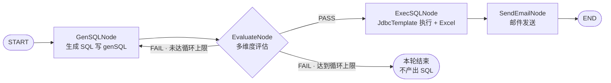

## 【学习目标】

学完本节，应当能够：

- 说清「大模型生成 SQL」在复杂场景下准确性无法保证的原因，以及它为什么是面试高频考点；
- 把 SQL 错误按根因分类（语法 / Schema / 语义 / 安全 / 性能），并说明每一类错误的暴露时机；
- 描述本章的优化路线图：评估节点 + 循环执行 + 调整大模型参数，三者如何形成闭环；
- 向面试官完整回答「如何提高生成 SQL 的准确性」这道系统设计题。

## 【正文】

让大模型帮我们生成 SQL，存在一个绕不开的问题：对于比较复杂的 SQL，生成的准确性其实无法很好地保证。所以，提高大模型生成 SQL 的准确性，是开发者必须自己解决的问题。10-8 节的测试已经演示过该痛点：一条「按商品与月份分组、连两张维度表」的查询，模型生成的 SQL 直接被数据库拒绝（500 → bad SQL）。生成的语句能不能执行、执行结果是否正确，模型自己并不负责，准确性必须由工程手段兜底。

### 一、为什么这是面试高频考点

先听面试官的原话：

> 「你做智能 BI 报表问答系统时，针对大模型出现的幻觉问题，是怎么提高它生成的 SQL 准确性的？」

这道题考察的不是某个 API，而是一套系统工程思维：候选人是否承认「模型输出不可信」这一前提，是否能把优化拆成可落地的机制，而不是回答「换个更强的模型」或「把提示词写详细一点」。本章的全部内容，就是对这道题的标准答案。可以先自己思考，再跟着后面的内容逐步落地，自己先想的价值在于：这道题没有标准 API，只有取舍。动手前先问自己三个问题：错误在哪暴露（数据库还是用户）、暴露之后有没有返工机会（重生成还是人工）、源头能不能降低跑偏概率（参数还是提示词）。三个问题分别指向评估、循环、参数调整，正是下一节展开的三件套。

### 二、错误分类：先分型，再治理

复杂 SQL 的失败不是铁板一块，按根因至少分五类，每类的暴露时机与治理手段不同：

| 错误类型 | 典型表现 | 暴露时机 | 治理方向 |
|---|---|---|---|
| 语法错误 | 关键字拼错、括号不匹配、方言函数用错 | 数据库执行时报错（如 10-8 的 500） | 执行前评估拦截 |
| Schema 错误 | 表名、列名不存在；JOIN 字段选错 | 执行时报「未知列」 | 把表结构注入上下文（RAG） |
| 语义错误 | SQL 合法且能跑，但答非所问（如漏 WHERE 条件） | 静默通过，结果错误 | 对照用户意图评估 |
| 安全错误 | 混入 DELETE / DROP / UPDATE | 执行即事故 | 生成约束 + 评估双卡 |
| 性能错误 | 笛卡尔积、全表扫描、无谓子查询 | 能跑但拖垮库 | 列为评估维度之一 |

这张表同时是 11-3 节评估提示词的维度蓝本，评估节点评审的六个维度（语法正确性、Schema 匹配度、语义准确性、执行安全性、性能考量、可维护性）基本覆盖了上表前五类。治理之前先分型，是因为不同类型的错误该由不同的环节拦截：语法与 Schema 错误可以在执行前发现，语义错误必须对照用户意图，安全错误一道都不能过。每一类配一个最小例子更直观：语法错误的典型是方言函数用错；Schema 错误的典型是凭「常识」编了一张不存在的表；语义错误最隐蔽，用户问「25 年 4 月」，SQL 查的是全历史；安全错误概率低但高危，漏出去就是事故；性能错误不报错也不错，只是慢慢拖垮数据库。五类错误的治理成本各不相同，但共同点是都不能靠「模型下次会表现好」来兜底。

### 三、路线图：评估节点 + 循环执行 + 参数调整

本章给出的解法由三部分组成：**评估节点 + 循环执行 + 调整大模型参数**，三者配合形成闭环，把 SQL 生成的准确率拉上去。落到开发层面是两件事：

1. 在 Agent 的流程图中新增一个工作节点，**评估节点（`EvaluateNode`）**，职责是对大模型生成的 SQL 做评估；
2. 引入循环判断：SQL 未通过评估时，回退到「生成 SQL」节点让大模型重新生成，再回到评估节点复评；循环到指定次数仍不通过，则判定本轮 Agent 结束，没有产出可用的 SQL；只有在某一次循环中 SQL 通过评估，才继续向下执行，用 `JdbcTemplate` 执行该 SQL 查询、动态生成 Excel 文件，再通过邮件发送给提问人。注意这条里的两处细节：「回退到生成节点」意味着评估结论要能驱动工作流跳转，这正是 11-7 节条件边的用武之地；「判定本轮 Agent 结束」意味着失败必须有显式终点，而不是让图停在半路。

口径说明：本节开篇预告这部分优化「拆成两个小点」，下一节展开时归并为「三部分（评估节点 + 循环执行 + 调整大模型参数）」。两者不矛盾，前者按「写两次代码」的工时口径数（评估节点一轮、循环与参数调整一轮），后者按机制口径数。以机制口径理解全章更完整。

为什么评估节点是主线？因为它把「人工粘库验证」（10-8 节的排查范式）部分自动化了：500 报错只是语法与 Schema 错误的末路，语义错误连报错都不会有。让模型在执行前先自检一遍，等于在「生成」与「执行」之间加一道质检工序；循环执行给这道工序配上返工通道；参数调整从源头降低跑偏概率。三道手段分别作用于事后、事中、事前，合起来才是完整的准确率工程。三件套的配合可以用一个类比记住：参数调整是提高原材料良品率，评估节点是出厂质检，循环执行是返工线。只提高良品率，不良品照样流出；只质检不返工，不良品只是被拦住堆在仓库；只返工不质检，返工没有依据。三者各管一段，缺一段，另外两段的效果都会打折。

### 四、求职视角

这道题在面试里通常层层追问：先问「怎么提高准确性」（本章三件套），再问「评估不通过怎么办」（循环 + 次数上限 + 终止语义），再问「评估节点本身出错怎么办」（空 SQL 防护、异常兜底，11-5 节的 `BadSqlGrammarException` 就是活例），最后落到「评估-循环-微调」三件套的完整叙事（11-8 节）。回答时先把错误分类表摆出来，再讲闭环机制，最后用一次真实的踩坑收尾，结构自然立住。还有一个加分项：主动给出失败路径的设计。面试官问「评估一直不过怎么办」，多数候选人会卡住，成熟的答案是「循环上限 + 明确终止 + 对外可解释的失败信息」。第 11 章后文会看到，这条失败路径上的每个决策（空 SQL 为什么判 pass、上限到了算什么）都有讲究，把这些讲清楚，比背下「评估-循环-微调」六个字更能体现工程成熟度。

## 【易错点 / 面试题】

1. **面试官问：「大模型生成 SQL 的幻觉，怎么系统化治理？」**
   答：先分类再治理：语法 / Schema 错误靠执行前评估拦截，语义错误靠对照用户意图评估，安全错误靠生成约束加评估双卡。工程上是「评估节点 + 循环执行 + 参数调整」闭环，生成后先评估，不通过打回重生成，达到循环上限则明确结束，绝不让未通过评估的 SQL 流到 `JdbcTemplate`。此外，评估让「重生成」有了依据，不通过时可以把评估发现的问题（如「列名不存在」）一并带回生成节点，相当于给模型一次带反馈的返工，比盲目重跑的收敛速度快得多。

2. **易错点：把「换个更好的模型」当答案。** 模型升级能降低错误率，但消除不了错误；准确性的兜底责任在工程侧。面试中只谈换模型，会被判定为缺少 Agent 工程经验，可以补一句：换模型属于「参数调整」那一层，能降低错误率，但评估与循环两层不因模型升级而省掉。

3. **易错点：循环没有终止条件。** 「不通过就重生成」必须配循环次数上限与明确的终止语义（本轮结束、不产出 SQL），否则一次坏查询可能让 Agent 无限重试，把 token 与数据库连接一起耗光。

4. **面试官问：「有没有办法从架构上消除一类幻觉，而不是降低概率？」**
   答：有。把「生成后解析」换成「生成即绑定」，Spring AI 2.0.1 的结构化输出（`call().entity()`，底层 `BeanOutputConverter`）让模型输出直接绑定到 POJO，字段对不上时绑定即失败。本课程配套工程 `980-demo/src/main/java/com/carl/ai/transfer/extract/TransferOrderExtractor.java` 即用此法收敛调拨单抽取，`980-demo/src/main/java/com/carl/ai/transfer/agent/TransferAgent.java` 在绑定结果上再做一次判空防护，前者消灭格式类幻觉，后者兜住内容类幻觉。

## 【小结】

本节立起全章的问题框架：复杂 SQL 的准确性无法保证，且错误必须按语法 / Schema / 语义 / 安全 / 性能五类分治；解法是「评估节点 + 循环执行 + 调整大模型参数」三部分组成的闭环，其中评估节点是主线，它把 10-8 节「人工粘库验证」的排查范式自动化。错误分型的意义还在于分配预算：安全类错误一道都不能过，评估必须严；语义类错误最值得多轮循环；性能类错误可以只告警不拦截，按错误代价分配工程精力，是这道题背后真正的架构判断。下一节进入编码：创建 `EvaluateNode`，先从状态机取出上游生成的 SQL。若想看「硬约束」如何与「软评估」互补，对照 `980-demo` 的 `TransferOrderExtractor`（`call().entity()` 绑定）与 `TransferAgent`（抽取后判空）即可。
