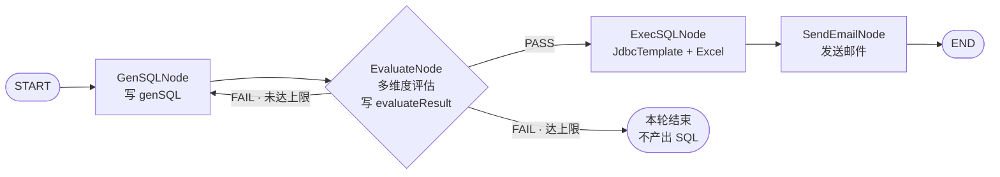

## 【学习目标】

学完本节，应当能够：

- 说清「评估节点 + 循环执行 + 调整大模型参数」三部分各自的职责与配合方式；
- 设计「生成 → 评估 → 不通过回退重生成」的闭环，包括循环次数上限与终止语义；
- 把 `EvaluateNode` 拆成三个环节：从状态机取 SQL、编写评估提示词、通过 `ChatClient` 调用大模型；
- 向面试官讲清「先评估再执行」在失败成本上相对「直接执行」的优势。

## 【正文】

针对「如何提高大模型生成 SQL 的准确性」这一问题，本节给出的解法由三部分组成：**评估节点 + 循环执行 + 调整大模型参数**，三者配合形成闭环。落点到开发层面：在流程图里新增**评估节点（`EvaluateNode`）**专司 SQL 评估，并引入循环，未通过评估则回退 `GenSQLNode` 重生成、再复评；循环到指定次数仍不通过，判定本轮 Agent 结束，不产出可用 SQL；某次通过则继续向下，由 `JdbcTemplate` 执行查询、动态生成 Excel、邮件发送给提问人。

### 一、闭环设计

先看清整张图的控制流，再动手写节点：



三个设计点值得先立规矩：

1. **循环上限必须存在。** 「不通过就重生成」若没有次数约束，一次持续失败的查询会把 token 与数据库连接一起耗光。上限值由业务延迟预算决定，原稿未给出具体数字，此处不虚构。
2. **终止要有明确语义。** 达到上限 = 本轮结束、不产出 SQL，而不是「随便返回一条」。Agent 的失败也必须是显式的。
3. **参数调整是源头手段。** 生成侧参数（如 temperature）影响每次生成的跑偏概率，与评估、循环分属事前 / 事中 / 事后三层，互不替代。

### 二、创建评估节点并梳理逻辑

按开发习惯，新建节点类 `EvaluateNode`，实现 `NodeAction` 并重写 `apply` 方法。动手之前先把业务逻辑拆清楚，该节点可以分成三个小环节：

1. **取 SQL**：从状态机里取出大模型生成的 SQL，拿到才能评估；
2. **写提示词**：定义提示词，告知大模型它要完成什么任务；
3. **调 `ChatClient` 评估**：通过 `ChatClient` 与大模型交互，完成评估动作。

#### 第一环节：从状态机取出 SQL

这一步最简单。回顾上游实现，`GenSQLNode` 生成的 SQL 存放在状态机的 `genSQL` key 中，因此 `EvaluateNode` 只需从同一个 key 取出 value。先看 `GenSQLNode` 的关键实现，重点是它对输出格式和安全性的约束，禁止使用 markdown、禁止输出与 SQL 无关的文本或解释、只允许生成 `SELECT`、每个查询字段必须用 `AS` 指定中文别名，以及最后通过 `return Map.of("genSQL", sb.toString())` 把 SQL 写回状态机：

```java
public class GenSQLNode implements NodeAction {
    // ...
    // 业务逻辑
    // 1. 根据用户输入生成SQL
    // 2. 禁止使用markdown格式，必须使用文本格式
    // 3. 禁止输出与SQL无关的文本或解释
    // 4. 禁止输出与SQL无关的文本或解释
    // 5. 禁止输出与SQL无关的文本或解释
    // 6. 禁止输出与SQL无关的文本或解释
    // 7. 禁止输出与SQL无关的文本或解释
    // 8. 禁止生成 DELETE, DROP, UPDATE, INSERT 语句，只允许生成 SELECT 语句
    // 9. 每个查询字段必须使用 AS 指定一个中文别名，中文名尽量简短、清晰、描述含义
    // 例如：'user_name AS '用户名''
    // ...
    StringBuilder sb = new StringBuilder();
    content.append(c).blockLast();
    log.info("genSQL={}", sb.toString());
    return Map.of("genSQL", sb.toString());
}
```

上下游的数据交接就靠 key 对齐：既然上游把 SQL 写进 `genSQL`，`EvaluateNode` 用 `state.value("genSQL", "")` 即可取出，缺省值给一个空字符串兜底。

需要说明：这段 `GenSQLNode` 是转写稿，`content.append(c).blockLast()` 里的 `content` 与上文声明的 `sb` 对不上（按流式写法应为 `content.doOnNext(c -> sb.append(c)).blockLast()` 一类的形态），`// ...` 折叠的也正是 10-9 节刚落地的中文别名约束。原貌逐字保留，语义以文字描述为准。空字符串兜底这一细节后面会变成 11-5 节的坑。

#### 第二环节：编写提示词

写提示词之前要先把节点依赖定义好：声明 `private final ChatClient chatClient` 属性并通过构造方法注入，之后才能用 `chatClient.prompt()` 组织提示词。

系统提示词的风格要与「生成 SQL 节点」以及「库存调拨智能优化系统」中的节点保持一致，沿用「角色 / 任务 / 分析 / 要求」这种结构化格式。该节点交给大模型的任务，正是对上游生成的 SQL 做评估，内容较多，下一节逐字逐句地写。`EvaluateNode` 的主干逻辑如下：先从状态机取出 SQL，再通过 `chatClient.prompt()` 组织系统提示词交给大模型评估：

```java
public class EvaluateNode implements NodeAction {
    // ...
    // 业务逻辑
    // 1. 获取状态机中生成的SQL
    // 2. 调用大模型进行评估
    // 3. 返回评估结果
    // ...
    String genSQL = state.value(key: "genSQL", defaultValue: "");
    // 调用大模型进行评估
    chatClient.prompt()
        .system(text: "...")
        .system(text: "...")
        .system(text: "...")
        .system(text: "...")
        .system(text: "...")
        .system(text: "...")
        .system(text: "...")
        .system(text: "...")
        .system(text: "...")
        .system(text: "...")
        .system(text: "...")
        .system(text: "...")
        .system(text: "...")
        .system(text: "...")
        .system(text: "...")
        .system(text: "...")
        .system(text: "...")
        .system(text: "...")
        .system(text: "...")
        .system(text: "...")
        .system(text: "...")
        .system(text: "...")
        .system(text: "...")
        .system(text: "...")
        .system(text: "...")
        .system(text: "...")
        .system(text: "...")
        .system(text: "...")
        .system(text: "...")
        .system(text: "...")
        .system(text: "...")
        .system(text: "...")
        .system(text: "...")
        .system(text: "...")
        .system(text: "...")
        .system(text: "...")
        .system(text: "...")
        .system(text: "...")
        .system(text: "...")
        .system(text: "...")
        .system(text: "...")
        .system(text: "...")
        .system(text: "...")
        .system(text: "...")
        .system(text: "...")
        .system(text: "...")
        .system(text: "...")
        .system(text: "...")
        .system(text: "...")
        .system(text: "...")
        .system(text: "...")
        .system(text: "...")
        .system(text: "...")
        .system(text: "...")
        .system(text: "...")
        .system(text: "...")
        .system(text: "...")
        .system(text: "...")
        .system(text: "...")
        .system(text: "...")
        .system(text: "...")
        .system(text: "...")
        .system(text: "...")
        .system(text: "...")
        .system(text: "...")
        .system(text: "...")
        .system(text: "...")
        .system(text: "...")
        .system(text: "...")
        .system(text: "...")
        .system(text: "...")
        .system(text: "...")
        .system(text: "...")
        .system(text: "...")
        .system(text: "...")
        .system(text: "...")
        .system(text: "...")
        .system(text: "...")
        .system(text: "...")
        .system(text: "...")
        .system(text: "...")
        .system(text: "...")
        .system(text: "...")
        .system(text: "...")
        .system(text: "...")
        .system(text: "...")
        .system(text: "...")
        .system(text: "...")
        .system(text: "...")
        .system(text: "...")
        .system(text: "...")
        .system(text: "...")
        .system(text: "...")
        .system(text: "...")
        .system(text: "...")
        .system(text: "...")
        .system(text: "...")
        .system(text: "...")
        .system(text: "...")
        .system(text: "...")
        .system(text: "...")
        .system(text: "...")
        .system(text: "...")
        .system(text: "...")
        .system(text: "...")
        .system(text: "...")
        .system(text: "...")
        .system(text: "...")
        .system(text: "...")
        .system(text: "...")
        .system(text: "...")
        .system(text: "...")
        .system(text: "...")
        .system(text: "...")
        .system(text: "...")
        .system(text: "...")
        .system(text: "...")
        .system(text: "...")
        .system(text: "...")
        .system(text: "...")
        .system(text: "...")
        .system(text: "...")
        .system(text: "...")
        .system(text: "...")
        .system(text: "...")
        .system(text: "...")
        .system(text: "...")
        .system(text: "...")
        .system(text: "...")
        .system(text: "...")
        .system(text: "...")
        .system(text: "...")
        .system(text: "...")
        .system(text: "...")
        .system(text: "...")
        .system(text: "...")
        .system(text: "...")
        .system(text: "...")
        .system(text: "...")
        .system(text: "...")
        .system(text: "...")
        .system(text: "...")
        .system(text: "...")
        .system(text: "...")
        .system(text: "...")
        .system(text: "...")
        .system(text: "...")
        .system(text: "...")
        .system(text: "...")
        .system(text: "...")
        .system(text: "...")
        .system(text: "...")
        .system(text: "...")
        .system(text: "...")
        .system(text: "...")
        .system(text: "...")
        .system(text: "...")
        .system(text: "...")
        .system(text: "...")
        .system(text: "...")
}
```

必须对第二个代码块如实说明：它是视频转写的中间产物，`chatClient.prompt()` 之后出现了 160 行完全相同的 `.system(text: "...")` 占位行，是转写压缩 / 丢行造成的假展开，不代表真实提示词有 160 条。评估提示词的完整内容见下一节（11-3），节点的完整实现见 11-4。此处逐字保留原貌，仅供对照节点结构：`state.value("genSQL", "")` 取数 → `chatClient.prompt().system(...)` 链式组织提示词。读这段代码时数行数没有意义，看结构才有意义。

#### 第三环节：调用 ChatClient 评估

提示词就绪后，通过 `chatClient` 发起调用、拿到评估结果，再写回状态机（新增 `evaluateResult` key）；具体调用形态（占位符传参、RAG 顾问、流式接收）在 11-4 节展开。至此节点职责边界划清：输入 `genSQL`，输出评估结论，不做执行、不发邮件，单一职责是节点可单测的前提。

### 三、为什么「先评估再执行」

把评估节点插在生成与执行之间，改变的是失败发生的时机与成本：

| 维度 | 无评估（生成即执行） | 有评估（先评估后执行） |
|---|---|---|
| 语法 / Schema 错误 | 到数据库才报错（10-8 的 500） | 执行前拦截，无数据库压力 |
| 语义错误 | 静默流出，用户收到错报表 | 评估节点对照用户意图卡住 |
| 安全错误 | 危险语句直达数据库 | 生成约束 + 评估双闸门 |
| 失败成本 | 一次执行 + 一次错误邮件 | 一次评估调用，可带反馈重生成 |
| 可观测性 | 只有数据库报错日志 | 有 `evaluateResult` 显式结论 |

评估不消除错误，只把错误从最贵的暴露点（数据库执行、邮件到达用户）挪到最便宜的暴露点（一次模型调用）；配合循环执行，错误还有返工机会，这就是「评估-循环」组合的工程本质。

## 【易错点 / 面试题】

1. **面试官问：「评估节点解决的是什么问题？直接把 SQL 丢给数据库执行，报错再重生成不行吗？」**
   答：不行，至少三件事做不到。其一，语义错误不报错，SQL 合法但答非所问时，数据库照样返回结果，错误报表直接发给用户；其二，危险语句（误生成的 DELETE / DROP）报错之前就已经造成破坏；其三，缺少评估结论就没有可观测的中间产物，排查只能靠数据库报错文本。评估节点把这三类风险的暴露点前移到一次廉价的模型调用。

2. **易错点：读转写代码块时逐行较真。** 本节第二段代码的 160 行占位是转写假展开，`GenSQLNode` 片段里也有变量名错位。判断标准是文字描述与代码结构，不是行数。

3. **易错点：循环无上限、终止无语义。** 必须同时定义「重试几次」与「上限之后算什么」，否则 Agent 的失败状态不可预期。

## 【小结】

本节给出第 11 章的主干设计：`EvaluateNode` 三环节（取 SQL → 写提示词 → 调 `ChatClient`）+ 循环执行（不通过回退 `GenSQLNode`，达上限则明确终止）+ 参数调整（源头降跑偏概率），并把它编排进 `START → GenSQLNode → EvaluateNode → ExecSQLNode → SendEmailNode → END` 的闭环。核心判断：评估把错误暴露点从数据库前移到模型调用。提示词全文见下一节。想看生产工程如何落实「生成 → 评估式校验 → 受控执行」的同款闭环，可对照本课程配套工程 `980-demo`：`980-demo/src/main/java/com/carl/ai/transfer/extract/TransferOrderExtractor.java` 用 `call().entity()` 在绑定层做格式校验（字段对不上即失败），`980-demo/src/main/java/com/carl/ai/transfer/agent/TransferAgent.java` 在绑定后判空兜底内容风险，`980-demo/src/main/java/com/carl/ai/transfer/service/TransferOrderServiceImpl.java` 以 `@Transactional` 保证两表入库要么全成要么全滚，评估节点卡在中间，两边各自守住自己那一段。
