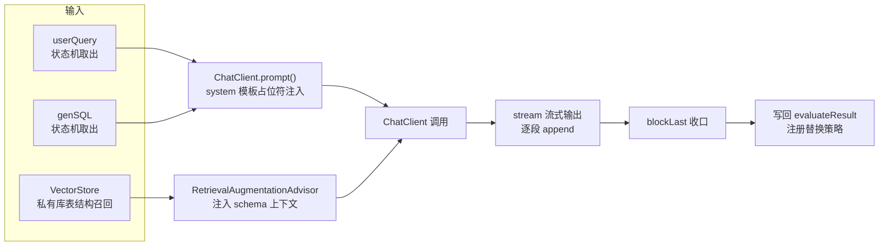

## 【学习目标】

学完本节，应当能够：

- 在 system 提示词里用 lambda 表达式 + 占位符注入动态数据（`userQuery`）；
- 说清 RAG 顾问（`RetrievalAugmentationAdvisor` + `VectorStore`）在评估环节的作用与两处必改报错；
- 用流式调用接收评估结果并 `blockLast()` 收口，把 `evaluateResult` 写回状态机并注册替换策略；
- 向面试官讲清「评估为什么需要 schema 上下文」。

## 【正文】

系统提示词写好之后，本节把它落地成 `EvaluateNode` 的初级版本代码。主要做四件事：用 lambda 表达式给提示词插入占位符、把用户的原始查询和大模型生成的 SQL 传进去、引入 RAG（检索增强）顾问让大模型看懂我们的表结构，最后用流式调用拿到评估结果并写回状态机。

### 一、节点骨架与提示词模板

`EvaluateNode` 依然实现 `NodeAction` 接口，在 `apply` 方法里完成评估逻辑：

```java
public class EvaluateNode implements NodeAction {
    @Override
    public Map<String, Object> apply(OverallState state) throws Exception {
        // ... 评估逻辑 ...
    }
}
```

提示词部分，复用之前**智能库存调拨优化系统**里那套写法：在 system 提示词中用 lambda 表达式配合占位符，外边用 `param` 把数据填进去。当时是在 user 提示词里这么干的，system 提示词里能不能也用 lambda 表达式来插占位符呢？试一下发现是支持的，把提示词内容通过 `text` 粘进来即可。

占位符插在哪？回看上一节的评估标准，「语义准确性」里有一句「SQL 逻辑是否准确反映了用户意图」。要评估意图，模型总得知道用户意图是什么。比如用户问的是「查询 25 年 4 月销售总额」，该意图对应 Agent 启动时用户用自然语言提出的问题，也就是状态机里的 `userQuery`。所以我们把 `userQuery` 从状态机取出来，塞进「用户意图」对应位置。完整的提示词模板如下：

```text
# 角色
你是一个专业的SQL专家，专门负责评估生成的SQL查询的质量、正确性和安全性。

# 评估标准
1. 语法正确性
    - SQL语法是否符合MySQL规范
    - 关键字、函数名使用是否恰当
    - 括号匹配、引号使用是否恰当
2. Schema匹配度
    - 检查表名、列名是否存在与提供的数据库结构中
    - 检查数据类型是否正确（如数字列不应使用字符串）
    - 确认JOIN条件中使用的字段是否正确
3. 语义准确性
    - SQL逻辑是否准确反映了用户意图（"user_query"）
    - WHERE条件、GROUP BY、HAVING等子句是否合理
    - 聚合函数使用是否恰当
4. 执行安全性
    - 是否包含危险操作，禁止使用DELETE、UPDATE、DROP、INSERT等潜在破坏性操作
    - 是否存在SQL注入风险模式
    - 查看复杂度是否在合理范围内
5. 性能考量
    - 是否存在明显的性能问题（如笛卡尔积、缺少关键过滤条件）
    - 子查询使用是否必要和优化
# 输出要求
如果SQL评估通过返回PASS，如果SQL评估不通过返回FAIL
```

模板里的 `("user_query")` 就是待填的占位符，`# 输出要求` 一节约定了 `PASS` / `FAIL` 的返回契约，与 11-3 节的 `pass` / `fail` 是同一约定的两种书写形态，实际匹配时注意大小写归一。

### 二、传入用户查询与生成 SQL

占位符定好后，因为我们只有一个参数，直接以 key-value 的方式传就行。取数据前先去状态机里拿到用户传过来的查询意图：对应的 key 是 `userQuery`，默认给一个空字符串兜底，作为用户原始的查询语句。

接着还得传 user 提示词，也就是把大模型生成的 SQL 作为 user 内容交给模型。这里同样用 lambda 表达式编写，参数名为 `genSQL`，value 就是从大模型拿到的那条生成 SQL。

一次评估调用的输入至此齐了：system 侧载入「审查专家 + 六维度标准 + 用户意图」，user 侧载入「待评估的 SQL」。注意分工，system 是恒定的评审框架，user 是每次变化的被评对象，动态数据全部走占位符注入，提示词模板本身保持静态可复用。

### 三、引入 RAG 顾问补充 Schema 上下文

这里有一个关键点：大模型并不知道我们私有知识库里的数据结构和表与表之间的关系。为了让它能正确评估「表名、列名是否存在于数据库中」「数据类型是否匹配」这些项，我们要像生成 SQL 节点那样，定义一个检索增强顾问（`RetrievalAugmentationAdvisor`），在 `chatClient` 调用时传进去，让大模型把私有知识库的表结构设计和表间对应关系当作上下文，评估时才更有依据。

我们可以直接把生成节点里的查询转换器和检索增强顾问复制过来。复制后有两个报错要修：

- 顾问需要的是一个 `ChatClient`，而现有的是 `ChatClient.Builder`，所以要把属性改成调用 `.build()` 之后再传入；
- 私有知识库存放在本地**向量数据库**里，需要从向量库做召回（检索），因此要给参数补上 `VectorStore` 属性。

补上之后就不报错了，大模型也就拿到了私有知识库的上下文。



Spring AI 2.0.1 里，这类横切能力统一走 Advisor 链：`RetrievalAugmentationAdvisor` 负责把向量库召回的表结构拼进上下文，与生成节点用的是同一套机制。评估节点复用它，等于把「评审依据」和「生成依据」统一到同一份 schema 证据上，评估时说的「表名不存在」，和生成时看到的表结构，永远是同一套。

### 四、流式调用与结果回写

系统提示词、user 提示词、RAG 顾问都就绪后，就可以发起 `stream` 流式调用。还是沿用之前的方式：定义一个 `StreamBuilder` 来接收流式输出，用响应式编程把流式内容 `append` 到 `StringBuilder` 里，并且一定要 `blockLast()` 阻塞住，等到大模型把结果全部返回之后再往下走。

```java
.chatClient.prompt(
    t -> t.t.text("...提示词模板..."),
    .user(t -> t.t.text("需要评估的SQL: {genSQL}").param("user_query", userQuery))
    .param("genSQL", genSQL)
    .content()
    .stream().content()
    .doOnNext(c -> sb.append(c).blockLast());
log.info("评估结果: {}", sb.toString());
```

全部接收完之后，先打一条 `log.info("评估结果: {}", ...)` 把评估结果打印出来，便于调试和监控。

最后要把评估结果写回状态机。新增一个 key 叫 `evaluateResult`，内容就是 `StringBuilder` 里汇总的结果。有了该新 key，还要到图的 key 策略工厂里把它登记进去，采用**替换策略**（后续评估结果覆盖旧值）。

如实说明第三段代码的形态：它是转写拼接的片段，`.chatClient.prompt(...)` 缺少方法调用的连接上下文，`sb`、`content`、`userQuery`、`genSQL` 的声明都不在片段内，`.doOnNext(c -> sb.append(c).blockLast())` 的括号层级也与前两节的写法有出入。按正文语义，它应读作：`chatClient.prompt(system 模板).user(...).param(...)` 组织请求 → `stream().content()` 拿到 `Flux<String>` → 逐段 `append` 进 `StringBuilder` → `blockLast()` 等流结束 → 打日志 → 写回 `evaluateResult`。跑工程时以文字为准。

流式在这里不是为性能，是为一致：生成节点用流式，评估节点沿用同一套接收范式，节点形态统一、排查路径统一。若自行设计，评估这种短输出直接 `call().content()` 拿全量字符串更简单，两种写法在 2.0.1 里都合法，选型看团队一致性要求。

## 【易错点 / 面试题】

1. **面试官问：「评估节点为什么要注入表结构上下文？模型不是见过 SQL 吗？」**
   答：模型见过的是「通用 SQL 知识」，没见过的是「我们私有库里有哪张表、哪张表跟哪张表什么关系」。不注入 schema，「表名列名是否存在」「JOIN 字段是否正确」两个维度就只能靠模型猜，猜出来的评估比不评估更危险，因为它给了错误结论一层权威感。`RetrievalAugmentationAdvisor` + `VectorStore` 就是把私有 schema 变成评估依据。

2. **易错点：把 `ChatClient.Builder` 当 `ChatClient` 传。** 复制生成节点代码时高发：顾问要的是构建完成的实例，`Builder` 必须先 `.build()`。该报错本身就是信号，提示你复制的代码缺了初始化那一行。

3. **易错点：新 key 忘记注册策略。** `evaluateResult` 加进状态机时，`KeyStrategyFactory` 必须同步登记替换策略，否则写入行为不可预期。代码与策略两处同步，是状态机开发的固定 checklist（10-8 节踩过同样的点）。

4. **易错点：流式不 `blockLast()`。** 不阻塞收口，`StringBuilder` 还是半成品就被打日志、被写回状态机，评估结论随机缺字。响应式流必须显式等待终点。

## 【小结】

本节把评估提示词落地为 `EvaluateNode` 初级版本：system 模板用 lambda 占位符注入 `userQuery`，user 侧传入待评估 `genSQL`，`RetrievalAugmentationAdvisor` + `VectorStore` 补上私有 schema 上下文，流式接收 + `blockLast()` 收口后把 `evaluateResult` 写回状态机并注册替换策略。四个工程细节（Builder 先 build、占位符保持模板静态、新 key 同步策略、流式显式收口）都是可迁移的节点开发惯例。下一节将该节点接进图里跑测试，顺带踩两个注册期才会暴露的坑。若关注「占位符传参」的生产替代方案，对照 `980-demo/src/main/java/com/carl/ai/transfer/extract/TransferOrderExtractor.java`：它把同类需求（把自然语言变成机器可判定结构）改用 `call().entity(TransferOrderParam.class)` 的硬绑定，与本节的软占位符是同一问题的两种解法。
