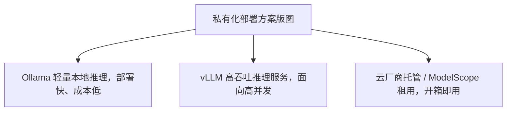

## 【学习目标】

学完本节，应当能够：

- 说出企业私有化部署大模型的三类方案：Ollama、vLLM、云厂商托管（含 ModelScope 租用），以及它们各自的成本结构；
- 讲清 Ollama 与 vLLM 的核心差异，特别是「部署成本高不等于开发成本高」这一关键区分；
- 根据公司的并发量与调用要求给出选型理由，并在面试中把「我知道有哪些方案、为什么选了这一种」讲成完整的决策链；
- 理解私有化部署对应用层透明：Spring AI 应用换 base-url 即可切换模型端点。

## 【正文】

从这一章开始，我们进入**企业大模型私有化部署**的话题。先把这一章要讲的内容铺开，再逐一落地。

### 一、本章内容总览

这一章主要讲三块：

1. 常见的私有化大模型部署方案介绍，先让你知道有哪些方案，才能结合公司实际情况去选；面试时也能有理有据地说清楚「我知道有哪些方案，但最终为什么选了这一种」。
2. 企业用 **Ollama** 部署的方案。
3. 企业用 **vLLM** 部署的方案。

这三块的顺序本身就是一条决策路径：先建立方案版图（本节），再准备算力（12-2 节），然后分别落地两种主流方案（12-3 节 Ollama、12-5 节起 vLLM）。到第 13 章的项目包装，这套选型逻辑也是重要的素材。

### 二、方案版图：两类主流 + 一类托管

常见的私有化部署主要分两类：**Ollama** 和 **vLLM**（当然现在也有其他方案，比如腾讯云、阿里云这类云厂商，已经提供了开箱即用的企业私有化部署方案，甚至类似魔搭（ModelScope）云端这类托管服务，直接租用就能用）。

对大部分公司来说，Ollama 和 vLLM 这两种用得最多，因为它们灵活性比较高，模型选型、量化精度、服务参数都在自己手里，不受托管平台的套餐限制。

三类方案的定位可以先建一个整体印象：

| 方案 | 一句话定位 | 灵活性 | 运维压力 |
|---|---|---|---|
| Ollama | 轻量本地推理，部署快、成本低 | 高 | 低 |
| vLLM | 高吞吐推理服务，面向高并发 | 高 | 高（机器配置要求高） |
| 云厂商托管 / ModelScope 租用 | 开箱即用，直接用 | 受平台限制 | 转移给厂商 |

### 三、Ollama 方案：低成本快速落地

**Ollama 方案**的特点是：成本比较低，部署成本也低，部署起来快、简单。这里的「成本」包含两部分，一是价格成本，二是时间成本。

往技术背景补一层：Ollama 本质是 llama.cpp 推理引擎的封装与分发层，模型以 GGUF 量化格式存在，一条命令就能把模型拉到本地跑起来，并且自带 OpenAI 兼容的 HTTP 接口。这解释了它为什么「快且简单」，量化格式让显存门槛大幅下降，兼容接口让应用层几乎零改造。

它适合的场景也很清晰：开发测试环境、中小并发场景、预算敏感的个人与团队。课程 12-3 节会完整演示一遍 AutoDL 服务器上安装 Ollama 的落地过程，12-4 节再讲原有项目怎么改造适配。

### 四、vLLM 方案：高并发的生产选择

**vLLM 方案**适合并发量比较高、或者对大模型调用要求比较高的公司。相比 Ollama，它的价格成本和部署成本都更高（注意是部署成本高，不是开发成本高），因为它对机器配置的要求更高。

同样补一层技术背景：vLLM 的核心是 PagedAttention 显存管理（借鉴操作系统虚拟内存的分页思想管理 KV cache）与连续批处理（continuous batching），目标是把 GPU 的吞吐榨到极致，并提供 OpenAI 兼容的推理服务。这解释了「价格成本高」，它要更强的机器才能发挥；也解释了「部署成本高但不是开发成本高」，部署阶段要调的是机器、显存、并行与批处理参数，而应用层接入的仍然是一个 OpenAI 兼容端点，开发工作量和接 Ollama 没有区别。

这句话值得在面试里重点展开：**评估一套方案的成本，要分清「部署侧成本」和「开发侧成本」**。vLLM 把复杂性都留在了部署侧，应用侧一个 base-url 就接完了；选型时如果只看到「部署更贵」而错过「开发同样便宜、吞吐高一个量级」，就会做出错误的决策。

### 五、云厂商托管与 ModelScope 租用

第三条路是托管：腾讯云、阿里云已经提供了开箱即用的企业私有化部署方案，类似魔搭（ModelScope）云端这类托管服务，直接租用就能用。

它的吸引力在于把运维压力整体转移给厂商，不用买卡、不用调推理参数、不用管扩容。与之相对的代价是灵活性与自主性受平台约束：模型版本、量化选项、服务参数都在平台的套餐里选。对没有自建运维团队、又想快速用上私有化能力的公司，这是一条务实的路；课程把它列为「其他方案」，主线仍放在灵活性最高的 Ollama 与 vLLM 上。

### 六、选型逻辑：把三个问题排成决策链

三类方案摆在一起，选型就是依次回答三个问题：

1. **并发量与调用要求高不高？** 高 → vLLM；不高 → Ollama 足够。这是课程给出的第一分叉。
2. **有没有运维团队与机器预算？** 有 → 自建 Ollama/vLLM，灵活性最高；没有 → 云厂商托管或 ModelScope 租用，开箱即用。
3. **时间成本敏不敏感？** 今天就要跑起来验证 → Ollama（快、简单）；可以接受部署周期换吞吐 → vLLM。

把这条决策链在面试里讲出来，就是「我知道有哪些方案，但最终为什么选了这一种」的标准答法，先展示版图，再展示分叉依据，最后落到公司实际约束。

### 七、对应用层透明：换 base-url 即可

还有一层贯穿全章的认识：**三种部署方案对 Spring AI 应用是透明的**。Ollama、vLLM 与 DashScope 兼容模式都提供 OpenAI 兼容端点，应用层的 `ChatClient`、`@Tool`、Advisor 链一概不用动，改的只是 `base-url`、`api-key`、`model` 三项配置。11-8 节配 `qwen3-max` 时用的 `https://dashscope.aliyuncs.com/compatible-mode` 就是这样一个端点；等 12-4、12-7 节把项目改造到 Ollama 与 Qwen 私有化部署时，改的同样只是这三项。

这正是配套工程采用多 profile 的原因：`980-demo/src/main/java/com/carl/ai/transfer/config/ChatModelConfig.java` 中，`transfer.offline=true`（default profile）装配 `OfflineChatModel` 离线返回固定 JSON，不联网、不填 Key 也能跑通主链路；`transfer.offline=false`（prod profile）经 `OpenAiApi.builder().baseUrl(...)` 指向真实端点，将来指向公司内网的 Ollama 或 vLLM，只是换一个 `transfer.llm.base-url` 取值的事。

顺带把本章的落地顺序理清：12-3 节在租好的 GPU 服务器上装 Ollama，12-4 节把原有项目改造适配；12-5 节装 vLLM 运行环境，12-6 节经魔搭社区下载开源 Qwen 模型，12-7 节再把项目改造适配到私有化 Qwen。两条路线走完，应用层代码一行不动，变的只有配置里的端点与模型名，这正是「应用层透明」的完整验证。

## 【易错点 / 面试题】

1. **面试官问：「Ollama 和 vLLM 的区别？你们为什么选了它？」**
   答：区别在吞吐与成本的取舍。Ollama 基于 llama.cpp、GGUF 量化，部署快、价格与时间成本都低，适合开发测试与中小并发；vLLM 用 PagedAttention 与连续批处理榨取 GPU 吞吐，适合高并发生产，但机器配置要求高、价格与部署成本都更高。选型依据是公司的并发量与调用要求，再加上运维团队与预算的约束。

2. **面试官问：「vLLM 部署成本高，是否意味着开发成本也高？」**
   答：不是，这是最容易被混淆的一点。vLLM 的复杂性在部署侧（机器、显存、并行与批处理参数），应用侧接入的是一个 OpenAI 兼容端点，和接 Ollama 一样只改 `base-url`/`api-key`/`model` 三项配置。评估方案要把部署侧成本与开发侧成本分开算。

3. **易错点：把「私有化部署」等同于「自建 Ollama/vLLM」。** 私有化还有托管这条路，云厂商开箱即用的企业方案、ModelScope 租用。没有运维团队时，托管是更务实的选择；面试里漏掉这一路，会显得方案版图不全。

4. **面试官问：「私有化之后，应用层要改多少代码？」**
   答：理想情况下零业务代码改动。三类方案都提供 OpenAI 兼容端点，`ChatClient` 抽象不变，端点、密钥、模型名走配置（多 profile 管理），改配置即切换。这也是课程反复强调「参数配置外置」的原因。

## 【小结】

本节建立了私有化部署的方案版图：Ollama（低成本、快、简单）与 vLLM（高并发、高吞吐，但机器配置与部署成本更高）两类主流，外加云厂商托管与 ModelScope 租用这一条开箱即用的路；选型按「并发量 → 运维与预算 → 时间成本」的决策链展开，且三方案对 Spring AI 应用透明，只差三项配置。接下来 12-2 节先解决算力问题（GPU 服务器选购与价格对比），12-3 节落地 Ollama 安装，12-5 节起落地 vLLM。配套工程已把「可切换」预置好：`980-demo/src/main/java/com/carl/ai/transfer/config/ChatModelConfig.java` 按 `transfer.offline` 开关在离线 Mock 与真实端点之间切换，`980-demo/src/main/java/com/carl/ai/transfer/config/OfflineChatModel.java` 保证 default profile 下不烧一分算力也能跑通「LLM 生成 → 提取 → 转换 → 入库」全链路。
