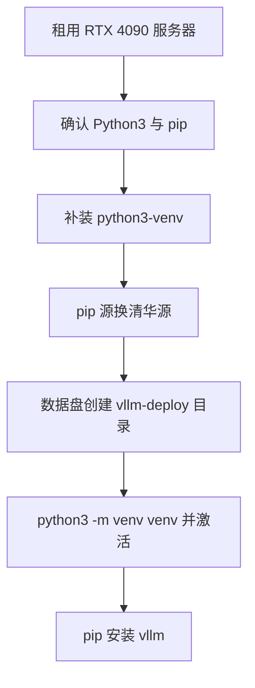

## 【学习目标】

- 说清 Ollama 与 vLLM 两种部署方式在环境要求上的本质差异。
- 独立完成「租服务器 → 检查 Python → 建虚拟环境 → 装 vLLM」的环境准备全流程。
- 掌握 Hugging Face 与魔搭社区两个开源模型源的特点，以及量化版、蒸馏版、满血版的选型逻辑。

## 【正文】

前面几课，我们在 AutoDL 上买了 GPU 算力服务器，安装了 Ollama，通过 Ollama 部署了 Qwen3 大模型，并把智能库存调拨优化系统里 Ollama 的连接地址改成了公网，直接访问这台 AutoDL 服务器上的模型。

从这一课开始，演示另外一种部署方案：依然是在 AutoDL 上购买算力服务器，但改用 vLLM 来部署 Qwen3 大模型。为了完整演示「从 0 到 1 部署大模型」的过程，我们重新租一台新的算力服务器。

## 一、租用服务器并远程连接

还是先到算力市场，在西北区选一台 RTX 4090 的服务器，挑最便宜的档位（一小时一块多钱），镜像版本保持不变，直接创建并开机。

机器开好之后，在本地启动一个 CMD 窗口，复制登录命令，把密码粘贴过去，回车后就进来了。接下来正式开始 vLLM 运行环境的安装。

镜像保持不变是有讲究的：该镜像本身是 Python3 环境，而 vLLM 的安装依赖 Python。选镜像时确认「带 Python3」这一条，能省掉后面装 Python 的步骤。选最便宜档位同样成立，演示环境不追求极限吞吐，4090 24G 显存跑 4B 到 8B 模型绰绰有余，等业务真的上来再升级配置。

## 二、检查并配置 Python 环境

使用 vLLM 这种部署方案，需要先有 Python 环境。好在租用服务器时，镜像本身就是一个 Python3 的环境，不需要重新安装，但还要确认两样东西。

第一是 pip。把安装 python3-pip 的命令传过去执行，发现只是下载一下就完成了，说明它本来就装好了。命令能「下载即完成」而不进入安装流程，说明包已处于最新状态，这是判断组件是否就绪的实用技巧。

第二是虚拟环境组件。检查 python3-venv 时，提示无法加载该包，说明缺少这一组件，补装一下即可。最小化镜像常常只带 Python 本体，venv 这类组件被裁剪掉，遇到「无法加载」的提示直接补装，不用怀疑Python本身有问题。

为了方便后续下载依赖，再把 pip 源换成国内的镜像，改成清华源。执行之后验证一下 pip 的配置，镜像地址里已经出现了清华的地址，说明添加成功。这样一来，Python 这套环境就齐了，我们不需要再做额外的配置。

pip 源换清华源的理由与 12-3 开学术加速一致：vLLM 的依赖包体积大、数量多，走国外源速度受限，换国内镜像后下载时间从「等」变成「秒级推进」。验证配置用 `pip config list` 类命令确认镜像地址已生效，避免「改了没生效白等半天」的假象。

## 三、数据盘、虚拟环境与 vLLM 安装

AutoDL 的容器分系统盘和数据盘，模型和部署文件这类大件肯定要放到数据盘里操作。先清一下屏，进入数据盘 `/root/autodl-tmp`，创建一个 `vllm-deploy` 目录，用来存放部署相关的文件。

从配置 pip 镜像、创建目录到激活虚拟环境，这一连串操作的命令如下：

```bash
apt install python3-pip
pip config set global.index-url https://pypi.tuna.tsinghua.edu.cn/simple
mkdir vla_deploy
python3 -m venv venv
source venv/bin/activate
```

如实说明：命令块中 `mkdir vla_deploy` 与原稿正文所述目录名 `vllm-deploy` 不一致，属讲稿笔误，实际执行时以正文的 `vllm-deploy` 为准；后续所有操作都在该目录下进行。另外 `source venv/bin/activate` 激活的是当前目录下的 `venv` 虚拟环境，执行前需确认已进入目标目录。

创建虚拟环境没有报错，就是成功了。接着把虚拟环境激活，命令行前面出现了 `(venv)` 标识，说明已经激活。

如果你之前学过 Python，应该知道 Python 是可以创建虚拟环境的：一般一个项目配一个虚拟环境，虚拟环境之间相互隔离。这里正好也把 vLLM 和 Ollama 两种部署方式的差别显现出来了：Ollama 是傻瓜式部署，命令复制一下、粘贴一下、启动就可以了；而 vLLM 的方案需要有一定的 Python 基础。

虚拟环境对 vLLM 不是可选项而是必需品：vLLM 的依赖树庞大，与系统里其他 Python 项目共用一套 site-packages 极易出现版本冲突；项目配一个 venv，销毁重建都干净。命令行前的 `(venv)` 标识是确认环境已激活的最直观信号，后续所有 pip 安装都必须在该标识存在的前提下进行，否则包装进了系统 Python，vLLM 启动时找不到依赖。



环境就绪，接下来通过 pip 安装 vllm。直接粘贴命令回车，它就开始下载了。速度还挺快，一秒能到十几兆。等它下载的功夫，我们先聊聊开源大模型都可以从哪些平台下载。

下载期间穿插讲模型源，是演示类课程节省时间的常规做法：vLLM 依赖包含 PyTorch 等大件，完整下载要一段时间，与其干等，不如把「模型从哪来」这一必然要面对的问题先讲清楚。

## 四、开源模型下载平台：Hugging Face 与魔搭社区

下载开源大模型主要有两个平台：

- **Hugging Face**：美国公司的开源大模型平台，需要科学上网才能访问；
- **魔搭社区（ModelScope）**：国内的平台，可以直接访问。

魔搭社区的模型库收录了目前几乎所有开源大模型，文本生成的、文本生成图片的、多模态的、自然语言处理的、语音的、计算机视觉的，应有尽有，可以直接下载做自己的部署。此外它还提供一些数据集。

这里特别说一下具身模型。它现在主要用在机器人、机器手臂这类场景，但我认为未来一定能进入更广泛的智能应用领域，市场很大，发展前景非常好。如果你不清楚现在 AI 都有哪些发展方向，就来魔搭社区的模型库翻一翻，看看现在都有什么模型，文本、语音、视频、多模态等等，大概就能了解现在大模型的发展方向。

顺带一提，魔搭社区也支持在线 API 调用，模型页面给出的调用示例大致如下：

```python
from openai import OpenAI
client = OpenAI(
    base_url="https://api-inference.modelscope.cn/v1",
    api_key="your_api_key"
)
```

因为网络问题，课程里演示用魔搭社区；Hugging Face 当然也是下载开源大模型的好去处，大家按需选择。

这段调用示例再次印证了 OpenAI 兼容协议的普适性：魔搭的在线 API 用 `openai` SDK 直连，只换 base-url 与 api-key。本地 vLLM 部署完成后同样是这套客户端姿势，只是地址换成自己的服务。选平台时把网络可达性作为第一过滤条件，下载几个 G 的模型时，源的可达性比源的丰富度更影响效率。

| 对比项 | Hugging Face | 魔搭社区（ModelScope） |
|---|---|---|
| 归属 | 美国公司 | 国内平台 |
| 网络要求 | 需科学上网 | 直接访问 |
| 模型覆盖 | 极全，更新最快 | 几乎覆盖所有开源模型 |
| 附加资源 | 数据集、Space 演示 | 数据集、在线 API 调用 |
| 课程用途 | 备选源 | 演示下载源 |

后面我们就要部署 Qwen3 大模型：在魔搭社区搜索 qwen3，可以看到一系列模型，比如 8B 规格的，进入模型页面就能下载到本地，之后通过 vLLM 直接启动，实现私有化部署。

另外要注意，模型库里的模型分量化版本和满血版本。量化版本就类似于 Ollama 上那种「阉割版」，功能有裁剪，智能水平打折；没有被裁剪的，就是满血版。以 DeepSeek R1 为例：在魔搭社区能搜到 600 多个 GB 的满血版本，而 Ollama 上最大的也才 404GB，上面的都是蒸馏、量化过后的版本。蒸馏版使用起来非常方便，对机器的性能要求不是特别高；满血版动辄 600 多个 GB，没有非常高的机器配置根本带不动。所以还是那句话：各有所需，各有所长。

三个概念的关系值得讲清，这是选型时最容易被混为一谈的地方：量化是把模型权重做压缩，换取更小体积和更低显存占用，代价是能力损失；蒸馏是用大模型教小模型，小模型继承部分能力；满血版是未经裁剪的原始权重。三者的机器门槛与能力是连续的谱系，不是非黑即白。选型时先看卡有多少显存，再倒推能带动多大的模型，最后在能力与成本之间取平衡。

## 五、小结

这一课我们把 vLLM 的运行环境准备了一遍：租用服务器、检查并配置 Python 环境、在数据盘上创建虚拟环境、安装 vLLM，也梳理了开源模型的下载平台。

回到终端再看一眼，vllm 还没有下载完。先让它继续下载，下一课我们通过魔搭社区把 Qwen3 大模型下载下来，再用 vLLM 把它启动起来。

## 【易错点 / 面试题】

1. **面试题：Ollama 和 vLLM 的部署差异反映了什么？** 答：Ollama 把环境依赖全部封死在二进制里，一条命令拉起服务，适合快速验证；vLLM 需要 Python 虚拟环境、依赖 pip 管理，门槛更高但换来的是高并发推理能力。选型本质是在「部署速度」与「服务能力」之间权衡。
2. **易错点：虚拟环境没激活就装包。** 命令行前没有 `(venv)` 标识时执行 pip install，包装进系统 Python，vLLM 启动报找不到模块。先看标识，再装包。
3. **易错点：把模型和部署文件放系统盘。** 系统盘 30G，模型加依赖很快占满，且数据盘速度更快。所有大件一律进 `/root/autodl-tmp`。

## 【小结】

本节是 vLLM 方案的环境篇：核心动作只有四个，确认 Python、建虚拟环境、换国内源、装 vLLM；核心认知有两条，vLLM 需要 Python 基础而 Ollama 不需要，模型分量化、蒸馏、满血三档且机器门槛递减。环境就绪后，剩下的就是下载模型并启动，这正是下一课的内容。

配套工程 `980-demo` 与具体部署方式解耦：`980-demo/src/main/java/com/carl/ai/transfer/config/ChatModelConfig.java` 只关心 `transfer.llm.base-url` 指向哪个 OpenAI 兼容端点，Ollama 的 6006 或 vLLM 的 6006 对应用层是同一份代码；`transfer.offline` 开关则保证没有 GPU 机器时，`OfflineChatModel` 返回固定 JSON，主链路（抽取 → 转换 → 入库）照样可测。这种「端点可换、离线可跑」的配置方式，建议在自己项目里固化成习惯。

下一课：通过魔搭社区下载 Qwen3 模型，并用 vLLM 启动它。
